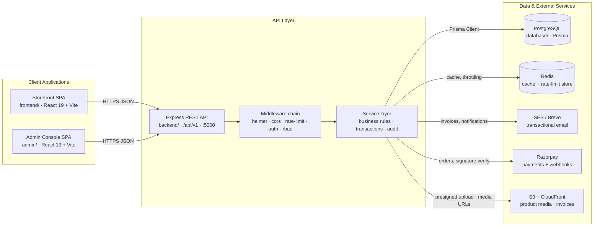
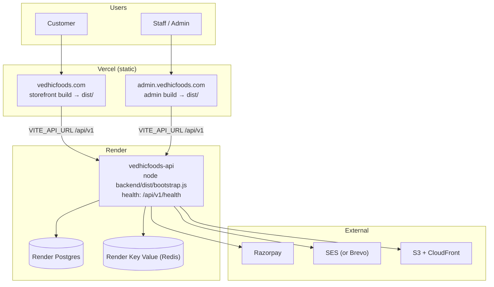
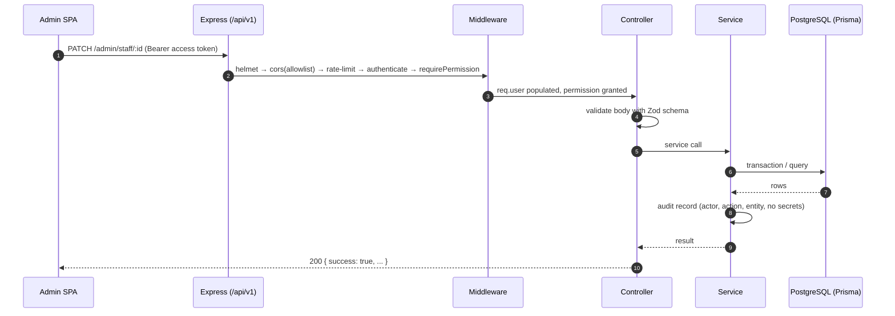
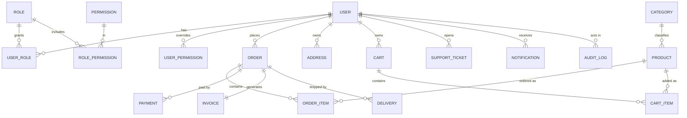
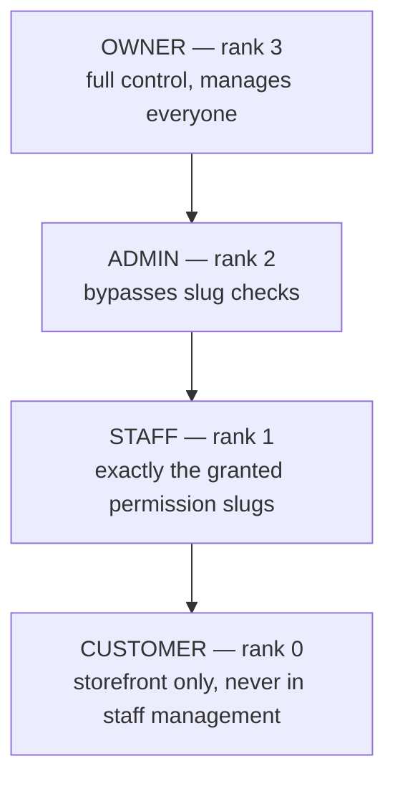

# VEDHIC FOODS — Platform Architecture & Developer Guide

**VEDHIC FOODS** is a production-grade organic and traditional food e-commerce
platform. It ships as a **monorepo** with two independently deployed single-page
applications (a customer storefront and a staff/admin console) and one Express
REST API backed by PostgreSQL via Prisma.

- **Spas (Vercel):** React 19 + TypeScript + Vite
- **API (Render):** Node.js + Express + TypeScript, mounted under `/api/v1`
- **Data:** PostgreSQL + Prisma ORM
- **Payments:** Razorpay · **Email:** Amazon SES (Brevo fallback) · **Media:** S3 + CloudFront

---

## Contents

1. [System Overview](#1-system-overview)
2. [High-Level Architecture](#2-high-level-architecture)
3. [Deployment Topology](#3-deployment-topology)
4. [Monorepo Structure](#4-monorepo-structure)
5. [Runtime Request Lifecycle](#5-runtime-request-lifecycle)
6. [Backend Module Map](#6-backend-module-map)
7. [Domain Model](#7-domain-model)
8. [Roles & Permissions (RBAC)](#8-roles--permissions-rbac)
9. [Environments & Configuration](#9-environments--configuration)
10. [Getting Started](#10-getting-started)
11. [Root Scripts](#11-root-scripts)
12. [Testing](#12-testing)
13. [Deployment](#13-deployment)
14. [Recent Engineering Changes](#14-recent-engineering-changes)
15. [Roadmap](#15-roadmap)

---

## 1. System Overview

| Layer | Technology | Location | Runtime port |
| --- | --- | --- | --- |
| Storefront SPA | React 19, Vite, React Router 7 | `frontend/` | `5173` |
| Admin SPA | React 19, Vite, React Router 7 | `admin/` | `5174` |
| REST API | Node 22, Express 4, TypeScript, Zod | `backend/` | `5000` |
| Data access | PostgreSQL 16 + Prisma 6 | `database/` | `5432` |
| Cache / rate-limit store | Redis (Render Key Value) | — | `6379` |
| Object storage | Amazon S3 behind CloudFront (OAC) | `backend/src/integrations` | — |

The two SPAs are deliberate **separate origins**: serving the admin console from
the storefront origin would let any storefront XSS inherit admin session reach.
Both origins are enumerated in the API's CORS allowlist (`FRONTEND_URL` /
`ADMIN_FRONTEND_URL`) and there is no wildcard fallback in production.

---

## 2. High-Level Architecture



---

## 3. Deployment Topology

Current target: **SPAs on Vercel, API + data on Render**. The repository also
contains AWS CloudFormation templates (`backend/infra/cloudformation/`) as an
alternative ECS Fargate deployment; the application code is identical for both.



Key deployment invariants:

- The API build **must run from the repo root** (`rootDir: .`): `backend`
  depends on the `vedhicfoods-database` npm workspace, which npm only links from
  the root. Build command: `npm ci --include=dev && npm run build:database && npm run build:backend`.
- `NODE_ENV=production` makes `backend/src/config/env.ts` **refuse to boot**
  until secrets and origins are real (see [§9](#9-environments--configuration)).
- Each Vite SPA refuses to build a production bundle unless `VITE_API_URL` is
  `https://…` and ends in `/api/v1` (guarded in `frontend/vite.config.ts` and
  `admin/vite.config.ts`).
- SPA deep links rely on `vercel.json` rewrites (`/… → /index.html`).

See [`docs/DEPLOYMENT_ENV.md`](docs/DEPLOYMENT_ENV.md) for the variable-by-variable guide.

---

## 4. Monorepo Structure

```text
vedhifoods/
├── frontend/                     # Customer storefront (own package.json + lockfile)
│   ├── src/
│   │   ├── components/           #   presentational + layout components
│   │   ├── pages/                #   route-level screens (catalog, cart, checkout, account)
│   │   ├── services/             #   API client (http.ts) + domain services
│   │   ├── context/              #   auth, cart, settings, toast providers
│   │   ├── hooks/                #   useAsync, useRealtime, …
│   │   ├── styles/               #   design tokens + layout CSS
│   │   └── config/               #   site config, hero image discovery
│   ├── vercel.json               #   SPA rewrite rules
│   └── vite.config.ts            #   alias '@', '@assets' → repo-root assests/
│
├── admin/                        # Staff/admin console (own package.json + lockfile)
│   ├── src/
│   │   ├── pages/admin/          #   dashboard, products, orders, staff, security, …
│   │   ├── components/admin/     #   AdminLayout, DataTable, guards, nav
│   │   ├── services/             #   adminService, adminAuthService, http.ts (GET coalescing)
│   │   ├── context/              #   AdminAuthContext, SettingsContext
│   │   └── data/                 #   navigation, permission metadata
│   ├── vercel.json               #   SPA rewrite rules
│   └── vite.config.ts            #   same production API-URL guard
│
├── backend/                      # Express REST API (npm workspace)
│   ├── src/
│   │   ├── bootstrap.ts          #   entrypoint: resolve secrets, then load server
│   │   ├── server.ts             #   HTTP server, graceful shutdown, sweeps
│   │   ├── app.ts                #   express app, CORS, security middleware
│   │   ├── config/               #   env (Zod), database, logger, secrets-manager
│   │   ├── routes/               #   /api/v1 router tree
│   │   ├── controllers/          #   request parsing + response shaping
│   │   ├── services/             #   business logic, transactions, audit
│   │   ├── middleware/           #   auth, rbac, rate-limit, error handling
│   │   ├── integrations/         #   razorpay, ses, s3
│   │   ├── utils/                #   errors, crypto, client-ip, privilege, pagination
│   │   └── types/                #   Zod schemas + shared types
│   ├── tests/                    #   unit/ + integration/ (Vitest + Supertest)
│   ├── infra/                    #   cloudformation/, ecs-task-definition.json, s3-cors.json
│   └── Dockerfile                #   multi-stage production image (root build context)
│
├── database/                     # Single source of truth for schema (npm workspace)
│   ├── prisma/
│   │   ├── schema.prisma         #   44 models · 18 enums
│   │   └── migrations/           #   14 migration directories (history)
│   ├── index.ts / client.ts      #   re-exports + PrismaClient singleton
│   ├── seed.ts                   #   RBAC, payment settings, catalogue, bootstrap admin
│   └── backup.Dockerfile         #   pg_dump one-off task image
│
├── docs/                         # architecture, audit, deployment documentation
├── .github/workflows/            # ci.yml · deploy.yml · db-backup.yml
├── render.yaml                   # Render Blueprint (API + Postgres + Key Value)
├── package.json                  # workspace root + task runner
└── README.md
```

`frontend/` and `admin/` are **not** npm workspaces — each carries its own
lockfile and deploys as an independent static bundle. Only `database/` and
`backend/` are workspaces, so a root `npm ci` installs exactly what the API needs.

---

## 5. Runtime Request Lifecycle



Every state-changing endpoint records an audit entry, and errors are masked by a
central error middleware so internal details never leak to the client.

---

## 6. Backend Module Map

All routers mount under `/api/v1` (`backend/src/routes/index.ts`):

| Area | Base path | Notes |
| --- | --- | --- |
| Health | `/health`, `/health/ready` | liveness + readiness probes |
| Auth | `/auth` | login, refresh, change-password, reset, verify |
| Settings | `/settings` | public-safe settings subset |
| Contact | `/contact` | unauthenticated, rate-limited |
| Support | `/support` | customer tickets (owner-scoped) |
| Notifications | `/notifications` | in-app notification centre |
| Content | `/content` | testimonials, FAQs, reviews, newsletter |
| Events | `/events` | Server-Sent Events real-time stream |
| Catalog | `/products`, `/categories` | public storefront |
| Cart / Checkout | `/cart`, `/checkout` | reservations, idempotency |
| Orders | `/orders` | customer + staff order flow |
| Customer | `/customer` | profile, addresses |
| Discounts | `/coupons`, `/promotions` | |
| Payments | `/payments`, `/payments/razorpay/webhook` | raw-body webhook verification |
| Webhooks | `/webhooks/email/sns` | SES bounce/complaint maintenance |
| Invoices | `/invoices`, `/invoices/reconciliation` | A4 PDF + GST reporting |
| Admin | `/admin` | staff console API (RBAC-gated) |

Layering is strictly one-directional:

```text
routes → middleware → controllers → services → Prisma (database/) → PostgreSQL
```

---

## 7. Domain Model

Representative subset of the 44 Prisma models (18 enums):



Prisma's generated client lives in `database/` and is exchanged with the backend
through the `vedhicfoods-database` workspace package. Sensitive values (Razorpay
credentials) are encrypted with AES-256-GCM before storage.

---

## 8. Roles & Permissions (RBAC)

Four roles with a strict rank hierarchy. Higher ranks manage lower ones:



- Permission slugs (e.g. `staff.create`, `orders.update`) gate routes via
  `requirePermission`. OWNER/ADMIN bypass slug checks; STAFF is limited to its
  effective set (role defaults, or a per-user grant set that replaces them).
- **Staff accounts are administrator-provisioned.** An admin creates the account
  and sets the login password directly — no invitation email is sent. Staff sign
  in with those credentials and **cannot change their own password**; an admin
  resets it from Staff management. Owners and admins retain self-service
  password rotation. This rule is enforced server-side, not just in the UI.

---

## 9. Environments & Configuration

The backend loads, in priority order: real environment variables → `.env.<NODE_ENV>`
→ `.env`. Real variables always win (so Render/ECS overrides work without files).

With `NODE_ENV=production` the boot guard **rejects** missing or placeholder
values for:

| Variable | Rule |
| --- | --- |
| `JWT_SECRET` | ≥ 32 chars, unique |
| `ENCRYPTION_KEY` | ≥ 32 chars, unique (general-purpose AES key) |
| `FRONTEND_URL` / `ADMIN_FRONTEND_URL` | explicit `https://` origins, not loopback/reserved |
| `TRUST_PROXY` | must resolve to non-`false` (Render auto-defaults to `1` when `RENDER=true`) |
| `REDIS_URL` | required in production |

Razorpay credentials are configured at runtime from **Admin → Payment Settings**
and stored encrypted, so `RAZORPAY_*` is no longer a boot requirement. Set
`PAYMENT_CREDENTIALS_ENCRYPTION_KEY` (≥ 32 chars, unique) before saving
credentials in production — it is the dedicated AES-256-GCM key for stored
payment credentials; legacy rows written with `ENCRYPTION_KEY` still decrypt and
are re-encrypted on the next save.

Copy key names from the matching template — never deploy an `.env` file:

| Target | Template |
| --- | --- |
| Storefront (Vercel) | `frontend/.env.production` |
| Admin (Vercel) | `admin/.env.production` |
| API (Render) | `backend/.env.production.example` |
| Database / migrations | `database/.env.example` |

---

## 10. Getting Started

**Prerequisites:** Node.js ≥ 20 (22 recommended), PostgreSQL 15+ (16 recommended).

```bash
# 1) Install workspaces + both SPAs
npm ci
npm ci --prefix frontend
npm ci --prefix admin

# 2) Generate the Prisma client and prepare the database
npm run prisma:generate
npm run prisma:migrate      # dev; production uses `npm run prisma:deploy`
npm run prisma:seed         # only creates the bootstrap admin when SEED_ADMIN_PASSWORD is set

# 3) Run the stack (each in its own terminal)
npm run dev:backend         # http://localhost:5000/api/v1
npm run dev:frontend        # http://localhost:5173
npm run dev:admin           # http://localhost:5174
```

The seed creates RBAC roles/permissions, encrypted payment settings and the
catalogue. No default credentials ship: the bootstrap admin appears only when
`SEED_ADMIN_PASSWORD` is set (see [`database/README.md`](database/README.md)).

Verify the API is alive:

```bash
curl http://localhost:5000/api/v1/health
```

---

## 11. Root Scripts

| Command | Description |
| --- | --- |
| `npm run dev:backend` / `dev:frontend` / `dev:admin` | start each service in watch mode |
| `npm run build` | build database → backend → frontend → admin |
| `npm run build:database` | `prisma generate` + `tsc` for the database workspace |
| `npm run build:backend` / `build:frontend` / `build:admin` | build one target |
| `npm run typecheck` | typecheck database, backend, frontend, admin |
| `npm run lint` | oxlint across all workspaces |
| `npm run test` | backend Vitest suite |
| `npm run prisma:migrate` / `prisma:deploy` / `prisma:seed` | migration & seed helpers |

---

## 12. Testing

| Suite | Command | Scope |
| --- | --- | --- |
| Backend unit (23 files · 232 tests) | `npm run test:unit --workspace vedhicfoods-backend` | pure logic, crypto, RBAC, IP resolution |
| Backend integration (52 files · 1,363 tests) | `npm run test:integration --workspace vedhicfoods-backend` | API + real PostgreSQL (disposable DB guard) |
| Admin (11 files · 116 tests) | `npm test --prefix admin` | console components/services |

The integration suite refuses to run against anything that looks managed or
production (`backend/tests/integration/_safety.ts`) and truncates between
suites — point `TEST_DATABASE_URL` at a throwaway database. CI runs unit tests
unconditionally and the integration suite against a throwaway Postgres service
container (`.github/workflows/ci.yml`).

---

## 13. Deployment

- **Storefront & admin → Vercel.** Root Directory `frontend` / `admin`,
  framework Vite, output `dist`. Set `VITE_API_URL` (Production scope) to the
  Render API URL ending in `/api/v1`. `vercel.json` provides SPA rewrites.
- **API → Render.** Root Directory = repo root; build
  `npm ci --include=dev && npm run build:database && npm run build:backend`;
  start `node backend/dist/bootstrap.js`; health check `/api/v1/health`.
  `render.yaml` provisions API + Postgres + Key Value in one Blueprint.
- **Migrations** run via the Render pre-deploy command (`npm run prisma:deploy`)
  or manually against the external database URL.

Full walkthrough and variable mapping: [`docs/DEPLOYMENT_ENV.md`](docs/DEPLOYMENT_ENV.md).

---

## 14. Recent Engineering Changes

**Staff lifecycle**
- Staff accounts are created directly by an admin (no invitation email). The
  console labels and flow now say "Add staff" / "Create account", and the
  account is active immediately so the staff member can sign in with the
  credentials the admin set.
- Staff have **no self-service password change**: the Security page shows an
  admin-managed notice instead of the form, and `PUT /auth/change-password`
  returns `403` for the STAFF role (audited as `PASSWORD_CHANGE_BLOCKED`).
  Owners/admins keep self-service rotation.

**CI hardening**
- Backend/database workspace builds generate the Prisma client before `tsc`, so
  a clean runner no longer fails on unresolved `@prisma/client` or the
  `vedhicfoods-database` package.
- CI sources the tracked `backend/.env.test.example` so env-dependent suites
  (`TRUST_PROXY`, `ADMIN_FRONTEND_URL`, `RAZORPAY_WEBHOOK_SECRET`) run against
  the documented test environment instead of Zod defaults.

**Console performance**
- The admin shell renders from a persisted session immediately and validates it
  in parallel with page data, roughly halving time-to-first-content.
- Concurrent identical GET requests are coalesced in `admin/src/services/http.ts`.

**Operations**
- Durable email outbox and an abandoned-checkout reservation reaper run in-process.
- `deploy.yml` pins the migration image and auto-rolls back on failure;
  `db-backup.yml` runs `pg_dump` as an in-VPC one-off task.

---

## 15. Roadmap

### Backend
- [ ] Redis caching for product catalogue read queries.
- [ ] Confirm Razorpay live webhook signature validation end-to-end against the sandbox.
- [x] S3 presigned URL generation for image uploads.

### Storefront
- [x] Customer account dashboard (`/login`, `/register`, `/account`).
- [ ] Progressive Web App manifest + offline service worker.

### Admin
- [ ] Route the product-create image field through the presigned S3 upload.
- [ ] Live order push notifications.
- [ ] CSV export for GST compliance reporting.

### Database
- [x] Automated daily backup pipeline to Amazon S3 (`db-backup.yml`).
- [ ] PostgreSQL full-text search (`tsvector`) on product names and tags.

### Deployment
- [ ] Reconcile the ECS CloudFormation path with the Vercel/Render target.
- [ ] `rds.force_ssl` and an SES → SNS webhook subscription in IaC.
