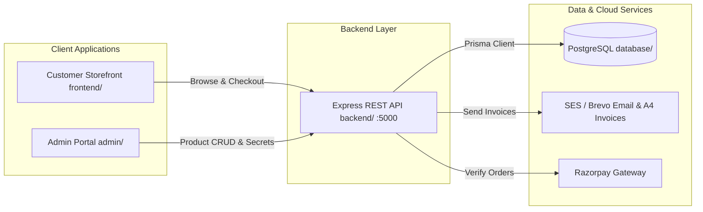

# VEDHIC FOODS — Master Platform Architecture & Documentation

Welcome to **VEDHIC FOODS**, a modern organic and traditional food e-commerce platform designed for production deployment on **AWS Cloud** with **PostgreSQL**, **Node.js/TypeScript**, **Amazon SES** (with **Brevo** as a fallback transport), and **Razorpay Payment Gateway**.

---

## 1. Master System Architecture

The platform is designed around four decoupled, dedicated modules:



---

## 2. Directory Breakdown & Isolation Rules

```
vedhifoods/
├── frontend/             # Customer Storefront (React 19, TypeScript, Vite)
├── admin/                # Dedicated Admin Portal (React 19, TypeScript, Vite)
├── backend/              # Node.js / Express / TypeScript REST API (/api/v1)
├── database/             # PostgreSQL Prisma Schemas, Seeds, Client, & Documentation
├── docs/                 # Product, architecture and implementation documentation
├── package.json          # Monorepo task runner & scripts
└── README.md             # Master platform architecture & documentation
```

### Module Responsibilities

1. **[`frontend/`](frontend)**:
   * Customer-only shopping experience.
   * **Zero Admin Exposure**: No admin buttons, links, or login screens exist in the customer navigation or footer.
   * Runs independently on port `5173`.
   * Real-time catalog queries directly reflect admin updates.

2. **[`admin/`](admin)**:
   * Dedicated store management portal.
   * Hosted on its own subdomain or port `5174`.
   * Direct URL access (`/` or `/login`).
   * Manages products, categories, stock, orders, and payment gateway credentials.

3. **[`backend/`](backend)**:
   * Clean layered Express REST API (`/api/v1`).
   * Handles 32-byte AES-256-GCM encryption for Razorpay credentials.
   * Formats A4 PDF tax invoices and dispatches them via Amazon SES (Brevo fallback).
   * Tested with Vitest: 45 backend test files (~1,000 cases) plus 4 admin portal test files.

4. **[`database/`](database)**:
   * PostgreSQL schema definitions (`schema.prisma`).
   * Database client singleton and seed scripts.
   * Prisma schema and migrations (14 migrations, 44 models, 18 enums). The
     CloudFormation RDS template defaults to `ap-south-1` (Mumbai) and local
     development uses the loopback database from `backend/docker-compose.yml`;
     the managed deployment runs on Supabase PostgreSQL (`ap-northeast-1`).

---

## 3. Step-by-Step Execution Guide

### Prerequisites
* **Node.js** >= 20.x
* **PostgreSQL** 15+ database URL

---

### Step 1: Initialize Database
```bash
cd database
npm install
npm run prisma:validate
npm run prisma:migrate    # dev workflow; production uses `npm run prisma:deploy`
npm run prisma:seed
cd ..
```
* Validates the Prisma schema (44 models, 18 enums).
* Applies migrations from `database/prisma/migrations/` (14 migrations).
* Seeds RBAC roles/permissions, encrypted payment settings and the catalogue.
* No default credentials are shipped: the seed creates a bootstrap admin only
  when `SEED_ADMIN_PASSWORD` is set, and warns otherwise. See `database/README.md`.

---

### Step 2: Start Backend REST API
```bash
cd backend
npm install
npm run build
npm run dev
```
* Express API starts at `http://localhost:5000/api/v1`.
* Test health endpoint: `curl http://localhost:5000/api/v1/health`.

---

### Step 3: Start Customer Storefront
In a new terminal:
```bash
cd frontend
npm install
npm run dev
```
* Storefront starts at `http://localhost:5173`.
* Customer can browse catalog, add to cart, and checkout with Cash on Delivery or Razorpay.

---

### Step 4: Start Admin Portal
In a new terminal:
```bash
cd admin
npm install
npm run dev
```
* Admin portal starts at `http://localhost:5174`.
* Sign in at `http://localhost:5174/login`. The bootstrap admin email is
  `admin@vedhicfoods.com`, created only when the seed ran with
  `SEED_ADMIN_PASSWORD` set (see Step 1).
* Update products and payment gateway settings. Changes immediately persist to PostgreSQL and reflect on `http://localhost:5173`.

---

## 4. Root Monorepo Shortcuts

From the workspace root directory:

```bash
# Development
npm run dev:backend       # Starts Backend on port 5000
npm run dev:frontend      # Starts Storefront on port 5173
npm run dev:admin         # Starts Admin Portal on port 5174

# Production Builds
npm run build:backend     # Compiles TypeScript backend to dist/
npm run build:frontend    # Compiles Storefront to frontend/dist/
npm run build:admin       # Compiles Admin Portal to admin/dist/
npm run build             # Compiles all three services

# Testing
npm run test              # Runs the backend Vitest suite (45 files, ~1,000 cases)
```

---

## 5. Audit of Cleaned Duplicates & Completed Files

### Removed Duplicates:
- ❌ **Root `src/`**: Removed monolithic combined codebase. Separated cleanly into `frontend/src/` and `admin/src/`.
- ❌ **`frontend/src/pages/admin/` & `frontend/src/components/admin/`**: Removed all 23 admin pages and components from customer storefront.
- ❌ **`frontend/src/services/admin*`**: Removed administrative services from customer storefront.
- ❌ **`admin/src/pages/customer/`**: Removed customer storefront pages and customer layout from admin portal.
- ❌ **`admin/src/pages/admin/PlaceholderFactory.tsx`**: Removed unused legacy placeholder.
- ❌ **Root `backend/` loose Python files**: Cleaned loose `app/`, `instance/`, `migrations/`, `config.py`, `run.py`, `seed_db.py`, `wsgi.py`. No Python sources or virtualenv remain under `backend/` (`backend/tests/` is TypeScript/Vitest only; there is no `backend/python_archive/`).

### Completed & Added Files:
- ✅ [`backend/src/controllers/payment-settings.controller.ts`](backend/src/controllers/payment-settings.controller.ts): Complete 32-byte AES-256 encryption and secret masking.
- ✅ [`backend/src/controllers/product.controller.ts`](backend/src/controllers/product.controller.ts): Complete product CRUD with PostgreSQL persistence and soft-delete.
- ✅ [`backend/src/controllers/order.controller.ts`](backend/src/controllers/order.controller.ts): Added checkout, A4 invoice creation, SES email dispatch (Brevo fallback), order status update, and `getOrder` lookup.
- ✅ [`backend/src/routes/order.routes.ts`](backend/src/routes/order.routes.ts): Mounted `/checkout`, `/`, and `/:orderNumberOrId`.
- ✅ [`admin/src/pages/admin/AdminNotFoundPage.tsx`](admin/src/pages/admin/AdminNotFoundPage.tsx): Created dedicated admin 404 page.
- ✅ [`database/package.json`](database/package.json): Standalone database migration runner.
- ✅ All four folders have individual, comprehensive `README.md` files with diagrams, step-by-step guides, and TODO lists.

### QA hardening pass (latest):
- ✅ **Admin dashboard** — `GET /admin/dashboard` now returns every widget in one aggregate payload (date-bounded 30-day revenue, server-side weekly series, top products, category performance, real lifetime spend). The console no longer fans out to paginated `fetchAll` chains, which fixes both several wrong figures and the recurring 60s request timeouts.
- ✅ **Cash on Delivery** — enabled in the storefront and admin payment selectors (the backend COD path already existed and was unreachable from the UI).
- ✅ **Error boundaries** — storefront now has a route-level `errorElement` plus a top-level `ErrorBoundary`, so a page crash no longer blanks the whole app.
- ✅ **Removed all mock/fallback data** — deleted the mock admin content service, the static 27-product catalog, the 600-line admin fixture dataset and the offline testimonial/FAQ/review fallbacks. FAQs, testimonials, reviews, support and the catalogue are now served exclusively by the API.
- ✅ **Correctness fixes** in the admin console order timeline and discount mapping.
- ✅ **Cleanup** — removed debug leftovers (`tmp-http.ts`, ad-hoc `dbcheck`/`testconn` scripts, the local `.pgtest/` Postgres data dir) and reconciled the CloudWatch log-group IAM policy with the ECS task definition.

### AWS deployment readiness pass (latest):
- ✅ **ECS task definition** — dropped the invalid `dependsOn` key from every `secrets` entry (the ECS `Secret` shape is `{name, valueFrom}` only, so the old template was rejected), and added `AWS_S3_PUBLIC_BASE_URL`.
- ✅ **Container image** — the `prod-deps` stage now installs the Prisma CLI and runs `prisma generate`, so the migration task can run and the runtime has a generated client.
- ✅ **CI/CD** — the integration job exports `SEED_ADMIN_PASSWORD`/`SEED_STAFF_PASSWORD` (the seed only creates these accounts when set, and ~15 RBAC suites log in as them); the deploy workflow's migration override now calls `./node_modules/.bin/prisma`.
- ✅ **Media serving** — new `AWS_S3_PUBLIC_BASE_URL` (CloudFront origin) is wired through `env.ts` and `S3Service.buildPublicUrl`, so product images and invoices resolve through the OAC distribution instead of a private bucket URL.
- ✅ **Prod secret guard** — the boot-time guard now also rejects `REPLACE_ME_*` / `placeholder` / `CHANGEME` values, which are long enough to pass the length check but are published in `.env.production.example`.
- ✅ **RDS monitoring** — pinned `DBInstanceIdentifier: vedhicfoods` so the CloudWatch alarms and DB-log metric filters (which default that dimension) monitor a real resource.
- ✅ **Invoice email** — routed through `EmailQueue` (retry, backoff, bounce/complaint suppression) with a dedupe key; online-payment invoices are no longer sent before capture, while COD orders still get theirs at checkout (they never reach the paid-invoice path).
- ✅ **Product images** — the admin uploader now downscales on a canvas to fit the 1 MB API body cap, so real multi-megabyte photos no longer fail with a 413.
- ✅ **Payment + invoices** — checkout sends an idempotency key; a failed online payment now releases the stock reservation; the storefront invoice adapter and the admin invoice download links were repaired.

---

## 6. Master TODO List

### Backend
- [ ] Implement Redis caching for product catalog read queries.
- [ ] Confirm Razorpay live webhook signature validation end-to-end against the sandbox.
- [x] Add AWS S3 presigned URL generation for image uploads — `S3Service.generatePresignedUploadUrl` + the `/admin/products/:id/images/presigned-url` route, consumed by `adminService.uploadProductImage`.

### Customer Storefront
- [x] Customer authenticated account dashboard — `/login`, `/register`, and `/account` (paginated order history via `GET /orders/my-orders`, profile summary, sign-out), linked from the header account icon.
- [ ] Add Progressive Web App (PWA) manifest and offline service worker.

### Admin Portal
- [ ] Route the product-create image field through the presigned S3 upload (`adminService.uploadProductImage`) instead of browser-downscaled data URLs — the edit flow already supports it once a product id exists.
- [ ] Add WebSocket live order push notifications.
- [ ] Add CSV export for GST compliance reporting.

### Database Layer
- [x] Create automated daily database backup pipeline to Amazon S3 — `database/scripts/backup-to-s3.mjs` scheduled by `.github/workflows/db-backup.yml`; see [`database/README.md`](database/README.md#5-automated-backups-to-amazon-s3). Supabase PITR remains a complementary control.
- [ ] Add PostgreSQL Full-Text Search (`tsvector`) on product names and tags.