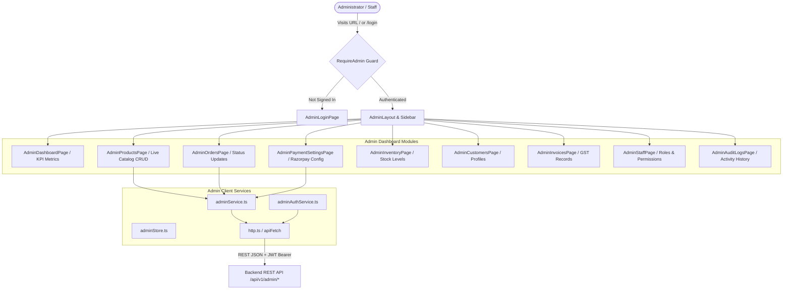

# VEDHIC FOODS — Dedicated Admin Portal (`admin/`)

The standalone, dedicated **Admin Portal** for store managers and staff of **Vedhic Foods**, built with **React 19**, **TypeScript**, and **Vite**.

---

## 1. Architecture Design

The Admin Portal is completely isolated from the customer storefront and is hosted on its own administrative domain or port:



### Folder Structure

```
admin/
├── src/
│   ├── components/
│   │   ├── admin/          # Admin-specific components: Sidebar, Table, Modals, Guards
│   │   └── common/         # Form fields, Buttons, Badges, Icons
│   ├── context/            # AdminAuthContext (sessions, permissions, tokens)
│   ├── data/               # Default metrics, fallback mock data
│   ├── pages/
│   │   └── admin/          # Dedicated admin screens (Dashboard, Products, Orders, etc.)
│   ├── routes/             # Dedicated admin routes (/login, /products, /orders, etc.)
│   ├── services/           # Admin HTTP client with fallback to local store
│   │   ├── adminAuthService.ts
│   │   ├── adminService.ts
│   │   ├── adminStore.ts
│   │   └── http.ts
│   ├── styles/             # Administrative dark/light styling and data tables
│   ├── types/              # Admin permissions, staff roles, and audit log interfaces
│   ├── App.tsx             # Root admin application
│   └── main.tsx            # DOM bootstrap
├── public/                 # Favicon and admin branding
├── .env                    # Environment configuration (VITE_API_URL)
├── index.html              # Admin HTML entrypoint
├── package.json            # Scripts & dependencies
├── tsconfig.json           # TypeScript configuration
└── vite.config.ts          # Configured on port 5174
```

---

## 2. Core Administrative Capabilities

### A. Real-Time Product Management
* **Workflow**: Admin updates product name, price, stock, or tags in `admin/` -> Dispatched to `PUT /api/v1/admin/products/:id` -> Persisted in PostgreSQL -> Immediately live for customers in `frontend/`.
* Complete product lifecycle: Creation, In-place editing, Stock adjustment, and Safe deactivation.

### B. Payment Gateway Settings & 32-Byte AES Encryption
* **Razorpay Key Management**:
  * Admin updates Razorpay Key ID, Key Secret, Webhook Secret, mode (Test/Live), and accepted payment methods.
  * Secrets are encrypted with **32-byte AES-256-GCM** on the backend before being written to PostgreSQL.
  * In the UI, secrets are always displayed masked (`rzp_sec_••••••••••••cdef`) to prevent shoulder-surfing and unauthorized access.

### C. Order Fulfillment & Status Pipeline
* Review live orders, filter by status (`CONFIRMED`, `PACKED`, `SHIPPED`, `DELIVERED`, `CANCELLED`).
* One-click status progression updates database in real time.

---

## 3. Step-by-Step Execution Guide

### Prerequisites
* Node.js >= 20.x
* Backend API running at `http://localhost:5000/api/v1`

### Step 1: Install Dependencies
```bash
cd admin
npm install
```

### Step 2: Configure Environment Variables
Create or verify `admin/.env`:
```env
VITE_API_URL=http://localhost:5000/api/v1
```

### Step 3: Start Development Server
```bash
npm run dev
```
The Admin Portal starts on port `5174`:
`http://localhost:5174`

### Step 4: Login to Admin Dashboard
Navigate to `http://localhost:5174/login` (or `/login`):
* **Admin Email**: `admin@vedhicfoods.com` — the seed account, created only when
  `SEED_ADMIN_PASSWORD` was set during `npm run prisma:seed` (no default password
  is shipped). The `*.@vedhifoods.example` rows in `src/data/admin.ts` are
  staff sample data, not login accounts.

### Step 5: Build for Production
```bash
npm run build
```
Generates the production-optimized static admin portal bundle in `admin/dist/`.

---

## 4. TODO & Next Milestones

- [ ] Add direct product image drag-and-drop file upload to Amazon S3.
- [ ] Implement live WebSocket push notifications for incoming customer orders.
- [ ] Add CSV export for tax invoices and monthly GST reporting.
- [ ] Implement two-factor authentication (2FA) for administrative staff logins.
- [ ] Build automated courier tracking integration (Delhivery / Blue Dart).
