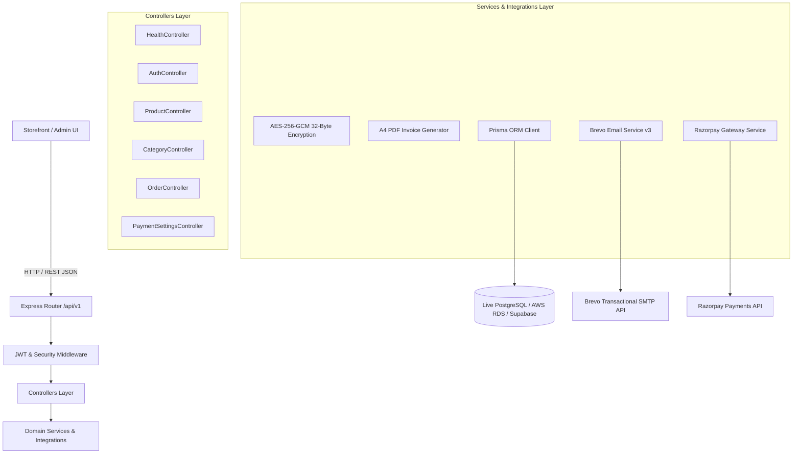

# VEDHIC FOODS — Backend Architecture & Service Documentation

Production-grade Node.js and TypeScript REST API service powering the **Vedhic Foods** organic and traditional e-commerce ecosystem.

---

## 1. Architecture Design

The backend follows clean layered architecture with explicit service boundaries:



### Layered Modules

```
backend/
├── src/
│   ├── config/             # Strongly-typed environment (env.ts), DB pooler (database.ts), logger (logger.ts)
│   ├── constants/          # HTTP codes and business domain constants
│   ├── controllers/        # Request validation, business coordination, response formatting
│   │   ├── auth.controller.ts
│   │   ├── category.controller.ts
│   │   ├── health.controller.ts
│   │   ├── order.controller.ts
│   │   ├── payment-settings.controller.ts
│   │   └── product.controller.ts
│   ├── integrations/       # External API abstractions
│   │   ├── brevo/          # Brevo (Sendinblue) transactional email with base64 PDF attachments
│   │   ├── pdf/            # Standard A4 PDF tax invoice generator
│   │   ├── razorpay/       # Razorpay order creation and signature verification
│   │   └── aws/            # AWS S3 and SES SDK integration
│   ├── middleware/         # Helmet, CORS, Rate-limiting, Request ID, Error handling
│   ├── routes/             # Mounted under /api/v1: health, products, categories, orders, admin
│   ├── utils/              # 32-byte AES-256 encryption, secret masking, AppError
│   ├── app.ts              # Express application setup
│   └── server.ts           # Server bootstrap with graceful shutdown
├── ../database/           # Prisma schema, migrations & seed (schema.prisma, seed.ts)
├── tests/
│   ├── unit/               # Environment & encryption tests
│   ├── integration/        # Health check, payment encryption, product & checkout tests
│   └── e2e/                # API security headers & CORS tests
├── Dockerfile              # Production multi-stage Docker build
├── AWS_DEPLOYMENT.md       # Production AWS deployment architecture, hardening, runbook
├── .env.example            # Environment configuration template
├── package.json
└── tsconfig.json
```

---

## 2. Key Technical Implementations

### A. 32-Byte (256-bit) AES Encryption for Payment Gateway
* **Algorithm**: `aes-256-gcm`
* **Key Derivation**: SHA-256 digest of `ENCRYPTION_KEY` yielding exactly 32 bytes (256 bits).
* **Format**: `<16-byte-IV-hex>:<16-byte-AuthTag-hex>:<Ciphertext-hex>`.
* **Zero Secret Leakage**: The `GET /api/v1/admin/payment-settings` endpoint automatically decrypts and masks secrets (`rzp_sec_••••••••••••cdef`) before returning them to the Admin Dashboard.

### B. Brevo Email Service & A4 PDF Tax Invoices
* Generates an official, GST-compliant **A4 Tax Invoice PDF** using `InvoiceGenerator.generateA4Pdf()`.
* Dispatches email via Brevo's v3 SMTP endpoint (`https://api.brevo.com/v3/smtp/email`) with the invoice attached directly as a base64 encoded document.

---

## 3. Step-by-Step Execution Guide

### Prerequisites
* Node.js >= 20.x
* PostgreSQL 15+ (Local or cloud instance)

### Step 1: Install Dependencies
```bash
cd backend
npm install
```

### Step 2: Configure Environment Variables
Copy `.env.example` to `.env`:
```bash
cp .env.example .env
```
Ensure `.env` contains:
```env
PORT=5000
NODE_ENV=development
DATABASE_URL="postgresql://<user>:<password>@<host>:5432/postgres"
ENCRYPTION_KEY="vedhic_super_secure_master_aes_32b_2026"
JWT_SECRET="vedhic_jwt_production_secret_key_2026"
BREVO_API_KEY="your-brevo-api-key"
BREVO_SENDER_EMAIL="orders@vedhicfoods.com"
BREVO_SENDER_NAME="Vedhic Foods"
```

### Step 3: Validate Schema and Migrations
```bash
npm run prisma:validate   # schema is valid
npm run prisma:migrate    # dev workflow; applies database/prisma/migrations/
```
Migrations are the source of truth for schema changes — do **not** use
`prisma db push` against a production database.

### Step 4: Seed Database
```bash
npm run prisma:seed
```
* Seeds a bootstrap Administrator at `admin@vedhicfoods.com` only when
  `SEED_ADMIN_PASSWORD` is set (min 12 chars); no default password is shipped.
* Seeds 7 traditional categories and 25 catalog products.
* Initializes encrypted payment settings.

### Step 5: Run Tests
```bash
npm test
```
Executes the backend suite: 100 unit + 322 integration tests.

### Step 6: Start Server
```bash
# Development (auto-reload via tsx):
npm run dev

# Production Build & Start:
npm run build
npm start
```
Server listens at `http://localhost:5000/api/v1`.

---

## 4. API Endpoints Reference

| Method | Endpoint | Description |
|---|---|---|
| `GET` | `/api/v1/health` | Service uptime and timestamp |
| `GET` | `/api/v1/health/ready` | Live PostgreSQL connection check |
| `GET` | `/api/v1/products` | Public catalog with search, category, sort, and pagination |
| `GET` | `/api/v1/products/:idOrSlug` | Detailed product specifications |
| `GET` | `/api/v1/categories` | Active product categories with count |
| `POST` | `/api/v1/orders/checkout` | Customer checkout, invoice generation, Brevo email dispatch |
| `GET` | `/api/v1/orders/:orderNumberOrId` | Customer order lookup |
| `POST` | `/api/v1/admin/auth/login` | Admin login & JWT generation |
| `GET` | `/api/v1/admin/payment-settings` | Masked payment gateway settings |
| `PUT` | `/api/v1/admin/payment-settings` | Update & 32-byte AES encrypt payment gateway settings |
| `GET` | `/api/v1/admin/products` | Admin product inventory list |
| `POST` | `/api/v1/admin/products` | Admin creates new catalog item |
| `PUT` | `/api/v1/admin/products/:id` | Admin updates product in PostgreSQL |
| `DELETE` | `/api/v1/admin/products/:id` | Admin deletes/deactivates product |
| `GET` | `/api/v1/admin/orders` | Admin orders management list |
| `PUT` | `/api/v1/admin/orders/:id/status` | Update fulfillment state |

---

## 5. TODO & Next Milestones

- [x] Implement AWS S3 presigned URL generation for admin product image uploads — `src/integrations/aws/s3/s3.service.ts` (`generatePresignedUploadUrl` / `generatePresignedDownloadUrl`).
- [x] Connect Razorpay live webhook signature validation — `src/controllers/payment.controller.ts` `RazorpayService.processWebhookEvent` (raw-byte HMAC-SHA256).
- [ ] Add Redis caching layer for `/api/v1/products` catalog queries.
- [ ] Implement customer SMS OTP verification via AWS SNS or Twilio.
- [ ] Add Prometheus metrics exporter for CloudWatch telemetry.
