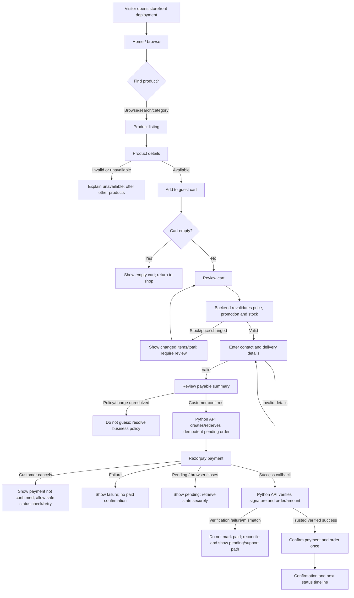
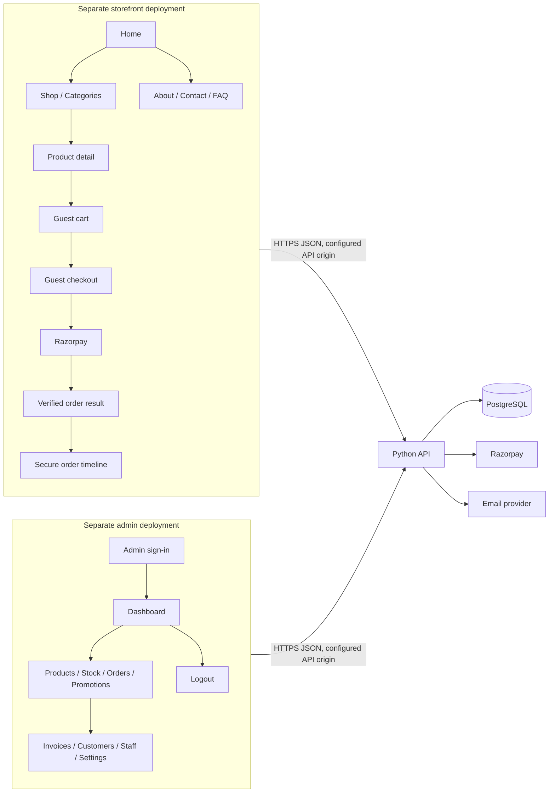
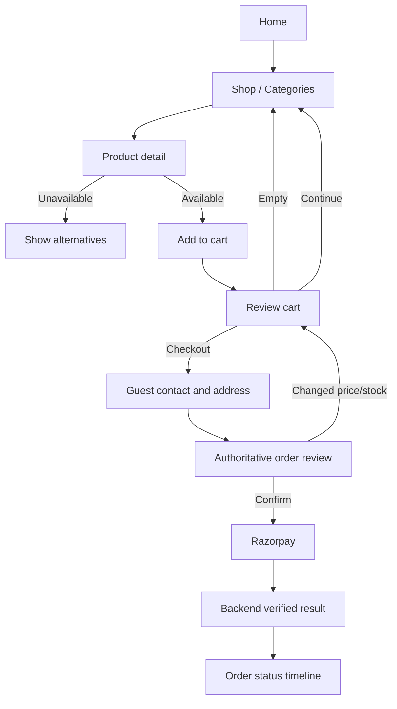
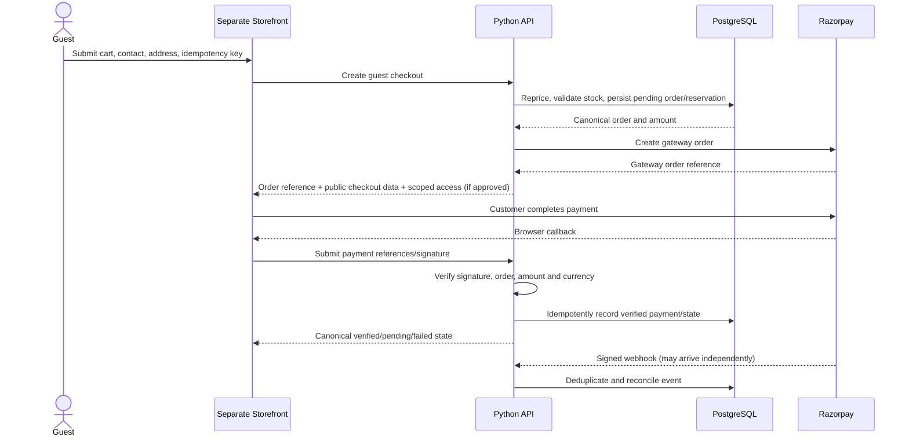
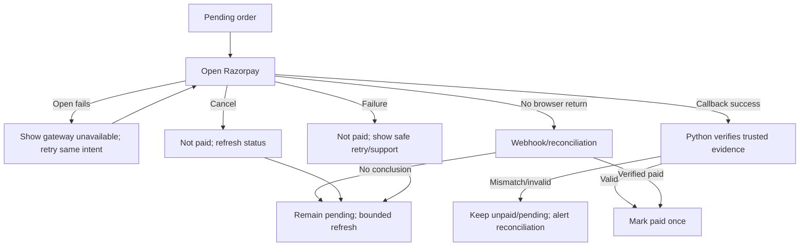
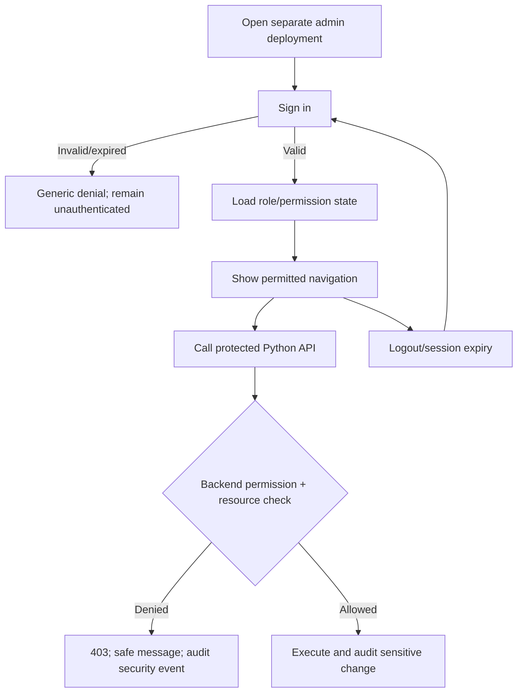
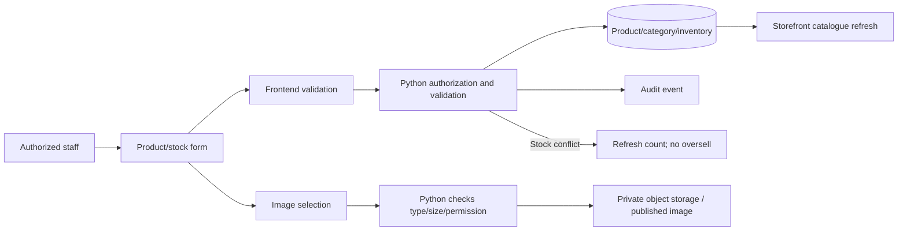
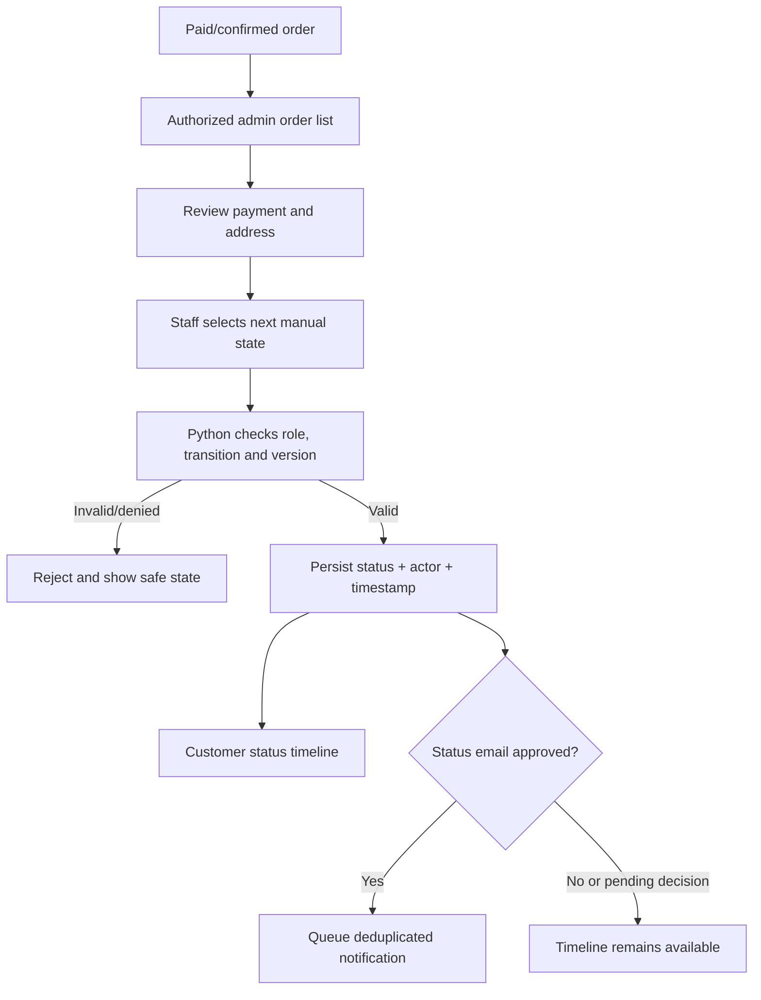
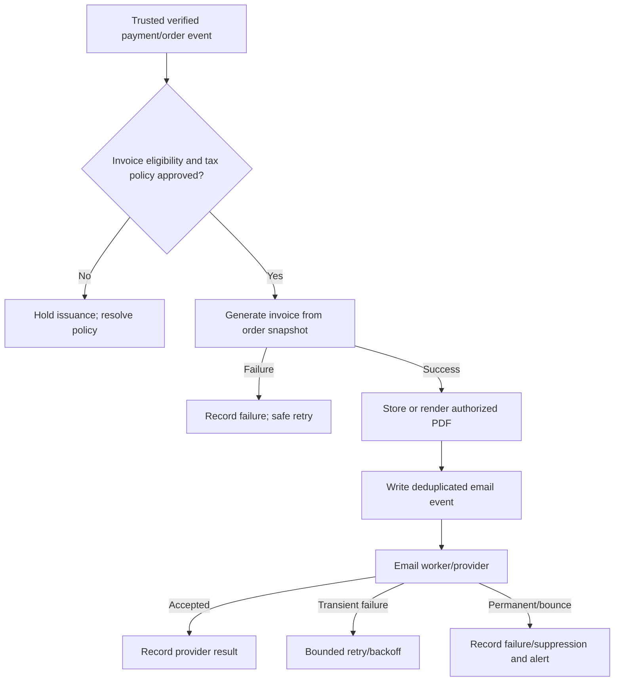

# VedhicFoods Application Flow and User Journey Document

## 1. Document Control

| Field | Value |
|---|---|
| Document title | VedhicFoods Application Flow and User Journey Document |
| Project name | VedhicFoods |
| Document ID | VF-APP-FLOW-001 |
| Version | 1.0 |
| Creation date | 17 October 2026 |
| Purpose | Define user roles, navigation, journeys, states, security boundaries and QA acceptance flows for the storefront and administration application. |
| Intended audience | Client/business owner, product/project managers, UX/UI designers, React developers, Python backend developers, QA, security and deployment teams |
| Related documents | [PRD](PRD.md), [TRD](TRD.md) |
| Approval status | **DRAFT — PENDING REVIEW**; no formal approval evidence found |
| Deployment decision | The owner reports that the storefront and admin dashboard are already deployed separately; the repository does not independently verify production URLs or deployment state. |
| Customer account decision | No customer account registration or customer sign-in in the intended product flow, as confirmed by the project owner in this request. |

### Status definitions

- **CONFIRMED REQUIREMENT**: stated in the approved business brief or latest owner direction.
- **VERIFIED EXISTING**: matching route/component/service code is present in this repository; this does not prove production health or test success.
- **PROPOSED**: recommended flow that needs design/technical review.
- **PENDING CONFIRMATION**: business or implementation decision is not settled.
- **NOT VERIFIED**: repository evidence is insufficient to establish behavior or live configuration.
- **MISMATCH**: current repository behavior conflicts with the latest confirmed product direction.
- **OUT OF SCOPE**: not included in the initial release.

## 2. Application Overview

VedhicFoods is a premium traditional Indian food storefront with a separate, protected administration application. Visitors browse approved products and may purchase as guests without registering. The admin application is for the owner and authorized staff to manage products, prices, inventory, orders, manual delivery status, invoices, promotions and other permitted operations.

### Separate deployment model

The customer storefront and admin dashboard are separate frontend applications, and the project owner confirms that they are already deployed separately. Each has its own build, deployment lifecycle, origin and navigation context. They communicate with the same Python-only REST API over HTTPS. The admin deployment must not be a hidden route or bundle section of the public storefront. The public storefront must not expose administrative controls or admin assets as part of its customer navigation.

The repository has distinct `frontend/` and `admin/` React/Vite projects and route trees (**VERIFIED EXISTING**). The owner confirms that the storefront and admin dashboard are separately deployed. Actual production hostnames, DNS records, TLS, deployment pipelines and CORS allowlist are **NOT VERIFIED** here; do not infer them. The admin-to-storefront link must resolve to the separately deployed storefront origin. Current admin code uses a relative `href="/"` for “View storefront”, which resolves on the admin origin; its production destination is a **MISMATCH / NOT VERIFIED** and must be a configured absolute storefront destination in the approved deployment design.

### Application areas and responsibilities

| Area | Primary users | Main responsibility | Status |
|---|---|---|---|
| Public storefront | Public visitors and guest buyers | Brand presentation, catalogue, cart, guest checkout, payment handoff, order result, support/contact | React routes/components **VERIFIED EXISTING**; behavior against future Python API requires compatibility verification |
| Admin dashboard | Owner/super admin and authorized staff | Protected operational console for catalog, orders, inventory, promotions, customers, invoices, staff and settings | React admin app/routes **VERIFIED EXISTING**; separate deployment confirmed by owner; permissions must be enforced in Python |
| Python API | Both applications; external Razorpay callbacks | All backend endpoints, validation, business rules, authorization, persistence, payment verification, invoice/email/storage operations | **CONFIRMED TARGET**, but current repository server is Express/TypeScript (**MISMATCH**; Python migration required by TRD) |
| PostgreSQL | Python API only | Authoritative catalog, order, payment, stock, invoice, staff and audit persistence | PostgreSQL/Prisma schema **VERIFIED EXISTING**; target Python persistence not yet implemented |
| Razorpay | Python API and customer payment handoff | Payment experience; API verifies signature and trusted webhook before paid status | Razorpay integration code **VERIFIED EXISTING** in current Node backend; Python implementation is target/proposed |
| Email and image storage | Python API/workers | Approved notifications/invoices and product image lifecycle | SES/Brevo and S3 source integrations **VERIFIED EXISTING**; live service/account state **NOT VERIFIED** |

The frontend may keep its current React/TypeScript framework. All backend responsibilities must ultimately run in Python. No customer purchase flow should depend on a customer profile, password, customer login, registration, or account dashboard.

## 3. User Roles and Entry Points

| Role | Entry point | Authentication | Permitted navigation | Restrictions and unauthorized handling |
|---|---|---|---|---|
| Guest customer | Public storefront deployment | No account and no sign-in required for browsing or purchasing. Guest order access requires a separately approved secure lookup mechanism. | Home, shop, categories, product, cart, guest checkout, payment, order result/status, About, Contact, FAQ and approved policies | No admin pages or customer account/registration flow. Private order data must never be disclosed by sequential order number alone. |
| Owner / Super Admin | Separate admin deployment; sign-in screen | Staff/admin authentication required | Admin dashboard and all owner-authorized operations, including staff/permission administration | Every operation still checked by Python API and audited where sensitive. Login failure does not expose account existence or internal errors. |
| Authorized staff member | Separate admin deployment; sign-in screen | Individual staff authentication required | Only pages/actions permitted by assigned role; restricted navigation may hide unavailable actions for usability | Must not inherit owner permissions. Python API denies forbidden operations even if a user calls an endpoint directly. Final role matrix **PENDING CONFIRMATION**. |

**Customer registration decision:** no customer registration/login is included in the intended application. The source repository currently routes `/login`, `/register`, and `/account` and has customer auth services; these are **VERIFIED EXISTING but MISMATCH** with the latest direction. This document does not change or remove those files. They must not appear as supported customer flows in the target baseline unless the owner changes the decision later.

**Admin session expiry:** an expired or revoked admin session returns the operator to admin sign-in with a safe message and return path if the session can be renewed securely. Never render privileged data while session validity is unresolved.

## 4. Application Sitemap

Routes below are the actual current SPA route paths where verified. They are pathnames within their own app origin, not production hostnames. Since the storefront and admin are separate deployments, `/` in the storefront and `/` in the admin are different origins/applications. Any proposed destination is explicitly labelled.

### A. Public storefront

| Screen / route path | Status | Notes |
|---|---|---|
| Home `/` | **VERIFIED EXISTING** | `frontend/src/routes/index.tsx`; premium brand/hero content is present, approval of product claims remains required. |
| Shop `/shop` | **VERIFIED EXISTING** | Catalogue list; query search/filter behavior depends on page/service state. |
| Categories `/categories` | **VERIFIED EXISTING** | Category browse page. |
| Category products `/shop?category={slug}` | **VERIFIED EXISTING** as mobile-nav link pattern | Category query listing. Query params validated by API. |
| Product detail `/product/:slug` | **VERIFIED EXISTING** | Product detail route. |
| Search/filter | **VERIFIED EXISTING** UI/service components, detailed supported filters **NOT VERIFIED** as final approved scope | Preserve current behavior only when backed by API; enhancements remain proposed. |
| Cart `/cart` | **VERIFIED EXISTING** | Guest cart. |
| Checkout `/checkout` | **VERIFIED EXISTING** | The target is guest-only and Razorpay-only. Current UI exposes a COD payment type in code, so production flow is **MISMATCH** until excluded. |
| Payment processing | Gateway modal/service; not a distinct route in current route table | Razorpay JS flow present in `frontend/src/services/paymentService.ts`; backend verification in current Node source. **VERIFIED EXISTING code**, Python target **PROPOSED**. |
| Order result `/order-success/:orderNumber` | **VERIFIED EXISTING** route | Success copy/state must be gated on trusted verified payment; avoid implying redirect alone confirms payment. |
| Order-status lookup | **PENDING CONFIRMATION** mechanism | Current order/token services exist, but no confirmed standalone secure lookup journey or access policy. No guessed ID lookup. |
| Invoice `/invoice/:id`, `/invoice/order/:orderNumber` | **VERIFIED EXISTING** routes | Actual authorization should be guest order credential or staff/customer ownership; invoice legal content pending. |
| About `/about` | **VERIFIED EXISTING** | Approved brand story only. |
| Contact `/contact` | **VERIFIED EXISTING** | Contact submission client exists; backend support integration is present in current Node code. Python target requires migration. |
| FAQs `/faq` | **VERIFIED EXISTING** | Content source and accuracy require approval. |
| Support `/support` | **VERIFIED EXISTING** | Treat ticket/account capabilities as guest-safe only if supported by secure flow; exact behavior **NOT VERIFIED** for no-account policy. |
| Customer login `/login` | **MISMATCH** | Existing route; remove from intended customer navigation/flow unless product owner reverses the no-account decision. |
| Customer registration `/register` | **MISMATCH / OUT OF SCOPE** | Existing route conflicts with confirmed direction. No registration journey in target product. |
| Customer account `/account` | **MISMATCH / OUT OF SCOPE** | Existing route conflicts with no customer-account direction. |
| Privacy, terms, shipping, cancellation/refund policy paths | **PENDING CONFIRMATION** | Publish only approved policies; paths/content and legal advice are not verified. |

### B. Administration deployment

The following current route patterns are in `admin/src/routes/index.tsx`. Route paths are relative to the **admin deployment origin**, separate from storefront origin.

| Screen / route path | Status | Notes |
|---|---|---|
| Admin sign-in `/admin/login` and `/login` | **VERIFIED EXISTING** | Separate admin app authentication; customer sign-in is not implied. |
| Dashboard `/admin` (also `/`) | **VERIFIED EXISTING** | Current route tree has aliases; deployment origin must be admin-only. |
| Products `/admin/products`, `/admin/products/compare`, `/admin/products/archive` | **VERIFIED EXISTING** | Permission guarded in current UI; Python must enforce. |
| Inventory `/admin/inventory` | **VERIFIED EXISTING** | Guarded in UI; backend permission required. |
| Orders `/admin/orders`, `/admin/orders/:id` | **VERIFIED EXISTING** | Review/status operations. |
| Customers `/admin/customers`, `/admin/customers/:id` | **VERIFIED EXISTING** | Sensitive data access; restrict to operational need and roles. |
| Delivery `/admin/delivery` | **VERIFIED EXISTING** | Manual status operations. |
| Invoices `/admin/invoices` | **VERIFIED EXISTING** | Access and invoice policy controls. |
| Discounts `/admin/discounts`; promotions `/admin/promotions` | **VERIFIED EXISTING** | Eligibility/date/combinations require approved business rules. |
| Support `/admin/support`, `/admin/support/:id` | **VERIFIED EXISTING** | Restricted ticket handling. |
| Staff `/admin/staff`, `/admin/staff/new`, `/admin/staff/:id` | **VERIFIED EXISTING** | Owner and staff-admin grants require backend control. |
| Permissions `/admin/permissions` | **VERIFIED EXISTING** | Final role model is **PENDING CONFIRMATION**. |
| Audit logs `/admin/audit-logs` | **VERIFIED EXISTING** | Data minimization and retention pending. |
| Settings `/admin/settings`, `/admin/payment-settings`, `/admin/security`, `/admin/theme`, `/admin/contact-settings`, `/admin/hero`, `/admin/content` | **VERIFIED EXISTING** | Current screens; environment and secret values must not be exposed. |
| Logout | **VERIFIED EXISTING** behavior in admin layout/auth context | Ends/revokes session as far as backend supports; confirm server revocation behavior. |
| Separate production hostname/origin | **CONFIRMED REQUIREMENT** by owner | Exact value and deployment mechanism **NOT VERIFIED**. |

### C. System states

| State | Applies to | Status / expected behavior |
|---|---|---|
| Loading/skeleton | Storefront and admin | **VERIFIED EXISTING** common components; do not hide errors indefinitely. |
| Empty catalogue/cart/orders | Storefront/admin | **VERIFIED EXISTING** state components/pages; clear next action; empty cart cannot proceed. |
| Error / route error / not found | Both | **VERIFIED EXISTING** error boundary/404 routes; safe generic user text. |
| Unauthorized / forbidden | Admin and private resources | **CONFIRMED REQUIREMENT**; frontend route guard plus mandatory Python API denial. |
| Network/API unavailable | Both | **PROPOSED** recovery: preserve safe local cart/input where possible; offer retry; never claim order/payment success. |
| Payment pending/failure/cancelled | Storefront | **CONFIRMED REQUIREMENT** distinct recoverable state; only backend verification establishes paid state. |
| Out of stock/stale price | Storefront/cart/checkout | **CONFIRMED REQUIREMENT**; refresh authoritative item state and require customer review of changed total. |
| Session expired | Admin | **VERIFIED EXISTING** handling in UI; backend revocation semantics need Python parity tests. |
| Customer account states | Storefront | Existing code only; **OUT OF SCOPE / MISMATCH** for target app. |

## 5. High-Level Application Flow



The diagram defines intended flow, not proof that the Python backend exists. A browser callback or redirect is not payment proof. Empty cart, stock/price change, invalid delivery information and unverified payment must not progress to a false success page.

## 6. Detailed Customer Journeys

Common security rule for CJ journeys: no customer account is created or required. Guest order access is limited to an approved order-specific mechanism; raw sequential order numbers are never credentials. All final prices, discounts, stock, payment state and access decisions come from the backend.

### CJ-001: Discover the website

- **Goal:** Understand the brand and find approved products.
- **Preconditions/entry:** Open the public storefront origin; no authentication.
- **Steps:** (1) Load home. (2) Browse main navigation/mobile menu. (3) Select category or Shop. (4) Open product card. (5) Return/back to continue browsing.
- **Screen/action:** Home, nav/menu, category/shop list, product detail.
- **Frontend response:** Display approved copy/images; show loading, empty or error state; keep navigation usable.
- **Python backend:** Serve active categories/products and approved content; apply pagination; avoid exposing admin data.
- **Database impact:** Read-only queries; analytics only if separately approved.
- **Success:** Visitor can open active product detail.
- **Failure/recovery:** API timeout shows retry and does not show fabricated product data; unavailable item returns to listing.
- **Security:** Public API exposes only approved fields; no customer registration CTA.
- **Acceptance:** AF-AC-001, AF-AC-015.
- **Status/pending:** Pages/routes **VERIFIED EXISTING**; catalog content approval and performance policy pending.

### CJ-002: Browse and search products

- **Goal:** Narrow the catalogue and find an item.
- **Preconditions:** Active catalogue exists.
- **Steps:** (1) Open Shop or Categories. (2) Enter query or choose available category/filter/sort. (3) Review resulting products/availability. (4) Clear or alter filters. (5) Open detail.
- **Screen/action:** `/shop`, `/categories`, category query, search/filter UI.
- **Frontend response:** Reflect active filters in results and offer clear/reset where supported.
- **Python backend:** Validate query length, filter/sort allowlist and page size; return only active products and totals.
- **Database impact:** Read-only indexed catalogue queries.
- **Success:** Relevant active products display.
- **Failure/recovery:** Invalid filter is cleared or explained; no results show a helpful empty state; API failure offers retry.
- **Security:** Parameterized queries and bounded search prevent injection/resource abuse.
- **Acceptance:** AF-AC-002.
- **Status/pending:** Search/filter components/services **VERIFIED EXISTING**; final available filters and search behavior **PENDING CONFIRMATION** where scope not specified.

### CJ-003: View product details

- **Goal:** Decide whether to add an item.
- **Preconditions:** Product identifier resolves to active product.
- **Steps:** (1) Open detail. (2) Review approved name, image, description, unit/quantity, price and availability. (3) Select quantity/variant if applicable. (4) Add to cart or return to catalogue.
- **Screen/action:** `/product/:slug`; quantity and add action.
- **Frontend response:** Display service response and validation; do not claim unverified nutritional/certification/organic attributes.
- **Python backend:** Confirm active product and current sale price/availability; return only approved fields; final checkout revalidates.
- **Database impact:** Product read; cart write may occur later.
- **Success:** Item is eligible to add.
- **Failure/recovery:** Archived/unknown/out-of-stock item cannot be added and visitor can browse alternatives.
- **Security:** Never trust client-provided product price or stock.
- **Acceptance:** AF-AC-003.
- **Status/pending:** Detail route/service **VERIFIED EXISTING**; content facts must be approved by business.

### CJ-004: Add products to cart

- **Goal:** Build and edit a purchase basket without account creation.
- **Preconditions:** Product currently purchasable.
- **Steps:** (1) Add item. (2) View cart. (3) Adjust quantity/remove item. (4) Continue shopping or proceed to checkout.
- **Screen/action:** Product detail, cart drawer, `/cart`.
- **Frontend response:** Show item, chosen quantity and indicative total; empty cart links back to Shop.
- **Python backend:** On checkout/quote, re-read product, price, promotion and inventory; reject invalid quantity and stale item state.
- **Database impact:** Client may keep cart state; persisted cart behavior only if API/auth policy supports it. No customer account is required for a local guest basket.
- **Success:** Nonempty cart is ready for guest checkout.
- **Failure/recovery:** Invalid quantity resets/reports; stock/price change is presented and cart updated only after user review; repeat updates should be idempotent where API operation is retried.
- **Security:** Client-side cart is not authoritative.
- **Acceptance:** AF-AC-004, AF-AC-005.
- **Status/pending:** Cart page/context/client services **VERIFIED EXISTING**; exact persistence and stock reservation timing are TRD/business dependencies.

### CJ-005: Checkout as a guest

- **Goal:** Provide contact and delivery details and buy without registering.
- **Preconditions:** Cart contains at least one eligible item; delivery rules are configured.
- **Steps:** (1) Select checkout. (2) Enter name, email, phone and delivery address. (3) Review validation errors. (4) Continue to authoritative review. (5) Submit using one checkout idempotency key.
- **Screen/action:** `/checkout`, customer/contact and address stages.
- **Frontend response:** Inline field errors, preserve safe inputs, no registration/login prompt, no COD option.
- **Python backend:** Validate fields and serviceability if approved; recalculate price/stock; create one order for one intent; return opaque order reference plus secure guest access credential only after policy approval.
- **Database impact:** Persist minimal contact/address snapshot, order, items, idempotency record and stock reservation according to approved transaction strategy.
- **Success:** Pending-payment order created and Razorpay can be initiated.
- **Failure/recovery:** Invalid fields remain editable; unavailable address is rejected only if coverage rules exist; repeated same request returns same order; changed key/payload is not silently duplicated.
- **Security/privacy:** TLS, input limits, minimal fields, no account creation, no contact/address in URL or analytics. Guest access credential must be protected from logs/referrers.
- **Acceptance:** AF-AC-006, AF-AC-007.
- **Pending:** Guest access token issuance/storage/expiry; delivery coverage and fees; privacy/retention rules.

### CJ-006: Review order

- **Goal:** Confirm the complete amount before payment.
- **Preconditions:** Backend quote/order creation returned current eligible lines.
- **Steps:** (1) Review product/variant, quantity and unit price. (2) Review eligible discount. (3) Review delivery charge and tax as defined by approved policies. (4) Read final payable total. (5) Confirm payment.
- **Screen/action:** Cart summary and checkout review stage.
- **Frontend response:** Match server-calculated quote; visibly explain changed total and require confirmation after material change.
- **Python backend:** Calculate money with exact decimal/minor unit representation; apply only active eligible promotions; calculate delivery/tax only from approved policies; ignore client totals.
- **Database impact:** Persist item/price/discount snapshots with order.
- **Success:** Customer sees the exact amount used to create Razorpay order.
- **Failure/recovery:** Price/stock/coupon changes cause refreshed quote and explicit review; unresolved tax/delivery rules are not fabricated.
- **Security:** Do not accept arbitrary submitted discount or amount.
- **Acceptance:** AF-AC-008.
- **Pending:** Tax-inclusive/add-on approach, tax data/rates, delivery fee/coverage, promotion stacking/eligibility.

### CJ-007: Pay using Razorpay

- **Goal:** Pay the pending order online.
- **Preconditions:** Pending order and exact server-side amount exist; gateway is available.
- **Steps:** (1) Python API creates gateway order using persisted order total. (2) Storefront opens Razorpay payment UI with public key and gateway order ID. (3) Customer chooses a method enabled by merchant account (UPI when supported). (4) Gateway returns result or customer closes the window. (5) Storefront sends returned references to Python verification endpoint; webhook may arrive independently.
- **Screen/action:** `/checkout` with Razorpay UI/modal; payment state presentation.
- **Frontend response:** Show processing while verification is underway; dismissal/cancel is not success; no COD.
- **Python backend:** Validate order ownership token/session; create gateway request, verify callback signature and webhook raw body, match order/amount/currency and event id, transition once.
- **Database impact:** Payment attempt and provider references; durable webhook event; payment/order status transition and inventory effect.
- **Success:** Only verified server-side success can become paid.
- **Failure/recovery:** Cannot load gateway offers retry; failed/cancelled is not paid; pending result allows safe status check/reconciliation; verification failure flags support/ops path.
- **Security:** No Razorpay secret in browser. Never trust redirect or client `success` boolean.
- **Acceptance:** AF-AC-009, AF-AC-010, AF-AC-011.
- **Status/pending:** Razorpay client/service and Node backend integration **VERIFIED EXISTING**; Python gateway backend is target and **MISSING**; production merchant configuration **NOT VERIFIED**.

### CJ-008: Order confirmation

- **Goal:** See a reliable result and know next action.
- **Preconditions:** Order created; payment result can be verified.
- **Steps:** (1) Frontend polls/retrieves order/payment state using authorized credential. (2) If verified paid, show order reference, summary and confirmation. (3) If pending, show pending and provide status refresh. (4) If failed, show safe retry/support route without duplicate order.
- **Screen/action:** `/order-success/:orderNumber` current route; target title/content must reflect actual state, not just pathname.
- **Frontend response:** Confirmation only after API reports trusted verified state; refresh reloads from API, not an optimistic local flag.
- **Python backend:** Idempotently return canonical order state; reconcile late webhook; keep order/payment separate.
- **Database impact:** Read order; update once for payment event; enqueue notification/invoice when approved triggers met.
- **Success:** Order confirmation reflects verified data.
- **Failure/recovery:** Browser redirect fails after payment: use approved secure order credential and status endpoint; do not submit new order automatically. Delayed webhook remains pending until reconciliation.
- **Security:** Order reference alone is not authorization.
- **Acceptance:** AF-AC-010, AF-AC-011, AF-AC-012.
- **Pending:** Payment transition map and exact status-check/retry timing.

### CJ-009: Find an order and track status

- **Goal:** Retrieve status and invoice for the guest's own order.
- **Preconditions:** Order exists; approved secure lookup method is available to customer.
- **Steps:** (1) Enter reference and approved second factor/access token. (2) Python API verifies the credential is valid, unexpired and order-bound. (3) Show minimum permitted order details and status history. (4) Offer invoice link only when authorized and available.
- **Screen/action:** Dedicated lookup route/screen is **PROPOSED**; no dedicated route verified in storefront route table. Existing order result, delivery service and invoice pages are present.
- **Frontend response:** Clear authorized status timeline from last staff update; no map/GPS/courier feed.
- **Python backend:** Validate guest credential or staff/customer session, rate-limit, return least data and transition history.
- **Database impact:** Read order/delivery history; log security-relevant access only as approved.
- **Success:** Guest sees only their own status and permitted invoice.
- **Failure/recovery:** Wrong/expired credential gives generic denial and approved recovery path; never reveal if another order number exists.
- **Security:** Sequential order number alone is not sufficient. Avoid token leakage in URL, analytics, logs and referrer headers.
- **Acceptance:** AF-AC-013.
- **Pending:** Secure lookup method, expiration/revocation, recovery and retention. Timeline is manual status history, not live courier tracking.

### CJ-010: Contact the business

- **Goal:** Ask a question or submit a support request without creating an account.
- **Preconditions:** Contact page and support channel available.
- **Steps:** (1) Open Contact or FAQ. (2) Read approved contact details/FAQs. (3) If using form, enter required name/email/phone/message/topic. (4) Submit and receive reference if accepted.
- **Screen/action:** `/contact`, `/faq`; `/support` behavior requires no-account policy review.
- **Frontend response:** Validate fields; show confirmation/reference or safe retry; provide approved direct contact fallback.
- **Python backend:** Validate and rate-limit public contact submission; persist minimal ticket/contact data; return opaque reference; prevent spam and unauthorized ticket lookup.
- **Database impact:** Create contact submission/support record only after accepted submission.
- **Success:** Submission accepted with reference; response-time claims shown only if approved.
- **Failure/recovery:** API unavailable offers retry/direct approved channel without losing typed content when safely possible.
- **Security/privacy:** Do not expose ticket contents publicly; protect PII and log redacted events.
- **Acceptance:** AF-AC-014.
- **Status/pending:** Contact UI and service **VERIFIED EXISTING**; Python support endpoint is **MISSING** until migration; support SLA/content must be approved.

## 7. Complete Checkout and Payment State Model

### Separate state axes

| Axis | Proposed states | Meaning |
|---|---|---|
| Cart | `EMPTY`, `ACTIVE`, `STALE`, `INVALID` | Browser basket state; not proof of reserved stock or price. |
| Checkout | `NOT_STARTED`, `DETAILS_IN_PROGRESS`, `READY_FOR_REVIEW`, `SUBMITTING`, `REJECTED` | Form and validation progress. |
| Order fulfillment | `PENDING_PAYMENT`, `CONFIRMED`, `PROCESSING`, `PACKED`, `SHIPPED`/`OUT_FOR_DELIVERY`, `DELIVERED`, `CANCELLED` (policy dependent) | Business fulfillment state. Exact enum/mapping must be reviewed from TRD and current schema. |
| Payment | `NOT_STARTED`, `CREATED`, `PENDING`, `VERIFICATION_PENDING`, `PAID`, `FAILED`, `CANCELLED`; refund states only if approved | Financial gateway state, separate from fulfillment. |
| Notification/invoice | `NOT_QUEUED`, `QUEUED`, `SENT/AVAILABLE`, `RETRYING`, `FAILED` | Side-effect state; must not determine payment truth. |

The exact mapping of provider statuses to internal order/payment states must be confirmed against `docs/TRD.md` and Python implementation. Repository currently has separate order/payment enums and current service logic; it is not the target Python implementation. A fulfilled order must not be marked paid merely because an admin or browser says so.

### State and interruption rules

- Refresh during checkout: rehydrate only safe cart/form data; request authoritative quote/order state again. Reuse the same idempotency key for the same intent.
- Browser closes during payment: server-side webhook/reconciliation may finish state; when customer returns, secure lookup/status resolves outcome. Do not create another order automatically.
- Razorpay redirect arrives before webhook: backend verifies callback signature; if verification is inconclusive, remain `VERIFICATION_PENDING` pending trusted gateway confirmation.
- Duplicate callbacks/webhooks: event deduplication and conditional transition mean exactly one paid transition and one side-effect event.
- Duplicate order submission: same idempotency key + same fingerprint retrieves original result; changed body with same key is conflict.
- Payment succeeds but browser return fails: webhook/reconciliation updates order; email/secure lookup can communicate outcome if approved.
- Payment remains pending: show pending, allow bounded refresh, and avoid paid invoice/fulfillment until trusted confirmation.
- Verified payment does not refresh UI immediately: polling/backoff or explicit refresh retrieves canonical API state. Any real-time stream is optional/proposed and never the payment authority.
- Failed/cancelled payment does not imply refund. Cancellation/refund and reservation expiry/restoration are **PENDING CONFIRMATION**.

## 8. Admin and Staff Journeys

### AJ-001: Admin sign-in

- **Goal/preconditions:** Owner/staff reaches the separate admin origin with active staff credentials.
- **Steps:** (1) Load `/admin/login` or `/login` within admin deployment. (2) Enter credentials. (3) Python API validates credentials and account state. (4) Backend issues proposed secure session/access credentials. (5) Client loads permitted navigation and resumes requested route only after authorization state resolves.
- **Frontend:** Empty credential fields; generic failure; expired-session message; no demo credentials. Do not display privileged content during restore.
- **Python API/data:** Rate limit; verify password hash, active state and RBAC; record login/audit/security event; never return secrets.
- **Success:** Navigate to allowed admin destination.
- **Failure:** Invalid/revoked/disabled account remains unauthenticated; service outage does not become an authorization bypass.
- **Status:** Admin sign-in screen/auth context **VERIFIED EXISTING**; Python implementation **MISSING**; cookie-vs-bearer transport **PENDING technical decision**.

### AJ-002: View dashboard

- **Goal/preconditions:** Authenticated user has dashboard/report permission.
- **Steps:** Open admin root/dashboard → API returns permitted operational summaries → user follows a card to relevant list.
- **Metrics:** Only verified defined data (e.g. order counts/status summaries) may be shown. Revenue, conversion, forecast and top-product metrics are **PROPOSED** until definitions approved and totals reconciled.
- **Failure:** Partial endpoint errors are labeled; never show stale/zero as actual when request failed.
- **Status:** Dashboard page/report API source **VERIFIED EXISTING**; data definitions and Python API pending.

### AJ-003: Create and update products

- **Steps:** Authorized user opens products → enters approved product fields/price/category/availability → chooses/upload image → frontend validates file/fields → Python API validates role, values, image metadata and references → persists product/image metadata → returns canonical record → admin verifies storefront publication.
- **Database:** Product/category/image transaction; audit actor and changed fields; preserve historical order snapshot.
- **Success:** Saved item appears in admin and public catalog when active.
- **Failure/recovery:** Duplicate slug/SKU, invalid product content or storage failure prevents partial publish; retain draft form; image retry is safe only for same upload intent.
- **Security:** Product-write permission and file controls checked by backend.
- **Status:** Admin product editor/upload paths and backend services **VERIFIED EXISTING** in current stack; Python rewrite target **MISSING**.

### AJ-004: Manage categories

- **Steps:** Authorized user opens category page/controls → create/edit name, slug, order and active state → API validates unique slug and referenced products → save and inspect storefront category listing.
- **Failure:** Duplicate/invalid slug or disabling a category with products follows approved archive policy; do not silently orphan items.
- **Status:** Category management appears in admin service/routes; specific dedicated screen and edge behavior require route/page verification. **NOT VERIFIED** for every operation.

### AJ-005: Manage inventory and stock

- **Steps:** Open inventory → locate product → enter adjustment and reason → API checks inventory permission/version and nonnegative invariant → commit stock change/event → storefront availability refreshes.
- **Out-of-stock:** Mark unavailable; prevent new checkout; revalidate carts already holding item.
- **Concurrency:** If checkout reserves stock simultaneously, conflict is reported and current count refreshed; no oversell.
- **Status:** Inventory screen/service **VERIFIED EXISTING**; target atomic strategy and Python tests proposed in TRD.

### AJ-006: Manage discounts and festival promotions

- **Steps:** Authorized operator creates rule/promotion → sets dates and eligibility supported by policy → preview/review → activate → basket recalculation is server-side → disable when campaign ends.
- **Failure:** Invalid date interval, unsupported combination or duplicate code rejected; active basket reprices and customer reconfirms changed total.
- **Status:** Discount/promotion pages and services **VERIFIED EXISTING**; stacking, customer eligibility and limits **PENDING CONFIRMATION**.

### AJ-007: Manage orders

- **Steps:** Authorized user opens filtered order list → opens detail → verifies payment state and fulfillment needs → updates allowed manual order/delivery status with note if required → API checks transition, permission and expected version → records actor/history → customer timeline reflects new status.
- **Failure:** Failed payment cannot be manually described as paid; stale version or illegal transition gives conflict; unauthorized user gets 403.
- **Status:** Order/delivery pages and services **VERIFIED EXISTING**; Python API target **MISSING**; exact transitions and notification trigger pending.

### AJ-008: Manage invoices and notifications

- **Steps:** Authorized user locates invoice/order → checks issued/available state → views/prints/downloads authorized PDF → sends/resends only if explicit authorized operation exists and dedupe policy allows.
- **Backend:** Invoice must use order snapshot and approved tax rules; email job is durable/deduplicated; any failure visible to permitted operators.
- **Failure:** Invoice generation or email failure cannot mutate payment state; retry must not duplicate invoice number or message unintentionally.
- **Pending:** Tax, seller details, invoice number, credit note/void, customer delivery channel, resend permissions.
- **Status:** Invoice/admin pages and Node generation/email services **VERIFIED EXISTING**; Python target **MISSING**.

### AJ-009: Create staff accounts

- **Steps:** Owner opens staff management → creates named staff identity → assigns only approved role/permissions → Python API validates grant authority and prevents self-escalation/last-owner lockout → sends approved invitation/reset mechanism → staff authenticates → protected API checks permission on each request.
- **Failure:** Duplicate identity/invalid permission is rejected; staff with expired/revoked session is denied; direct API call does not bypass UI guard.
- **Status:** Staff and permissions screens/routes **VERIFIED EXISTING**; exact role matrix and invitation policy **PENDING CONFIRMATION**.

### AJ-010: Logout and session expiration

- **Steps:** User selects logout → client clears local session and calls server revocation if supported → redirect to admin sign-in. On expiry/revocation, next protected request clears session and returns to sign-in.
- **Failure:** Network loss still clears client credential locally; server revocation must retry or credential expiry bound exposure. Reauthentication required for protected page.
- **Security:** Prevent back-button cache from revealing privileged page; never retain tokens in logs or public deployment.
- **Status:** Logout/expiry UI is **VERIFIED EXISTING**; Python session revocation must be implemented and tested.

## 9. Role and Permission Matrix

This matrix states access boundaries, not a finalized staff role design. Owner is privileged. Staff capabilities remain **PENDING CONFIRMATION** and must be configured and enforced in the Python API, not only hidden in navigation.

| Capability | Public visitor | Guest buyer | Owner / Super Admin | Staff member |
|---|---|---|---|---|
| Browse active products | ALLOW | ALLOW | ALLOW | ALLOW |
| Manage cart and guest checkout | ALLOW | ALLOW | ALLOW as customer journey; admin role does not bypass checkout rules | ALLOW as customer journey; not admin privilege |
| Register/sign in as customer | DENY | DENY | DENY in customer app | DENY in customer app |
| Guest order lookup | DENY | PENDING CONFIRMATION; only own order through approved secure method | ALLOW through authorized admin order access | PENDING CONFIRMATION; only assigned operational need |
| View order details | DENY | PENDING CONFIRMATION; own order/minimal data | ALLOW | PENDING CONFIRMATION by role and data need |
| Update fulfillment status | DENY | DENY | ALLOW | PENDING CONFIRMATION by assigned permission |
| Create/edit/archive products | DENY | DENY | ALLOW | PENDING CONFIRMATION by role |
| Manage categories | DENY | DENY | ALLOW | PENDING CONFIRMATION by role |
| Update inventory | DENY | DENY | ALLOW | PENDING CONFIRMATION by role |
| Create/disable discounts | DENY | DENY | ALLOW | PENDING CONFIRMATION by role |
| View customer data | DENY | DENY except own authorized order | ALLOW for business operations | PENDING CONFIRMATION; minimum necessary |
| Access invoices | DENY | PENDING CONFIRMATION for own order/approved secure access | ALLOW | PENDING CONFIRMATION by permission |
| Create staff accounts | DENY | DENY | ALLOW | DENY unless separately delegated/approved |
| Change roles/permissions | DENY | DENY | ALLOW | DENY unless owner explicitly delegates scope |
| Access admin settings | DENY | DENY | ALLOW | PENDING CONFIRMATION by setting/permission |

## 10. Error, Empty, and Recovery Flows

| Case | User sees / frontend response | Python backend action and retry safety | Data that must not be exposed |
|---|---|---|---|
| Product list unavailable | Clear loading error and Retry; no fake catalog | Return safe 5xx/request ID; retry read is safe | Stack, DB/provider details |
| Product unavailable | Item unavailable and alternatives; block add/checkout | Recheck active state; read is safe, checkout rejected | Internal inventory policy/other customer orders |
| Stock depleted after add | Updated availability and cart correction; ask before proceeding | Atomic stock check; no order if insufficient; safe to refresh quote | Other customer/reservation details |
| Price changes before checkout | Show old/new total and require customer review | Return updated quote/conflict; quote retry safe | Internal discount rules beyond disclosed terms |
| Invalid delivery details | Identify fields; retain safe entered form | Validate input and serviceability only if configured; corrected retry safe | Submitted PII in logs/errors |
| Address outside coverage | Explain unavailable delivery area only if coverage rules exist | Apply approved serviceability/fee policy; no order | Coverage rules not approved for public disclosure |
| Razorpay cannot open | Explain payment unavailable, allow safe retry | Keep pending order; create/reuse gateway attempt idempotently | Secret key/provider credentials |
| Payment cancelled | Payment not confirmed; offer status refresh/retry | Record observed cancellation if reliable; do not mark paid; retry requires same order policy | Signature or internal gateway diagnostics |
| Payment failed | Failure/pending clarification; no order-success claim | Persist failed status only from trusted evidence; reconcile; retry policy pending | Raw webhook/error body, secrets |
| Verification delayed | Pending state and refresh/help path | Hold payment state; process webhook/reconciliation; no paid invoice | Other order or provider data |
| Payment succeeds but redirect fails | Return visit can retrieve status via secure access | Webhook/reconciliation updates once; same order lookup is safe | Order details without credential |
| Duplicate order submit | Reuse existing order result or explain conflict | Idempotency key/fingerprint prevents duplicate order; same retry safe | Key value in logs |
| Email notification fails | Order result remains valid; support/admin may see delivery pending | Durable retry/dedupe and alert; retry safe by event key | Recipient list/provider credentials/message internals |
| Invoice generation fails | Invoice temporarily unavailable; do not imply legal document delivered | Record failure, retry generation with same invoice identity policy | Tax/internal errors and another order's invoice |
| Admin session expires | Sign-in page, safe return route, expiry message | Reject revoked/expired credential; reauth required | Privileged content in browser cache |
| Staff unauthorized action | Safe forbidden message | Log actor/action/request ID and deny; retry unsafe unless permissions change | Permission internals/customer data |
| Image upload fails | Preserve metadata/form and show retry | Reject invalid files or record transient provider failure; upload may retry with idempotent key | Signed URL/token, filesystem paths |
| API unavailable | Offline/error state and Retry; preserve local cart if safe | No state assumed; writes retry only with idempotency key | Stack/config/secrets |
| Database operation fails | Generic temporary failure and request ID | Roll back transaction; alert; write retry only when idempotent | Connection string/query/PII |

## 11. Notification and Email Flows

Email service name/account is not assumed configured. Existing repository has SES and Brevo integrations in Node source; Python adapter/worker is target. Event handling follows TRD outbox requirements.

| Trigger | Event/responsible backend component | Recipient / expected result | Failure and retry | Status / pending decision |
|---|---|---|---|---|
| Verified successful order/payment | Python payment/order service writes durable confirmation event | Guest checkout email address; confirmation and reference | Retry transient failure, dedupe by order/event; payment remains paid if email fails | Trigger **PROPOSED**; live provider **NOT VERIFIED** |
| Invoice generated and approved for issue | Python invoice service + email worker | Guest address; invoice document/link | Retry safely; private/short-lived access; no duplicate invoice | Tax, invoice eligibility and email policy **PENDING CONFIRMATION** |
| Manual order-status update | Python delivery/order service | Guest contact only if owner enables that event | Retry/dedupe; timeline remains authoritative | Whether each status triggers email **PENDING CONFIRMATION** |
| Administrative alert | Python monitoring/notification worker | Owner/staff recipients configured for incident | Route via approved operational channel, avoid sensitive payload | Need and recipient rules **PENDING CONFIRMATION** |
| Contact/ticket submission receipt | Python support service | Submitter, if approved | Retry and dedupe; ticket persists independently | Receipt content/SLA **PENDING CONFIRMATION** |

## 12. Screen-by-Screen Navigation Table

| Screen ID | Screen name | Role | Entry route/source | Primary / secondary action | Success destination | Failure destination/state | Backend interaction | Authentication | Status |
|---|---|---|---|---|---|---|---|---|---|
| FS-01 | Storefront Home | Public/guest | storefront `/` | Shop / choose category; About/contact | `/shop`, `/categories` | Home error/empty | settings/content/catalog API | None | **VERIFIED EXISTING** |
| FS-02 | Shop | Public/guest | `/shop` | Search/filter/open product | `/product/:slug` | Empty/error | Product list/search | None | **VERIFIED EXISTING** |
| FS-03 | Categories | Public/guest | `/categories` | Choose category | `/shop?category=...` | Empty/error | Category/product API | None | **VERIFIED EXISTING** |
| FS-04 | Product Detail | Public/guest | `/product/:slug` | Choose quantity/add | Cart drawer or `/cart` | Unavailable/error | Product detail/availability | None | **VERIFIED EXISTING** |
| FS-05 | Cart | Guest | `/cart` or cart drawer | Change/remove/checkout | `/checkout` | Empty/stale/error | Optional cart/quote | None | **VERIFIED EXISTING** |
| FS-06 | Checkout Details | Guest | `/checkout` | Enter contact/address | Review stage | Inline validation/serviceability | Checkout validation | None; no customer account | **VERIFIED EXISTING** |
| FS-07 | Order Review | Guest | Checkout stage | Confirm exact total | Payment stage | Stale price/stock hold | Quote/order create | None + guest order context after order creation | **VERIFIED EXISTING** UI; rules pending |
| FS-08 | Payment | Guest | Checkout Razorpay launch | Pay/cancel | Pending/verified result | Gateway error/pending/failure | Create payment, verify, status | Guest order credential/session | **VERIFIED EXISTING** client code; Python target missing |
| FS-09 | Order Result | Guest | `/order-success/:orderNumber` | View result/status/invoice if authorized | Order timeline/receipt | Pending/failure/retry | Authorized order/payment read | Guest credential required for private data | Route **VERIFIED EXISTING**; secure behavior pending |
| FS-10 | Order Lookup/Timeline | Guest | Proposed link from confirmation/contact | Secure lookup and refresh timeline | Authorized order detail | Generic denied/expired state | Guest-auth order/delivery read | Secure mechanism **PENDING CONFIRMATION** | **PROPOSED**; no dedicated route verified |
| FS-11 | Invoice View | Guest | `/invoice/:id` or `/invoice/order/:orderNumber` | View/print/download | Return to order | Unauthorized/unavailable | Invoice and download API | Guest order token or staff auth | **VERIFIED EXISTING** route; policy pending |
| FS-12 | About | Public | `/about` | Explore brand/contact | `/contact`, `/shop` | Not found/error | Content/settings | None | **VERIFIED EXISTING** |
| FS-13 | Contact | Public | `/contact` | Submit question/direct contact | Confirmation/reference | Validation/API error | Contact/support create | None; rate-limited | **VERIFIED EXISTING** UI |
| FS-14 | FAQ | Public | `/faq` | Read answer/follow contact | `/contact` | Empty/error | Content API | None | **VERIFIED EXISTING** |
| FS-15 | Customer registration/login/account | Customer | `/register`, `/login`, `/account` currently | None in target product | None | Redirect/404/unsupported after approved change | No customer-auth journey | Not allowed | Existing source **MISMATCH / OUT OF SCOPE** |
| AD-01 | Admin Sign-in | Owner/staff | admin origin `/admin/login` or `/login` | Authenticate/reset if enabled | `/admin` or requested allowed route | Safe denial/session error | Python staff auth | Required | **VERIFIED EXISTING** UI |
| AD-02 | Admin Dashboard | Owner/staff | admin origin `/admin` or `/` | Navigate to operations | Relevant admin route | Empty/error/no permission | Dashboard/report API | Required + dashboard permission | **VERIFIED EXISTING** |
| AD-03 | Product Management | Owner/staff | `/admin/products` | Create/edit/archive/upload | Product detail/list | Validation/upload/403 | Product CRUD/image API | Permission-dependent | **VERIFIED EXISTING** |
| AD-04 | Categories | Owner/staff | Admin catalog navigation (exact route not confirmed) | Create/edit category | Product list | Conflict/403 | Category CRUD | Permission-dependent | **NOT VERIFIED** exact route |
| AD-05 | Inventory | Owner/staff | `/admin/inventory` | Adjust/mark stock | Inventory list | Conflict/403 | Inventory API | Permission-dependent | **VERIFIED EXISTING** |
| AD-06 | Discounts/Promotions | Owner/staff | `/admin/discounts`, `/admin/promotions` | Configure/activate | Promotion list | Invalid rule/403 | Pricing API | Permission-dependent | **VERIFIED EXISTING** |
| AD-07 | Orders/Delivery | Owner/staff | `/admin/orders`, `/admin/delivery` | Review/update manual state | Order detail/list | Invalid state/403 | Orders and delivery API | Permission-dependent | **VERIFIED EXISTING** |
| AD-08 | Customers/Invoices | Owner/staff | `/admin/customers`, `/admin/invoices` | View customer/invoice | Detail/download | Unauthorized/not found | Customer/invoice API | Restricted permission | **VERIFIED EXISTING** |
| AD-09 | Staff/Permissions | Owner; limited staff admin if approved | `/admin/staff`, `/admin/permissions` | Create staff/assign grant | Staff detail/list | Conflict/403 | Staff/RBAC API | Owner/approved permission | **VERIFIED EXISTING**; matrix pending |
| AD-10 | Audit/Settings/Content | Owner/staff | `/admin/audit-logs`, `/admin/settings`, etc. | Inspect/update allowed config | Selected admin page | 403/validation | Admin config/audit APIs | Per setting permission | **VERIFIED EXISTING** routes |
| AD-11 | Logout/Expired Session | Owner/staff | Admin shell/logout or API 401 | End session or reauthenticate | `/admin/login` | Safe local clear if network down | Revoke session if supported | Current session | UI **VERIFIED EXISTING** |
| SYS-01 | Loading/Empty/Error/Not Found | Any | Any request/unknown route | Retry or navigate away | Previous/target page | Generic safe state | Depends on request | Same as requested resource | **VERIFIED EXISTING** components |
| DEP-01 | Separate deployment boundary | Public/admin | Separate production origins | Navigate across apps via explicit configured link | Other deployment origin | If unavailable, safe external-link error | Same Python API with exact CORS origins | Public vs staff auth | Separate deployment **CONFIRMED**; hostnames **NOT VERIFIED** |

## 13. Flow Diagrams

All diagrams describe intended behavior; they are not declarations that Python routes or production deployments are already running.

### 13.1 Overall application navigation



### 13.2 Customer shopping journey



### 13.3 Guest checkout and payment



### 13.4 Payment failure and recovery



### 13.5 Order-status tracking

```mermaid
sequenceDiagram
  actor Guest
  participant Store as Storefront
  participant API as Python API
  participant DB as PostgreSQL
  participant Staff as Admin deployment
  Guest->>Store: Provide order reference + approved secure proof
  Store->>API: Request scoped order/timeline
  API->>API: Verify guest credential and scope
  API->>DB: Read minimal order and status history
  DB-->>API: Authorized status events
  API-->>Store: Timeline only; no live map
  Staff->>API: Manually update delivery status
  API->>DB: Check permission, transition and audit actor
```

### 13.6 Admin and staff access



### 13.7 Product and inventory management



### 13.8 Order management and manual delivery updates



### 13.9 Invoice and email notification lifecycle



## 14. Responsive and Mobile Navigation

### Intended customer mobile destinations

1. Home
2. Categories
3. Shop
4. Contact Us
5. About

This list is a **CONFIRMED REQUIREMENT**. Current `frontend/src/components/layout/MobileNav.tsx` implements a mobile menu populated by `PRIMARY_NAV`, category links and contact/social details; this is **VERIFIED EXISTING**, but the exact five destination labels/layout have not been checked against final product design. The repo also has a mobile bottom-nav stylesheet/component; exact user-facing labels and visibility require visual acceptance.

- Small screens: menu must open/close predictably, keep focus in a modal menu while open, return focus on close, close on Escape/outside selection where appropriate, and not obscure essential content.
- Cart: cart entry and count must remain discoverable independently of primary five links; avoid adding an extra sixth primary destination unless design approves.
- Checkout: fields, error text, payment button and review total must fit narrow screens; sticky controls cannot cover address, privacy notice or payment actions.
- Admin: separate application should remain usable on mobile for urgent order/delivery work; permission-filtered navigation collapses safely. Mobile admin ergonomics require UX review.
- Accessibility: keyboard and screen reader semantics, visible focus, target size, contrast and reduced-motion support. Touch should not be the only means to navigate.
- Destination not implemented: do not route to a dead page; hide or present an approved not-yet-available state. Do not invent a route.

Visual layout, exact component styling and brand system belong in the separate UI/UX Design Brief.

## 15. Security and Privacy Boundaries

| Data/action | Boundary and required flow protection | Evidence status |
|---|---|---|
| Customer name, phone, email and address | Collect only for checkout/support; TLS; keep out of URLs, analytics and routine logs; restrict admin visibility by role; retain/delete by approved policy | Requirement confirmed; current application captures fields; Python policy **PROPOSED**, retention **PENDING CONFIRMATION** |
| Guest order access | Opaque high-entropy, scoped credential or verified-contact flow; no sequential order number alone; rate-limit, expire/revoke, minimize response | Secure access requirement confirmed; exact method **PENDING CONFIRMATION** |
| Admin credentials/session | Separate admin origin; secure transport/storage; short-lived/revocable session; rate limit and audit; no prefilled credentials | Existing UI/auth code partially verified; Python target **MISSING** |
| Staff permissions | Python backend checks user status, assigned permission and object scope for every action; UI hiding is usability only | Requirement confirmed; role matrix **PENDING CONFIRMATION** |
| Price/discount/stock/order state | Server authoritative; validate current product and rules at checkout; transactional inventory concurrency | Requirement confirmed; Python implementation **MISSING** |
| Razorpay | Browser only receives public key/reference; Python verifies signed callback/webhook and amount/order; deduplicate events | Requirement confirmed; Node code exists, Python target **MISSING** |
| Invoice | Authorized access to own order or permitted admin record; private document handling and approved tax data | Invoice required; access and tax details pending |
| Separate deployments | Distinct public/admin origins/builds; exact CORS allowlist to both frontend origins; admin has no public app bundle exposure; explicit cross-app links | Separate deployment confirmed by owner; production origin/config **NOT VERIFIED** |

Never claim security controls are present merely because current React UI hides a button. Do not expose Razorpay secrets, JWT/session credentials, database connection data, stack traces or provider secrets to either frontend.

## 16. Business Rules and Flow Constraints

| Rule ID | Rule | Status |
|---|---|---|
| AF-BR-001 | Customer can browse and purchase as guest; no customer registration, login or account is part of the target journey. | **CONFIRMED by latest owner direction**; current account routes are a mismatch |
| AF-BR-002 | Customer storefront and administration dashboard are separate deployments with separate frontend origins/builds and independently managed deployment lifecycles. | **CONFIRMED by latest owner direction**; current code has separate apps; production hostnames are not verified |
| AF-BR-003 | Both frontends communicate with backend APIs over HTTPS; all backend responsibilities are Python-only. | **CONFIRMED target**; current backend is Express/TypeScript and requires migration |
| AF-BR-004 | Product availability and prices displayed in a cart are provisional until backend revalidates at order creation. | **PROPOSED technical rule** consistent with PRD/TRD |
| AF-BR-005 | Backend calculates final item, promotion, delivery and approved tax amounts; frontend values are never authoritative. | Server-side price rule proposed in PRD/TRD; final tax/delivery policy **PENDING CONFIRMATION** |
| AF-BR-006 | Discounts/promotion apply only under approved eligibility, validity and combination rules. | Rule principle proposed; combinations **PENDING CONFIRMATION** |
| AF-BR-007 | Razorpay is the sole initial-release online payment path; UPI is available only if merchant config supports it; COD is unavailable. | **CONFIRMED** |
| AF-BR-008 | Order is shown/recorded as paid only after trusted Python backend verification. | **CONFIRMED** |
| AF-BR-009 | Repeated checkout/payment/webhook events do not create duplicate orders, paid transitions, stock effects, invoices or notifications. | **PROPOSED mandatory technical safety rule** |
| AF-BR-010 | Fulfillment and payment are separate status axes; valid state transitions are enforced by Python API. | **PROPOSED technical rule**; exact mapping requires implementation verification |
| AF-BR-011 | Owner/authorized staff manually update delivery/order progress; customer sees a status timeline, not live courier map. | **CONFIRMED** |
| AF-BR-012 | Guest order/invoice access requires approved credential or verification; order number alone is never access control. | Secure ownership **CONFIRMED**; exact lookup **PENDING CONFIRMATION** |
| AF-BR-013 | Every protected admin operation receives backend permission and resource-scope checks. | **CONFIRMED**; final staff role grants **PENDING CONFIRMATION** |
| AF-BR-014 | Invoice reflects verified order snapshot; tax, seller details and numbering follow accountant-approved requirements. | Consistency **CONFIRMED**; details **PENDING CONFIRMATION** |
| AF-BR-015 | Cancellation, refund, reservation expiry and stock restoration use approved policy only. | **PENDING CONFIRMATION** |
| AF-BR-016 | Email notification triggers are separate from order/payment truth; failure cannot make payment unpaid or duplicate business events. | **PROPOSED technical rule**; notification enablement/content pending |
| AF-BR-017 | Storefront/admin cross-links use configured absolute URLs for the other deployment, not ambiguous relative `/`. | **PROPOSED**, needed by separate deployment constraint; canonical hostnames **PENDING CONFIRMATION** |

## 17. Traceability Matrix

PRD IDs below are reused from the actual `docs/PRD.md`. A status of verified refers only to current repository code. Python migration work remains missing. Screen references use Section 12; acceptance IDs use Section 18.

| PRD requirement | Flow ID | Screen ID | Role | Related TRD component | Acceptance criterion | Status | Pending dependency |
|---|---|---|---|---|---|---|---|
| FR-001, FR-002 | CJ-001, CJ-010 | FS-01, FS-12–14 | Public/guest | Content/catalog API | AF-AC-001, AF-AC-014 | React routes **VERIFIED EXISTING** | Brand content approval; Python migration |
| FR-003, FR-004 | CJ-001, CJ-002 | FS-02, FS-03 | Public/guest | Catalog/search API | AF-AC-001, AF-AC-002 | **VERIFIED EXISTING** UI/services | Approved filters and content |
| FR-005 | CJ-003 | FS-04 | Public/guest | Product detail API | AF-AC-003 | **VERIFIED EXISTING** | Verified product claims |
| FR-006 | CJ-004 | FS-05 | Guest | Cart/quote service | AF-AC-004, AF-AC-005 | **VERIFIED EXISTING** | Cart persistence/stock policy |
| FR-007 | CJ-005 | FS-06 | Guest | Checkout service | AF-AC-006 | Guest UI/API currently **VERIFIED EXISTING** | Python migration; no account registration |
| FR-008 | CJ-005 | FS-06 | Guest | Checkout schema/service | AF-AC-006, AF-AC-007 | **VERIFIED EXISTING** UI validation | Required fields, privacy policy |
| FR-009 | CJ-006 | FS-07 | Guest | Pricing service | AF-AC-008 | Calculation in current backend **VERIFIED EXISTING** | Tax/delivery policy |
| FR-010 | CJ-005, CJ-008 | FS-07–09 | Guest | Idempotent order service | AF-AC-007, AF-AC-012 | Current code **VERIFIED EXISTING** | Python parity tests |
| FR-011, FR-012 | CJ-007 | FS-08 | Guest | Razorpay adapter | AF-AC-009, AF-AC-010 | Node integration **VERIFIED EXISTING** | Python implementation, merchant setup |
| FR-013 | CJ-007, CJ-008 | FS-08–09 | Guest | Payment reconciliation/state service | AF-AC-010–012 | Paths in Node code **VERIFIED EXISTING** | Python parity; retry/reservation policy |
| FR-014, FR-018 | CJ-009 | FS-10 | Guest | Scoped order access/timeline API | AF-AC-013 | Mechanism code partly **VERIFIED EXISTING** | Secure lookup decision |
| FR-015 | CJ-003, CJ-004, AJ-005 | FS-04/05, AD-05 | Guest/admin | Inventory service | AF-AC-005, AF-AC-016 | Node code **VERIFIED EXISTING** | Python concurrency tests |
| FR-016, FR-017 | AJ-007 | AD-07 | Owner/staff | Order/delivery state service | AF-AC-018 | Admin/API code **VERIFIED EXISTING** | Final transition map/role matrix |
| FR-019, FR-029 | CJ-009, AJ-008 | FS-11, AD-08 | Guest/admin | Invoice/PDF service | AF-AC-020 | Generation code **VERIFIED EXISTING** | Tax fields, invoice number and access policy |
| FR-020 | CJ-008, AJ-008 | FS-09, AD-08 | Guest/admin | Notification outbox/worker | AF-AC-019 | Node code **VERIFIED EXISTING** | Provider, trigger and sender verification |
| FR-021, FR-027 | AJ-002 | AD-02 | Owner/staff | Reporting service | AF-AC-017 | Dashboard/report code **VERIFIED EXISTING** | Metric definitions and access matrix |
| FR-022 | AJ-003 | AD-03 | Owner/staff | Catalog/image service | AF-AC-016 | Existing code **VERIFIED EXISTING** | Python/S3 deployment |
| FR-023 | AJ-006 | AD-06 | Owner/staff | Discount/promotion service | AF-AC-017 | Existing code **VERIFIED EXISTING** | Eligibility/stacking policy |
| FR-024 | AJ-007–008 | AD-07–08 | Owner/staff | Customer/order/invoice authorization | AF-AC-018, AF-AC-020 | Existing UI/services **VERIFIED EXISTING** | Privacy and roles |
| FR-025 | AJ-001, AJ-009, AJ-010 | AD-01, AD-09, AD-11 | Owner/staff | Auth/RBAC/session | AF-AC-021 | Existing Node/API/UI **VERIFIED EXISTING** | Python auth and final permissions |
| FR-026 | AJ-003, AJ-005–010 | AD-03–11 | Owner/staff | Audit service | AF-AC-021 | Node audit code **VERIFIED EXISTING** | Retention/content policy |
| FR-028 | AJ-003 | AD-10 | Owner/staff | Content management API | AF-AC-001 | Content admin exists | Publication approval workflow |
| Owner-confirmed deployment separation | Overall, all | DEP-01 | Public/admin | Separate frontend deployments + shared Python API/CORS | AF-AC-022 | Separate app code **VERIFIED EXISTING**, separate deployment **CONFIRMED by owner** | Exact hostnames, origins, link config |
| Owner-confirmed no customer registration | CJ-001–010 | FS-15 excluded | Guest | Remove customer auth from product/API scope | AF-AC-006, AF-AC-023 | Account routes **VERIFIED EXISTING MISMATCH** | Product change in implementation, future account roadmap |

## 18. Acceptance Criteria and QA Checklist

These are required test outcomes, not results already observed. Run against the Python API and both separately deployed frontends when implemented.

| ID | Journey / test | Expected result |
|---|---|---|
| AF-AC-001 | Public discovery | Home, categories, active catalogue and product details load; approved fields only; clear loading/empty/error states. |
| AF-AC-002 | Search/filter | Supported search/filter/sort produce bounded correct results; invalid values are rejected or safely reset. |
| AF-AC-003 | Product detail | Current price/availability are shown; inactive/out-of-stock item cannot be added for purchase. |
| AF-AC-004 | Cart edit | Add/change/remove updates displayed cart; empty cart cannot proceed; invalid quantity rejected. |
| AF-AC-005 | Stock/price changed after cart | Checkout refreshes authoritative quote, prevents oversell and requires customer review of changed total. |
| AF-AC-006 | Guest checkout without account | Signed-out visitor completes valid contact/address stages without registration prompt, customer login or account dependency. |
| AF-AC-007 | Duplicate checkout | Repeating same intent creates one order/reservation; idempotent response is returned. |
| AF-AC-008 | Order review | Server total equals Razorpay amount; no unresolved tax/delivery/discount values are fabricated. |
| AF-AC-009 | Razorpay initiation | API uses persisted order amount; client sees no secret; UPI shown only when merchant supports it; COD absent. |
| AF-AC-010 | Payment failure/cancel/delay | No success/paid display without backend verification; state and retry/reconciliation path are clear. |
| AF-AC-011 | Verified payment and webhook | Correct signature/order/amount transitions to paid exactly once; forged, mismatched and duplicate events do not. |
| AF-AC-012 | Redirect loss/refresh | Browser close/refresh or missing return resolves from secure API/webhook state without duplicate order. |
| AF-AC-013 | Secure guest order tracking | Valid approved guest credential reads only its order; guessed number, wrong/expired token is denied without data leak. |
| AF-AC-014 | Contact/FAQ | Contact validates and returns safe reference; failure preserves safe input/retry; no unsupported SLA claim. |
| AF-AC-015 | Customer accounts removed from experience | Public nav and supported journeys offer no registration/login/account creation; existing routes are handled according to approved cutover. |
| AF-AC-016 | Product/image/inventory admin | Authorized update persists and appears in storefront; invalid file/unauthorized update fails; concurrent checkout cannot oversell. |
| AF-AC-017 | Promotions/dashboard | Promotion validity/eligibility and dashboard totals match approved definitions; permission is checked server-side. |
| AF-AC-018 | Manual order status | Authorized actor updates valid transition; audit/timeline reflects event; unauthorized/invalid transition is denied. |
| AF-AC-019 | Email failure | Email event retries/deduplicates; order/payment remains correct; failure visible to permitted operator. |
| AF-AC-020 | Invoice generation/access | Invoice values reconcile to verified order snapshot; authorized user can access; tax/numbering match approved accountant rules. |
| AF-AC-021 | Staff security | Staff only performs granted operations; direct API call to forbidden action fails; owner/staff actor is audited. |
| AF-AC-022 | Separate frontend deployments | Storefront and admin load independently from approved distinct origins, use intended shared Python API, have exact CORS allowlist and correct cross-app link destinations. |
| AF-AC-023 | Guest no-account purchase invariant | No account credential/profile is requested or created at any step in a successful guest order. |
| AF-AC-024 | Mobile navigation | Required Home/Categories/Shop/Contact Us/About destinations are reachable by touch and keyboard; cart and checkout remain usable at approved viewports. |
| AF-AC-025 | API/database/provider failure | Safe error/request reference; no false success; transaction rollback/idempotent retry; no internal stack/secret/PII leakage. |
| AF-AC-026 | Responsive/admin expiry | Admin UI works on approved mobile viewport; expired/revoked session returns to sign-in and cached protected data is not exposed. |

## 19. Open Questions and Pending Confirmations

| ID | Question | Impact | Responsible stakeholder | Status |
|---|---|---|---|---|
| AF-DEC-001 | What secure guest order lookup credential/challenge, lifetime, revocation and recovery method is approved? | Order status/invoice access and privacy | Owner, product, security | **PENDING CONFIRMATION** |
| AF-DEC-002 | Are prices tax-inclusive or is tax added? What tax rules/rates apply? | Cart total/payment/invoice | Owner/accountant | **PENDING CONFIRMATION** |
| AF-DEC-003 | What seller details, tax fields, invoice numbering, format and credit-note rules are required? | Invoice generation/legal accounting | Accountant/owner | **PENDING CONFIRMATION** |
| AF-DEC-004 | What cancellation, refund, payment retry and stock reservation/restoration policies apply? | Payment recovery and customer support | Owner/accountant/operations | **PENDING CONFIRMATION** |
| AF-DEC-005 | Delivery area/serviceability, fee, estimated delivery time and unsupported address behavior? | Checkout eligibility and promise | Owner/operations | **PENDING CONFIRMATION** |
| AF-DEC-006 | Final staff roles, permission slugs, access to customer fields and role-grant constraints? | Admin UI and backend security | Owner/security | **PENDING CONFIRMATION** |
| AF-DEC-007 | Which order/delivery transitions trigger emails, and which recipients/templates are approved? | Customer communication | Owner/operations | **PENDING CONFIRMATION** |
| AF-DEC-008 | Which catalogue search/filter fields, coupon support and promotion combinations are required in initial release? | Product discovery/pricing | Owner/product | **PENDING CONFIRMATION** |
| AF-DEC-009 | What customer data retention/deletion, privacy notices and jurisdictional requirements apply? | Collection, support and guest access | Owner/legal adviser | **PENDING CONFIRMATION** |
| AF-DEC-010 | Will customer accounts ever be introduced in a later release, and what problem would they solve? | Future roadmap only; not current purchase flow | Owner/product | **PENDING CONFIRMATION**; current release has no customer accounts |
| AF-DEC-011 | What are the production storefront and admin hostnames, canonical API URL, DNS owner, TLS and CORS origins? | Separate deployment and cross-app links | Owner/operations | Separate deployment confirmed; actual values **PENDING CONFIRMATION / NOT VERIFIED** |
| AF-DEC-012 | What is the approved support response-time claim and contact/ticket access policy? | Contact copy and ticket experience | Owner/operations | **PENDING CONFIRMATION** |

## 20. Assumptions, Risks, and Dependencies

### Confirmed dependencies

- Existing React storefront and admin applications are to remain separate frontends and separate deployments.
- A Python-only backend is the target; current Node/Express implementation must be replaced/migrated before target is satisfied.
- Razorpay online payments, manual fulfillment updates, guest checkout and status timeline are required; no COD or courier map.
- Owner provides approved product content and assigns staff roles. Accountant/owner provides tax and invoice policy.
- BigRock is the existing registered domain provider; DNS and production records need owner/operations access.

### Proposed technical dependencies

- Python FastAPI API, PostgreSQL, secure deployment and migrations as detailed in TRD.
- Razorpay sandbox/merchant account, email sender/provider, image storage, monitoring, backups and deployment pipeline.
- Separate production storefront and admin origins, HTTPS, exact CORS allowlist, and configured absolute cross-app links.

### Risks

| Risk | Effect on flow | Mitigation / owner |
|---|---|---|
| Payment is treated as successful from frontend redirect | Unpaid order falsely confirmed/fulfilled | Python verifies signature/webhook, amount and order; QA tests forged/delayed outcomes; engineering |
| Duplicate checkout or webhook | Duplicate order, stock decrement, invoice/email | Idempotency keys, event dedupe and transaction constraints; engineering |
| Stale inventory or price | Oversold or unexpected payable total | Revalidate at checkout, show changed summary, atomic reservation; operations/engineering |
| Insecure guest order access | Exposure of address/contact/order | Approve scoped lookup mechanism, rate-limit, minimize fields; owner/security |
| Existing customer registration/account route remains exposed | Conflicts with latest no-account policy and confuses customers | Remove from target navigation/route experience in separately authorized implementation work; this document flags mismatch; product/engineering |
| Separate deployment link/CORS misconfiguration | Admin cannot reach storefront/API or security origin is widened | Confirm canonical hosts, absolute link, HTTPS and exact origin allowlist; operations |
| Existing relative admin storefront link | “View storefront” opens admin root, not separate public site | Configure approved external storefront origin in implementation; operations/frontend |
| Incorrect tax or invoice detail | Financial/legal error | Do not issue final invoices until accountant approves policies and sample reconciliation; owner/accountant |
| Excessive staff permission | Unauthorized customer or financial data access | Least privilege, backend enforcement, permission tests and audit; owner/security |
| Email failure | Customer lacks confirmation/invoice/status update | Durable outbox, retries, operator visibility and contact fallback; operations |
| Backend remains Node during Python target transition | Product flow and architecture requirement not met | Staged route parity migration; do not cut over before Python acceptance; engineering |
| Current UI exposes COD/account flows | Contradictory modes in production storefront | Confirm owner decisions at implementation and remove/disable from product experience; no source changed here |

## 21. Definition of Done

The App Flow document is complete when:

- Public guest and separate admin/staff journeys are documented with success, failure and recovery paths.
- No customer registration/login/account journey is part of the target flow; the existing implementation mismatch is explicit.
- Separate storefront/admin deployment boundaries, API communication and cross-app navigation concerns are documented.
- Guest checkout, Razorpay verification, payment states, manual delivery updates and status timeline follow PRD decisions.
- Python-only backend requirement is explicit and current Express/TypeScript discrepancy is accurate.
- Roles, authorization boundaries, mobile navigation, notifications, invoice/privacy risks and pending business decisions are documented.
- Every major journey has testable acceptance criteria and maps to actual PRD requirement IDs where available.
- Current routes/screens are identified separately from proposed or pending paths; no hostnames or unverified features are invented.
- Mermaid diagrams are readable and fenced; Markdown sections and IDs are consistent.
- The document is saved at `docs/APP_FLOW.md`; no Document 4, 5 or 6 is created by this task.

**Document status:** Complete as a draft for review; not formally approved. Document completion does not implement route changes, remove customer account code, migrate the backend to Python, or deploy frontend applications.

## Repository inspection and evidence notes

`docs/PRD.md` and `docs/TRD.md` were found and reviewed. Relevant current code reviewed includes `frontend/src/routes/index.tsx`, storefront page/service files and mobile navigation, `admin/src/routes/index.tsx`, admin auth/layout, API route mounting in `backend/src/routes/index.ts`, payment/order/contact routes and services, plus the separate `frontend/` and `admin/` project structure. Existing frontend routes and service clients are evidence of source implementation only, not production runtime verification.

Key discrepancies/limits: current backend is Express/TypeScript and not Python; Python target backend is not present. Customer `/login`, `/register`, and `/account` routes exist but conflict with the latest confirmed no-customer-account direction. Current checkout source includes COD method type although COD is excluded by PRD. Storefront and admin are separate source applications and separate deployment is confirmed by the owner, but their production origins/pipelines are not verified. A current admin storefront link is relative and does not establish the separate storefront destination. Contact, invoice, Razorpay, SES/Brevo, S3, deployment, DNS, and database live state cannot be confirmed from repository source. Environment secret values were not inspected or included. No application source was changed and no tests were run for this documentation task.
