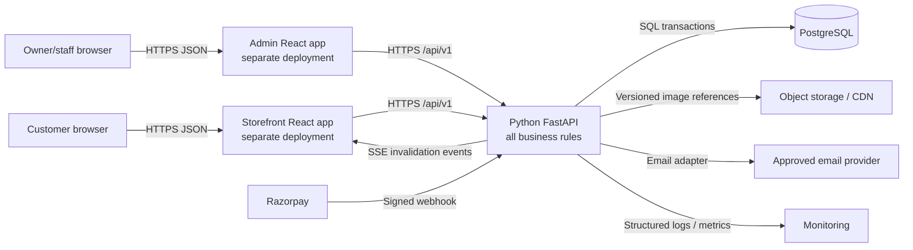
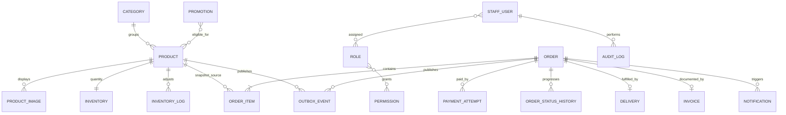
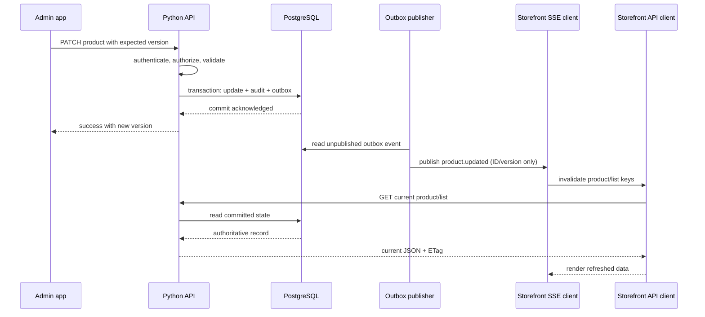
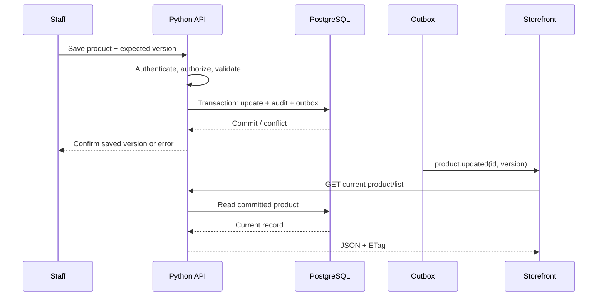
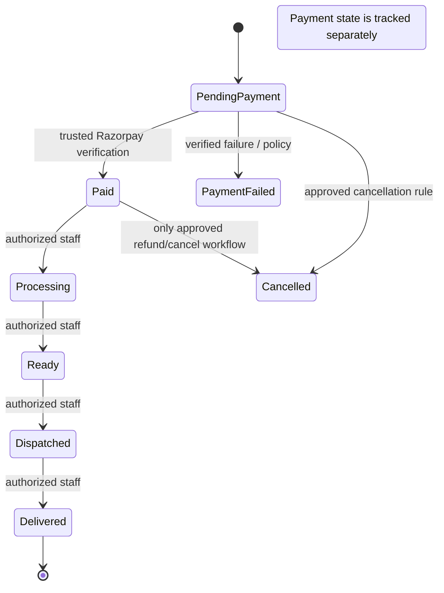
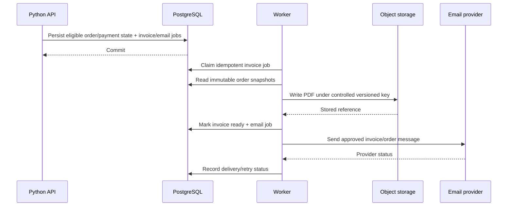
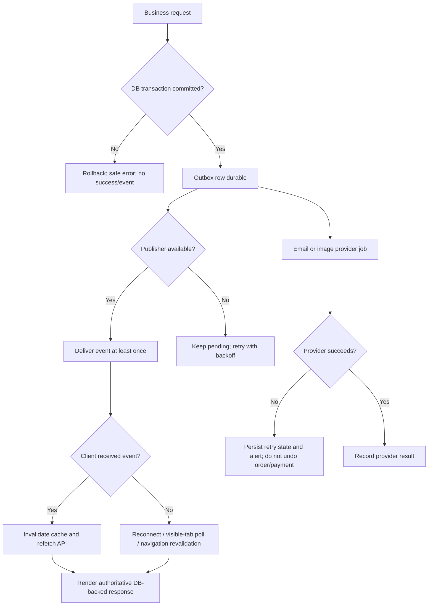

# VedhicFoods Backend Specification

## 1. Document Control

| Field | Value |
|---|---|
| Document ID | VF-BACKEND-001 |
| Version | 1.0 |
| Status | Draft for owner review; not an implementation approval |
| Purpose | Specify the Python-only backend target and the migration boundary from the verified repository implementation |
| Audience | Product owner, Python backend engineers, database engineers, frontend engineers, security/operations reviewers |
| Related documents | [PRD](PRD.md), [TRD](TRD.md), [App Flow](APP_FLOW.md), [UI/UX Design Brief](UI_UX_DESIGN_BRIEF.md) |
| Approval | Product owner approval pending; technical decisions marked proposed remain subject to review |

This is Document 5 in the documentation set. Document 6, `IMPLEMENTATION_PLAN.md`, is deliberately not part of this task.

Evidence labels used below:

- **VERIFIED EXISTING**: present in repository source/configuration; this does not prove live deployment or successful operation.
- **PROPOSED**: target behavior/technology specified here, not yet implemented or approved unless expressly stated.
- **PENDING CONFIRMATION**: business decision needed before implementation.
- **NOT VERIFIED**: repository inspection did not establish deployed/live status.
- **MISMATCH**: existing implementation conflicts with the owner-confirmed intended behavior or the Python-only target.

## 2. Executive Summary

VedhicFoods needs one Python backend API serving two independently deployed React applications: the public customer storefront and the protected admin dashboard. The storefront is guest-first: customers browse and buy without customer registration or sign-in. Admin and staff authentication remain required. Razorpay is the only initial payment method; COD is out of scope. Staff update fulfillment manually and customers see a status timeline, not live GPS.

The target backend owns all business decisions: permissions, catalog, price and promotion calculations, stock validation, orders, payment verification, invoices, notifications, audit, and persistence. PostgreSQL is the durable source of truth. When authorized staff save a change, it is committed first; storefront pages revalidate and, for already-open pages, receive a lightweight event that causes them to fetch the current API record. No frontend redeployment is required for catalog/content changes.

**VERIFIED EXISTING:** backend behavior is currently implemented in Node.js/TypeScript/Express and database access uses PostgreSQL/Prisma. **MISMATCH:** this does not meet the Python-only target in the TRD. This document defines a migration target and compatibility requirements; it does not migrate code or replace the existing schema.

## 3. Existing Architecture Audit

| Area | Repository evidence | Status and target implication |
|---|---|---|
| Customer frontend | React 19, TypeScript, Vite in `frontend/`; customer routes in `frontend/src/routes/` | **VERIFIED EXISTING**; retain presentation and finalized UI/UX. No redesign is specified here. |
| Admin frontend | Separate React/TypeScript/Vite app and routes in `admin/` | **VERIFIED EXISTING**; owner confirms it is deployed separately from storefront. Production origins **NOT VERIFIED**. |
| Backend | `backend/src/`, TypeScript controllers/services/routes; Express dependency and Node 22 Dockerfile | **VERIFIED EXISTING; MISMATCH** to Python-only target. Migration required; no source edits in this task. |
| API | Versioned `/api/v1` routes; route files include product, category, cart, checkout/order, payment, admin, inventory, delivery, invoices, staff, settings, contact, support, content and events | **VERIFIED EXISTING** paths where noted in Section 8. Existing contracts need capture and parity review during migration. |
| Database | PostgreSQL schema in `database/prisma/schema.prisma`; migration history in `database/prisma/migrations/` | **VERIFIED EXISTING**. This schema and migration history are the migration source of truth until an approved schema change plan exists. |
| Existing model families | User/RBAC, customer profile/address, catalog/media/inventory, cart, order/payment, coupons/promotions, invoice/delivery, notifications/support/contact, settings, audit/session tokens, content | **VERIFIED EXISTING** names; exact fields/constraints must be mapped from Prisma before Python migrations. |
| Authentication | Current Node routes include customer register/login and admin login; JWT/access/refresh and order access middleware exist | **VERIFIED EXISTING; MISMATCH** for customer registration/account flows, which are excluded by current owner direction. Preserve admin/staff auth and secure guest order access. |
| Payment | Razorpay integration code, create/verify/webhook routes | **VERIFIED EXISTING** code. Live merchant configuration and production readiness **NOT VERIFIED**. |
| Email | SES and Brevo adapter/queue/retry components | **VERIFIED EXISTING** code. Sender verification and live delivery **NOT VERIFIED**. |
| Image storage | S3 integration and presigned upload routes | **VERIFIED EXISTING** code. Bucket, CDN and live permissions **NOT VERIFIED**. |
| Realtime | SSE `/api/v1/events` code and admin realtime client | **VERIFIED EXISTING** mechanism. Product/catalog event coverage and production multi-instance delivery **NOT VERIFIED**. |
| Deployment | AWS/Docker/ECS/CloudFormation/runbook files | **VERIFIED EXISTING** configuration artifacts. AWS deployment state, DNS, TLS, BigRock DNS and live origins **NOT VERIFIED**. |
| Tests | Backend Vitest tests and root test reports are present | **VERIFIED EXISTING** test artifacts; this task did not run tests and makes no pass claim. Python target tests are proposed in Section 26. |

Current repository customer auth routes and screens (`/login`, `/register`, `/account`) conflict with the latest instruction. They are not part of the target customer experience. Their removal/disablement belongs to a separately approved implementation task. Do not treat customer registration as necessary for checkout.

## 4. Target Architecture

All server-side business logic runs in Python. The storefront and admin remain separate frontend deployments and call the same HTTPS API. PostgreSQL is private to the API. Razorpay, email, and object storage are outbound integrations; Razorpay webhooks enter through a narrowly scoped API endpoint.



**Request lifecycle:** ingress enforces TLS and request-size limits; FastAPI assigns/accepts a request ID, validates schema, authenticates, authorizes, invokes a service transaction, serializes a safe response, then records duration/result. Integration calls are made outside or after the database transaction where appropriate; durable work is queued through persisted records/outbox rather than held in a database transaction while waiting on a provider.

**Trust/failure boundaries:** browsers are untrusted; only API-computed amounts and permissions are authoritative. Razorpay is trusted only after signature verification and reconciliation. The database commit is the persistence boundary. Email, SSE delivery, object storage, and CDN are independently failing systems. Admin and storefront origins are separate and must both be explicitly configured in CORS; actual hostnames remain **NOT VERIFIED**. The admin-to-storefront link must use the configured storefront origin, not a relative `/` on the admin host.

## 5. Python Technology Stack

| Component | Target recommendation | Status / reason |
|---|---|---|
| Runtime | CPython 3.12+ | **PROPOSED**, consistent with TRD; verify supported AWS runtime/image at implementation. |
| HTTP framework | FastAPI | **PROPOSED**, consistent with TRD; typed routes, dependency injection and OpenAPI. Django REST Framework is an alternative but would conflict with the existing TRD recommendation. |
| Validation | Pydantic 2 | **PROPOSED**; request/response contracts and safe serialization. |
| Database | PostgreSQL | **VERIFIED EXISTING** database design; retain as proposed target database. Managed hosting choice **PENDING CONFIRMATION**. |
| ORM / migrations | SQLAlchemy 2.x / Alembic | **PROPOSED**, consistent with TRD. Map current Prisma schema first; do not create competing tables or reset history. |
| Testing | pytest, HTTPX; pytest-asyncio only if async database/IO is selected | **PROPOSED**, consistent with TRD. |
| Payment | Razorpay official Python SDK or carefully scoped signed HTTP integration | **PROPOSED**; pin/version-review package at implementation. Server verifies all trusted transitions. |
| AWS integrations | boto3 where AWS services are approved | **PROPOSED**; role-based credentials, no keys in source or browser. |
| PDF | Python PDF library selected after invoice layout/legal rules are approved | **PENDING CONFIRMATION**; no package selection implied. |

Prefer synchronous SQLAlchemy initially unless measured concurrency requires async. Keep provider adapters behind service interfaces so provider changes do not infect domain logic. No package installation is part of this documentation task.

## 6. Python Project Structure

Proposed layout (not present today):

```text
python-backend/
  app/main.py                 # app factory, lifespan, router registration
  app/core/                   # config, logging, IDs, security primitives
  app/api/v1/                 # HTTP routers and dependency wiring
  app/schemas/                # Pydantic request/response contracts
  app/models/                 # SQLAlchemy persistence mappings
  app/repositories/           # queries and persistence; no HTTP concerns
  app/services/               # business rules and transaction orchestration
  app/auth/                   # staff sessions, permission dependencies, guest tokens
  app/integrations/           # Razorpay, email, object storage adapters
  app/modules/{catalog,inventory,orders,payments,promotions,invoices}/
  app/events/                 # transactional outbox, SSE publisher/subscriber
  app/middleware/             # request ID, CORS boundary, limits, security headers
  app/errors/                 # domain errors and API exception mapping
  alembic/                    # reviewed database migrations
  tests/{unit,integration,contract,e2e}/
```

Routers handle HTTP translation only; services own business rules and transaction boundaries; repositories isolate query details; models encode persistence constraints; schemas prevent accidental field exposure. Integrations never decide local authorization or order state. Event consumers fetch/emit identifiers and versions, not customer secrets. Dependencies should flow inward toward domain services and repositories; services must not import frontend or route components.

## 7. API Standards

- Prefix versioned resources with `/api/v1`. Preserve existing paths where frontend compatibility requires it; new path changes require contract/version review.
- JSON request and response bodies use UTF-8, snake_case on the wire unless a compatibility contract requires existing casing. UTC RFC 3339 timestamps; display timezone is a frontend concern.
- Money is represented as decimal strings with explicit currency (initial currency **PENDING CONFIRMATION**; do not assume tax treatment). Never use binary float for calculations. DB uses fixed precision numeric or integer minor units consistently; migration mapping decides which.
- Lists use bounded `limit` plus opaque/offset cursor as justified; maximum page size proposed 100. Stable sort includes a unique tie-breaker. Filters are allowlisted.
- Mutating create/payment endpoints accept `Idempotency-Key`; store scope, key, request hash and result atomically for a bounded retention window. Payment-provider event IDs have unique constraints.
- Include `X-Request-ID` in response; accept a validated client correlation ID or generate one. Do not trust it for authorization.
- Public mutable catalog endpoints may use short-lived validators (ETag/Last-Modified) and `Cache-Control: public, max-age=0, must-revalidate`; private/admin/order/payment responses use `private, no-store`. Exact TTL and CDN rules are proposed in Section 17.
- Rate-limit login, checkout, guest order access, contact/newsletter, upload signing, and payment initiation. Return `429` and `Retry-After` where applicable.
- OpenAPI generated by FastAPI is for internal/client integration; production exposure/access policy **PENDING CONFIRMATION**.
- Compatibility: do not silently remove fields or change meaning within v1; add optional fields first. Existing Express API behaviors must be contract-tested during migration.

Proposed error envelope:

```json
{"error":{"code":"OUT_OF_STOCK","message":"One or more items are unavailable.","request_id":"...","details":[{"field":"items[0].quantity","issue":"exceeds_available"}]}}
```

No raw SQL, stack trace, provider secret, or internal hostname is returned.

## 8. Complete API Catalogue

Paths below marked **Existing path** are verified in current route source and therefore are not claims about Python implementation. Paths marked **Target path** are proposed Python API contracts. Existing route behavior may differ; compatibility/migration tests are required. Common responses: `200`/`201` success; `400` malformed request; `401` unauthenticated; `403` forbidden; `404` absent or intentionally concealed; `409` state/version/idempotency conflict; `422` validation/business-rule error; `429` rate limited; `502/503` dependency unavailable. All write endpoints audit sensitive actions and use transaction/outbox policy as applicable.

### 8.1 Public storefront APIs

| API ID | Method/path | Access; request/validation | Result, effects and controls |
|---|---|---|---|
| API-PUB-001 | GET `/api/v1/products` (**Existing path**) | Public; proposed `category`, `q`, `availability`, `sort`, `cursor`, `limit`; allowlisted filters | Active/public product cards, paging and ETag; no DB change; public catalog revalidation. Errors 400/429/503. |
| API-PUB-002 | GET `/api/v1/products/{id}` or `/slug/{slug}` (**Existing path**) | Public; stable ID/slug | Current public product, images, category, displayed price/availability; no secrets; ETag. 404 if not public. |
| API-PUB-003 | GET `/api/v1/categories`, `/categories/slug/{slug}` (**Existing path**) | Public; paging where needed | Visible categories and current listing relationship. Public cache revalidation. |
| API-PUB-004 | GET `/api/v1/promotions/active` and `/promotions/slug/{slug}` (**Existing path family**) | Public | Only active, eligible public promotions; server computes display eligibility. Revalidate after event/focus. |
| API-PUB-005 | GET `/api/v1/content/faqs`, `/testimonials` (**Existing paths**) | Public | Published content only; content freshness validator; no write. |
| API-PUB-006 | GET/POST `/api/v1/cart` resource operations (**Existing route family**) | Guest session/cart token target; item SKU and positive quantity | Cart is advisory; return current product snapshots and calculated preview. No client amount authority. Current implementation path specifics verified in `cart.routes.ts`; guest/session contract needs migration design. |
| API-PUB-007 | POST `/api/v1/orders/checkout` (**Existing path**) | Public guest; idempotency key; contact, delivery address, item IDs/quantities, accepted terms if approved | Reprice, recheck stock/promo, create order/payment attempt or checkout result. No customer account required. DB transaction and inventory policy; 409/422 on conflicts; strict rate limit. |
| API-PUB-008 | POST `/api/v1/payments/razorpay/order` (**Existing route family**) | Guest scoped order credential; order reference | Create provider order using server amount; persist attempt/idempotency. Never accept authoritative amount from client. |
| API-PUB-009 | POST `/api/v1/payments/razorpay/verify` (**Existing route family**) | Guest scoped credential; provider order/payment IDs and signature | Verify signature server-side, compare order/amount/currency, persist idempotently; no client claim alone can mark paid. |
| API-PUB-010 | GET `/api/v1/payments/status/{orderId}` (**Existing path family**) | Scoped guest order credential | Minimal own payment/order status; `no-store`; access token never logged. |
| API-PUB-011 | GET `/api/v1/orders/{orderRef}` and `/delivery` (**Existing path family**) | Guest order access token; secure lookup mechanism **PENDING CONFIRMATION** | Authorized order summary/timeline only; no enumeration; `no-store`, strict rate limit. Sequential order number alone is insufficient. |
| API-PUB-012 | POST `/api/v1/contact`, `/newsletter` (**Existing route families**) | Public; validated fields/consent | Store submission/subscriber; rate-limit, spam controls, provider failures do not misreport saved state. |

### 8.2 Admin APIs

| API ID | Method/path | Access; request/validation | Result, effects and controls |
|---|---|---|---|
| API-ADM-001 | GET `/api/v1/admin/dashboard` (**Existing path**) | Staff `reports.read` | Aggregate summaries, bounded query; no customer PII unless needed. |
| API-ADM-002 | GET/POST/PATCH/DELETE `/api/v1/admin/products[/{id}]` (**Existing paths**) | `products.read/create/update/delete`; fields validated, optimistic version required in target | Persist/archive product; audit; outbox product event; invalidate catalog validators; idempotency for create. 409 stale version. |
| API-ADM-003 | GET/POST/PATCH/DELETE `/api/v1/admin/categories[/{id}]` (**Existing paths**) | `categories.*`; slug uniqueness and visibility validation | Persist and publish category/listing invalidation. Deletion with referenced products is conflict/archive policy. |
| API-ADM-004 | GET/PATCH/POST `/api/v1/inventory`, `/{productId}`, `/{productId}/adjust` (**Existing paths**) | inventory permission; quantity delta/reason/version | Atomic stock adjustment and immutable adjustment log; outbox availability event; prevent negative stock except separately approved policy. |
| API-ADM-005 | GET/POST/PATCH/DELETE `/api/v1/admin/promotions` and `/api/v1/admin/discounts` (**Existing route families**) | promotion/discount permission; dates/value/eligibility validation | Persist campaign, audit and emit affected listing/pricing invalidation; stacking policy remains pending. |
| API-ADM-006 | GET `/api/v1/admin/orders` and `/orders/{id}` (**Existing path family**) | `orders.read`; bounded filters/paging | Order and minimal contact details per permission; `no-store`; access logged. |
| API-ADM-007 | PATCH/PUT `/api/v1/admin/orders/{id}/status` (**Existing equivalent update route**) | `orders.update`; target transition, reason, current version | Manual fulfillment transition, history, audit, outbox private status event and optional notification job. Payment status separate. |
| API-ADM-008 | GET `/api/v1/admin/customers` (**Existing path**) | `customers.read`; exact role matrix pending | Minimal operational fields; log access; no bulk export unless separately approved. |
| API-ADM-009 | GET/POST/PATCH/DELETE `/api/v1/staff[/{id}]`; PATCH `/{id}/permissions` (**Existing paths**) | staff permission; owner-only boundary pending | Invite/create, disable/update role grants; audit; no customer accounts. Password reset/invitation policy pending. |
| API-ADM-010 | GET `/api/v1/invoices`, `/order/{id}`, `/{id}/download`; POST regenerate/cancel (**Existing paths**) | staff permission or scoped order access | Authorized invoice metadata/PDF; audit mutating actions; `no-store` for download authorization. Legal fields pending. |
| API-ADM-011 | GET/PUT `/api/v1/admin/payment-settings` (**Existing paths**) | settings permission; secrets cannot be returned | Non-secret merchant configuration; secret rotation via secure secret store only. |
| API-ADM-012 | GET `/api/v1/audit-logs`, `/api/v1/inventory/{productId}/history` (**Existing paths**) | `audit_logs.read` / inventory read | Paginated immutable audit history; sensitive values redacted. |

### 8.3 Authentication and integration APIs

| API ID | Method/path | Access; validation | Result / safeguards |
|---|---|---|---|
| API-AUTH-001 | POST `/api/v1/admin/auth/login` (**Existing path**) | Admin/staff only; generic failure response, login throttling | Establish staff session; proposed secure HttpOnly, Secure, SameSite cookie preferred for browser apps. Token migration/CSRF design must be compatible with current clients. |
| API-AUTH-002 | POST `/api/v1/admin/auth/logout` (**Target path**) | Staff session | Revoke session/refresh token, clear cookie; idempotent. |
| API-AUTH-003 | GET `/api/v1/admin/auth/me` (**Existing path**) | Staff session | Identity and effective permissions for UI only; every action rechecks server-side. |
| API-AUTH-004 | POST `/api/v1/admin/auth/refresh` (**Target path**) | Valid refresh session, rotation | Rotate/revoke token family; detect reuse. Customer login/register APIs are not target APIs. |
| API-INT-001 | POST `/api/v1/payments/razorpay/webhook` (**Existing path**) | Razorpay signature over raw body | Verify before parse/trust; unique provider event ID; acknowledge duplicate safely after durable processing. |
| API-INT-002 | POST `/api/v1/admin/products/{id}/images/upload-intent` (**Existing equivalent presigned URL**) | Staff `products.update`; file metadata allowlist/size | Short-lived scoped upload URL or Python streaming upload; finalize endpoint verifies object then stores DB reference. No arbitrary key/path. |
| API-INT-003 | GET `/api/v1/events` (**Existing SSE path**) | Public channel limited to non-sensitive catalog events; staff/private stream separate | SSE invalidation only; event IDs/reconnect. Do not put bearer secrets in query strings. Existing query-token design requires security review during migration. |
| API-INT-004 | POST `/api/v1/internal/email-events` (**Target/internal**) | Provider signature or internal IAM | Record delivery/bounce event idempotently; no public client access. |
| API-INT-005 | GET `/health/live`, `/health/ready` (**Existing route family**) | Infrastructure | Liveness and dependency readiness; no secrets or detailed infra returned publicly. |

**Target write rules:** product/category/promotion/inventory writes use DB transaction plus transactional outbox row. Order/payment state writes use idempotency key/provider event ID and database constraints. Events invalidate/revalidate; they never carry authority for price, stock, permission, or payment. Upload URLs are short-lived; all endpoints enforce API-side permissions regardless of visible admin navigation.

## 9. Database Design

PostgreSQL is **VERIFIED EXISTING** and the target database per TRD. The following is a logical target model, not a replacement DDL. Existing Prisma fields, enum values, nullability and migrations must be mapped field-by-field before Alembic is introduced. Numeric precision, currency, seller/tax data and retention periods requiring legal/product decisions remain **PENDING CONFIRMATION**.

| Logical entity | Purpose and key fields (types indicative/proposed) | Integrity, relationships and privacy |
|---|---|---|
| Product | UUID/ID, slug, name, description, active/visibility state, price fixed decimal, currency, version, timestamps | Unique slug; nonnegative price; indexed visibility/category; references category; no hard delete after order use. Public fields only. |
| Category | ID, unique slug, name, display order, visibility, version, timestamps | Referenced by products; archive/deactivate if referenced; category visibility controls listing. |
| ProductImage | ID, product ID, object key/URL, alt text, sort order, primary flag, asset version | FK product; unique ordering/one primary enforced transactionally; object key private from user input. |
| Inventory | Product ID, on-hand quantity, reserved quantity only if reservation policy approved, version | Nonnegative checks and atomic conditional decrement; FK product; index low-stock query. |
| InventoryLog | ID, product ID, delta, resulting quantity, reason, actor ID, order reference, created time | Append-only audit of stock changes; FK product/actor; restricted read. |
| Promotion / Coupon | ID, code/slug, type, value, active flag, dates, eligibility, usage constraints | Unique normalized code; fixed-decimal values; join tables for product/category scope where needed; stacking and timezone rules pending. |
| GuestOrderContact | Order ID, name, email, phone, address fields/snapshot | Order-scoped PII; least-privilege access, encrypted transport/storage controls, retention pending; never public event payload. Existing `Order`/`Address` may cover this. |
| Order | ID, public reference, state, payment state, currency, subtotal/discount/shipping/tax/total snapshots, contact/address snapshot, idempotency reference, version, timestamps | Unique public reference/idempotency scope; checks that totals reconcile; no dependence on current Product values. Existing `Order` model is migration source. |
| OrderItem | ID, order ID, product reference nullable, name/SKU/price/quantity/discount snapshots | FK order; immutable after payment except audited correction; product deletion cannot change historical line. |
| PaymentAttempt / Payment | ID, order ID, provider, provider order/payment/event IDs, amount/currency, status, signature-verification metadata, timestamps | Unique provider IDs; amount matches order; no card data/secrets; transition constraints and idempotency. Existing `Payment` model likely maps. |
| OrderStatusHistory | ID, order ID, old/new fulfillment state, actor, reason, timestamp | Append-only; FK order/actor; separate payment lifecycle. Existing delivery history can be mapped. |
| Delivery | Order ID, manual status, optional carrier/reference if approved, updated time | No GPS tracking; delivery address remains private. |
| Invoice | ID, order ID, invoice number only after numbering policy, status, document object key, generated timestamp, snapshot version | Unique order/number subject to policy; immutable issued copy; legal fields and numbering pending. |
| StaffUser / Role / Permission / grants | Existing User, Role, Permission, UserRole, RolePermission, UserPermission concepts | Unique normalized identity, least privilege, disabled state, password hash; audit role changes. Remove customer registration from target flows without assuming old customer rows can be deleted. |
| AuditLog | ID, actor, action, resource type/ID, request ID, limited before/after diff, timestamp | Append-only; redact secrets/PII; index actor/resource/time; retention policy pending. |
| Notification / EmailDelivery | ID, order/event relation, template key, recipient reference, provider ID, status, attempts, timestamps | Dedup key unique; minimize retained address/body; provider failure independent of order commit. |
| OutboxEvent | ID, aggregate type/ID/version, event type, minimal payload, created/published time, attempt count | Insert in same DB transaction as business change; unique aggregate version/event as appropriate; retained for replay window, then prune under policy. No PII in public events. |
| Cart | Guest session token hash, expiry (if approved), timestamps | Optional anonymous persistence; exact cookie/local ownership and expiry pending. Do not tie to customer account. |

ER diagram (logical target):



**Migration/transaction rules:** preserve existing PostgreSQL data and migration history. First map schema and constraints; only then add Alembic ownership in an approved migration plan. Do not have Prisma and Alembic independently mutate the same schema during a live cutover. Product update transaction includes product/media reference, audit and outbox. Order creation transaction includes order/item snapshots and inventory decrement/reservation policy; external payment API call is not part of a long-held SQL transaction. Payment webhook transaction records unique event and payment/order state together. Use FK constraints, unique provider/idempotency keys, nonnegative stock checks, and row locks or conditional updates for contested stock.

## 10. Product and Category Management

Staff create/edit only through authenticated, permission-checked API. Validate required name/slug, normalized unique slug, permitted price precision/currency, category state, image references, and visibility. Product states should distinguish draft/active/archived if supported by existing enum; confirm exact mapping. Public APIs expose only publishable products and their safe fields. Deletion is an archive/soft-delete when order history or references exist.

Use an integer `version` or `updated_at` optimistic concurrency check: admin edit submits the version it read; stale save returns `409 VERSION_CONFLICT` with current version, requiring the UI to reload/resolve rather than overwrite another staff member's change. A successful commit writes audit and outbox entries. Category updates invalidate category lists and affected product listings. Image update commits the new versioned object reference only after upload verification. Storefront revalidates on route entry, focus and event; checkout always reads current values.

## 11. Inventory and Stock Consistency

Database quantity is authoritative. Product-card availability is informational and may be stale. Cart does not reserve stock unless an approved hold policy is implemented. At checkout, within a transaction, lock or atomically conditionally decrement each relevant inventory row (`available >= requested`), in deterministic product-ID order; if any item fails, roll back all changes and return an actionable unavailable/quantity error. For multi-item checkout, no partial order is created.

**Reservation/hold policy: PENDING CONFIRMATION.** Simplest target is decrement-on-order-creation and restore only on an approved cancellation/payment-failure transition, with carefully idempotent compensation. Whether stock should be held while Razorpay is pending, and for how long, is unresolved. Do not invent expiry. Every adjustment has actor/reason log and version; prevent negative values. Concurrent last-unit purchases must result in at most one successful allocation. Reconciliation identifies stale pending orders without silently changing policy.

## 12. Pricing, Discounts, and Promotions

Price, eligible promotion and payable total are calculated by Python from committed records at checkout; frontend values are display hints. Store order-line name/SKU/unit price/discount and totals as immutable snapshots. Use decimal arithmetic and one explicit rounding policy at currency minor-unit precision. Changing current product price never rewrites historical orders/invoices.

Promotions must be active, within approved time window, eligible for item/category, and satisfy usage constraints. Start/end timezone semantics, coupon stacking/priority, discount on shipping/tax, usage limits and tax-inclusive/add-on behavior are **PENDING CONFIRMATION**. Until approved, implementation must not infer stacking. Promotion enable/disable/eligibility updates are transactional and invalidate affected price/list data. Checkout rechecks all predicates and returns a `409/422` recalculation response when a displayed offer is no longer valid.

## 13. Cart, Guest Checkout, and Orders

Customer checkout requires no customer account. Target guest cart can be client-held item identifiers or a server cart addressed by a high-entropy anonymous session token; which persistence strategy and expiry are **PENDING CONFIRMATION**. In both cases, client-submitted names, prices, discounts, stock, and totals are ignored and recomputed by API.

Guest checkout collects only confirmed contact/delivery fields. It validates address coverage and delivery fees once those policies are confirmed. An idempotency key plus request hash prevents duplicate orders after retries; same key/different payload returns conflict. Generate an opaque public order reference separate from internal primary key. Return scoped access credential through a safe channel (secure cookie or one-time token not placed in referrer/logs); exact guest lookup mechanism and token lifetime remain **PENDING CONFIRMATION**. Sequential order number alone is never authorization.

Order item snapshots preserve purchase-time product facts. Fulfillment and payment states are separate. Order creation, stock allocation and payment initiation failure handling must be deterministic and reversible through idempotent state transitions. Customer registration, profile, saved-address and account history APIs are not part of the target customer flow. Existing customer tables may remain during migration pending data-retention decision.

## 14. Razorpay Payment Integration

Only Razorpay online payment is in initial scope; UPI availability depends on the merchant account. COD is excluded. Python creates the Razorpay order from server-computed amount/currency and stores an attempt. The browser receives only public provider identifiers and checkout data; no secret key. On return, Python verifies provider signature and cross-checks local order, amount, currency and provider order ID. Webhooks are independently signature-verified over raw bytes and are the durable reconciliation input.

Payment state transitions are idempotent and monotonic where possible; duplicate webhook event IDs are acknowledged after the first durable application. A frontend success redirect is not proof of payment. Pending/delayed events remain pending until trusted confirmation/reconciliation. A failed attempt does not automatically imply fulfillment cancellation unless policy says so. Refund/cancellation behavior and gateway settlement reconciliation schedule are **PENDING CONFIRMATION**. Persist provider request/event IDs and safe diagnostic codes, never secret/signature values or full sensitive payloads. Alert on amount mismatch, invalid signatures, prolonged pending state and provider outage.

## 15. Order Lifecycle and Manual Delivery Management

Payment state (for example pending/authorized/paid/failed/refunded) and fulfillment state (for example received/processing/ready/dispatched/delivered/cancelled) are distinct. Exact enum mapping and allowed transitions must be reconciled against current enums and owner policy. No live GPS.

Staff update delivery/order status manually with `orders.update` (or approved granular permission), expected version, optional reason, and an audit actor. Service checks transition and current version in transaction, appends immutable history, writes outbox notification event, commits, then notification worker sends only approved messages. Invalid/backward transitions return `409`. Customer timeline exposes only safe status, customer-visible timestamp and approved message through scoped guest access. Two simultaneous edits cannot silently overwrite each other.

## 16. Admin Authentication and Staff Authorization

Only owner and individually managed staff use admin authentication. No public customer registration/login in target. Hash passwords with a modern adaptive password hash (Argon2id preferred, exact library/parameters selected at implementation); never store plaintext. Prefer Secure, HttpOnly, SameSite cookies for browser sessions, short access lifetime, refresh rotation/revocation and CSRF protection for cookie-authenticated writes. If migration must retain bearer tokens temporarily, document transition and ensure browser storage exposure is minimized.

Every protected request validates session, active staff state and permission server-side. UI hiding is not authorization. Denials are 403 (or concealed 404 for sensitive records, consistent policy). Rate-limit login; generic errors avoid account enumeration; log failed attempts without password/token. Session lifetime, MFA requirement, password reset/invitation channel and owner recovery are **PENDING CONFIRMATION**. Current model has Role/Permission/UserRole/RolePermission/UserPermission; use it as migration source. Exact role matrix and owner-only actions remain **PENDING CONFIRMATION**. Log changes to roles, staff status, customer access, payments/refunds and order status.

## 17. Database-Driven Storefront Synchronization

### 17.1 Source of truth and cache policy

PostgreSQL is authoritative for persistent business state. Successful admin UI response means the API confirms its database transaction committed. A local optimistic form state is provisional until success. Client cache never decides final price, stock, promotion, payment or status. If event delivery fails, the page refetches on navigation/focus and checkout reads fresh server data.

| Data type | Authoritative source | Update trigger | Cache action | Frontend response | Recovery |
|---|---|---|---|---|---|
| Product details/list | DB via Python API | Product saved/archived | ETag, `max-age=0, must-revalidate`; invalidate affected product/list queries | Refetch affected records on event | Refetch route entry/focus/periodic fallback |
| Price | DB via Python API | Price/promotion change | Invalidate dependent price/list cache | Display latest server value | Checkout always recalculates |
| Stock | DB via Python API | Inventory adjustment/order allocation | No long-lived availability cache; event invalidation | Refresh indicator | Checkout atomic validation |
| Image | Object storage plus DB reference | Image replacement | New versioned object URL/key; short metadata revalidation | Use new ref after data fetch | Retry load; fallback image on failure |
| Category | DB via Python API | Category saved/visibility change | Invalidate category and product listing ETags | Refresh nav/listing data | Refetch on navigation/focus |
| Promotion | DB via Python API | Promotion activated/edited/expired | Invalidate impacted listing/prices | Re-render current eligibility | Checkout re-evaluates |
| Order status | DB via Python API | Authorized status update | Private `no-store` | Re-fetch own timeline | Refetch on focus and reconnect |

Admin and private customer/payment APIs: `Cache-Control: private, no-store`. Public catalog JSON: proposed revalidation-first policy with ETag and optional small shared-cache TTL only after measured need; CDN must respect validators and purge/version rules. Images are immutable/versioned URLs; changing the DB image reference makes the new URL current. Never rely on browser cache purge alone. Exact public catalog TTL and CDN settings are **PROPOSED** and require deployment review.

### 17.2 Selected strategy

**PROPOSED:** request revalidation plus SSE invalidation for already-open storefront pages. Revalidate on page/navigation entry, browser `visibilitychange` to visible, and relevant user action. As a fallback, visible product/listing pages poll a lightweight catalog version endpoint every 30 seconds (proposed interval); pause while hidden and abort when unmounted. Polling only the version avoids repeated full payloads. SSE gives faster updates without bidirectional complexity; WebSockets are not justified for one-way cache invalidation. Checkout remains authoritative regardless of UI freshness.

Use SSE resource events `product.updated`, `product.availability_changed`, `category.updated`, `promotion.updated`, `inventory.updated`; exact event names are **PROPOSED**. Payload includes event ID, resource type, opaque resource ID, monotonically increasing version and timestamp only. No customer information, address, order reference, price/stock authority or credentials on public stream. On event, frontend invalidates query keys and fetches canonical GET. Private order status uses a separately authorized, scoped channel only if implemented; otherwise request revalidation. Do not use bearer tokens in query parameters. Prefer same-site secure session cookie or a short-lived one-use stream ticket if private SSE is approved.

### 17.3 Reliable lifecycle and failure handling



Numbered lifecycle: (1) admin opens edit and fetches current version; (2) staff edits form; (3) app submits with expected version/idempotency key; (4) Python authenticates; (5) Python checks permission; (6) schema/business rules validate; (7) one DB transaction updates business rows, appends audit entry and inserts outbox event; (8) only after commit does API return success; (9) publisher delivers event at least once; (10) connected storefront invalidates and refetches canonical API data; (11) image change references a new versioned asset; (12) later focus/navigation/version polling repairs missed events; (13) DB failure rolls back and returns error, so UI keeps unsaved state and does not report success.

The outbox avoids “DB committed but event permanently lost”: business update and outbox insert commit atomically. Publisher retries with backoff and idempotent event ID. Use PostgreSQL `LISTEN/NOTIFY` only as a wake-up hint, not durable delivery; poll unpublished outbox rows as recovery. Each API instance manages its own SSE clients and publisher/listener; every instance must observe outbox events, using DB polling/notifications or a managed broker only if measured scale requires it. SSE `Last-Event-ID` can replay retained events; if cursor expired or replay fails, client performs full revalidation. Bound connection count/timeouts and heartbeat. Outbox retention/replay window and poll cadence are **PROPOSED** operational parameters.

## 18. Image Upload and Storage

Current S3 integration/presigned URL code is **VERIFIED EXISTING**, live bucket and CDN **NOT VERIFIED**. Target storage provider is AWS object storage **PROPOSED**, consistent with intended AWS deployment. Admin first requests a short-lived upload intent after permission and metadata checks, uploads to a generated key, then finalizes. Backend verifies object ownership, size and detected content before linking it to product. Allow JPEG, PNG and WebP only unless content team approves more; proposed 10 MiB maximum per image, subject to owner confirmation. Validate magic bytes/MIME, reject SVG/HTML/executable content, strip metadata where practical, use malware scanning where service is available. Bucket is private-write; public reads use controlled CDN/public object delivery without exposing credentials. New content-addressed/versioned key prevents stale CDN image. Failed upload leaves old DB reference intact; orphan cleanup is scheduled and age-gated. Delete old object only after reference switch and retention check.

## 19. Invoice Generation

Invoice is generated from immutable order/item/totals snapshots, never current catalog values. Generate on an approved trigger (likely verified payment or explicitly approved order state); exact trigger, tax inclusion, seller legal details, invoice number sequence, tax IDs, required fields and cancellation/refund documents are **PENDING CONFIRMATION**. Do not fabricate these facts.

Create invoice record idempotently, render PDF using selected Python library to private/controlled object storage, store document version/key and generation status, then expose authorized download with short-lived access URL or streamed response. Regeneration must not silently alter an issued invoice; corrected document policy is pending. A4 print layout is a presentation requirement; tax/legal compliance review is required before issuance. Failure marks generation retryable and does not reverse payment/order. Customer access requires guest order credential; staff access permission and audit. Historical document remains unchanged after product edits.

## 20. Email and Notification Services

Existing code has SES/Brevo adapters and retry/dedup components (**VERIFIED EXISTING**); live provider/sender **NOT VERIFIED**. Target provider interface isolates templates and delivery. AWS SES is **PROPOSED**, not selected as live provider. Candidate events: order confirmation after order persistence/payment policy, invoice ready, and status update only after notification rules approved. Persist an idempotent notification job keyed by business event/template/recipient, attempt with capped exponential backoff and dead-letter/alert after policy limit. Record provider message ID/status and redact content/recipient in general logs.

Email failure never rolls back a committed order or trusted payment. Retry must not create duplicate order/payment or duplicate customer-visible email where provider idempotency is unavailable; use send ledger and deterministic event key. Consent, required transactional templates, sender identity, locale and notification timing are **PENDING CONFIRMATION**.

## 21. Validation and Error Handling

| Condition | HTTP/code | Behavior |
|---|---|---|
| Invalid field or business input | 422 `VALIDATION_ERROR` | Field-level safe details; do not echo secrets. |
| Missing/non-public resource | 404 `NOT_FOUND` | Conceal sensitive existence consistently. |
| Stale edit, invalid transition, duplicate key with different payload | 409 `CONFLICT` / `VERSION_CONFLICT` | Include current version/state only if caller is authorized. |
| No/expired admin or guest credential | 401 `UNAUTHENTICATED` | No internal auth detail. |
| Authenticated user lacks permission | 403 `FORBIDDEN` | Generic safe message; audit protected denials as policy permits. |
| Stock unavailable or price/promo changed | 409/422 `OUT_OF_STOCK` / `REPRICE_REQUIRED` | Return current safe checkout summary when authorized; never silently charge old amount. |
| Razorpay invalid signature/provider error | 400 for invalid webhook; 502/503 for transient initiation issue | Do not mark paid; log request/event ID and safe code. |
| DB unavailable/constraint failure | 503 `SERVICE_UNAVAILABLE` or 409 mapped conflict | Roll back; never return success; sanitize database details. |
| Image/email/event failure | 502/503 where synchronous request depends on it; otherwise durable pending/retry status | Image replacement keeps previous reference; email/outbox retries independently. |
| Rate limit | 429 `RATE_LIMITED` | `Retry-After`, no sensitive detail. |

Standard envelope is specified in Section 7. Central exception middleware maps domain errors, assigns request ID, emits structured log and prevents stack traces from leaving the service. Unknown exceptions return generic 500 `INTERNAL_ERROR`.

## 22. Security and Privacy

- Enforce authentication and per-action permission in Python, using least privilege and deny-by-default.
- Adaptive password hashing; secure cookie/session flags, refresh rotation/revocation, CSRF controls if cookie-based; no tokens in URLs. Secrets supplied by approved secret manager/environment injection and rotated; never committed or returned.
- Parameterized SQL/SQLAlchemy expressions; Pydantic allowlists; output schemas prevent mass assignment and sensitive field leakage.
- CORS exact allowlist includes only separately deployed storefront/admin origins and approved local development origins. Do not use wildcard with credentials. Production hostnames **NOT VERIFIED**.
- HTTPS for all apps/API, HSTS at ingress, secure headers; frontend handles output encoding/CSP as appropriate. API treats uploaded text/content as untrusted. CSRF applies to cookie-authenticated mutating requests.
- Rate limits and abuse detection for login, checkout, guest lookup, upload and contact. Guest lookup uses high-entropy credential and constant-time token comparison; order ref alone is insufficient; suppress timing/enumeration signals.
- Razorpay webhook raw-body signature verification, replay/idempotency controls and amount reconciliation. No card data stored. Payment secrets only in backend secret store.
- File type/content/size validation, generated object keys, short-lived upload grant, private-write object bucket and least-privilege IAM role.
- PII minimization, restricted customer access, encrypted transport and managed database/object encryption subject to hosting config. Retention, erasure, consent and breach response policy **PENDING CONFIRMATION**.
- Audit sensitive actions without passwords, access/refresh tokens, payment signatures, full webhook secrets or unnecessary customer content.
- Infrastructure controls (network segmentation, TLS termination, secret service, backups, IAM, WAF) complement Python controls; they do not replace API authorization.

## 23. Transaction and Reliability Design

Use explicit SQL transactions for related persistent changes. Roll back all on validation/constraint failure. For inventory use conditional updates/row locks; retry serialization/deadlock failures only a small bounded number with jitter and idempotency. Sort multi-product lock order to reduce deadlock risk. Never keep a DB transaction open across slow provider requests.

Idempotency records prevent duplicate checkout/payment creation. Provider webhook event IDs are unique; process event + payment/order transition + outbox/notification job in one transaction, then acknowledge. Outbox publisher is at-least-once; consumer/stream clients deduplicate by event ID and always refetch. Object uploads and email are sagas: upload can orphan and be cleaned; email retries independently. Payment provider outcome uncertainty is reconciled by webhook/status query, not guessed. If DB commit succeeds but HTTP response is lost, client retries same idempotency key and gets original result. If DB commit fails, no success response and no event. If event delivery is down, outbox remains pending and polling/focus revalidation repairs the storefront.

## 24. API and Database Performance

Bound page sizes and request/upload bodies. Return card fields for listing, details only on detail APIs; avoid N+1 by explicit eager loading/projection. Add indexes after query plan review: public product visibility/category/slug, category slug/order, inventory product/low-stock, order created/status/reference, order-item/order, payment provider IDs/status, promotion active dates, audit resource/actor/time, outbox unpublished/created. Add only after examining existing indexes and actual queries.

Use bounded DB pool per process so aggregate connections fit database limits; configure statement/transaction timeouts. Use ETags and HTTP revalidation for catalog before introducing shared cache. Do not add Redis/broker without load/reliability evidence; transactional outbox plus PostgreSQL polling/notification is proposed initial solution. Deliver images through object storage/CDN with versioned URLs. Measure p50/p95/p99, database pool wait, slow queries, payload size and SSE connections; load test checkout, catalog and event fan-out against owner-approved target traffic (not yet specified).

## 25. Logging, Monitoring, and Audit

Emit JSON logs with timestamp, severity, service/version, request ID, route template, status, latency and safe actor/resource IDs. Metrics: request rate/latency/errors, DB pool/query latency, checkout conflicts, stock failures, payment verification/webhook lag and invalid signatures, pending order age, outbox backlog/age, SSE connected clients/reconnects, cache revalidation and email delivery/retry/dead-letter counts. Traces may correlate API-to-provider calls without recording secrets.

Audit admin changes with actor, action, resource, request ID, timestamp, reason, and minimal/redacted before/after diff. Log order status transitions and inventory adjustment. Payment logs use provider IDs and safe outcome codes only. Health liveness checks process; readiness checks required dependencies with bounded timeout, but never expose credentials/topology. Alert on sustained API/DB failures, outbox backlog, payment mismatch/signature anomalies, repeated email failure, storage errors, backup failure and unusual login/guest lookup rates. Retention/alert thresholds are **PENDING CONFIRMATION**.

## 26. Testing Strategy

All tests below are target acceptance criteria. No Python tests were run or added in this documentation task.

| Test group / ID | Scenario | Expected acceptance |
|---|---|---|
| Unit UT-PRICE-01 | Decimal price, discount and rounding | Deterministic totals; no float drift; approved policy only. |
| Unit UT-STOCK-01 | Quantity availability/atomic allocation | Never negative stock; insufficient quantity rejected. |
| Unit UT-AUTH-01 | Role/permission evaluation | Deny by default; disabled staff denied. |
| Unit UT-ORDER-01 | Order/payment/fulfillment transition rules | Only approved transitions; separate state axes. |
| Unit UT-VALID-01 | API schema validation | Invalid values rejected with safe structured details. |
| Integration IT-DB-01 | Product write transaction | Product, audit and outbox commit together or all roll back. |
| Integration IT-SYNC-01 | Admin price save → storefront GET | After commit, canonical API returns new price without frontend deployment; ETag changes. |
| Integration IT-SYNC-02 | Event delivery failure | Outbox remains retryable; focus/poll revalidation returns committed value. |
| Integration IT-STOCK-01 | Set quantity zero, then checkout | Checkout rejects even if browser shows stale availability. |
| Integration IT-IMAGE-01 | Replace image | New verified object reference returned; old version not served as current. |
| Integration IT-PROMO-01 | Activate/deactivate promotion | Listing revalidation and checkout eligibility agree. |
| Integration IT-PAY-01 | Invalid/duplicate/delayed Razorpay event | Invalid signature cannot mark paid; duplicate has one effect; delay remains pending until verified. |
| Integration IT-MAIL-01 | Provider failure after order commit | Order remains committed; retry ledger records outcome without duplicate order. |
| E2E E2E-ORDER-01 | Guest checkout | Order can be placed without customer account; scoped order access only. |
| E2E E2E-STAFF-01 | Staff updates delivery | Authorized timeline refreshes; unauthorized staff receives 403. |
| E2E E2E-FAIL-01 | DB failure during admin save | Error shown; no success state, no event, old data remains authoritative. |
| E2E E2E-PAY-01 | Browser claims payment success without valid verification | Order is not paid. |
| Concurrency CT-STOCK-01 | Two buyers buy last unit | At most one successful allocation. |
| Concurrency CT-EDIT-01 | Two admins edit same version | First commit succeeds; stale second receives 409 and cannot overwrite silently. |
| Concurrency CT-IDEMP-01 | Duplicate checkout and webhook | One order/payment transition/stock effect. |
| Security ST-ENUM-01 | Guest order enumeration | Sequential references reveal no data; throttling and generic failure. |
| Security ST-WEBHOOK-01 | Invalid/replayed webhook | Invalid rejected; replay idempotent. |
| Security ST-UPLOAD-01 | Spoofed MIME/oversized/malicious upload | Rejected before linking to product. |
| Security ST-RBAC-01 | Direct API permission bypass attempt | Denied even if UI route is accessible. |

## 27. Deployment and Environment Configuration

AWS is intended, but deployed infrastructure is **NOT VERIFIED**. Target proposal: Python FastAPI container(s) behind HTTPS ingress/load balancer; private PostgreSQL; object storage for images/PDFs; approved email provider; Razorpay webhook ingress; secret manager; centralized logs/metrics. The customer frontend and admin dashboard remain independently deployed with separate origins and release pipelines, calling the shared API. No UI redesign or merged deployment is implied.

Environments (local/test/staging/production) use separate DBs, payment credentials, buckets, email sender settings and CORS origin allowlists. Production uses Razorpay live credentials only after owner/provider readiness check. Apply Alembic migration as reviewed release job with backup/rollback plan; avoid auto-migration at every worker startup. Health checks, DB connection limits, rolling deploy compatibility and event replay across versions are required. Configure automated encrypted backups and restore drills. Rollback application image independently; schema rollback must be forward-safe and data-aware. Exact AWS service selections, region, ECS/task sizing, BigRock DNS/TLS, origins, backup RPO/RTO, CI pipeline and live webhooks are **PENDING CONFIRMATION / NOT VERIFIED**. Never include real secrets in this document.

## 28. Technical Decisions Register

| ID | Decision | Status / rationale | Alternatives and risks | Dependencies / approver |
|---|---|---|---|---|
| TD-001 | Python-only backend; FastAPI | **PROPOSED**, mandated by task/TRD; typed API suitable for existing clients | Django REST; migration from Express is substantial | Owner/technical approval; parity inventory |
| TD-002 | PostgreSQL | **VERIFIED EXISTING / target proposed**; preserve transactional data | Other relational DB adds migration risk | Existing schema review; owner approves hosting |
| TD-003 | SQLAlchemy 2 + Alembic | **PROPOSED**, TRD-aligned | Other ORM; risk of competing Prisma/Alembic migrations | Cutover ownership plan |
| TD-004 | Staff cookie session with refresh rotation | **PROPOSED** security preference; current JWT contracts require migration | Bearer token; cookie requires CSRF controls | Frontend compatibility/security approval |
| TD-005 | Guest cart persistence | **PENDING CONFIRMATION** | Browser cart vs anonymous server cart; impacts recovery/privacy | Product owner |
| TD-006 | Razorpay authoritative verification and webhook idempotency | **CONFIRMED rule; Python implementation proposed** | Redirect-only is rejected | Merchant configuration and event policy |
| TD-007 | Revalidation + SSE invalidation + fallback version poll | **PROPOSED**; one-way updates do not justify WebSockets | Poll-only is simpler but slower; broker increases operations | Product freshness SLA and load review |
| TD-008 | No Redis initially; PostgreSQL outbox | **PROPOSED**, durable and adequate until scale evidence | Redis/pub-sub or managed queue adds ops and costs | Monitor outbox/connection load |
| TD-009 | ETag revalidation and immutable image URLs | **PROPOSED** | Shared cache needs careful purge; no indefinite mutable cache | CDN configuration and frontend cache contract |
| TD-010 | AWS object storage | **PROPOSED; existing S3 code verified** | Other object provider | Bucket/IAM/CDN approval |
| TD-011 | SES behind email adapter | **PROPOSED; existing SES/Brevo code verified** | Brevo or other provider | Sender/domain/provider readiness |
| TD-012 | Python PDF library and invoice trigger | **PENDING CONFIRMATION** | Build/store at request vs async generation | Tax/legal fields, numbering, owner approval |
| TD-013 | Separate storefront/admin deployments use shared API | **Owner-confirmed deployment separation; production hosts not verified** | Combined deploy not target | CORS and absolute cross-app links |
| TD-014 | No customer account registration/login | **Owner-confirmed target** | Optional accounts excluded from initial flow | Remove/disable existing flows in future approved implementation |
| TD-015 | Inventory reservation/cancellation policy | **PENDING CONFIRMATION** | Decrement at order vs timed reservation | Owner/payment lifecycle policy |

## 29. Traceability Matrix

PRD requirement IDs below are actual IDs present in `docs/PRD.md`; TRD references identify the corresponding technical concern rather than claiming an exact section number where not established. API/database/test IDs refer to this document. UI behavior must consume API contracts while preserving the client-finalized design.

| PRD ID | TRD concern | Backend feature / API | Database entities | Frontend dependency | Test | Status |
|---|---|---|---|---|---|---|
| FR-001 | Approved home brand/product content | API-PUB-001/005 | Product, Category, ProductImage, content | Current storefront home | IT-SYNC-01 | UI/code verified; content approval pending |
| FR-002 | Public navigation and approved policy links | API-PUB-005 where API content-backed | Content/settings | Current storefront navigation/routes | Public route/API contract test | Frontend routes verified; policy content coverage not verified |
| FR-003 | Active catalog with availability and price | API-PUB-001 | Product, Category, Inventory | Shop/listing | IT-SYNC-01, IT-STOCK-01 | Express routes verified; Python target proposed |
| FR-004 | Search/filter/sort | API-PUB-001 | Product, Category | Shop search/filter UI | Catalog query contract test | Frontend/service code verified; target filter contract proposed |
| FR-005 | Product detail fields and stock state | API-PUB-002 | Product, ProductImage, Inventory, Category | Product detail | IT-SYNC-01, IT-IMAGE-01 | Existing capability verified; Python target proposed |
| FR-006 | Cart quantity/removal/current totals | API-PUB-006 | Cart, CartItem | Cart UI | Cart validation integration test | Existing route family verified; guest persistence pending |
| FR-007 | Checkout without account | API-PUB-007 | Order, OrderItem, GuestOrderContact | Guest checkout | E2E-ORDER-01 | Confirmed target; existing source includes conflicting auth paths |
| FR-008 | Contact and delivery address capture | API-PUB-007 | Order contact/address snapshot | Checkout address form | E2E-ORDER-01 | Existing form/service verified; exact fields/privacy policy pending |
| FR-009 | Checkout amount breakdown | API-PUB-007 | Order, OrderItem | Checkout summary | UT-PRICE-01 | Server calculation required; tax/delivery policy pending |
| FR-010 | Idempotent order and immutable snapshot | API-PUB-007 | Order, OrderItem, idempotency record | Checkout result | CT-IDEMP-01 | Requirement confirmed; Python target proposed |
| FR-011 | Razorpay online payment/eligible UPI | API-PUB-008, API-INT-001 | PaymentAttempt, Order | Existing payment client | IT-PAY-01 | Code verified; live configuration not verified; COD excluded |
| FR-012 | Trusted backend payment verification | API-PUB-009, API-INT-001 | PaymentAttempt, Order | Payment result/status | E2E-PAY-01 | Existing verification code; Python target proposed |
| FR-013 | Failed/abandoned/pending/delayed payment recovery | API-PUB-010, API-INT-001 | PaymentAttempt, Order | Payment result/status | IT-PAY-01 | Existing paths; live behavior not verified; reservation policy pending |
| FR-014 | Secure guest order access | API-PUB-011 | Order, guest credential/token record | Order result/status | ST-ENUM-01 | Existing order token code; lifetime/lookup policy pending |
| FR-015 | Stock management/current purchasability | API-ADM-004, API-PUB-001/007 | Inventory, InventoryLog | Admin inventory and storefront stock | IT-STOCK-01, CT-STOCK-01 | Existing routes verified; concurrency rule proposed |
| FR-016 | Staff order processing states | API-ADM-006/007 | Order, OrderStatusHistory | Admin order operations | UT-ORDER-01 | Existing code verified; final transitions pending |
| FR-017 | Manual fulfillment/delivery updates | API-ADM-007 | Delivery, OrderStatusHistory, AuditLog | Admin delivery operations | E2E-STAFF-01 | Manual operation confirmed; no live GPS |
| FR-018 | Authorized customer status timeline | API-PUB-011 | Order, OrderStatusHistory | Guest tracking view | E2E-STAFF-01, ST-ENUM-01 | Endpoint/client evidence; end-to-end behavior not verified |
| FR-019 | Invoice generation/access/delivery | API-ADM-010 | Invoice, Order, OrderItem | Customer/admin invoice UI | Invoice integration test | Generator code verified; legal fields pending |
| FR-020 | Transaction email and delivery outcome | API-INT-004 and worker | Notification, EmailDelivery | Customer/admin status display | IT-MAIL-01 | Adapter code verified; live sender/delivery not verified |
| FR-021 | Admin dashboard summary | API-ADM-001 | Order, PaymentAttempt, Inventory and aggregates | Admin dashboard | Dashboard aggregate integration test | Existing dashboard/report code verified |
| FR-022 | Product/category/image administration | API-ADM-002/003, API-INT-002 | Product, Category, ProductImage, OutboxEvent | Admin catalog forms/storefront | IT-IMAGE-01, IT-SYNC-01 | Existing code verified; Python target proposed |
| FR-023 | Price, discounts and timed promotions | API-ADM-005, API-PUB-004, API-PUB-007 | Promotion/Coupon, joins, OrderItem | Admin discount tools/storefront | IT-PROMO-01, UT-PRICE-01 | Existing code verified; stacking/tax rules pending |
| FR-024 | Permission-limited customer/order information | API-ADM-006/008 | Order, GuestOrderContact, AuditLog | Admin customer/order screens | ST-RBAC-01 | Existing pages/RBAC verified; access matrix pending |
| FR-025 | Owner-managed restricted staff | API-ADM-009, API-AUTH-001–004 | StaffUser, Role, Permission, grants | Separate admin auth | UT-AUTH-01, ST-RBAC-01 | Existing RBAC verified; exact role matrix pending |
| FR-026 | Administrative audit history | API-ADM-012 | AuditLog | Admin audit screen | Audit integration test | Existing audit code/pages verified; retention pending |
| FR-027 | Operational reports in approved scope | API-ADM-001 and report routes | Order, PaymentAttempt, Inventory | Admin reports | Report aggregate integration test | Existing implementation verified; definitions/scope pending |
| FR-028 | Maintainable and approved policy/content | API-PUB-005 and approved admin content operations | Faq, settings/content models, AuditLog | Current content pages | Content publication contract test | Partial source present; approval workflow not verified |
| FR-029 | Authorized admin invoice copy/generation | API-ADM-010 | Invoice, Order | Admin invoice operations | Invoice integration test | Existing code verified; legal rules pending |
| BR-005/006/007 | Trusted payment/idempotency/state separation | API-PUB-009, API-INT-001, API-ADM-007 | Order, PaymentAttempt, OutboxEvent | Payment result/status UI | IT-PAY-01, CT-IDEMP-01 | Requirements from PRD; Python target proposed |
| BR-010/014 | Permission checks; online-only/COD excluded | API-AUTH-001–004, all admin APIs, API-PUB-007 | Staff RBAC, AuditLog | Separate admin; guest checkout | ST-RBAC-01, E2E-ORDER-01 | Confirmed target |

The matrix uses the PRD's exact FR identifiers and summarizes their actual intent. API/test IDs are specification IDs, not existing code identifiers. No customer-account requirement is added; any existing account-related source is a mismatch to the owner-confirmed flow.

## 30. Definition of Done

This specification is complete for review when the Python-only target, existing Node/Prisma gap, API groups, logical data model, guest checkout, trusted Razorpay verification, manual fulfillment, authorization, synchronization lifecycle, cache policy, recovery, security, testing, deployment boundaries and unresolved decisions are documented. The document is saved as `docs/BACKEND_SPECIFICATION.md`. Source code, frontend, schema, environment, dependencies and deployment configuration are outside this task and remain untouched by this specification task. Document 6 is not created.

## Required Diagram Index

The ten required diagrams are embedded above/in the relevant sections:

1. Overall backend architecture — Section 4.
2. Admin update → database commit → cache/event → storefront refresh — Section 17.3.
3. Product update sequence — below.
4. Inventory and checkout sequence — below.
5. Guest checkout and payment verification — below.
6. Order lifecycle and manual fulfillment — below.
7. Admin authentication and authorization — below.
8. Database relationships — Section 9.
9. Invoice/email lifecycle — below.
10. Failure recovery and retry — below.

### 3. Product update sequence



### 4. Inventory and checkout sequence

```mermaid
sequenceDiagram
  participant Browser
  participant API as Python API
  participant DB as PostgreSQL
  Browser->>API: Submit guest cart and idempotency key
  API->>DB: Begin transaction; read current prices/promotions
  API->>DB: Conditional stock allocation / row lock
  alt Available and valid
    API->>DB: Insert order/item snapshots + outbox
    API->>DB: Commit
    API-->>Browser: Order reference + scoped access
  else Unavailable or stale
    API->>DB: Roll back
    API-->>Browser: Reprice/stock conflict
  end
```

### 5. Guest checkout and payment verification

```mermaid
sequenceDiagram
  participant Guest
  participant API as Python API
  participant DB as PostgreSQL
  participant R as Razorpay
  Guest->>API: Guest checkout + idempotency key
  API->>DB: Revalidate catalog, stock, promotion; create order/attempt
  DB-->>API: Commit
  API->>R: Create provider order with server amount
  R-->>API: Provider order ID
  API-->>Guest: Public checkout data + scoped order access
  Guest->>R: Complete payment
  R-->>API: Signed webhook
  API->>API: Verify signature and amount/order binding
  API->>DB: Idempotently update payment/order state
  DB-->>API: Commit
  API-->>R: Acknowledge durable event
```

### 6. Order lifecycle and manual fulfillment



The diagram is illustrative; exact states/transitions must be mapped to existing enums and owner-approved policy. No live GPS transition exists.

### 7. Admin authentication and authorization

```mermaid
sequenceDiagram
  participant Admin
  participant API as Python API
  participant DB as PostgreSQL
  Admin->>API: Sign in credentials
  API->>API: Rate limit and verify adaptive hash
  API->>DB: Load active staff and grants
  DB-->>API: Staff state/permissions
  API-->>Admin: Secure session; generic failure otherwise
  Admin->>API: Protected request
  API->>DB: Recheck active user + required permission
  alt Allowed
    API->>DB: Execute authorized transaction + audit
    API-->>Admin: Result
  else Denied
    API-->>Admin: 403 safe error
  end
```

### 9. Invoice and email lifecycle



### 10. Failure recovery and retry behavior



