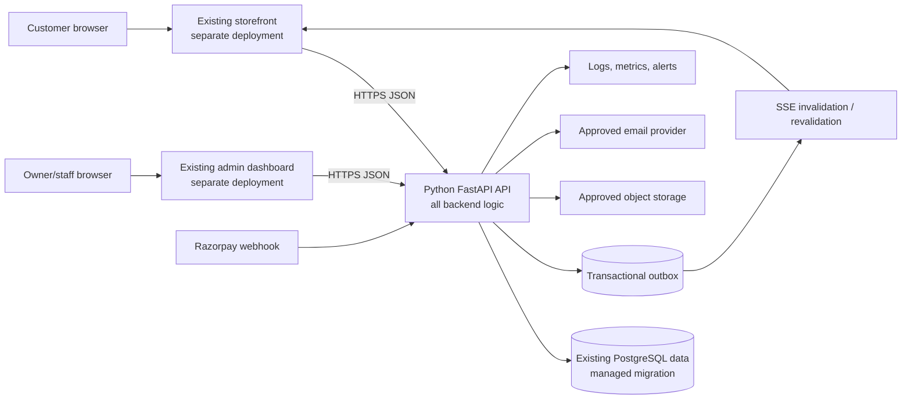
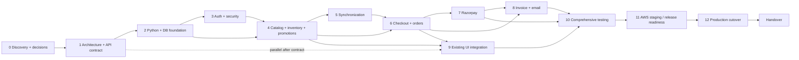
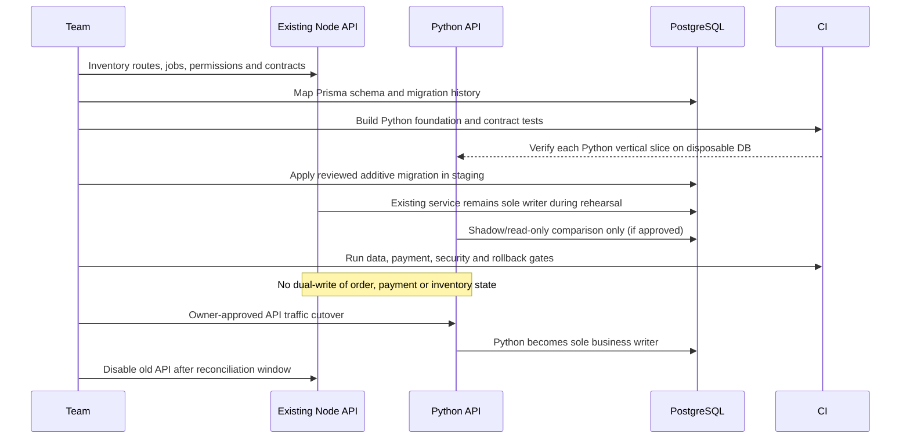
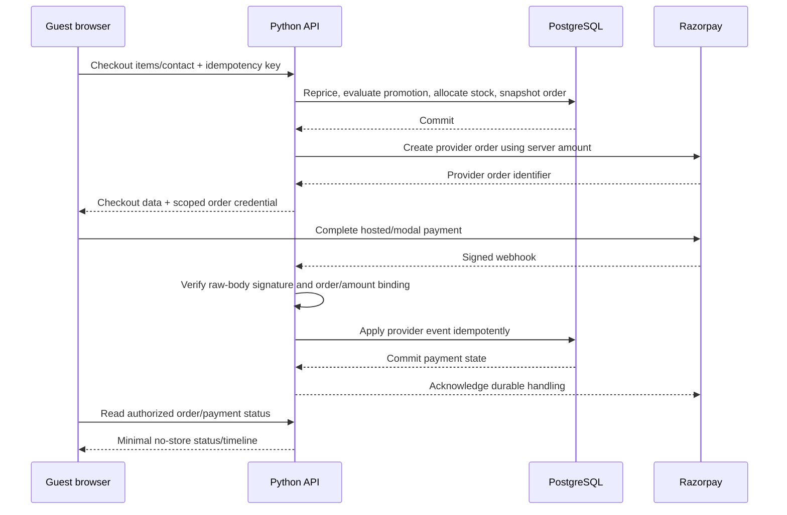
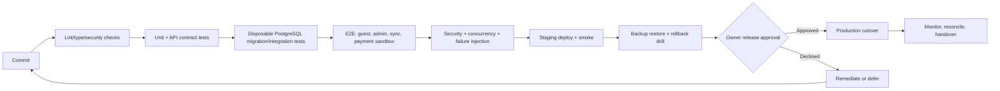
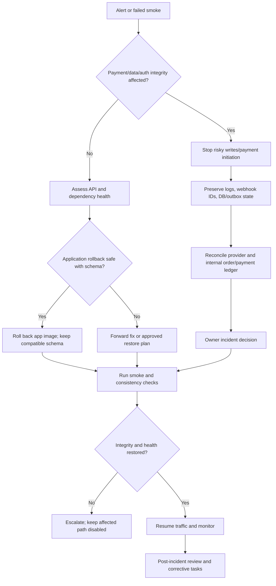

# VedhicFoods Implementation Plan

## 1. Document control and status

| Field | Value |
|---|---|
| Document ID | VF-IMPLEMENTATION-001 |
| Version | 1.0 |
| Status | Draft for project-owner review; estimates and proposed decisions are not commitments |
| Owner | Project owner to assign |
| Purpose | Roadmap and task-level work plan for completing the approved VedhicFoods product and migrating backend responsibilities to Python |
| Audience | Project owner, backend/frontend engineers, database engineer, QA, security and operations |
| Scope | Planning only. No application feature implementation is performed by this document. |
| Related documents | [PRD](PRD.md), [TRD](TRD.md), [App Flow](APP_FLOW.md), [UI/UX Design Brief](UI_UX_DESIGN_BRIEF.md), [Backend Specification](BACKEND_SPECIFICATION.md) |
| Approval | Pending project-owner review |

This is Document 6 of 6. The roadmap treats the UI/UX as client-finalized and preserves it; it plans API integration and state behavior within the existing experience, not a redesign. The customer storefront and admin dashboard remain distinct applications/deployments. Customer browsing and checkout are guest-based; customer account registration/sign-in is not part of the intended initial flow. Admin/staff authentication is required.

Statuses describe evidence in the repository, not completion of planned work:

- `VERIFIED EXISTING`: relevant implementation/configuration is in the repository; production operation is not implied.
- `NOT STARTED`: target implementation task has no verified completion evidence.
- `IN PROGRESS`: work has been explicitly started and is evidenced in the repository/work tracker.
- `BLOCKED`: a required decision/dependency prevents work.
- `IMPLEMENTED — NOT VERIFIED`: implementation appears present but required verification is absent.
- `TESTED — PASS` / `TESTED — FAIL`: use only with recorded test evidence from the target implementation.
- `DEFERRED`: intentionally moved out of the approved release scope.
- `PENDING CONFIRMATION`: owner decision required.

## 2. Executive summary

The repository contains two React 19/TypeScript/Vite applications, a substantial Node.js/TypeScript/Express backend and a PostgreSQL/Prisma data layer. The current backend contains routes and services for catalog, cart/checkout/orders, Razorpay, admin/staff/RBAC, inventory, delivery, invoices, content, support, email and storage. These features are **VERIFIED EXISTING in the Node implementation**, not verified as production-ready and not implemented in the required target language.

The target is a **Python-only backend** (FastAPI is recommended by the TRD and Backend Specification) backed by the existing PostgreSQL data and a carefully managed schema/migration transition. The React storefront and separate admin dashboard should remain in place; the customer UI/UX is finalized. A safe migration requires contract inventory, data/schema mapping, security/payment validation and a controlled cutover. It must not leave two permanent backends implementing the same commerce rules.

Release-critical work includes server-enforced authorization, guest order privacy, authoritative price/promotion/stock calculation, non-overselling inventory, trusted/idempotent Razorpay verification, invoices under approved rules, and automatic propagation of committed admin changes to the storefront. The proposed synchronization design is API revalidation plus SSE invalidation events backed by a transactional outbox, with visible-tab/version polling and route/focus revalidation as recovery. The 30-second polling and 10-second immediate freshness target below are proposals only; the owner must approve the user-facing freshness objective.

This roadmap does not promise a launch date. A provisional 16–24 week delivery range assumes two backend engineers, one frontend engineer, QA support, and part-time product/operations/security review. Estimate confidence is low to medium until schema compatibility, feature parity, unresolved policies, and production topology are verified.

## 3. Project goals and release scope

### Goals

1. Operate all backend application and business logic in Python.
2. Preserve the existing finalized customer experience and separate storefront/admin applications.
3. Support guest browsing, cart and checkout without customer registration.
4. Persist catalog, pricing, stock, promotions, orders, payments and admin changes in PostgreSQL.
5. Provide owner/staff operations with backend-enforced permissions and audit history.
6. Process Razorpay payments only; never treat the browser return as proof of payment. UPI is available only when enabled for the merchant.
7. Support manual order fulfillment and a secure customer-visible status timeline; no live GPS tracking.
8. Make committed product, image, category, inventory, promotion and order-status changes visible without rebuilding/redeploying the storefront.
9. Provide approved invoice/A4 print and email workflows with recoverable provider failures.
10. Deploy only after security, data, payment, backup and release gates pass.

### Initial-release scope

Public catalog, product/category detail, search/filter/sort as agreed in PRD, cart, guest checkout, online Razorpay payment, secure guest order access, manual order/delivery management, inventory, promotions, staff RBAC, product media, invoices/email under approved legal/business rules, operational content/settings, reports included in approved scope, audit/monitoring, responsive behavior and independent storefront/admin deployments.

### Explicitly excluded or conditional

- Customer account registration, customer login, account dashboard and account-dependent checkout: excluded by owner direction, despite related current routes/screens.
- Cash on Delivery: excluded.
- Live courier GPS: excluded.
- Refund automation, stock reservation expiry, discount stacking, legal invoice/tax rules, delivery pricing/regions, and exact role combinations: blocked pending owner decisions.
- UI redesign: excluded; preserve the approved UI and work through existing components/flows.
- Permanent parallel Node and Python commerce backends: prohibited absent separately approved, time-bounded migration exception.

## 4. Source documents and requirement traceability

All five preceding documents were found in `docs/` and read for this plan:

| Sequence | Document | Use in this plan |
|---|---|---|
| 1 | `docs/PRD.md` | Product scope, FR-001–FR-029, BR policies and unresolved business rules |
| 2 | `docs/TRD.md` | Python/FastAPI target, PostgreSQL, security, migration, CI/deployment and testing recommendations |
| 3 | `docs/APP_FLOW.md` | Guest-only customer journey, separate storefront/admin applications and manual delivery flow |
| 4 | `docs/UI_UX_DESIGN_BRIEF.md` | Client-finalized visual design and current page/route inventory to preserve |
| 5 | `docs/BACKEND_SPECIFICATION.md` | Target API, logical schema, outbox/SSE synchronization, security, payment and acceptance tests |
| 6 | `docs/IMPLEMENTATION_PLAN.md` | Current document |

The traceability matrix in Appendix A maps each actual PRD FR identifier to work packages and release evidence. Requirements are not silently changed by this plan. Where earlier docs contain design options (for example SSE/outbox) they remain proposed until the relevant decision is approved. The older source still contains customer login/register/account screens, while the owner-confirmed target does not; this plan schedules a later integration cleanup/disablement and does not modify the finalized customer UI design without owner approval. The PRD/TRD tax, delivery, invoice and permission uncertainties remain unresolved.

## 5. Repository assessment and existing implementation status

Assessment reflects repository artifacts inspected for this plan. No tests, migration, deploy or live service call was run as part of this documentation task.

| Area | Evidence | Status and action |
|---|---|---|
| Repo layout | `frontend/`, `admin/`, `backend/`, `database/`, `docs/`, `.github/workflows/` | **VERIFIED EXISTING** monorepo layout. Separate Vite projects and development ports in frontend/admin manifests. Owner confirms separate deployment; actual live origins **NOT VERIFIED**. |
| Customer app | `frontend/package.json`, `frontend/src/routes/`, `frontend/src/services/` | **VERIFIED EXISTING** React 19, TypeScript, Vite and customer route/API client code. Preserve approved layout. Account routes/auth code conflict with target guest-only product flow. |
| Admin app | `admin/package.json`, `admin/src/routes/`, admin services/context | **VERIFIED EXISTING** separate React 19/TypeScript/Vite application with authentication, catalog, orders, stock, invoices, staff/settings and other operation pages. Production deployment details **NOT VERIFIED**. |
| Backend runtime | `backend/package.json`, `backend/src/`, `backend/Dockerfile` | **VERIFIED EXISTING:** Node 22, TypeScript, Express 4.21, Zod, Prisma client. **MISMATCH** with required Python-only backend. Python backend is **NOT STARTED**. |
| Existing endpoint families | `backend/src/routes/` and controller/service tree | **VERIFIED EXISTING** health/auth, products/categories, cart/checkout/orders, Razorpay, admin, inventory, delivery, staff, invoices, discounts/promotions, settings, contact/support, content, events, email webhook, reconciliation/report routes. Contract compatibility needs verification. |
| Database | `database/prisma/schema.prisma`, `database/prisma/migrations/` | **VERIFIED EXISTING:** PostgreSQL/Prisma; 14 named migration directories were present at inspection. Preserve data and migration history; no Python schema exists. |
| Authentication | `backend/src/middleware/`, auth/order access routes/services, frontend/admin auth clients | **VERIFIED EXISTING** bearer/access-refresh and order-scoped access patterns. Exact production token/cookie topology and policy not verified. Customer registration/account paths conflict with target. |
| Payment | `backend/src/integrations/razorpay/`, payment routes/controller/services; `RAZORPAY_*` names in example configuration | Razorpay create/verify/webhook code **VERIFIED EXISTING**; live credentials, merchant methods, webhook registration and production transactions **NOT VERIFIED**. Never expose actual credential values in docs/logs. |
| Email | SES/Brevo adapters, queue/retry and webhook files | **VERIFIED EXISTING** provider code. Sender verification and live delivery **NOT VERIFIED**. |
| Images | S3 adapter and presigned-image routes | **VERIFIED EXISTING** code. Bucket policy, CDN and production behavior **NOT VERIFIED**. |
| Synchronization | Express SSE route and admin realtime client are present | **VERIFIED EXISTING** mechanism, but storefront product event coverage, durable event delivery and Python multi-worker behavior **NOT VERIFIED**. |
| Tests | 45 backend `*.test.ts` files were found. Root test reports exist. Backend uses Vitest/Supertest; admin has Vitest script. | Test code/reports are **VERIFIED EXISTING**; current pass/fail state is **NOT VERIFIED** by this plan. No Python suite exists in inspected manifests. |
| CI | `.github/workflows/ci.yml` defines lint/build/type/schema/unit/integration work, including disposable Postgres test service | Workflow configuration **VERIFIED EXISTING**. This does not prove a recent CI run passed. Python gates must replace/add target language gates during migration. |
| Deployment | `.github/workflows/deploy.yml`, `backend/AWS_DEPLOYMENT.md`, ECS/CloudFormation/infra/runbook files | AWS ECS, OIDC, migration and release artifacts **VERIFIED EXISTING**. Actual cloud resources, domain/DNS/TLS, running service, frontend hosting and successful deployment **NOT VERIFIED**. |
| Working tree | Repository had pre-existing modifications and untracked assets/source/docs when inspected | Avoid overwriting/reverting them. This documentation task creates only this plan file. |

**Known current-state mismatches to resolve before release:** (1) Node backend vs Python-only target; (2) customer account routes vs no account-registration target; (3) COD paths/selectors in some source vs Razorpay-only target; (4) existing SSE access strategy needs review to prevent credentials in URLs and must deliver storefront catalog invalidation reliably; (5) existing model/auth complexity must be reconciled with guest-only behavior; (6) current UI shell/route implementation must remain client-approved, though functional conflicts may require owner-approved behavior-only change.

## 6. Assumptions and constraints

| ID | Assumption/constraint | Status |
|---|---|---|
| AS-001 | Python is the only permitted backend application runtime for final target, including jobs and provider orchestration. | Confirmed by task and TRD |
| AS-002 | React/TypeScript frontend applications can remain separate and consume versioned APIs. | Verified and confirmed |
| AS-003 | UI/UX is client-finalized; integration should reuse existing layouts/components. | Owner-confirmed |
| AS-004 | Customer registration/login is not required and is excluded from the target initial release. | Owner-confirmed; current code mismatch |
| AS-005 | Guest checkout and Razorpay-only payment are required; COD excluded. | PRD-confirmed |
| AS-006 | PostgreSQL data is valuable and must be preserved; no destructive rebuild/reset. | Required migration constraint |
| AS-007 | Existing Prisma migrations are current data/schema history until a reviewed cutover plan says otherwise. | Proposed safe approach |
| AS-008 | Actual AWS services, live deployment, domains and RPO/RTO have not been proven from repository files. | Not verified |
| AS-009 | No implementation dates, hourly capacity, final team size or launch date are approved. | Pending |
| AS-010 | The owner will appoint decision-makers for business, legal/tax, payment, delivery and production operations. | Pending |

## 7. Target architecture and Python migration strategy

Target topology is two separately deployed frontends (storefront and admin) communicating over HTTPS with one Python FastAPI API. PostgreSQL is the system of record; approved external integrations include Razorpay, email and object/image storage. All business rules, permission checks, payment trust decisions, audit and background job handling run in Python. No Node application backend remains as a parallel source of business truth after cutover.



### Migration approach

1. **Baseline and contract capture:** inventory current routes, payloads, permission slugs, DB state, jobs, provider side effects and test fixtures. Record actual data volumes and migration status in a secure owner-approved environment; do not print production records or secrets into documentation.
2. **Compatibility design:** approve API v1 compatibility and identify mismatches (customer auth, COD, order access, SSE). Do not let old/new behavior become ambiguous.
3. **Python foundation:** create Python runtime and application structure, PostgreSQL access, error handling, request IDs, tests and observability. Build against disposable/test database first.
4. **Schema ownership:** compare complete Prisma schema and live schema/migrations with proposed SQLAlchemy mappings. Design an expand-and-contract plan. Do not let Prisma and Alembic independently make production schema changes during transition. Keep current app operating while compatible additive changes are applied.
5. **Vertical migration:** implement one bounded domain slice at a time in Python—identity/admin, catalog/inventory, orders/payments, notifications/invoices—while maintaining contract tests. For parallel validation, use read-only comparison or shadow tests; never dual-write orders, payment state or inventory to competing systems.
6. **Cutover rehearsal:** restore a production-like sanitized database backup into staging; run migration rehearsal, data reconciliation, webhook replay tests, smoke tests, rollback and recovery drill. Define cutover window and freeze/queue policy for writes.
7. **Cutover:** route API traffic to Python only after all gates and owner approval. Keep old Node artifact available for application rollback, but only if schema remains backward-compatible. If a Python-only deadline is mandatory, no continuing Node fallback may serve business logic after final cutover.
8. **Decommission:** after agreed observation period and data reconciliation, disable old backend endpoints/credentials/workers, remove obsolete infrastructure in a separately approved change, retain needed audit/rollback records under policy.

No Strangler-style dual backend or dual-write mode is the default. A temporary read-only comparison can be approved with limited data, expiry date, and clear owner; payment/order/inventory writes must have one authoritative writer.

## 8. Implementation principles

- Protect customer, payment and staff data before optimizing convenience.
- One authoritative writer for order, payment and inventory state.
- Server-authoritative values: price, promotion eligibility, stock, permissions and paid state.
- Commit business data, audit records and outbox notifications atomically where required.
- Version API contracts and test compatibility before frontend changes.
- Preserve the client-finalized UI and each app's independent deployment lifecycle.
- No customer-account gate; no COD; no live GPS.
- Keep unresolved tax, invoice, shipping, refund and role decisions explicit.
- Build reversible, additive schema changes; avoid destructive migrations and deploy-time implicit changes.
- Make async email/event delivery durable, observable, idempotent and independently retryable.
- Treat tests/reports as evidence only for the exact commit/configuration and execution that produced them.
- Every phase has measurable exit evidence. A planned task is not “done” because this roadmap exists.

## 9. Phase-by-phase implementation roadmap

| Phase | Name | Primary scope | Exit gate |
|---|---|---|---|
| 0 | Discovery and baseline verification | Runtime/schema/data/contracts/test/security/deployment audit and backlog | Baseline accepted, blockers/decisions assigned |
| 1 | Architecture and development environment | Python stack, API contracts, local/test setup, secret/config/log/CI design | Repeatable dev setup and approved architecture |
| 2 | Python backend foundation and database | Python app, ORM mapping, migration strategy, errors, transaction foundations | App/DB/migration tests pass on disposable PostgreSQL |
| 3 | Authentication, authorization and security | Staff identity, sessions, permission checks, guest access, abuse controls | RBAC/security tests pass; matrix approved |
| 4 | Catalog and storefront APIs | Product/category/media, price, stock, promotion APIs | Current catalog drives storefront and admin APIs correctly |
| 5 | Storefront synchronization | Commit/audit/outbox, SSE, cache revalidation, fallback | SYNC acceptance passes at approved freshness target |
| 6 | Cart, guest checkout and orders | Authoritative quote, inventory/order transactions, manual fulfillment | Guest order and secure timeline tests pass |
| 7 | Razorpay payment | Create/verify/webhooks/state reconciliation | Sandbox/payment integrity matrix passes |
| 8 | Invoices, email and notifications | Approved invoice, A4 output, durable messages and retries | Legal sample approved; provider failure behavior passes |
| 9 | Frontend and admin integration | Existing UI wired to Python contracts; account/COD mismatch resolved per approval | Customer and admin journeys work without UI redesign |
| 10 | Comprehensive testing and hardening | Full regression, security, concurrency, performance and defect closure | Release candidate passes critical gates |
| 11 | AWS staging and production deployment | Environment, secret, network, backup, deploy/rollback setup | Staging evidence and owner production approval |
| 12 | Release, monitoring and handover | Production verification, monitoring, ops docs and acceptance | Owner accepts scope and operations handover |

The dependency order is intentionally cautious about database ownership and payment cutover. Frontend layout-preserving API integration can proceed in parallel after contracts stabilize. Production deployment is not inferred from existing IaC/workflows.

## 10. Task and subtask backlog

Effort is person-days (PD), one productive engineer day, rough ranges excluding owner decision wait. Dependencies use task IDs. The status is target-work status; `VERIFIED EXISTING` means a current Node/frontend/infrastructure equivalent exists, not that the Python target is done. All Python migrations start `NOT STARTED` unless evidence changes.

| Task ID | Phase | Task and subtask | Priority | Dependencies | Component | Deliverable | Acceptance criteria | Required tests/evidence | Effort | Status | Blocking decision |
|---|---|---|---|---|---|---|---|---|---|---|
| IMP-001 | 0 | Record versioned inventory of apps, APIs, jobs, providers and current deployment artifacts | P0 | — | All | Baseline inventory | Paths, owner, evidence and confidence recorded; no secret values | Review against manifests/routes/workflows | 2–4 | VERIFIED EXISTING (evidence found); baseline sign-off NOT STARTED | None |
| IMP-002 | 0 | Inspect schema/migrations and reconcile live schema/data state safely | P0 | IMP-001 | PostgreSQL/Prisma | Schema/data migration assessment | Every entity/index/enum/data migration has target mapping and verified DB state | Schema diff and sanitized staging inspection | 3–6 | NOT STARTED | DB access and data owner |
| IMP-003 | 0 | Run/collect current baseline quality results and classify existing tests/failures | P0 | IMP-001 | CI/tests | Dated baseline report | Results tied to commit/config; no pass claim without run evidence | Existing CI artifact review; approved local baseline run | 2–5 | NOT STARTED | Test environment availability |
| IMP-004 | 0 | Build current-to-target feature/route/permission parity matrix | P0 | IMP-001, IMP-002 | API/contracts | Parity matrix | Each API, business rule, role and event has Python owner/status | Contract review | 3–5 | NOT STARTED | None |
| IMP-005 | 0 | Inspect security/payment/SSE/deploy risks and prioritize blockers | P0 | IMP-001, IMP-004 | Security/ops | Risk and migration assessment | Owner-reviewed risk, evidence, impact, mitigation | Security review; no live secrets exposed | 2–4 | NOT STARTED | Security/ops reviewer |
| IMP-006 | 0 | Assign product, legal/tax, payment, delivery and AWS decision owners | P0 | — | Governance | Decision owner list | Each pending item has one accountable owner and due milestone | Decision register review | 0.5–1 | PENDING CONFIRMATION | Project owner |
| IMP-007 | 1 | Approve Python architecture/framework/runtime and nonfunctional targets | P0 | IMP-004, IMP-005 | Architecture | Signed architecture decision | FastAPI/Python baseline, API compatibility, scale/availability scope accepted | Architecture review | 1–3 | BLOCKED | Technical owner |
| IMP-008 | 1 | Define API contracts, error envelope, versioning and compatibility tests | P0 | IMP-004, IMP-007 | API | OpenAPI/contract baseline | All storefront/admin screens have endpoint/request/response mapping | Contract tests/spec review | 3–6 | NOT STARTED | API behavior decisions |
| IMP-009 | 1 | Define env/config validation, logging, request IDs, lint/type/security CI for Python | P1 | IMP-007 | Backend/CI | Developer setup and CI design | No production credential needed locally; checks run in CI | Clean environment CI proof | 2–4 | NOT STARTED | CI runner constraints |
| IMP-010 | 1 | Define environments, secret management and local/test data policy | P0 | IMP-007 | Ops/security | Placeholder config template and instructions | No real credentials committed; staging/prod separated | Secret scanning/config review | 2–3 | BLOCKED | AWS service/owner decision |
| IMP-011 | 2 | Scaffold Python FastAPI app, layers, health and startup/shutdown | P0 | IMP-007, IMP-009 | Python API | Minimal runnable Python service | Python app starts, reports health, uses dependency injection cleanly | Unit/API smoke test | 4–7 | NOT STARTED | Runtime approval |
| IMP-012 | 2 | Implement PostgreSQL connection/pool, SQLAlchemy mappings and repository boundaries | P0 | IMP-002, IMP-011 | DB | Python persistence foundation | Connection pool bounded; mapping matches approved schema | Disposable PostgreSQL integration tests | 5–10 | NOT STARTED | Schema mapping approval |
| IMP-013 | 2 | Design Prisma-to-Alembic schema ownership and expand/contract migrations | P0 | IMP-002, IMP-012 | DB migrations | Migration/cutover playbook | No dual migration owner; upgrades are additive/backward-compatible where required | Empty DB apply, upgrade and rollback/recovery rehearsal | 5–10 | BLOCKED | Data/schema owner |
| IMP-014 | 2 | Add domain error mapping, validation, transactions, idempotency and audit primitives | P0 | IMP-011, IMP-012 | Core backend | Shared service primitives | Failed writes never return success; idempotency scopes are unique | Unit/integration fault injection | 5–8 | NOT STARTED | API contract approval |
| IMP-015 | 2 | Establish Python test harness, fixture DB, lint, format, type and dependency scan | P0 | IMP-011, IMP-012 | Tests/CI | Python quality gates | Safe disposable DB; CI cannot reach production data | CI execution evidence | 3–5 | NOT STARTED | CI architecture |
| IMP-016 | 3 | Confirm staff role/permission matrix and owner-only capabilities | P0 | IMP-006, IMP-004 | Product/security | Approved permission matrix | Every admin action has permission and sensitive data scope | Owner sign-off; matrix coverage test | 1–3 | PENDING CONFIRMATION | Owner |
| IMP-017 | 3 | Implement staff authentication, password hash, secure session/refresh/logout | P0 | IMP-011, IMP-016 | Auth | Python admin auth | Disabled/invalid users denied; safe rotation/revocation; secrets redacted | Auth unit/API/security tests | 6–10 | NOT STARTED | Session/CSRF policy |
| IMP-018 | 3 | Enforce action/object permissions on all admin APIs | P0 | IMP-016, IMP-017 | RBAC | Permission dependencies/policies | Direct API calls cannot bypass UI/role grants | Negative/positive RBAC tests across endpoint inventory | 5–9 | NOT STARTED | Permission matrix |
| IMP-019 | 3 | Implement secure guest order credential handling and abuse controls | P0 | IMP-006, IMP-017 | Guest privacy | Approved lookup/access mechanism | Order ref alone reveals nothing; token expiry/rotation and recovery match approval | Enumeration, expiry and rate-limit tests | 4–7 | BLOCKED | Guest verification decision |
| IMP-020 | 3 | Add rate limits, CORS, CSRF/session controls, audit policy and security checks | P0 | IMP-010, IMP-017 | Security/infra | Security baseline | Exact origins; safe headers; no token in URL/log; admin actions audited | Security tests and config review | 4–7 | NOT STARTED | Production origins/session mode |
| IMP-021 | 4 | Implement public product/category/list/detail/search APIs | P0 | IMP-008, IMP-012 | Catalog API | Public catalog endpoints | Only published safe fields; bounded filters/page size; ETag support | API contract and query tests | 5–8 | VERIFIED EXISTING (Node equivalent); Python NOT STARTED | Content publication rules |
| IMP-022 | 4 | Implement admin product/category CRUD, archive and optimistic versioning | P0 | IMP-018, IMP-021 | Admin catalog | Python admin catalog APIs | Permission/version enforced; history retained; duplicate slug rejected | CRUD/RBAC/concurrency tests | 6–10 | VERIFIED EXISTING (Node equivalent); Python NOT STARTED | Delete/archive rule |
| IMP-023 | 4 | Implement image upload intent/finalize, content validation and storage adapter | P1 | IMP-010, IMP-018 | Media | Secure media flow | Only approved content/size; old reference remains if upload fails | Upload abuse/provider failure tests | 5–8 | VERIFIED EXISTING (Node/S3 equivalent); Python NOT STARTED | Storage/CDN choice and limits |
| IMP-024 | 4 | Implement inventory read/adjust/history APIs with atomic operations | P0 | IMP-012, IMP-018 | Inventory | Python stock operations | No negative stock; every adjustment actor/reason recorded | Unit/DB/concurrency tests | 5–8 | VERIFIED EXISTING (Node equivalent); Python NOT STARTED | Reservation policy |
| IMP-025 | 4 | Implement promotion/coupon eligibility and price quote service | P0 | IMP-012, IMP-021 | Promotions/pricing | Server quote/discount APIs | Uses approved active window, product/category eligibility and precision | Boundary/rounding/eligibility tests | 5–9 | VERIFIED EXISTING (Node equivalent); Python NOT STARTED | Tax/stacking/minimum policy |
| IMP-026 | 5 | Design/implement outbox schema, publisher, replay and idempotent event envelope | P0 | IMP-014, IMP-022, IMP-024, IMP-025 | Sync/events | Durable invalidation delivery | Domain write and outbox commit atomically; retry/replay observable | Transaction rollback/publisher failure tests | 6–10 | NOT STARTED | Event retention/freshness decision |
| IMP-027 | 5 | Implement catalog SSE stream and multi-worker delivery/reconnect strategy | P1 | IMP-026 | API events | Public-safe SSE channel | Minimal payload; no PII/token URL; disconnect/replay/fallback defined | Multi-instance reconnect/event tests | 4–8 | VERIFIED EXISTING (Express SSE only); Python NOT STARTED | Deployment scale decision |
| IMP-028 | 5 | Integrate storefront revalidation on event, navigation, focus and visible polling | P0 | IMP-008, IMP-021, IMP-026 | Storefront client | Query invalidation/refetch wiring | New committed catalog state appears with no frontend redeploy; hidden polling pauses | Browser tests SYNC-001..007, SYNC-010 | 4–8 | NOT STARTED | Freshness target |
| IMP-029 | 5 | Add private order-status revalidation, outbox/notification and missed-event recovery | P0 | IMP-019, IMP-026 | Order tracking | Secure tracking refresh | Only authorized order updates visible; focus/reconnect repairs missed signal | SYNC-008/009, guest privacy tests | 3–6 | NOT STARTED | Guest access + notification decisions |
| IMP-030 | 6 | Confirm guest cart ownership/persistence and delivery input contract | P0 | IMP-006, IMP-008 | Cart/checkout | Approved cart contract | No customer registration; data minimized; delivery fields/fees explicit | Product sign-off and API contract | 1–3 | BLOCKED | Cart/delivery policy |
| IMP-031 | 6 | Implement cart validation and authoritative checkout quote/repricing | P0 | IMP-021, IMP-024, IMP-025, IMP-030 | Checkout | Python guest checkout | Ignores client prices; revalidates product, promotion, stock, currency and delivery policy | Pricing/stale-data API tests | 6–10 | VERIFIED EXISTING (Node equivalent); Python NOT STARTED | Delivery/tax policies |
| IMP-032 | 6 | Implement order creation, immutable snapshots, idempotency and inventory transaction | P0 | IMP-013, IMP-014, IMP-024, IMP-031 | Orders/DB | Order write path | One order per intent; no partial allocation; concurrent last-unit safe | DB/concurrency/duplicate-request tests | 7–12 | VERIFIED EXISTING (Node equivalent); Python NOT STARTED | Stock/payment hold rule |
| IMP-033 | 6 | Implement admin order listing/detail and manual fulfillment transitions/history | P0 | IMP-018, IMP-032 | Admin/order | Order operations | Valid transitions only, attributable, versioned, customer timeline safe | RBAC/state transition tests | 5–9 | VERIFIED EXISTING (Node equivalent); Python NOT STARTED | State/role policy |
| IMP-034 | 6 | Implement scoped guest order lookup and timeline APIs | P0 | IMP-019, IMP-032, IMP-033 | Order access | Guest status API | No sequential ID disclosure; minimal data and no-store | E2E/privacy/rate-limit tests | 4–7 | BLOCKED | Guest verification decision |
| IMP-035 | 7 | Implement Razorpay order initiation and internal payment-attempt persistence | P0 | IMP-032 | Payments | Python gateway adapter | Server amount only; idempotent provider order association | Sandbox API tests | 4–7 | VERIFIED EXISTING (Node SDK equivalent); Python NOT STARTED | Merchant config/test account |
| IMP-036 | 7 | Implement signature verification, webhook raw-body verification and idempotent state machine | P0 | IMP-014, IMP-035 | Payments | Trusted payment processor | Invalid/duplicate/out-of-order events cannot double-pay or double-consume stock | Signed fixtures, replay and failure tests | 6–10 | VERIFIED EXISTING (Node equivalent); Python NOT STARTED | Provider event/hold policy |
| IMP-037 | 7 | Implement uncertain-state reconciliation and payment incident runbook | P0 | IMP-036 | Payment operations | Reconciliation task/runbook | Pending/mismatch cases detectable; no untrusted forced paid state | Sandbox delayed/duplicate tests; runbook drill | 4–7 | VERIFIED EXISTING (Node routes exist); Python NOT STARTED | Reconciliation frequency/owner |
| IMP-038 | 8 | Confirm invoice fields, tax handling, numbering, trigger and void/correction rules | P0 | IMP-006, IMP-032, IMP-035 | Product/legal | Signed invoice decision and sample | Owner/accountant supplies legal facts and approved sample | Documented review | 1–4 + decision wait | PENDING CONFIRMATION | Owner/accountant |
| IMP-039 | 8 | Implement snapshot-based invoice generation and protected A4 print/download view | P0 | IMP-038, IMP-032 | Invoice | Python PDF/view service | Repeatable authorized copy; historical snapshot unchanged | PDF content/access tests | 5–9 | VERIFIED EXISTING (Node PDFKit equivalent); Python NOT STARTED | Invoice decision |
| IMP-040 | 8 | Select provider and implement transactional email job/retry/dedup/bounce status | P1 | IMP-010, IMP-032, IMP-038 | Notifications | Python mail adapter/worker | Provider errors do not undo order/payment; retries are deduped/observable | Fake provider and sandbox delivery tests | 5–9 | VERIFIED EXISTING (SES/Brevo code); Python NOT STARTED | Provider/sender approval |
| IMP-041 | 8 | Approve templates/trigger policy for order/payment/invoice/status messages | P1 | IMP-038, IMP-040 | Product/content | Approved templates and event map | No unapproved claims or premature confirmation | Content approval and delivery test | 1–3 + review | PENDING CONFIRMATION | Owner/content reviewer |
| IMP-042 | 9 | Replace storefront hardcoded/mock data with compatible Python API behavior where used | P0 | IMP-008, IMP-021, IMP-025, IMP-028, IMP-031 | Storefront | Existing UI/API integration | Visual structure unchanged; API data authoritative; all states handled | Route/API browser tests | 6–12 | IMPLEMENTED — NOT VERIFIED (service code exists; live contract uncertain) | API contract freeze |
| IMP-043 | 9 | Integrate admin auth, catalog, stock, order, invoice and staff clients to Python API | P0 | IMP-008, IMP-018, IMP-022, IMP-024, IMP-033 | Admin | Existing admin integration | Separate app/origin; permissions enforced server-side; no redesign | Admin workflow/RBAC tests | 7–14 | IMPLEMENTED — NOT VERIFIED (client services exist) | API contract + origins |
| IMP-044 | 9 | Resolve customer register/login/account and COD code paths against approved scope | P0 | IMP-006, IMP-008 | Storefront/business flow | Approved behavior-only correction backlog | No registration gate or COD offer in intended initial flow; UI changes only after owner-approved scope | Route/checkout regression test | 2–5 | BLOCKED | Owner approves removal/disablement approach |
| IMP-045 | 9 | Verify responsive behavior/accessibility and preserve approved UI details | P1 | IMP-042, IMP-043 | Both frontends | Responsive/accessibility report | Desktop/tablet/mobile flows usable; no unapproved design changes | Browser/keyboard/screen-size evidence | 4–8 | VERIFIED EXISTING design artifacts; validation NOT STARTED | Finalized design reference |
| IMP-046 | 10 | Execute Python unit, API, DB, migration and contract suites | P0 | IMP-015, IMP-021..043 | Backend/DB | Test evidence | Critical rule paths covered and all release tests pass | pytest/HTTPX/Postgres CI report | 6–10 | NOT STARTED | Feature code complete |
| IMP-047 | 10 | Execute storefront/admin and full end-to-end/regression suite | P0 | IMP-042, IMP-043 | Frontends/E2E | Browser test report | Guest journey and admin workflows pass at unchanged intended UI | E2E on staging-like env | 5–9 | NOT STARTED | Python API staging candidate |
| IMP-048 | 10 | Execute security review, abuse tests, dependency/image scan and defect triage | P0 | IMP-020, IMP-046, IMP-047 | Security | Findings/defect register | Critical/high issues fixed or formally accepted by authorized owner | Pen test/review and scan reports | 4–8 | NOT STARTED | Security reviewer |
| IMP-049 | 10 | Execute performance/reliability, concurrency and event failure tests | P0 | IMP-026..037, IMP-046 | System | Profile and recovery evidence | Approved load profile met; no oversell; outbox recovers; no invented threshold | Load/fault/concurrency test report | 4–8 | NOT STARTED | Traffic/freshness targets |
| IMP-050 | 11 | Confirm AWS service topology, budget, region, network, origins, DNS/TLS and scaling | P0 | IMP-006, IMP-007, IMP-010 | Cloud architecture | Approved deployment design | Architecture and cost envelope approved; actual owner/account verified | Infra review | 2–5 | BLOCKED | AWS/domain owner |
| IMP-051 | 11 | Build Python image, staging deploy, secret/config wiring and health probes | P0 | IMP-011, IMP-050 | Deployment | Python staging service | No secrets in image/log; app health/DB readiness work | Staging deploy and smoke evidence | 5–9 | NOT STARTED | AWS approval |
| IMP-052 | 11 | Configure compatible migration rollout, backups, restore and rollback playbooks | P0 | IMP-013, IMP-050, IMP-051 | DB/ops | Recovery and deploy runbooks | Restore and app rollback rehearsed; external payment effects reconciled | Restore drill and rollback rehearsal | 5–9 | NOT STARTED | Backup/RPO/RTO owner decision |
| IMP-053 | 11 | Configure production payment/email/webhook/domain only after authorization | P0 | IMP-037, IMP-040, IMP-048, IMP-050..052 | Integrations/ops | Production readiness evidence | Credentials verified privately; endpoints/signatures/alarms tested safely | Controlled smoke tests | 2–5 | BLOCKED | Merchant, email and DNS owners |
| IMP-054 | 12 | Owner-approved cutover to Python API and disable Node business writer | P0 | IMP-046..053 | Release | Cutover record | Single Python writer; reconciliation counts and smoke tests pass | Release checklist, owner sign-off | 2–4 + window | NOT STARTED | Owner approval |
| IMP-055 | 12 | Production verification, monitoring, handover and known-issues acceptance | P0 | IMP-054 | Operations | Handover and acceptance report | Critical journeys, monitoring, escalation and maintenance owner confirmed | Production smoke evidence | 3–6 | NOT STARTED | Owner acceptance |

### Backlog interpretation

`IMP-021..043` denotes a dependency range, not a literal dependency ID. For task tracking software, expand that range into explicit task links. `VERIFIED EXISTING` rows identify the current implementation baseline; they do not satisfy the Python target. Work estimates include implementation and developer verification but not multi-week owner/vendor decisions. Priorities may be re-sequenced only when security, payment/data integrity and no-oversell release gates remain protected.

## 11. Dependency graph and critical path

| Workstream | Depends on | Can proceed in parallel with | Critical-path note |
|---|---|---|---|
| Discovery/decision ownership | None | Initial contract inventory | Must resolve schema/data and production access assumptions early. |
| Python foundation | Architecture, CI/environment decisions | Frontend design-preserving test preparation | Framework and DB mapping gate downstream work. |
| Authentication/RBAC | Python foundation, approved role matrix | Public catalog implementation after core DB | Must gate every admin write/read of protected customer data. |
| Catalog/inventory/pricing | Python DB layer, API contract | Staff auth and frontend mock contract preparation | Checkout cannot be safe before server pricing and stock rules. |
| Synchronization | Catalog/inventory/promotion writes, outbox | Guest checkout work after shared transaction primitives | Release-critical; depends on exactly-once DB commit + at-least-once notification design. |
| Checkout/orders | Guest and delivery decisions, pricing/stock | Invoice legal decision gathering; admin UI integration prep | Critical data path; inventory and idempotency gate payment. |
| Razorpay | Order/payment model and provider test setup | Invoice template discovery | Cannot enable production until webhook and reconciliation pass. |
| Invoice/email | Order snapshot and legal/template decisions | AWS staging foundations | Invoice legal rule is a blocker; email provider failure must be isolated. |
| Frontend integration | Stable API contracts and Python endpoints | Backend implementation, if contract mocks/fixtures are stable | No design redesign; frontend work can start with contract-approved clients. |
| System testing | Feature slices and staging-like data | Runbook drafting | Full testing must precede cutover. |
| AWS production | Approved topology, tests, backups, rollback | Handover materials | Production credentials/deploy only after owner approval. |



Parallel work is allowed only against a frozen, reviewed API contract and isolated test data. No parallel writes from Node and Python to production order, payment or stock state.

## 12. Database and migration workstream

1. Capture the Prisma data model, enum values, constraints, indexes, triggers, migration history and generated-client behavior. Verify production schema state through a controlled/read-only owner-approved path; repository migration files alone do not prove deployed state.
2. Map existing entities to Python models, including users/RBAC, products/categories/media, inventory/log, cart, orders/items, payments, discounts/promotions, invoices/delivery, notifications/support/content/settings and audit/token records. Decide which customer-auth models are retained for historical data vs removed from active API.
3. Compare actual DB to checked-in migrations. Produce checksums, table/row counts and referential-integrity report in protected operations storage; redact all PII from documents/logs.
4. Establish one migration owner. Do not run Prisma and Alembic production migrations independently. Proposed transition is expand-and-contract: additive compatible changes first; deploy compatible readers/writers; backfill if needed; verify; switch API; remove old columns only in later approved release.
5. Set constraints for unique public order reference, idempotency key, provider event IDs, nonnegative inventory, order item snapshots and foreign keys. Add indexes after query review.
6. Test blank install, upgrade from each supported baseline, repeated deployment, interrupted migration recovery and rollback/forward-fix in a disposable PostgreSQL copy.
7. Before production cutover, take verified backup, quiesce or safely queue writes, record order/payment/inventory reconciliation totals, apply migration, route traffic to Python, compare critical counts and run smoke flows. If mismatch, stop new writes and execute approved application/schema recovery plan.

**Data-loss guardrail:** no destructive migration or test against non-disposable/production DB. Migrations are reviewed, transactional where supported, time-bounded, observable and backed by restore evidence. A schema rollback is not assumed safe after new writes; prefer forward-compatible fixes or restore/controlled reconciliation.

## 13. Authentication and security workstream

1. Approve role/permission matrix, customer-data access scope, owner-only actions, session duration, MFA requirement, staff invitation/password reset, guest token lifetime and retention.
2. Implement Python staff auth using adaptive password hashing, secure session/refresh rotation and revocation. If cookie-based, implement CSRF controls and exact CORS; if bearer-based during migration, document transitional storage/rotation and prevent URL/query token use.
3. Apply route-level and object-level permission checks for every admin operation. Do not rely on route guards, hidden navigation or frontend role state.
4. Protect guest order endpoints with unguessable order-bound credentials, expiry/revocation policy and rate limits. Never authorize using only order number/email/phone unless explicitly approved challenge exists.
5. Validate Razorpay raw-body signature, event freshness/replay/idempotency and amount/order matching. Keep provider secrets in approved secret manager; redact them from errors, logs, telemetry and build artifacts.
6. Restrict CORS to actual, approved separate storefront/admin origins. Enforce HTTPS, security headers, input limits, parameterized queries, strict upload validation, IAM least privilege and dependency/image scans.
7. Log sensitive admin access and role changes without passwords, tokens, full address/payment content. Define privacy retention/deletion and incident response with owner/legal reviewer.

Security exit requires negative tests for privilege escalation, guest enumeration, CSRF/session theft risk as applicable, invalid/replayed webhook, malicious uploads, secret leaks and customer data leakage.

## 14. Catalog, inventory, and promotions workstream

Implement public product/category reads and admin CRUD in Python. Model publication/visibility and archival explicitly. Use optimistic versioning for concurrent admin edits. Product image upload uses an approved provider/short-lived scoped upload or validated streaming, then stores only verified object references. Public endpoints expose safe customer-facing fields only.

Inventory is database-authoritative. At checkout, lock or conditionally decrement rows atomically in stable order; roll back all order/stock writes if any line is unavailable. Cart stock is advisory. Define reservation and failed-payment/cancellation stock-release behavior before implementation; never silently create an expiry duration. Discounts and promotions are server-calculated with decimal-safe arithmetic; tax/discount stacking/minimum/eligibility policies require approval. Product/category/price/availability/promotion changes commit audit and outbox invalidations in the same transaction.

## 15. Database-driven storefront synchronization workstream

### Selected provisional design

Use API-driven retrieval with ETag/revalidation for public catalog, category and promotion data; refetch when a customer navigates to a relevant page or returns to a visible browser tab. For already-open storefront tabs, use SSE events that contain only resource ID/version/event ID and cause frontend cache invalidation followed by an authoritative GET. Use a transactional outbox inserted atomically with the business update. PostgreSQL notification may wake publishers, but durable polling/replay is required; transient `LISTEN/NOTIFY` alone is not guaranteed delivery. Pause version polling while the tab is hidden; proposed 30-second visible-tab fallback. WebSockets are not proposed because updates are one-way invalidations.

### Freshness objective

Proposed measurable objective for owner review: **within 10 seconds p95** for an already-open, connected storefront page to show a committed product/category/promotion/inventory change, measured from successful API commit to rendering the fetched current value. **PENDING CONFIRMATION.** Revalidation on next navigation/focus is expected on the next successful request, while checkout always revalidates synchronously. If SSE/network is interrupted, visible polling/focus/navigation revalidation provides eventual recovery; no finite recovery bound is promised until a network/recovery SLA is approved.

Trade-off: SSE plus outbox adds connections, publisher polling, replay retention and monitoring, but gives near-real-time one-way updates without a full broker/WebSocket system. A short polling fallback consumes modest API load, mitigated by a cheap version endpoint and pausing hidden tabs. If measured multi-instance fan-out exceeds PostgreSQL capacity, evaluate managed messaging as a later decision; do not introduce Redis by default.

### Lifecycle

1. Staff loads current record/version from Python API.
2. API authenticates staff and checks action permission.
3. Python validates expected version, input and business rules.
4. Transaction writes domain rows + audit + outbox event and commits.
5. API returns successful new version only after commit; failed transaction returns error and frontend retains unsaved state.
6. Publisher retries outbox event at least once and records delivery/attempt state.
7. SSE client invalidates relevant query keys; it then fetches authoritative API data and rerenders without rebuild/deploy.
8. Missed event is recovered by `Last-Event-ID` replay where retained, or full refetch when reconnect cursor is expired; route/focus/visible polling is fallback.
9. Checkout recalculates price, active promotion and stock inside its order transaction regardless of any browser update.
10. Product images use new versioned object keys/URLs so CDN/browser does not pin old mutable bytes.

Public event payload must contain no PII, order details, price/stock decision, credential, or secret. Private order status is handled by secure scoped revalidation or a separately authorized channel. Never put bearer credential in URL. Log commit/outbox/event/reconnect/refetch outcome with correlation IDs, not token values.

## 16. Checkout, orders, and payment workstream

Guest cart contract and delivery details are approved before implementing final checkout. Checkout ignores client totals and reads current catalog/promotion/inventory; idempotency prevents duplicate order creation. One transaction creates order/item snapshots and allocates inventory; failure rolls back all. Guest credential is bound to the order and protected under approved lookup policy. Payment status and fulfillment status are separate. Staff transitions are permission-checked, versioned, audited and visible in customer timeline.

Razorpay order uses server-derived total. Verify payment signatures and webhooks independently; store provider event IDs uniquely; process duplicates idempotently; reconcile delayed/uncertain status. Never mark paid from browser redirect. Payment retries, pending order expiry, stock restoration, cancellation/refund API behavior and gateway reconciliation schedule require owner/provider decision before those specific policies are built.

## 17. Invoices, email, and notification workstream

Obtain signed invoice sample and seller/tax/numbering/trigger/void rules before invoice issuance. Generate from immutable order snapshot; ensure admin A4 print and authorized customer access. Do not regenerate historical invoice from current product data. Use Python PDF renderer chosen after packaging/AWS runtime spike. Email provider is behind adapter; SES/Brevo code exists in Node but live provider not verified. Select provider/sender with owner; use durable notification ledger/outbox, dedupe, capped retry, bounce/suppression policy and provider status visibility. Provider failure cannot reverse committed order/payment. Notify about status only after policy/template approval.

## 18. Frontend and admin integration workstream

Preserve approved design details and independent deployment pipelines. Storefront API clients receive current catalog and invalidate/revalidate when events arrive; checkout displays server quote and handles reprice/stock errors in existing layout. Admin APIs use staff session and permission capabilities; forbidden actions present clear existing design-compatible messages. Both clients use configuration for Python API origin, and CORS explicitly lists the separately deployed storefront/admin origins. Admin-to-storefront navigation uses configured storefront origin.

Remove dependency on hardcoded catalog/stock/promotion facts for production responses. Resolve registration and COD source paths only in a separately tracked, owner-approved behavior change; no changes to those files are part of this plan. Test mobile/tablet/desktop, keyboard/accessibility and error/loading/empty states without redesign. Do not use production mock data or development auth fallbacks.

## 19. Testing strategy and quality gates

No numerical coverage/performance threshold is an approved requirement. Proposed targets require owner/engineering review. Every result must record commit, environment, command/suite, configuration class, date and artifacts. The existing 45 Node test files/reports and CI workflow are baseline artifacts only; no current pass is claimed here.

| Gate | What/how | Required evidence | Pass condition | Blocks next phase when |
|---|---|---|---|---|
| QG-01 Code quality | Python formatter/linter/type/static/security/dependency checks in clean CI | CI run tied to commit | No required check fails; accepted exception documented | New target branch lacks reproducible checks |
| QG-02 Unit/API contracts | pytest domain tests, HTTPX API tests, OpenAPI/frontend contract validation | Test report and schema diff | Critical rules and compatible payloads match approved contracts | Price/auth/order behavior diverges |
| QG-03 Database/migrations | Disposable PostgreSQL clean install, upgrade from baseline, repeat deploy, drift and rollback/fix rehearsal | Migration logs, schema diff, data reconciliation | No data loss; supported path repeatable | Unknown live schema or destructive migration |
| QG-04 Auth/security | Positive/negative endpoint/object tests, guest enumeration, session/CSRF, upload/webhook abuse, scans | Security report and remediations | No unresolved critical auth/payment issue; high findings fixed or signed acceptance | Privilege bypass or PII leak remains |
| QG-05 Payments/inventory | Razorpay sandbox, invalid signatures, duplicate/delayed events, last-unit concurrency | Provider-safe fixtures and reconciliation results | Only trusted verification marks paid; no double allocation/oversell | Any payment/stock invariant fails |
| QG-06 Sync | Automated admin-commit-to-browser test, SSE disconnect/replay, poll/focus recovery | Timestamped SYNC matrix results | Approved freshness target met; recovery after injected event failure | Stale committed catalog cannot self-correct |
| QG-07 Frontend quality | Existing app build/type/lint, route states, responsive/keyboard checks | CI and browser evidence | Approved UI preserved; critical flows usable at target sizes | Auth/account/COD mismatch unresolved for release |
| QG-08 Integration/E2E | Guest browse→checkout→Razorpay; admin edits→storefront; order timeline; invoice/email | Staging test report | Critical end-to-end flows pass and no false-success state | Critical user workflow fails |
| QG-09 Performance/reliability | Approved traffic profile, DB pool, SSE connections, event backlog, dependency outages | Reproducible profile and recovery report | Approved targets met without correctness failure | Capacity/latency or recovery unacceptable |
| QG-10 Staging/release | Smoke tests, rollback, backup restore, secrets, webhooks, CORS/TLS | Checklist and owner approvals | All release blockers closed | Any release-blocker checklist item false |

### Test scope by layer

- **Unit:** decimal calculations, promotion boundary rules, stock allocation rules, session/permission evaluation, state transitions, validation and safe error mapping.
- **Integration:** Python API/PostgreSQL, migration, audit/outbox atomicity, image adapter, invoice rendering, email adapter, Razorpay signature and webhook idempotency.
- **Frontend:** page rendering, route navigation, form validation, empty/loading/error states, accessibility, responsive layouts and stale-data recovery without changing the approved design.
- **End-to-end:** guest purchase, payment verification, order timeline, catalog updates, price/promotion/stock refresh, invoice/email, denied staff action and failed-event recovery.
- **Concurrency/security:** last item, double checkout, two admin edits, duplicate webhook, guest enumeration, invalid signatures, malicious file upload, privilege escalation, secret/PII exposure.

## 20. AWS deployment strategy

The repository contains AWS/ECS/CloudFormation/Docker/workflow configuration, but deployment state is **NOT VERIFIED**. The workflow appears designed for Node/Express and Prisma and therefore cannot be treated as a Python production pipeline. Rework requires separate approved implementation work.

Proposed, subject to AWS/account/budget confirmation: build signed/scanned Python container; deploy one or more FastAPI tasks behind HTTPS ingress/load balancer; keep PostgreSQL private; use least-privilege workload identity; inject secrets at runtime from approved secret store; use object storage for public product assets and controlled invoice files; integrate approved email provider; expose Razorpay webhook endpoint; emit logs/metrics/alarms. Storefront and admin remain separately deployed frontend apps with explicit API origin/CORS configuration. Actual hosting of frontend apps is unknown.

Environments: local, CI test, staging and production have isolated databases, buckets, email/payment modes, secrets, allowed origins and webhook endpoints. Staging uses nonproduction Razorpay config and fake/test customer data. Production change requires owner approval. Migration runs as a controlled release job, not opportunistically in every API process startup. Configure backups/restore, health checks, connection limits, TLS, DNS and cost alarms. BigRock domain and AWS region/service/availability topology require verification; no live resource is claimed.

## 21. Release, rollback, and disaster recovery

### Release procedure

1. Freeze release commit and require CI checks green.
2. Review schema diff, migration duration/locks and backward compatibility; confirm verified backup and recovery contact.
3. Deploy to staging; apply migration; verify API, CORS, SSE reconnect, storefront/admin journeys, payment sandbox, email, invoice, logs and alerts.
4. Execute restore/rollback rehearsal and record result.
5. Confirm owner decisions, production secrets and merchant/webhook/email configuration privately; never include values in ticket/document.
6. Owner approves change window and rollback threshold.
7. Back up/record baseline; apply additive migration; deploy Python and route traffic. Ensure a single writer for order/payment/stock.
8. Run smoke tests and reconcile order/payment/inventory/event counts. Monitor errors, pending payment, outbox age, event freshness and email failures.
9. Stop/rollback on any payment mismatch, data-integrity/auth defect, unexplained inventory delta, inability to access customer/admin critical flow or failed health checks.

### Rollback and recovery

Application rollback may restore an older application image but cannot undo database changes, email already sent, image objects replaced, or Razorpay transactions. Schema rollback may be unsafe after new code writes new-format data. Prefer forward-fix for compatible schema; restore database only under incident owner approval, with documented point-in-time and external side-effect reconciliation. Keep migrations backward-compatible for the rollback window (expand/contract).

For payment incidents, stop payment initiation if integrity is uncertain, preserve webhook records, reconcile provider events/settlement against internal attempt/order ledger, then apply only authorized corrections. For duplicate webhook/outbox/email jobs, use durable idempotency keys. For event publisher outage, retain outbox rows and replay; frontend focus/navigation/version polling restores current catalog state. For email outage, retry with capped policy and surface status. For DB/storage outage, fail closed for writes/payment state and restore through approved backup/runbook.

Define RPO/RTO, escalation owner, backup retention and restore frequency with operations owner. Do not invent values. Perform at least one staging restore and one controlled rollback/failure-recovery exercise before production release.

## 22. Timeline, effort, and resource assumptions

**Provisional range: 16–24 calendar weeks** after decision owners and team are available. It is not a promised launch date. The estimate assumes:

- Two backend engineers experienced in Python and transactional commerce (full time).
- One frontend engineer (full time during integration, part time earlier).
- QA engineer (part time early, full time during integration/release).
- DevOps/security support (roughly 0.25–0.5 FTE during foundations and deployment).
- Product owner plus legal/tax/payment/delivery reviewers available for decisions within several business days.
- Existing React design and most business behaviors are retained; current Express contract and data can be inspected safely.

| Calendar window (provisional) | Work | Duration | Parallelism / gate |
|---|---|---|---|
| Weeks 1–2 | Phase 0 discovery, schema/route parity, decision assignment | 1–2 weeks | Must finish before schema/cutover commitments |
| Weeks 2–4 | Phase 1 architecture/contracts/env/CI | 2–3 weeks | Frontend test prep can run in parallel |
| Weeks 4–8 | Phase 2 Python foundation, schema mapping, migration rehearsal | 3–5 weeks | Highest uncertainty; DB mapping blocks feature ports |
| Weeks 6–9 | Phase 3 auth/RBAC/security | 2–4 weeks | Some overlap with catalog read APIs; protected admin writes wait |
| Weeks 7–11 | Phase 4 catalog/inventory/promotions | 3–5 weeks | Depends on ORM/auth/contracts |
| Weeks 9–12 | Phase 5 outbox/SSE/storefront revalidation | 2–4 weeks | Can start once transaction primitives and catalog writes stabilize |
| Weeks 10–14 | Phase 6 checkout/orders and Phase 7 payment | 4–6 weeks | Sequential within each data dependency; sandbox prep parallel |
| Weeks 12–15 | Phase 8 invoices/email | 2–4 weeks | Invoice work is blocked by legal decisions; adapter can proceed |
| Weeks 12–16 | Phase 9 frontend/admin API integration | 3–5 weeks | Parallel against frozen API contracts, UI preserved |
| Weeks 15–19 | Phase 10 regression/security/performance/fix buffer | 3–5 weeks | Critical gate; unknown findings can extend schedule |
| Weeks 18–22 | Phase 11 AWS staging/recovery/cutover rehearsal | 2–4 weeks | Depends on approved AWS topology and test results |
| Weeks 21–24 | Phase 12 controlled production release/handover | 1–3 weeks | Owner approval and vendor readiness required |

Estimated engineering effort is approximately **150–230 person-days** across backend, frontend, QA and operations, excluding long decision/vendor delays; this range is provisional because production data/schema state, test quality, active worktree changes, feature parity and release expectations have not been measured. Add a **20–30% uncertainty buffer** for migration and payment/deployment unknowns; this is a planning proposal, not a commitment. Work that must not be compressed: schema/data reconciliation, payment state verification, guest privacy, concurrent stock, synchronization recovery, backup restore and release smoke.

## 23. Risk register

Likelihood/impact are provisional qualitative assessments; review with owners during Phase 0.

| Risk ID | Risk | Likelihood | Impact | Priority | Mitigation | Contingency | Owner | Related tasks |
|---|---|---|---|---|---|---|---|---|
| RSK-001 | Node-to-Python migration misses an existing behavior or API contract | High | High | P0 | Route/service/permission parity matrix; contract tests; vertical slices | Delay cutover; retain current approved service until parity, then single-writer cutover | Technical lead | IMP-004, IMP-007–015, IMP-054 |
| RSK-002 | Prisma/live PostgreSQL drift or Alembic ownership causes data loss | Medium | Critical | P0 | Verify live schema; additive expand/contract; restore rehearsals; one migration owner | Halt cutover; restore/forward-fix under incident approval | DB owner | IMP-002, IMP-013, IMP-052 |
| RSK-003 | Unauthorized admin access or privilege escalation | Medium | Critical | P0 | Deny-by-default RBAC, object checks, session/CSRF controls, negative tests | Disable affected endpoint/session; rotate/revoke; incident response | Security lead | IMP-016–020, IMP-048 |
| RSK-004 | Staff role matrix is incomplete or too broad | High | High | P0 | Owner-approved permission matrix and customer-data scope | Disable affected permission/operation until approved | Product owner | IMP-016, IMP-018 |
| RSK-005 | Guest order information is exposed by enumerable reference | Medium | Critical | P0 | High-entropy order-bound credential, rate limits, no-store, enumeration tests | Disable lookup endpoint and provide approved manual support channel | Security/product | IMP-019, IMP-034 |
| RSK-006 | Storefront serves stale price/promotion/stock indefinitely | Medium | High | P0 | ETag, SSE invalidation/outbox, focus/poll fallback, checkout revalidation | Disable stale cache/CDN path; force no-store/revalidation | Backend/frontend leads | IMP-026–029, IMP-049 |
| RSK-007 | Concurrent buyers oversell inventory | Medium | Critical | P0 | Atomic conditional decrement/row locks, rollback, concurrency tests | Temporarily disable item checkout; reconcile order/stock ledger | Backend/ops | IMP-024, IMP-031–032, IMP-049 |
| RSK-008 | Razorpay webhook outage/duplicate/out-of-order events corrupt payment state | Medium | Critical | P0 | Signature verification, unique event IDs, idempotency, reconciliation | Pause payment initiation; reconcile provider ledger before corrections | Payment owner | IMP-035–037, IMP-053 |
| RSK-009 | Order is incorrectly marked paid or payment side effect duplicates | Low/Medium | Critical | P0 | Server-only verification, amount binding, sandbox failure matrix | Freeze fulfillment; reconcile; authorized correction/refund policy | Payment owner | IMP-036–037 |
| RSK-010 | Invoice/tax ambiguity creates legally incorrect invoice | High | High | P0 | Accountant-approved sample/numbering/tax policy before issue | Disable invoice issuance; provide approved interim document only if legally cleared | Owner/accountant | IMP-038–039 |
| RSK-011 | Email provider failure delays required communication | Medium | Medium | P1 | Durable queue, dedupe, retry, delivery status and alerts | Manual resend under audited process; retain order state | Operations | IMP-040–041 |
| RSK-012 | Image upload, bucket or CDN misconfiguration exposes content or serves stale assets | Medium | High | P1 | Scoped upload, content validation, private write, versioned keys and IAM review | Revert DB image reference; disable upload; purge/replace asset | Cloud owner | IMP-023, IMP-028, IMP-050 |
| RSK-013 | AWS service/budget/scale assumptions are wrong | Medium | High | P1 | Confirm services, estimate cost, load test and alarms before approval | Reduce scope/scale, use safe staged capacity; no unapproved service spend | Cloud/account owner | IMP-050–053 |
| RSK-014 | DNS/TLS/CORS mismatch across independent frontend origins | Medium | High | P0 | Verify actual origins; explicit CORS/TLS checks in staging | Roll back origin config; maintain prior app endpoint during repair | Cloud/frontend owner | IMP-010, IMP-020, IMP-050–053 |
| RSK-015 | Backup exists but cannot restore or does not include relevant objects | Medium | Critical | P0 | Restore drill includes DB/media/invoice references; verify RPO/RTO | Incident response and reconciliation from provider/audit sources | Operations owner | IMP-052 |
| RSK-016 | Unresolved shipping, refund, stock-hold or promotion rules block implementation | High | High | P0 | Assign named decision owner/deadline; isolate configurable policy | Disable affected feature path safely; re-sequence independent work | Product owner | IMP-006, IMP-025, IMP-030–041 |
| RSK-017 | Insufficient test/fix time or misleading old reports create false confidence | Medium | High | P0 | Clean CI evidence per commit, dedicated E2E/fix buffer, gates | Delay release; reduce only approved noncritical scope | QA lead | IMP-003, IMP-046–049 |
| RSK-018 | Existing auth/COD flows conflict with target scope and remain reachable | Medium | High | P0 | Route/API inventory and owner-approved scope correction | Disable conflicting server paths before release; preserve approved UI elsewhere | Product/frontend lead | IMP-004, IMP-044 |
| RSK-019 | SSE/outbox growth or multi-instance design exceeds PostgreSQL capacity | Low/Medium | Medium | P1 | Measure backlog/connections/poll load, retention and fan-out | Move to approved managed messaging after architecture review | Backend/ops | IMP-026–029, IMP-049 |
| RSK-020 | Active repository changes are overwritten during parallel development | Medium | High | P1 | Separate branches/worktrees and review current diffs; no reset/checkout of user work | Restore from version control/user backup only with owner direction | Tech lead | IMP-001, all implementation tasks |

## 24. Decision register

| Decision ID | Owner | Required decision | Impact if unresolved | Affected phase/task | Current status |
|---|---|---|---|---|---|
| DEC-001 | Product owner | Tax-inclusive vs tax-added pricing, rates and seller tax details | Checkout totals, invoice accuracy and legal exposure | 0, 4, 6, 8; IMP-006, 025, 031, 038 | PENDING CONFIRMATION |
| DEC-002 | Owner + accountant | Invoice numbering, mandatory fields, finalization trigger, void/correction and legal content | Blocks issuing production invoices | 0, 8; IMP-038–039 | PENDING CONFIRMATION |
| DEC-003 | Product/security owner | Guest order lookup mechanism, token expiry/recovery, identity verification and privacy retention | Blocks customer tracking and safe access | 0, 3, 6; IMP-019, 034 | PENDING CONFIRMATION |
| DEC-004 | Owner/payment operator | Cancellation/refund/reversal policy and authority | Payment/order state and customer support | 0, 6–7; IMP-033, 036–037 | PENDING CONFIRMATION |
| DEC-005 | Owner | Staff roles, granular permissions, owner-only actions and customer data visibility | Blocks RBAC implementation and customer access | 0, 3; IMP-016–018 | PENDING CONFIRMATION |
| DEC-006 | Owner/fulfillment | Delivery coverage, fee, estimated times, minimum order and address validation | Blocks final checkout amount and delivery promises | 0, 6; IMP-030–031 | PENDING CONFIRMATION |
| DEC-007 | Owner + cloud account holder | AWS services, region, production origins, budget, scaling and hosting ownership | Blocks production design, CORS, cost and release | 0–1, 11; IMP-010, 050–053 | PENDING CONFIRMATION |
| DEC-008 | Owner + operations | RPO/RTO, backup retention, incident owner, support hours and alert escalation | Blocks production readiness/handover | 0, 11–12; IMP-052, 055 | PENDING CONFIRMATION |
| DEC-009 | Owner + product | Checkout stock reservation vs decrement, pending-payment hold/release and expiry | Inventory consistency and payment failure behavior | 0, 4, 6–7; IMP-024, 032, 036 | PENDING CONFIRMATION |
| DEC-010 | Product owner | Discount stacking, precedence, minimums, eligibility/timezone and shipping/tax interaction | Price correctness and storefront display | 0, 4, 6; IMP-025, 031 | PENDING CONFIRMATION |
| DEC-011 | Product/technical owner | Storefront freshness target for connected page; proposed 10 sec p95, visible poll 30 sec | Determines SSE/poll cost and test criteria | 1, 5, 10; IMP-026–029, 049 | PENDING CONFIRMATION |
| DEC-012 | Owner/security | Admin session mode/lifetime, MFA, reset/invitation flow and owner recovery | Auth design and operational account recovery | 1, 3; IMP-017, 020 | PENDING CONFIRMATION |
| DEC-013 | Owner/operations | Email provider, verified sender, notification events, locale, retry and retention | Blocks production email and message content | 0, 8, 11; IMP-040–041, 053 | PENDING CONFIRMATION |
| DEC-014 | Owner/content | Product claims, images, FAQ/policy publication approval and content governance | Risk of publishing unapproved claims/policies | 0, 4, 9; IMP-021–023, 042–045 | PENDING CONFIRMATION |
| DEC-015 | Technical/security owner | Python runtime/framework, migration cutover and temporary comparison policy | Determines backend migration and operational scope | 0–2; IMP-007, 013 | PROPOSED FastAPI; approval pending |

No decision entry becomes approved by appearing in this plan. Record decision, date, approver and downstream task updates in the project decision tracker when resolved.

## 25. Phase exit criteria

| Phase | Exit criteria and required evidence |
|---|---|
| 0 | Current routes, jobs, schema/migrations, test/CI and deployment artifacts inventoried; target parity and risks reviewed; every unresolved decision has named owner; baseline test results collected or explicitly unavailable. |
| 1 | Python/runtime/API/environment architecture approved; OpenAPI/API contract and compatibility plan reviewed; no production secrets needed for developer setup; CI quality gates defined. |
| 2 | Python app and DB connectivity work in clean environment; mapping matches approved schema; migration repeatable on disposable PostgreSQL; rollback/forward-recovery plan rehearsed; foundational tests pass. |
| 3 | Permission matrix approved; all admin endpoints protected; staff session/logout/revocation and guest access tested; no critical/high unaccepted auth issue. |
| 4 | Public API returns only published safe data; admin manages catalog/media/stock/promotions; price and availability are DB-backed; concurrent stock invariants pass. |
| 5 | Admin update commits before success; audit/outbox atomicity proven; connected storefront receives/refetches updates at approved freshness; event outage recovers; no redeploy required. |
| 6 | Guest checkout creates one consistent order; current price/promotion/stock recalculated; order snapshots stable; manual order/fulfillment transitions authorized; secure guest timeline passes. |
| 7 | Sandbox create/verify/webhook flows pass, including invalid, duplicate, delayed and reordered events; no redirect-only paid state; reconciliation documented. |
| 8 | Legal invoice sample and rules approved; invoice derives from order snapshot, A4 view works, access is protected; email failure/retry/dedup and approved templates pass. |
| 9 | Existing storefront/admin work through Python API; finalized visual design preserved; no customer registration/COD is required for guest purchase; distinct app deployments/origins are handled. |
| 10 | All required test suites and security checks have current evidence; concurrency, synchronization, migration and payment integrity pass; critical/high defects fixed or formally accepted; performance profile approved. |
| 11 | Staging deploy, secrets, origins, webhook, backup/restore, monitoring, migration and rollback are verified; staging smoke/E2E passes; owner approves production readiness. |
| 12 | Python is sole business backend; production smoke, synchronization, payment/email/invoice flows verified; alerts and escalation active; handover and owner acceptance recorded. |

## 26. Final acceptance checklist

Release owner must check each item with evidence. Unchecked items are release blockers or explicitly deferred only by authorized owner where scope allows.

### Requirements and scope

- [ ] FR-001–FR-029 traceability reviewed; scope and content approval recorded.
- [ ] Customer registration/login/account journey is absent from the approved customer flow; guest checkout works.
- [ ] COD and live GPS are unavailable in initial release.
- [ ] Unresolved policy decisions have signed outcomes or affected feature is safely disabled.

### Python backend

- [ ] Backend business logic, APIs, jobs, payment, auth, email, invoice and event handling run in Python.
- [ ] No permanent second Node backend handles the same business operations.
- [ ] No critical payment-integrity defect remains.
- [ ] No known critical authorization vulnerability remains.
- [ ] Errors, rate limits, correlation IDs, logging and health checks meet approved behavior.

### Database and migrations

- [ ] PostgreSQL schema is reconciled with source-of-truth migration history.
- [ ] Migrations are reviewed, repeatable, backup-protected and rollback/forward-fix ready.
- [ ] Admin changes are committed before success is reported.
- [ ] Audit and outbox records are atomic with required business writes.
- [ ] No destructive data migration runs without owner-approved backup/restore plan.

### Authentication and authorization

- [ ] Owner/staff matrix is approved and every protected API is checked server-side.
- [ ] Staff cannot exceed assigned permissions; customer PII is least-privilege.
- [ ] Guest order details cannot be retrieved by guessing reference numbers.
- [ ] Session, logout, token rotation, CSRF/CORS and abuse protection are verified.

### Products and categories

- [ ] Public APIs expose only current published data.
- [ ] Product/category/media CRUD, archive, concurrent version conflict and audit behavior pass.
- [ ] Price and images update without storefront rebuild/redeploy.

### Inventory and promotions

- [ ] Stock adjustment history is attributable and stock cannot go below approved limit.
- [ ] Concurrent requests cannot oversell available inventory.
- [ ] Promotions are recalculated and disabled promotions are not applied.
- [ ] Checkout revalidates authoritative prices, promotions and inventory.

### Automatic storefront updates

- [ ] Committed product/category/image/price/stock/promotion changes become visible without frontend redeployment.
- [ ] Connected page freshness target is approved and measured.
- [ ] Event loss/disconnect recovers through replay/revalidation/polling.
- [ ] Public events contain no sensitive customer data or credentials.
- [ ] Order status changes appear only to authorized customer tracking view.

### Guest checkout

- [ ] Customer can complete checkout without registration or customer sign-in.
- [ ] Idempotency prevents duplicate order on retry.
- [ ] Server recomputes totals, delivery charges (once approved), discounts and availability.
- [ ] Guest contact/delivery data follows approved privacy and retention policy.

### Razorpay payments

- [ ] Server creates provider order using authoritative amount/currency.
- [ ] Payment status is validated securely on the server; redirect alone cannot mark paid.
- [ ] Webhook signature, idempotency, replay, duplicate, delayed and mismatch handling pass.
- [ ] No secret key appears in frontend, logs, image, documents or API response.
- [ ] Production merchant methods and webhook endpoint are explicitly authorized and verified.

### Orders and manual delivery tracking

- [ ] Payment and fulfillment statuses are separate, valid and audited.
- [ ] Manual delivery status transitions are permission-checked and visible in timeline.
- [ ] No live GPS feature is represented.

### Invoices and email

- [ ] Invoice follows approved legal/business rules and order snapshot.
- [ ] Admin A4 print/download access is authorized.
- [ ] Email retry and failure isolation work; duplicate event does not create unintended duplicate email.
- [ ] Provider/sender and notification templates have owner approval.

### Responsive frontend and admin dashboard

- [ ] Approved UI/UX remains intact; any behavior change has owner approval.
- [ ] Storefront and admin remain separately deployed with approved origins and correct cross-app link.
- [ ] Desktop/tablet/mobile, keyboard/accessibility, error/loading/empty states are checked.
- [ ] No mock/development-only behavior can authorize production actions.

### Security and privacy

- [ ] CORS, TLS, secret storage, logging redaction, upload policy and IAM are reviewed.
- [ ] Guest privacy, admin access, session, webhook and malicious-upload security tests pass.
- [ ] Retention/deletion and incident process are documented with accountable owners.

### Testing and performance

- [ ] Required unit, integration, contract, migration, E2E, security, concurrency and synchronization tests pass.
- [ ] Test evidence is tied to the production candidate commit/configuration.
- [ ] Performance and reliability tests meet approved profiles; no unapproved threshold is assumed.
- [ ] No critical/high release defect remains without authorized written acceptance.

### AWS deployment

- [ ] AWS resources, production origins, DNS, HTTPS, region and budget are owner-confirmed.
- [ ] Production credentials and secrets are securely configured; no secrets are in repo or image.
- [ ] Database, object storage, email, webhook, network and frontend hosting are verified.
- [ ] Production deploy has owner approval and staged migration sequence.

### Monitoring, backup, and recovery

- [ ] Monitoring alerts cover API, DB, payments, inventory, outbox/SSE, email, storage and backup.
- [ ] Backup and restore procedures have been tested and RPO/RTO approved.
- [ ] Application rollback and schema recovery are rehearsed; external payment/email effects are reconciled.
- [ ] Incident escalation owner and runbooks are available.

### Documentation, handover, and approval

- [ ] Six-document set is reviewed and cross-references/decisions are current.
- [ ] Operator/staff training, support path, maintenance and known issues are documented.
- [ ] Owner approves scope, release evidence and operational responsibility.

## 27. Definition of Done

Implementation is complete only when the approved scope is running on the Python-only backend, all required frontend/admin journeys work through the shared API without unapproved UI redesign, database and payment invariants are proven, committed catalog changes self-propagate without frontend redeployment, required gates pass on the release candidate, staging/production readiness and recovery are demonstrated, and the owner signs off. A code artifact, prior Node feature, roadmap entry or old test report alone is not completion evidence.

## 28. Handover and maintenance

Before handover, provide:

- Architecture, API/OpenAPI, entity/migration map and environment setup guide.
- Staff/admin operating guide and permission matrix.
- Payment/webhook reconciliation, refund/cancellation policy and incident procedure.
- Invoice generation/legal reference and correction process.
- Product image/content publication guidance.
- Backup/restore, deployment, rollback, alert and on-call runbooks.
- Test report, security findings/remediation, known issues and deferred work list.
- Owner for AWS, DNS/domain, Razorpay, email, data privacy and application support.

Maintenance includes dependency/security updates, periodic permission review, backup restore drills, event backlog review, provider credential rotation, schema drift checks, payment reconciliation and renewal of product/policy content approvals. Frequency and service-level coverage are **PENDING CONFIRMATION**. Monitor rate/latency/errors, DB utilization, inventory mismatch, payment exceptions, outbox age, image load failures and email delivery. Any change to finalized UI requires client approval through the existing design review process.

## 29. Appendices and diagrams

### Appendix A — PRD traceability summary

The table below uses the actual identifiers from `docs/PRD.md`. Task IDs identify planned work; test IDs in Section 19 are evidence targets.

| PRD requirement | Plan work / API or module | Verification |
|---|---|---|
| FR-001 | IMP-021, IMP-028, IMP-042 public home/catalog data | API/browser content test |
| FR-002 | IMP-042, IMP-045 navigation/policy routes | Route/accessibility test |
| FR-003 | IMP-021 public list/category | Catalog contract test |
| FR-004 | IMP-021 listing search/filter/sort | Query/API test |
| FR-005 | IMP-021 product detail/image/availability | Product detail + image tests |
| FR-006 | IMP-030–031 cart validation/totals | Cart/quote API test |
| FR-007 | IMP-030–032 guest checkout | Guest E2E |
| FR-008 | IMP-030–031 contact/address contract | Field-validation E2E |
| FR-009 | IMP-025, IMP-031 server total quote | Price/tax/delivery tests |
| FR-010 | IMP-014, IMP-032 idempotency/order snapshot | Duplicate checkout test |
| FR-011 | IMP-035 Razorpay initiation | Sandbox order test |
| FR-012 | IMP-036 trusted verify/webhook | Signature and amount tests |
| FR-013 | IMP-036–037 pending/failure/reconciliation | Delayed/duplicate payment matrix |
| FR-014 | IMP-019, IMP-034 secure guest order access | Enumeration/expiry tests |
| FR-015 | IMP-024, IMP-031–032 inventory integrity | Last-unit concurrency test |
| FR-016 | IMP-033 order processing states | Transition tests |
| FR-017 | IMP-033 manual delivery operations | Staff update E2E |
| FR-018 | IMP-029, IMP-034 order timeline | Authorized tracking E2E |
| FR-019 | IMP-038–039 legal invoice/PDF/email delivery | Invoice sample/content/access tests |
| FR-020 | IMP-040–041 notification lifecycle | Retry/dedup/provider test |
| FR-021 | IMP-001/004, IMP-042/043 dashboard metrics | Aggregate reconciliation test |
| FR-022 | IMP-022–023 admin catalog/media | CRUD, upload and sync tests |
| FR-023 | IMP-025 promotion/pricing and IMP-031 checkout | Promotion boundary tests |
| FR-024 | IMP-018–020, IMP-043 controlled customer/order access | RBAC/privacy tests |
| FR-025 | IMP-016–018 staff account and grants | Permission matrix tests |
| FR-026 | IMP-014, IMP-018, IMP-020 audit trail | Audit integration test |
| FR-027 | IMP-001, IMP-043 reports and agreed definitions | Report/source reconciliation |
| FR-028 | IMP-021–023 content/publication approvals | Content workflow/API test |
| FR-029 | IMP-038–039 admin invoice copy | Authorized invoice test |

### Appendix B — Backend migration sequence



### Appendix C — Admin update to storefront synchronization

```mermaid
sequenceDiagram
  participant Admin
  participant API as Python API
  participant DB as PostgreSQL
  participant Outbox
  participant SSE as Storefront SSE
  participant FE as Storefront data client
  Admin->>API: PATCH resource with current version
  API->>API: Authenticate, authorize, validate
  API->>DB: Transaction: update + audit + outbox
  DB-->>API: Commit acknowledgement
  API-->>Admin: Saved version
  Outbox->>SSE: Publish ID/version event, retry on failure
  SSE->>FE: Invalidation signal
  FE->>API: GET authoritative current record
  API->>DB: Read committed state
  DB-->>API: Current data
  API-->>FE: Data + ETag
  FE-->>Admin: No redeployment required; customer page refreshes
```

### Appendix D — Guest checkout and Razorpay payment



### Appendix E — Testing and release pipeline



### Appendix F — Production rollback and recovery



**Rollback principle:** restoring an application image does not undo a database migration or reverse money movement, sent emails or external object changes. Schema compatibility, provider reconciliation, backup verification and explicit incident ownership are required before declaring recovery.

