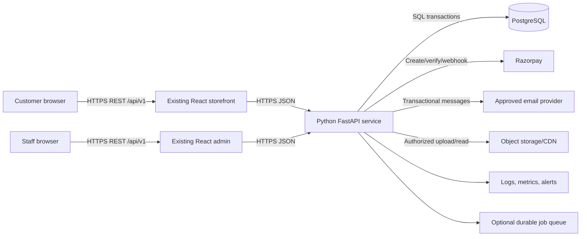
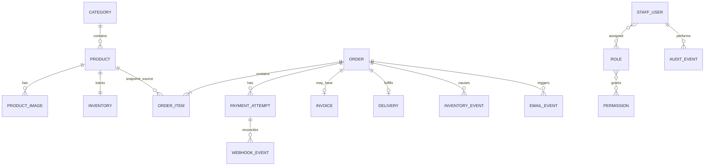

# VedhicFoods Technical Requirements Document

## 1. Document control

| Field | Value |
|---|---|
| Project | VedhicFoods |
| Document | Technical Requirements Document (TRD) |
| Version | 1.0 |
| Preparation date | 17 October 2026 |
| Status | Draft for technical and business review |
| Intended audience | Backend/frontend engineers, database and cloud engineers, security, QA, operations, product owner |
| Approval status | Pending; no approval evidence was found |

### Revision history

| Version | Date | Change |
|---|---|---|
| 1.0 | 17 October 2026 | Initial target architecture and migration requirements based on repository review and `docs/PRD.md` |

## 2. Technical overview

This document defines a proposed Python backend architecture and its integration, security, data, testing, and deployment requirements. It translates product requirements in [the PRD](PRD.md) into technical boundaries. It is not an implementation plan, backend specification, API approval, or evidence that the Python migration has occurred.

**Non-negotiable target:** all backend responsibilities will be implemented in Python. **FastAPI** is the recommended framework. PostgreSQL remains the proposed relational database. The existing React/TypeScript storefront and admin clients may remain and will continue communicating with a versioned HTTP API. This is a significant migration: the repository currently contains a TypeScript/Node.js/Express backend, not a Python backend.

Labels used here:

- **CONFIRMED**: supplied product constraint or decision.
- **VERIFIED EXISTING**: directly visible in repository source/configuration; does not prove production operation.
- **PROPOSED**: recommended target decision awaiting technical/business approval.
- **PENDING CONFIRMATION**: unresolved policy or configuration.
- **NOT VERIFIED**: cannot be established from repository evidence.
- **MISSING**: no implementation found in the reviewed paths.

### Key constraints and assumptions

- Python-only applies to all backend services and jobs; it does not require a frontend rewrite.
- Guest checkout is mandatory; customer registration cannot be a purchase prerequisite.
- Razorpay is the online payment gateway; UPI availability depends on merchant configuration; COD is excluded.
- Delivery state is updated manually by authorized staff. There is no initial courier API or live map.
- Tax rules, invoice legal details/numbering, refund/cancellation policy and guest lookup policy are unresolved.
- No production state, secret values, AWS account configuration, domain control, test results or service credentials are inferred from templates.

## 3. Existing system assessment

| Component | Repository evidence | Assessment |
|---|---|---|
| Repository modules | `frontend/`, `admin/`, `backend/`, `database/`; root `package.json` workspaces | **VERIFIED EXISTING** split client/server/data layout |
| Storefront/admin frontend | React 19 and TypeScript dependencies in `frontend/package.json`, `admin/package.json`; Vite configs; route trees under `src/routes/` | **VERIFIED EXISTING**. Client code can be retained with contract compatibility work. |
| Backend language/framework | `backend/package.json`, `backend/src/app.ts`, `backend/src/server.ts`, Express imports throughout `backend/src/` | **VERIFIED EXISTING: Node.js/TypeScript/Express**. This conflicts with the required Python target and must be migrated. |
| API shape | Express mounts API under `/api/v1` in `backend/src/app.ts`; routes in `backend/src/routes/`; clients use `VITE_API_URL` in `frontend/src/services/http.ts` and admin HTTP service | **VERIFIED EXISTING** REST-style versioned API. Exact response/validation conventions vary and need normalization. |
| Database and ORM | PostgreSQL Prisma schema at `database/prisma/schema.prisma`, database workspace/client and migrations at `database/prisma/migrations/` | **VERIFIED EXISTING**. Proposed Python SQLAlchemy models must be reconciled with, not blindly substituted for, this schema/history. |
| Authentication and authorization | `backend/src/middleware/auth.middleware.ts`, auth/staff routes/services, `admin/src/context/AdminAuthContext.tsx`, frontend auth/token services | **VERIFIED EXISTING** bearer JWT, refresh/access token flows, database-resolved permissions and resource checks. Python behavior must preserve and test contracts. |
| Guest order access | `backend/src/middleware/order-auth.middleware.ts`, order routes and frontend `orderTokenStore.ts` | **VERIFIED EXISTING** order-bound anonymous token approach in code. Lifetime/policy remains **PENDING CONFIRMATION** per PRD. |
| Payments | `backend/src/integrations/razorpay/`, payment controller/routes/services, frontend `paymentService.ts` | **VERIFIED EXISTING** Razorpay create/verify/webhook paths in source. Live merchant configuration and live transaction readiness are **NOT VERIFIED**. |
| Email | `backend/src/integrations/email/`, `backend/src/integrations/ses/`, `backend/src/integrations/brevo/`, queue and notification services | **VERIFIED EXISTING** SES/Brevo code and retry/deduplication components. Production sender verification/delivery is **NOT VERIFIED**. |
| Image storage | `backend/src/integrations/aws/s3/`, admin upload service/pages, infra S3 configuration | **VERIFIED EXISTING** S3 integration and upload flow in source; deployed bucket/CDN status **NOT VERIFIED**. |
| Invoice | `backend/src/services/invoice.service.ts`, `backend/src/integrations/pdf/invoice-generator.ts`, invoice routes/pages | **VERIFIED EXISTING** PDF/invoice generation and access paths. Tax/legal correctness and approved numbering are **PENDING CONFIRMATION**. |
| Admin operations | Admin pages for catalog, promotions, stock, orders, delivery, customers, staff, permissions, audit and invoices; corresponding backend routes/services | **VERIFIED EXISTING** source capabilities; authorization matrix needs approval and Python parity testing. |
| Deployment | `backend/Dockerfile`, `backend/docker-compose.yml`, `backend/AWS_DEPLOYMENT.md`, `backend/PRODUCTION_RUNBOOK.md`, `backend/infra/` CloudFormation/ECS templates, `.github/workflows/` | **VERIFIED EXISTING** Node-oriented deployment artifacts and plans. Actual deployed AWS resources are **NOT VERIFIED**. Python deployment must replace runtime/build/migration artifacts. |
| BigRock domain | Domain is named in supplied requirements; repo deployment docs contain hostnames/DNS references | Planned connection is **CONFIRMED**; ownership, DNS/TLS records and current routing are **NOT VERIFIED**. |
| Tests | 45 backend `*.test.ts` files using Vitest, plus integration/unit/e2e directories; Prisma/database and admin tests exist | **VERIFIED EXISTING** test files. This TRD did not run them and does not claim pass status. All backend tests need Python equivalents or explicit retirement after coverage mapping. |

The repository has a broad existing Prisma model set (including users/RBAC, products, inventory, carts, orders, payment, discount/promotion, invoices, delivery, audit, notification, support and content models). The exact field-level schema remains in `database/prisma/schema.prisma`; it is the migration source of truth until a separately approved schema plan exists. Do not use stale README claims as proof of deployment, legal invoice compliance, or test execution.

## 4. Target architecture



### Components and boundaries

- **Existing storefront/admin:** presentation, client-side validation for usability, request correlation, session/token presentation and state display. They never decide authoritative prices, paid status, permissions or inventory.
- **Python API:** the sole backend implementation. Owns validation, authentication, authorization, catalog, cart/checkout, price calculation, orders, stock, payments, invoices, email triggers, staff operations, audits, logging and background work.
- **PostgreSQL:** system of record for product/order/payment/inventory/invoice and access-control state. All multi-record business transitions use explicit transactions and constraints.
- **Razorpay:** external payment processor. The API alone creates payment orders and verifies signatures/webhooks. No secret reaches the browser.
- **Email provider and object storage:** isolated behind provider interfaces. Provider names/accounts remain configurable and production use is unverified.
- **Operations plane:** health/readiness, structured logs, metrics/alerts, backup and recovery, deployment and secret management.

### Trust boundaries and failure behavior

Browsers and gateway callbacks are untrusted inputs. Validate requests at the API boundary; authorize every private resource and admin action server-side. The API-to-database and API-to-provider boundaries use TLS/network controls and narrowly scoped credentials. Payment/email/storage outages must leave durable business state consistent and expose retry/reconciliation state; do not report success before durable recording and trusted payment verification. Use correlation IDs across API and async jobs. Do not log credentials, access tokens, full addresses or payment secrets.

**Deployment boundary:** one or more Python API containers behind an HTTPS ingress/load balancer; PostgreSQL in a restricted network; object storage and managed provider APIs accessed using service roles/short-lived credentials where available. This is a **PROPOSED** deployment shape, not a statement of what is deployed today.

## 5. Python backend technology stack

| Component | Recommendation | Purpose/status |
|---|---|---|
| Runtime | CPython 3.12+ (proposed baseline) | Security-supported runtime compatible with modern libraries. Confirm the selected AWS base image, native wheels and complete dependency set at implementation. |
| Web framework | FastAPI | Async-capable typed HTTP routing, dependency injection and OpenAPI generation. **PROPOSED**, required Python target. |
| Validation | Pydantic v2 | Request/response/config schemas; reject unknown or malformed input where appropriate. |
| ORM/query layer | SQLAlchemy 2.x; use explicit transaction boundaries | PostgreSQL persistence and relational operations. Prefer sync SQLAlchemy first unless measured I/O concurrency justifies async complexity. |
| Migrations | Alembic | Versioned and reviewed schema evolution; run as a controlled release job. |
| Database | PostgreSQL (managed production service TBD) | Relational integrity, transactions, uniqueness and concurrency control. |
| Testing | pytest, HTTPX, pytest-asyncio only if async stack selected | Unit, API and integration testing. Test DB isolated from production. |
| Razorpay | Official/maintained compatible Python SDK if it meets webhook/signature needs; otherwise small reviewed HTTP client adapter | Gateway operations behind an integration interface. Exact package choice/version **PENDING technical verification**. |
| Email | boto3 SES adapter when AWS SES is approved; provider-neutral interface | Template dispatch, retry, bounce events and provider swapping. Brevo-compatible adapter only if retained by owner. |
| Object storage | boto3 S3 adapter, or compatible signed upload approach | Product image upload and delivery. |
| PDF | WeasyPrint (HTML/CSS to PDF) recommended for branded layout, subject to native runtime dependency validation; ReportLab alternative for programmatic layout | Invoice PDF. Final choice **PROPOSED** pending deployment compatibility and sample review. |
| Background processing | Start with durable PostgreSQL outbox + worker; use SQS if production operations approves managed queue | Retryable email, webhook side effects and reconciliation without in-request loss. Avoid in-process fire-and-forget tasks for critical work. |
| Locking | `uv` or pip-tools lock file; pin complete transitive dependency set and hashes where supported | Reproducible build. Select one tool in implementation baseline. |
| Quality/security | Ruff, mypy or pyright, pip-audit and/or approved vulnerability scanner, SBOM | Formatting/static analysis/dependency risk review in CI. Tool selection proposed. |

FastAPI documentation states Python 3.10+ for current tutorial baseline; SQLAlchemy 2.1 documentation reports Python 3.11+ support. Python 3.12+ is recommended here to avoid selecting the older compatibility floor; verify all pinned dependencies and AWS runtime together when baselining. See [FastAPI first steps](https://fastapi.tiangolo.com/tutorial/first-steps/), [SQLAlchemy 2.1 migration notes](https://docs.sqlalchemy.org/en/21/changelog/migration_21.html), and [AWS Lambda Python runtimes](https://docs.aws.amazon.com/lambda/latest/dg/lambda-python.html) if Lambda remains under consideration. These links do not establish a selected deployment service.

No Python package versions are installed or verified in the repository. Lock exact tested versions at implementation; review licenses, Python compatibility, CVEs, transitive dependencies and reproducibility before release.

## 6. Python project structure

The following is a **PROPOSED** target structure; it does not describe current files.

```text
backend/
  app/
    main.py                 # FastAPI app factory/lifespan
    core/                   # settings, security, logging, errors
    api/dependencies.py     # DB/session/auth dependencies
    api/v1/                 # versioned router and endpoint modules
    schemas/                # Pydantic request/response contracts
    models/                 # SQLAlchemy persistence models
    repositories/           # persistence queries, no HTTP concerns
    services/               # business rules and transaction orchestration
    integrations/            # Razorpay, email, storage, PDF adapters
    workers/                # outbox/queue consumers and reconciliation jobs
    middleware/             # request ID, security, metrics, error mapping
  migrations/               # Alembic env and revisions
  tests/                    # unit, integration, contract, security, e2e
  pyproject.toml
  uv.lock                   # or approved equivalent
  .env.example              # names/placeholders only; no secrets
```

Routes should parse/authorize requests and call services; services enforce business rules and transaction boundaries; repositories handle persistence; schemas define external contracts; integrations wrap provider-specific APIs. Frontend continues to call `/api/v1` through its configured API URL. Avoid coupling Python internal models to TypeScript UI types.

## 7. API design standards

| Topic | Requirement |
|---|---|
| Versioning | Preserve `/api/v1` during migration. Breaking changes require a new version or coordinated, documented compatibility period. |
| REST | Nouns for resources, HTTP methods for actions; explicit action endpoints allowed for checkout, payment verification and status transitions. JSON UTF-8. |
| Status codes | 200 read/update, 201 create, 202 accepted async work, 204 successful no-content, 400 malformed/business-invalid, 401 unauthenticated, 403 unauthorized, 404 absent/private resource, 409 state/idempotency conflict, 422 schema validation, 429 throttled, 5xx unexpected/upstream failure. Do not leak resource existence where that creates privacy risk. |
| Errors | Stable envelope `{ "error": { "code": "...", "message": "...", "requestId": "...", "details": [] } }`; no stack traces or internal secrets. Align during client compatibility work. |
| Validation | Pydantic validates types, lengths, enums and formats; service layer validates policy and database state. Reject unexpected payment fields and client totals. |
| Pagination | Cursor pagination for large/changing admin lists where practical; bounded page/limit for current compatibility. Maximum page size is configured and tested. |
| Search/filter/sort | Allowlist fields/operators and sort keys; parameterize all database operations; cap query length and result size. |
| Idempotency | Require idempotency key for checkout creation and payment initiation; persist scoped key, request fingerprint, result and expiry policy. Repeated identical request returns same outcome; conflicting reuse returns 409. |
| Authentication | Bearer access credential for existing client compatibility initially; refresh/revocation behavior specified in Section 12. Guest access is separate and resource-scoped. |
| Authorization | Backend dependency/policy checks on every protected route and object; deny by default; test UI bypass and cross-customer access. |
| OpenAPI | Publish authenticated/internal API docs in non-production; production exposure policy approved by owner/security. |
| CORS | Exact allowlist for storefront/admin origins; no wildcard with credentials. Origins vary by environment. |
| Rate limits | Apply stricter limits to login, checkout, guest lookup, payment initiation/verification and webhooks; shared counter store for multi-instance production. |
| Correlation | Accept or create validated request ID, return it in header/error envelope, propagate into logs/jobs/provider metadata where supported. |
| Resource limits | Bound JSON body, file size, list page size, search text, request duration and concurrency; values set from load testing. |

## 8. API endpoint catalogue

The existing API is under `/api/v1`; frontend service clients are the compatibility reference. Paths below show the target contract and generally preserve current path families. Python target endpoints are **PROPOSED**, even where analogous Node endpoints exist. Never expose an unauthenticated list of all orders or predictable guest order data.

| Method and URL | Purpose / access | Important input | Response / validation and principal errors |
|---|---|---|---|
| GET `/products` | Public catalogue list/search/filter | `page` or `cursor`, `limit`, `q`, `category`, `sort`, availability | Product summaries; validate allowlisted filters and limits; 400 invalid filters, 429 throttled |
| GET `/products/{id_or_slug}` | Public product detail | path identifier | Approved detail and availability; 404 missing/inactive |
| GET `/categories` | Public active categories | pagination optional | Active category summaries/counts; 5xx dependency failure |
| GET `/products/{id}/availability` (optional) | Public purchasability snapshot | product ID | Boolean/quantity policy-safe result; do not reveal internal stock thresholds unless approved |
| POST `/orders/checkout/validate` (proposed) | Guest or signed-in, no order created | item IDs/quantities, address, coupon code | Validated summary with server prices; 422 fields, 409 stock/discount change |
| POST `/orders/checkout` | Guest or signed-in order creation | contact/address, item IDs/quantities, coupon, idempotency key | Pending-payment order reference and scoped guest credential where approved; 422 invalid, 409 stock/key conflict, 429 |
| GET `/orders/{order_ref}` | Customer session or guest order credential | opaque ref plus `X-Order-Token` or bearer | Minimal authorized order; 401/403/404; rate limited, no sequential ID disclosure |
| GET `/orders/{order_ref}/delivery` | Customer session/guest credential | same credential | Authorized status timeline only; no courier map requirement |
| POST `/payments/razorpay/order` | Order owner credential or authenticated user | order reference, idempotency key | Gateway order ID, amount/currency/public key reference; reject paid/cancelled or mismatched amount |
| POST `/payments/razorpay/verify` | Order owner credential/session | gateway order/payment/signature values | Verification outcome; invalid signature 400/403; mismatch 409; never trust client status |
| POST `/payments/razorpay/webhook` | Public gateway callback, signature-authenticated | raw body and signature header | 200/202 after durable event record; invalid signature 400; transient persistence failure 5xx to permit retry |
| GET `/payments/status/{order_ref}` | Order owner/session | scoped credential | Safe payment/order state; no secret/provider internals |
| POST `/auth/login` | Staff/admin (customer login if separately retained) | email/password | Access/session response; generic failure, lockout/rate limit |
| POST `/auth/refresh` | Valid refresh credential | refresh token or secure session | Rotated credentials; revoke on reuse/invalid state |
| POST `/auth/logout` | Authenticated | current session/token | 204 and credential revocation |
| GET `/admin/products`, POST `/admin/products` | Product read/write permission | filters; product content/price/status | Paginated list/create; 401/403, 422, 409 SKU/slug |
| GET/PATCH/DELETE `/admin/products/{id}` | Catalog permission | product fields/version | Detail/update/archive; optimistic conflict 409; delete/archive semantics must preserve order snapshots |
| CRUD `/admin/categories` | Category permission | name/slug/sort/status | Category result; unique slug conflict, 403 |
| CRUD `/admin/discounts`, `/admin/promotions` | Pricing/promotions permission | rule, eligibility, active interval | Promotion state; validate intervals, limits and policy; conflicts 409 |
| GET/PATCH `/admin/inventory` and `/admin/inventory/{product_id}` | Inventory permission | adjustment quantity/reason/version | Current stock and audit reference; nonnegative constraints, 409 concurrency |
| GET `/admin/orders` and `/admin/orders/{id}` | Orders read permission | filters, pagination | Scoped order list/detail; never public |
| PATCH `/admin/orders/{id}/status` | Orders update permission | target status, reason, expected version | Updated state/history; invalid transition 409 |
| PATCH `/admin/deliveries/{id}/status` | Delivery update permission | target status, notes/tracking fields only if approved | Updated manual status/timeline; 403/409; no courier integration |
| GET `/invoices`, GET `/invoices/{id}`, GET `/invoices/{id}/download` | Authorized staff or owning customer/guest | pagination or opaque id + auth | Invoice/PDF; 401/403/404; legal fields policy-controlled |
| GET `/admin/customers`, GET `/admin/customers/{id}` | Customer read permission | pagination/search | Minimum necessary customer info; audit access; 403 |
| CRUD `/admin/staff` | Owner/staff-management permission | identity, assigned roles, active state | Staff record; validate role grant authority, duplicate identity 409 |
| GET/PUT `/admin/roles`, `/admin/permissions` | Owner security permission | role and permission map | Approved effective access; deny self-escalation unless explicit policy permits |
| GET `/admin/audit-logs` | Audit-read permission | time, actor, event, pagination | Filtered immutable events; sensitive values redacted |
| GET `/admin/dashboard` and `/admin/reports/{report}` | Report permission | date range/filters | Defined aggregates; validate report access/time range |
| GET `/health/live`, GET `/health/ready` | Operational probe | none | Liveness/readiness; readiness checks essential dependencies without leaking details |

Before parity implementation, inventory the complete route behavior in `backend/src/routes/`, controllers and frontend service clients. Endpoint details are proposed, not a new API already deployed.

## 9. Database design

**Target recommendation:** PostgreSQL with SQLAlchemy and Alembic. Existing PostgreSQL/Prisma structure is **VERIFIED EXISTING**. The existing schema must be treated as the current data contract and migration history; produce a field-by-field mapping and compatibility migration before Python cutover. Do not replace production schema or data by generating a fresh schema.

### Logical entities (not a final schema)

| Entity | Purpose and key relationships | Important constraints/indexes and sensitive data |
|---|---|---|
| Product | Catalog item; belongs to category; relates to images, inventory, order items, promotions | Unique stable slug/SKU as applicable; active/search/category indexes; approved content only |
| Category | Product grouping | Unique slug; active/sort index |
| ProductImage | Product image metadata/object key | FK product; validated media type/key; no arbitrary external URL trust |
| Inventory | Stock counts and reservation state per product/variant | Unique product key; nonnegative invariant; concurrency version/lock strategy |
| InventoryEvent | Stock adjustment/reserve/commit/release history | FK product/order/actor as relevant; immutable event and time indexes |
| Discount/Promotion | Eligibility and date-limited rules | Active interval and eligibility indexes; prevent ambiguous duplicate codes/rules |
| GuestContact/Address snapshot | Necessary buyer and delivery data captured for order | Restrict access; order stores immutable fulfillment snapshot; retention policy pending |
| Order | Unique opaque public reference, customer/contact snapshot, financial totals, statuses | Unique order number and idempotency scope; indexes on created/status/payment status |
| OrderItem | Product reference plus immutable name/SKU/unit/quantity/unit-price/discount snapshot | FK order/product (product may later archive); decimal-safe amounts; quantity > 0 |
| PaymentAttempt/Payment | Attempts, provider references, amount/currency/status/timestamps | Unique provider payment ID; unique gateway order ref where applicable; never card PAN/CVV |
| WebhookEvent | Durable authenticated provider event receipt and processing result | Unique provider event ID; payload minimization/redaction; processing status/time index |
| Invoice | Order-linked invoice reference, totals, issue/void state and document key | Unique invoice identifier; FK order; tax/legal fields only from approved requirements |
| StaffUser | Admin identity and active state | Unique normalized login; password hash only if passwords; never plaintext credential |
| Role / Permission / assignments | Role-based access with possible explicit grants | Unique slug/relationship constraints; deny-by-default effective permissions |
| AuditEvent | Actor, action, resource, request ID, timestamp and minimal before/after metadata | Append-only access controls and retention; redact secrets/personal data |
| EmailEvent/Outbox | Durable notification intent, dedupe key, attempts/provider outcome | Unique dedupe key; retry/next-attempt indexes; avoid retaining full message unnecessarily |

### Relationships



Diagram expresses a logical proposal; exact cardinalities and existing relations must be confirmed against Prisma schema and data.

### Data correctness requirements

- Use `NUMERIC/DECIMAL` or integer minor units consistently for currency; never binary floating-point for money. Store currency explicitly. Define rounding/tax calculation only after accountant approval.
- Snapshot product display name, SKU/unit, quantity, unit price and applied discount on order item so later catalog edits cannot alter past orders or invoices.
- Create order, order items, inventory reservation and idempotency record in a transaction or a recoverable saga/outbox design. Keep gateway network calls outside long-held DB transactions.
- Use row-level locking or atomic conditional updates/version columns for stock. Verify sufficient available quantity in the same transaction as reservation.
- Unique constraints enforce order number, request idempotency scope, provider payment IDs, provider event IDs and invoice numbering sequence once approved.
- Referential integrity protects order/payment/invoice/audit relationships. Use archive/soft-delete for catalog entities referenced by history.
- Alembic revisions are reviewed, forward-only by default, tested on a production-like copy, and run once as a release task. Never use destructive autogeneration as approval.
- Backups, point-in-time recovery, RPO/RTO, retention, encryption and restore drills require operations approval; existing backup readiness is **NOT VERIFIED**.
- Never store raw card data. Retain only required gateway references and status evidence.

## 10. Guest checkout architecture

1. Frontend sends item identifiers/quantities, customer/contact/address, coupon if any, and an idempotency key; never sends an authoritative total.
2. API validates field lengths/formats and eligibility, then loads current products, prices, discount rules and stock from PostgreSQL.
3. Service calculates a decimal-safe quote, applying only approved discount, tax and delivery rules. If required policies/data are unresolved, production checkout must not silently invent a charge.
4. In a short transaction, persist idempotency intent, order and immutable items, with stock reservation under approved reservation policy. A duplicate identical request returns the original order result.
5. Create a Razorpay order from the persisted server amount using an idempotent external request strategy. Persist gateway reference before returning checkout data.
6. Frontend opens Razorpay checkout with public key ID and gateway order reference only. Customer completes or abandons payment.
7. Browser response is submitted to API for server-side signature verification; it is a signal, not proof by itself.
8. Razorpay webhook signature is verified against the raw request body. Persist an event receipt uniquely before effects; process duplicate delivery idempotently.
9. Payment attempt and order payment state move only through valid transitions. Verify amount, currency, gateway order and order mapping. Mismatch triggers exception/reconciliation, not paid status.
10. Commit stock or release reservation according to approved policy and verified result; status updates and history are atomic or recoverable.
11. Write invoice/notification work to durable outbox when triggering conditions are met; worker retries without duplicate invoice/email effects.
12. Customer reads minimum necessary order/timeline/invoice via signed-in ownership or the approved guest lookup mechanism.

### Failure handling

| Condition | Required behavior |
|---|---|
| Success verified | Mark payment paid exactly once; preserve provider references; continue fulfillment and approved invoice/message flow. |
| Failed payment | Keep not-paid state; customer gets next step; reservation release follows approved rule. |
| Pending/delayed callback | Show pending; query/reconcile gateway safely; do not create a second order or mark paid speculatively. |
| Abandoned modal/network interruption | Keep recoverable pending state; status check and reservation expiry policy must be approved. |
| Duplicate checkout request | Return same order for same key/fingerprint; reject changed payload reuse with conflict. |
| Duplicate webhook | Record/detect unique provider event; return success after durable receipt; no repeated stock, invoice or email effects. |
| Stock changes during checkout | Atomic revalidation/reservation rejects insufficient stock with clear conflict. |
| Gateway timeout | Persist attempt state and correlation; reconcile before retrying external create/payment request. |
| Amount/currency mismatch | Do not mark paid; flag for alert/manual reconciliation; do not issue paid invoice. |

**Guest lookup:** secure order access is **PENDING CONFIRMATION**. Recommended options for owner review are a cryptographically random, order-bound, short-lived/revocable access token or verified-contact challenge. The current repository has an order-token pattern, but adopting its duration/storage/channel is not a business decision. Never authorize by sequential order number alone; rate limit lookup and return minimum data.

## 11. Razorpay integration

- Python payment adapter creates gateway orders only from persisted server-side amount/currency and maps them to one internal order/payment attempt.
- Store internal order ID, gateway order/payment references, amount, currency, normalized status, verification evidence and timestamps. Unique constraints prevent reference reuse.
- Verify the checkout signature using the documented gateway algorithm and a constant-time comparison where applicable. Verify event signature from the exact raw webhook body before parsing or processing.
- Keep API key secret and webhook secret in managed secret storage; public key ID can be delivered to the browser. Never put secret material in frontend bundles, logs or exceptions.
- Verify payment reference belongs to expected gateway order and internal order; amount/currency match recorded intent. Client-supplied `success` is never proof.
- Persist webhook event IDs and processing state; handle duplicate, out-of-order, retry and late events idempotently. Acknowledge only after durable recording. A worker may process effects after receipt.
- Allowed transition map must distinguish `CREATED/PENDING/AUTHORIZED/CAPTURED/FAILED/REFUNDED` provider concepts from internal order status. Exact state mapping must be documented and tested.
- Reconciliation job periodically compares internal pending/paid/refund references and amounts with gateway records or reports; unmatched/mismatched items create a restricted operational alert and manual resolution record.
- Validate in Razorpay test mode, including valid/invalid signatures, amount mismatch, duplicate/out-of-order webhooks, delayed event and network retry. Production readiness and merchant UPI configuration remain **NOT VERIFIED**.
- Refund API and workflow are **PENDING CONFIRMATION**; do not implement automatic refund semantics until owner/accountant approval.

## 12. Authentication and authorization

### Principals and credential approach

| Principal | Target access approach | Restriction |
|---|---|---|
| Guest | No account required; order-scoped high-entropy credential or verified-contact flow, decision pending | Credential authorizes only one order and minimum required actions/data; never general admin access |
| Owner/super admin | Staff authentication with MFA recommended; short-lived access session and revocable refresh/session credential | Highest privilege; sensitive grants and settings audited |
| Restricted staff | Staff authentication; role/permission resolved server-side | Least privilege; suspended/disabled account immediately denied |
| Customer account (future/optional) | Separate customer identity/session flow only if approved | Must never become checkout prerequisite |

The existing clients send Bearer JWTs and currently retain tokens in browser storage. **PROPOSED migration direction:** first preserve compatible access/refresh semantics while Python service is substituted; security review must decide whether to move browser credentials to Secure, HttpOnly, SameSite cookies (which requires CSRF controls and coordinated client changes) or retain explicit bearer headers with documented XSS risk mitigation. Do not silently change token format or storage mid-cutover.

### Controls

- Passwords, if used, are hashed with Argon2id (or an approved modern adaptive password hash) using maintained library defaults; never encrypted or stored plaintext. Add reset/rotation and compromise response.
- Access tokens must be short-lived, issuer/audience/purpose-bound, algorithm-pinned and validated; refresh tokens rotate and are stored hashed/revocable with reuse detection. Logout and account disable revoke sessions. Exact TTL pending security approval.
- Use generic authentication failures, rate limits, exponential delay/temporary lockout with safe recovery, and monitoring for brute force. Avoid account enumeration.
- Resolve active user/role/permission on protected request or use a revocation design that guarantees fast deactivation; stale authorization must not outlive policy.
- Deny by default. Check permission and resource ownership in Python service/dependency for every sensitive object and state-changing action. Do not trust hidden controls or role claims from client.
- Prevent privilege escalation: only owner-authorized actor can grant roles within their grant scope; protect self-grant and last-owner cases.
- Audit login, failed login patterns, staff/role changes, product/price/stock changes, order state/payment operations, invoice actions and sensitive data access at approved detail level.

### Proposed role-permission matrix (final matrix PENDING CONFIRMATION)

Legend: R read, W write, A administer, — deny by default. “Owner” bypass must still be audited and constrained on high-risk actions.

| Capability | Owner | Catalog staff | Inventory staff | Order/delivery staff | Accountant |
|---|---:|---:|---:|---:|---:|
| Products/categories/content | A | R/W | R | R | R |
| Price/discount/promotion | A | R (W pending) | — | R | R |
| Inventory | A | R | R/W | R | — |
| Customer/order contact data | A | — | minimal | R/W fulfillment need | R/minimal |
| Order state/delivery | A | — | — | R/W | R |
| Payments/refunds | A | — | — | R (refund — until approved) | R/W only if approved |
| Invoices | A | — | — | R where operational | R/W per approved process |
| Staff/roles/security | A | — | — | — | — |
| Audit/reports/settings | A | scoped | scoped | scoped | financial reports only |

Roles shown are examples, not approved product roles. Final role names, data fields and grants require DEC-008/PRD confirmation.

## 13. Order and inventory lifecycle

### Separate state dimensions

- **Order status:** proposed lifecycle `PENDING_PAYMENT → CONFIRMED → PROCESSING → PACKED → SHIPPED/OUT_FOR_DELIVERY → DELIVERED`; terminal alternatives can include `PAYMENT_FAILED`, `CANCELLED`, `RETURNED` only where approved. Exact current enum includes additional states; map and retain data before cutover.
- **Payment status:** separate state `PENDING → AUTHORIZED/CAPTURED/FAILED`; `REFUNDED/PARTIALLY_REFUNDED` only after refund policy approval.
- **Delivery status:** separate manual operational state, updated by authorized staff and surfaced as a customer timeline. No live-map dependency.

The above is a target model, not a final approved transition contract. Define a transition table, actor permission, preconditions, side effects and audit event for each edge. Reject invalid state changes with 409. Do not let an order-status update silently manufacture a payment success.

### Inventory strategy

**PROPOSED:** on checkout, reserve available units atomically with an expiry; on verified paid result, commit reservation; on definitive failure/expiry, release it. Reservation lifetime, COD behavior (excluded from release), cancellation restoration and late successful payment after release require approved business rules. Use conditional updates/row locks and invariant `available = on_hand - reserved` (subject to final schema). Each adjustment/reserve/commit/release has an inventory event and correlation to order/actor. Concurrency tests must prove no overselling.

Cancellation/refund and stock restoration rules remain **PENDING CONFIRMATION**. Manual delivery state changes require permission, reason/note where appropriate and audit event.

## 14. Invoice and email services

### Invoice

- Generate invoice from immutable, verified order snapshot; do not recalculate historical item prices from the current catalog.
- Keep monetary totals identical to the order. Reconcile line subtotal, discount, shipping, approved tax and grand total with decimal-safe arithmetic.
- Generate a unique invoice identifier using the approved numbering policy; sequence, seller legal identity, tax IDs/rates, inclusive/exclusive treatment, mandatory fields, credit note/void rules and refund presentation are **PENDING CONFIRMATION**.
- Customer PDF and admin copy must be permission checked. Store a document key or regenerate deterministically; avoid public permanent object links. Use short-lived download authorization where appropriate.
- **PDF recommendation:** WeasyPrint allows HTML/CSS branded templates; validate its OS packages, font rendering, security and runtime image size in the selected container. ReportLab is a viable alternative for programmatic PDF where fewer HTML dependencies are preferred. Select after sample invoice review and deployment spike. Do not carry forward “tax compliant” claims from old docs without accountant/legal sign-off.

### Email and notification events

Write a durable outbox event with a unique dedupe key in the same transaction as the triggering business transition. Worker renders versioned approved templates and sends via selected provider. Record attempt number, provider reference, result category and next retry. Exponential bounded retry for transient failure; permanent rejection, bounce/complaint and suppression stop automatic retries and create operational visibility. Never let email failure roll back a paid order. Distinguish queued, accepted, delivered/bounced where provider event evidence supports it.

## 15. Product images and file uploads

- Use a provider adapter; AWS S3 is an existing Node integration and a proposed Python target, not a verified production bucket.
- Only authenticated users with catalog/image permission can initiate uploads. Use short-lived scoped pre-signed upload or API-mediated upload with server-side object key assignment; do not accept arbitrary bucket keys/URLs.
- Allowlist raster formats actually needed (e.g. JPEG/PNG/WebP; SVG only after active-content sanitization/explicit approval). Validate MIME and file signature, enforce an initial proposed 10 MB source maximum (business/operations to tune), decode/re-encode images, strip metadata where feasible, and cap dimensions/pixel count against decompression bombs.
- Generate opaque object keys; never derive paths from raw user input. Use quarantine/validation path before public delivery if direct uploads are used.
- Product image delivery may be public after publication; admin originals/drafts remain private. Invoices and customer uploads are private. Access policy and CDN cache invalidation must be explicit.
- Define cleanup for abandoned multipart uploads, replaced/unused images and orphan records. Log upload failures without leaking signed URL tokens.
- Test valid/oversized/mislabeled/corrupt/active-content files, unauthorized upload, storage outage and read delivery.

## 16. Email integration

| Option | Fit | Trade-off/status |
|---|---|---|
| Amazon SES via boto3 | Fits AWS target; supports sending and event feedback through configured AWS services | **PROPOSED preferred** if sender/domain/account are approved and SES deliverability is configured. Not verified live. |
| Brevo API via Python HTTP client | Existing code has Brevo integration; can preserve provider as adapter | **PENDING decision** whether to retain as primary/fallback; account/sender readiness unverified. |

Use provider-neutral `EmailSender` interface and test implementation. Required configuration names should be defined in Python settings and documented in `.env.example` without values; production credentials come from a managed secret mechanism or IAM role. Verify sender identity/domain, DKIM/SPF/DMARC policy as applicable, sandbox/production status, bounce/complaint subscriptions and alert owner. Trigger confirmation only on durable order/payment transitions; send invoice after the policy-defined verified condition. Do not email an invoice for unverified/failed online payment. Retry transient provider errors with deduplication; route permanent failure/suppression to operational state. Development must not accidentally send real email; use capture/sandbox. No sender domain readiness is assumed.

## 17. Security requirements

| Threat | Required controls |
|---|---|
| Broken access control / IDOR | Deny-by-default permissions; per-resource ownership; opaque references; backend authorization tests for every role and cross-customer attempt. |
| SQL injection | SQLAlchemy parameterized expressions; prohibit unsafe string SQL without reviewed parameter binding; least-privilege DB user. |
| XSS | Contextual output escaping in frontend, sanitize approved rich text, restrictive CSP; avoid rendering untrusted HTML. |
| CSRF | If cookie credentials are selected, SameSite/CSRF token and Origin checks for state changes. Bearer-header approach reduces ambient-cookie CSRF but does not solve XSS/token theft. |
| SSRF | Do not fetch arbitrary user URLs for images/webhooks; validate destinations and block private/link-local ranges if outbound fetch ever exists. |
| Credential theft/brute force | MFA recommendation for owners, adaptive password hash, rate limit, rotation/revocation, secret manager, no secrets in source/image/logs. |
| Unsafe upload | Type/signature validation, size/dimension limits, re-encode, quarantine, private defaults, least-privilege storage. |
| Replay/webhook forgery | Verify raw-body signature, timestamp/replay window if provider supports it, durable unique event IDs, idempotent processing. |
| Duplicate payment effects | Unique provider references, transaction-safe state transition, idempotent handlers/outbox, reconciliation. |
| Sensitive data exposure | Data minimization, scoped guest access, redacted logs/errors, TLS, database/storage encryption, retention/deletion policy. |
| CORS/API abuse | Exact origins, no permissive credentials, request limits, rate limiting, WAF/edge controls subject to cloud design. |
| Excessive requests/resource exhaustion | Body/query limits, connection pool caps, timeouts, rate limits, bounded worker queues and backpressure. |

All network traffic carrying credentials or personal data must use HTTPS/TLS. Encrypt database, backups and private object storage at rest using managed key controls. Protect sensitive stored fields only where threat/legal assessment justifies application-layer encryption and key lifecycle can be safely operated. Use safe errors, structured redacted logs, audit trails and vulnerability scans. No certification or regulatory compliance is claimed. Privacy law, retention and deletion obligations are **PENDING CONFIRMATION**.

## 18. AWS deployment architecture

AWS production is an intent; no live resources were independently verified. Existing artifacts describe Node/ECS-oriented deployment, RDS/PostgreSQL templates, edge/load balancer, monitoring and S3/SES. They are not evidence of deployed infrastructure. Python requires new build, runtime, dependency, health and Alembic execution paths.

### Options

| Concern | Option A | Option B | Recommendation/status |
|---|---|---|---|
| Python API | ECS Fargate container behind ALB | AWS App Runner or Elastic Beanstalk managed app | ECS is **PROPOSED preferred** because repository already has container/ECS concepts and background worker/network separation may be useful; platform/account fit and cost require approval. |
| PostgreSQL | Amazon RDS PostgreSQL | Existing managed PostgreSQL provider if confirmed | RDS is aligned with AWS target; actual database location/provider is **NOT VERIFIED**. Preserve data and decide after inventory. |
| Product images | Private S3 + CDN/origin access control | Managed compatible object store | S3 **PROPOSED** based on existing integration; verify ACL, KMS, CDN and domain. |
| Email | SES | Brevo | SES **PROPOSED** preferred AWS option; sender and production sending access pending verification. |
| Secrets | Secrets Manager + task role injection | SSM Parameter Store SecureString | **PROPOSED**; scope least privilege, avoid credentials in task definitions. |
| Monitoring | CloudWatch logs/metrics/alarms | Approved external observability service | CloudWatch is **PROPOSED** in AWS plan; actual setup unverified. |
| DNS/TLS | BigRock DNS to AWS ingress/ACM certificate | Transfer DNS hosting after owner approval | Keep BigRock domain as required. Exact DNS owner/records and TLS target **PENDING CONFIRMATION**. |

### Environment and release controls

- Separate development, staging and production databases/accounts/configuration; no production customer data in developer/test environments.
- Maintain Python-only image build from a locked dependency file. Run tests, static checks, dependency scan and image scan in CI; publish immutable artifact and SBOM.
- Use execution role for image pull/log emission and task role for narrowly scoped application actions. Prefer private subnets for API/database access; expose only HTTPS ingress. Exact network layout awaits AWS account review.
- Keep configuration keys in settings schema and names-only `.env.example`; production values in managed secret store/role-based retrieval. Never bake secrets in images or frontend builds.
- Run Alembic migration as explicit one-off deployment task with backup/compatibility check; application rollout must not race schema change. Use expand/contract migrations for rolling release.
- Health endpoints separate liveness from readiness. Readiness checks database and critical dependencies without disclosing connection strings.
- Deploy canary/rolling only after parity checks; use immutable image tag. Rollback application image and use forward-fix/restore plan for schema changes; do not assume DB migration is reversible.
- BigRock DNS must be updated only after approved endpoint, certificate validation, TTL/cutover plan and rollback destination are ready. No DNS change is part of this TRD task.
- Verify production smoke tests, Razorpay non-charge or controlled validation, email capture/test, image access, alerts, backup, and restore procedure before launch.

## 19. Performance and scalability

No traffic volume, baseline, or benchmark result is known. Targets below are **PROPOSED test objectives**, not achieved measurements; product/operations must approve numeric budgets.

| Metric | Proposed initial target | Test conditions |
|---|---|---|
| Public read API latency | p95 ≤ 500 ms excluding external dependencies | Staging-like DB/data, warm and cold requests, realistic pagination and concurrent clients |
| Checkout API latency | p95 ≤ 1.5 s excluding Razorpay hosted interaction | Representative DB and stock contention; report gateway calls separately |
| Database query latency | p95 ≤ 100 ms for indexed common queries | Production-like dataset and query plan capture; exclude network setup |
| Catalogue pagination | Bounded page (default 24, maximum 100 proposed) without unbounded scans | Search/filter/sort mix on catalogue volume approved by owner |
| Concurrent checkout | Sustain 50 simultaneous attempts in a controlled test without overselling or duplicate order | Limited-stock contention plus normal stock; adjust after traffic forecast |
| Image delivery | p95 ≤ 1 s for optimized image from target geography | Representative image sizes and CDN cache cold/warm; target needs geography confirmation |
| Error rate | <1% server-side 5xx over a 15-minute load window, excluding deliberate fault injection | Defined staging load; distinguish provider errors and client 4xx |
| Resource utilization | Keep CPU/memory below 70% sustained at expected peak | Profile worker/API separately; capacity and autoscaling thresholds require AWS design |

Run baseline, load, soak, burst, checkout contention and dependency degradation tests before setting production limits. Never use these proposals as current performance claims.

## 20. Testing strategy

Python implementation should use pytest and HTTPX (FastAPI test client or ASGI transport) plus PostgreSQL integration environment. Production-like payment/email tests must use sandbox/test configuration and captured side effects.

| Test area | Required expected outcome |
|---|---|
| Unit/business rules | Price, discount, state transitions and access policies match approved rules including boundary cases. |
| API/schema | Valid requests return documented responses; invalid types/ranges and malformed payloads are rejected consistently. |
| PostgreSQL integration | Constraints, transaction rollback, migrations and repository behavior pass against supported PostgreSQL version. |
| Authentication | Expired, malformed, revoked, wrong-purpose and disabled-account credentials are rejected; rotation/reuse behavior is safe. |
| RBAC/resource privacy | Each role's allowed action succeeds and denied action fails at backend; one customer cannot retrieve another's orders/invoices. |
| Cart/pricing | Server recalculates catalog price; stale client amount ignored; decimal arithmetic and approved promotion/tax behavior reconcile. |
| Inventory concurrency | Competing checkout cannot oversell; reserve/commit/release are exactly-once and auditable. |
| Razorpay | Test-mode order creation, valid/invalid signatures, amount/currency mismatch, duplicate/out-of-order webhook and delayed result. |
| Guest privacy | Guessable IDs fail, token is order-bound/expired as specified, lookup is rate limited and response minimizes personal data. |
| Invoice | Snapshot totals equal order, numbering uniqueness, approved tax fields, PDF content/rendering and access checks. |
| Email | Outbox retry, dedupe, permanent failure, bounce/suppression, disabled provider and no real send in test. |
| Upload/storage | Permission, content signature, size/pixel limits, invalid type, outage, private invoice and published image paths. |
| Security | Dependency scan, static analysis, injection/XSS/CSRF as applicable, rate limits, secrets/log redaction, API abuse. |
| Performance | Approved Section 19 profile passes without correctness failures; record hardware/data/config with result. |
| Frontend compatibility | Existing React clients complete catalog, guest checkout, auth, payment, admin and invoice flows against Python contract. |
| Deployment smoke | Container starts, readiness works, DB migration gate and secret resolution are correct, ingress/TLS/CORS operate. |
| Recovery | Restore backup to isolated environment, verify orders/payments/invoices/audit integrity and measure approved RPO/RTO. |

The repository currently has 45 backend Vitest TypeScript test files. They were not run for this TRD. During migration, map each test scenario to Python tests and retain the old backend test suite until equivalent coverage and cutover acceptance are demonstrated. Do not report passing tests without recorded execution output.

## 21. Observability and operational support

- Emit structured JSON logs with timestamp, level, service/version, request ID, route template, actor ID (when appropriate), outcome and duration. Redact authorization, guest tokens, secrets, address/email/phone and full webhook payloads.
- Metrics: request count/latency/error by route class; database pool/wait/query indicators; checkout/order/payment state counts; webhook backlog/age; outbox/email retry and bounce counts; stock conflicts; worker queue depth; storage error rate.
- Liveness checks process availability; readiness checks DB and critical local dependencies; third-party provider outage should degrade relevant feature without leaking infrastructure detail.
- Alert on repeated payment mismatches, unprocessed verified webhooks, stuck pending orders, outbox age/failures, database availability/capacity, backup failure, elevated 5xx and storage failure. Define severity, on-call owner and runbook before production.
- Reconciliation reports must be restricted, actionable, and record operator resolution. Do not log full payment credentials.
- Define audit retention, operational log retention, privacy retention and deletion separately; obtain owner/legal approval. Existing CloudWatch templates do not prove live alerts/retention.

## 22. Technical risks and migration plan

| Risk | Impact | Mitigation | Dependency / validation |
|---|---|---|---|
| Current backend is Node/Express while target requires Python | Requirement not met until complete service migration | Build Python service and cut over only after route/feature parity, security and operational validation | Route inventory; no Python implementation found; parity matrix approved |
| Prisma schema/migrations and Python ORM diverge | Data loss, incompatible writes or duplicate schema authority | Preserve PostgreSQL; map every Prisma model/enum/index/constraint to SQLAlchemy/Alembic; adopt one migration authority after cutover | Schema comparison, migration rehearsal, checksums/reconciliation |
| Existing browser clients depend on Node API quirks | Checkout/admin regressions | Capture API contract from frontend services and integration tests; compatibility adapter and contract tests | Client route inventory, no breaking cutover until E2E pass |
| Auth/token semantics change | Users locked out or access/privacy vulnerability | Preserve compatible token claims/refresh where safe; approve cookie vs bearer strategy; test revocation/RBAC parity | Security review and cross-client tests |
| Payment side effects differ across implementations | False-paid orders, duplicate email/stock operations | Dual-run only in non-production; unique provider/event refs; reconciliation and controlled payment test plan | Razorpay test account and exact state map |
| Deployment and CI are Node-specific | Python cannot build/deploy reliably | Replace Docker build, runtime health, dependency install, CI test, ECS task, migration task and rollback configuration | AWS review and Python image test |
| Historical data migration corrupts financial/order history | Invoices and audit not trustworthy | In-place schema-compatible deployment preferred; otherwise rehearsed ETL with counts, totals, references and rollback checkpoint | Database owner and backup validation |
| Unresolved tax/refund/guest policy blocks safe behavior | Incorrect invoices or data exposure | Resolve PRD decisions before final implementation acceptance; use explicit non-production defaults only in isolated tests | Owner/accountant/security decisions |
| Test suite lacks parity | Hidden behavioral regressions | Map all critical existing TS tests to Python; require coverage of P0 flows and negative authorization | QA sign-off by requirement ID |

### Controlled migration sequence (documentation only)

1. Inventory Express routes, middleware, DTOs, models, service behavior, frontend API use and existing test cases.
2. Build a route/behavior mapping to proposed Python `/api/v1` contracts; classify compatibility deviations.
3. Map all Prisma schema objects, migrations, indexes, enums and seed behavior to an approved PostgreSQL migration plan.
4. Implement Python/FastAPI slices with unit/integration/contract tests; move business rules to services and repositories.
5. Validate Razorpay signature/webhook/reconciliation and email/storage/PDF adapters in isolated test accounts.
6. Run existing frontend and admin clients against Python staging; test guest privacy, staff roles, retries and mobile checkout.
7. Replace Node-specific Docker/CI/deployment and Alembic release workflow; verify observability, backup and restore.
8. Reconcile data counts, financial totals, order/payment references and audit rows; complete regression, security and load tests.
9. Approve cutover, freeze writes or use an explicitly designed compatibility window; maintain rollback to prior artifact/data strategy.
10. Retire Node services only after business/engineering approval, stable reconciliation window, and preservation of required records.

No migration step was executed by creating this TRD.

## 23. Technical decisions register

| Decision ID | Topic | Current state | Recommendation | Rationale | Alternatives | Dependencies | Status |
|---|---|---|---|---|---|---|---|
| TD-001 | Backend language/framework | Node.js/TypeScript/Express exists | Python + FastAPI | Required Python-only target; typed API and OpenAPI | Flask/Django REST Framework; FastAPI preferred absent constraint | Team/runtime approval | **PROPOSED** |
| TD-002 | Database | PostgreSQL + Prisma exists | Keep PostgreSQL; migrate persistence to SQLAlchemy/Alembic after schema mapping | Preserve data and relational behavior | Other DB only with approved evidence | Schema mapping, owner | **PROPOSED** |
| TD-003 | ORM/migrations | Prisma migrations own current schema | SQLAlchemy 2.x + Alembic after migration plan | Mature relational toolkit and explicit Python migration authority | SQLModel; direct SQL | Data migration and ORM spike | **PROPOSED** |
| TD-004 | Authentication | Bearer JWT/refresh code exists | Preserve compatible semantics initially; decide secure cookie vs bearer after review | Minimize client breakage while addressing browser token risk | Cookie session, opaque server session | Security review, PRD DEC-008/DEC-011 |
| TD-005 | Guest lookup | Existing order-bound token code | High-entropy order-scoped credential or verified contact challenge | Avoid predictable ID disclosure | One-time emailed link, OTP | Business policy DEC-001, privacy |
| TD-006 | Image storage | S3 integration code exists | S3 with scoped upload and private defaults for sensitive docs | Fits AWS goal and current client flow | API proxy upload, compatible store | AWS/account/CDN review |
| TD-007 | Email | SES + Brevo adapters exist | Provider abstraction; SES preferred if verified, Brevo as approved alternative | Retry and provider change isolation | Other transactional provider | Sender readiness/ownership |
| TD-008 | Invoice PDF | Existing Node PDF generator | WeasyPrint recommendation after runtime spike | Branded HTML/CSS layout; assess OS dependencies | ReportLab | Accountant sample, AWS image review |
| TD-009 | AWS hosting | ECS/RDS/edge artifacts describe Node plan | ECS Fargate Python container is preferred candidate | Reuse operational concepts; Python runtime image | App Runner, Elastic Beanstalk, Lambda | Account/cost/network review |
| TD-010 | Background work | Node queue/outbox code exists | Durable outbox + worker, optionally SQS | Reliable retry/deduplication for payment/email side effects | Celery/RQ/managed queue | Throughput/ops decision |
| TD-011 | Observability | CloudWatch assets and structured Node logs exist | Structured Python logs + CloudWatch metrics/alarms if AWS confirmed | Operational continuity | Approved external service | AWS live state and retention policy |
| TD-012 | Currency storage | Existing schema stores financial fields; exact data types inspect in migration | Decimal-safe fixed precision or integer minor units consistently | Avoid floating-point errors | Numeric decimal | Accountant rounding/currency decisions |
| TD-013 | Customer token storage | Frontend persists bearer/session material | Decide HttpOnly cookie vs explicit bearer headers | XSS/CSRF trade-off and compatibility | Server-side opaque session | Security review and coordinated client changes |

## 24. Traceability matrix

Status describes design/evidence, not completion. Acceptance references use the PRD Section 14 IDs. Detailed Python test IDs will be assigned during implementation.

| PRD requirement | Technical component | API/data dependency | Security requirement | Test requirement | Implementation status |
|---|---|---|---|---|---|
| FR-001, FR-002, FR-028 | Storefront content/navigation and content admin | Content pages/settings and approved copy | Publish permission, safe rendering, no unapproved claims | Route/content approval, render/authorization | React pages and content service **VERIFIED EXISTING**; Python content API **MISSING** |
| FR-003, FR-004, FR-005 | Catalog API/service | Product/category/image | Public field minimization, query limits | API/search/catalog contract | Node source **VERIFIED EXISTING**; Python **MISSING** |
| FR-006, FR-009 | Cart/quote/pricing service | Product, discount and monetary rules | Ignore client totals | Decimal/pricing tests | Node source **VERIFIED EXISTING**; Python **MISSING** |
| FR-007, FR-008 | Guest checkout API | Contact/address/order | Data minimization and validation | Guest checkout/privacy tests | Node source **VERIFIED EXISTING**; Python **MISSING** |
| FR-010, BR-004 | Checkout/idempotency service | Order and idempotency key | Replay-safe request scope | Duplicate request/concurrency | Node source **VERIFIED EXISTING**; Python **MISSING** |
| FR-011, FR-012, BR-005 | Razorpay adapter | Payment attempt/webhook records | Server signature verification; secret storage | Razorpay sandbox/signature | Node source **VERIFIED EXISTING**; Python **MISSING** |
| FR-013, BR-006, BR-007 | Payment/order state service | Payment and order transition tables | Idempotent callbacks and reconciliation | Failure/delay/duplicate event | Node source **VERIFIED EXISTING**; Python **MISSING** |
| FR-014, FR-018, BR-009 | Guest access/order timeline | Opaque order ref and access token | Owner-only resource access, rate limits | IDOR/guess/expiry tests | Node/client source **VERIFIED EXISTING**; Python **MISSING**; policy pending |
| FR-015, BR-003 | Inventory service | Inventory/event/stock reservation | Atomic updates, staff permission | Oversell contention tests | Node source **VERIFIED EXISTING**; Python **MISSING** |
| FR-016, FR-017, BR-008 | Order/delivery service | Status history and actor | Backend permission and audit | Valid/invalid transition tests | Node source **VERIFIED EXISTING**; Python **MISSING** |
| FR-019, FR-029, BR-011 | Invoice/PDF service | Order snapshot, invoice sequence | Private/authorized download | Arithmetic, numbering, PDF/access | Node source **VERIFIED EXISTING**; Python **MISSING**; tax pending |
| FR-020, BR-013 | Outbox/email worker | Email events and provider refs | Secret/log redaction and dedupe | Retry/bounce/no-duplicate tests | Node source **VERIFIED EXISTING**; Python **MISSING** |
| FR-022, FR-023 | Admin catalog/pricing | Product/category/image/promo | RBAC, upload validation | Admin permission/file tests | Node/admin source **VERIFIED EXISTING**; Python **MISSING** |
| FR-024, FR-025, BR-010 | Customer/staff/RBAC service | User, role, permission and ownership | Deny-by-default server enforcement | Role matrix and IDOR tests | Node source **VERIFIED EXISTING**; Python **MISSING** |
| FR-026 | Audit service | Append-only audit events | Restrict/read-redact logs | Critical action audit tests | Node source **VERIFIED EXISTING**; Python **MISSING** |
| FR-029 | Admin invoice access | Invoice/order snapshot and PDF | Staff permission and customer ownership | Invoice listing/download authorization | Node/admin source **VERIFIED EXISTING**; Python **MISSING** |
| FR-021, FR-027 | Reporting service | Defined aggregates | Report permission and privacy | Reconciliation/report authorization | Node source **VERIFIED EXISTING**; Python **MISSING** |
| NFR-002 | API/security middleware | Auth, rate limits, validation | Threat controls in Section 17 | Security test suite | Current Node controls exist; Python **MISSING** |
| NFR-012 | Backup/recovery operations | DB/storage backup | Least privilege/encryption | Restore drill | **NOT VERIFIED** production; Python deployment pending |

## 25. Definition of done

### Architecture approval

- Python-only backend target, service boundaries, runtime and AWS hosting choice approved.
- Risks and technical decisions are accepted or assigned to named decision owners.
- No unresolved architecture choice is represented as deployed fact.

### API contract approval

- Python request/response/error contracts are documented and compared to all frontend/admin clients.
- Guest order access, auth transport, rate limits, idempotency and payment webhook semantics are approved.
- OpenAPI review and compatibility/deprecation plan are signed off.

### Database design approval

- Prisma-to-target field/constraint/index/enum mapping and production data plan are reviewed.
- Transaction, stock concurrency, snapshots, monetary precision, migration ownership, backup and recovery decisions are approved.
- Sample invoice/order totals reconcile under accountant-approved rules.

### Python implementation readiness

- Python version, pinned dependencies, repository layout, coding/static checks and test strategy are locked.
- P0 PRD requirements have mapped Python components and passing test plans; no test pass is presumed by this document.
- Environment configuration and secret handling are defined without committing credentials.

### Integration and security readiness

- Razorpay test-mode signature/webhook/idempotency paths, email capture/retries, storage validation and PDF output are verified.
- Backend role/resource checks, privacy, abuse/rate limits, secret redaction and dependency scanning have reviewed evidence.
- Live credentials/accounts are independently provisioned and approved; documentation does not establish that status.

### Deployment readiness

- Python image and CI/CD pipeline, Alembic release task, TLS/DNS for BigRock domain, monitoring, alerts and rollback are rehearsed.
- Backup restoration meets approved RPO/RTO and order/payment/invoice integrity is checked.
- Production smoke, frontend compatibility and migration rollback/cutover plan are approved.

**Document completion** means these requirements and recommendations are recorded. It does not mean Python code exists, migration is done, integrations are live, tests pass, infrastructure is deployed, or the TRD is approved.

## Repository inspection notes

Review scope included `docs/PRD.md`; package manifests and source routing/client files; `backend/src/`, `frontend/src/`, `admin/src/`; `database/prisma/schema.prisma` and migration paths; tests; Docker/Compose, CI workflows, and AWS deployment/infrastructure docs. Environment templates were consulted for variable names only; no actual environment values were copied into this document. No app code, dependency, database, environment file, AWS resource or deployment was changed. No tests were run.

Repository contains many pre-existing working-tree changes. They were left untouched. The documented evidence is source/configuration presence only; live AWS/Razorpay/SES/Brevo/S3/PostgreSQL/BigRock operation and production security posture remain **NOT VERIFIED**.
