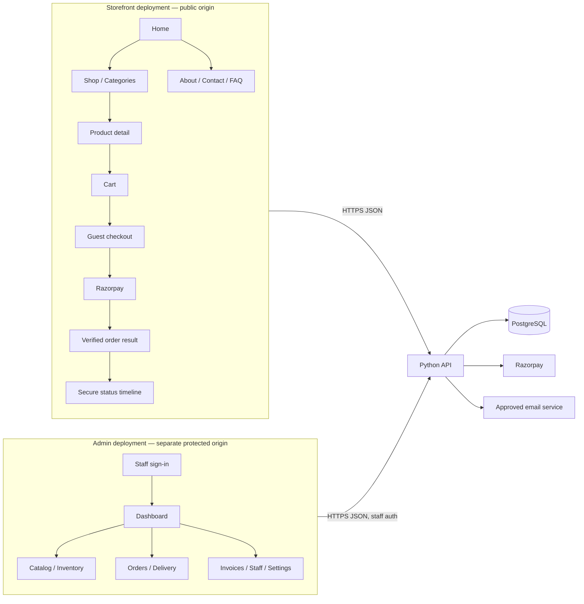
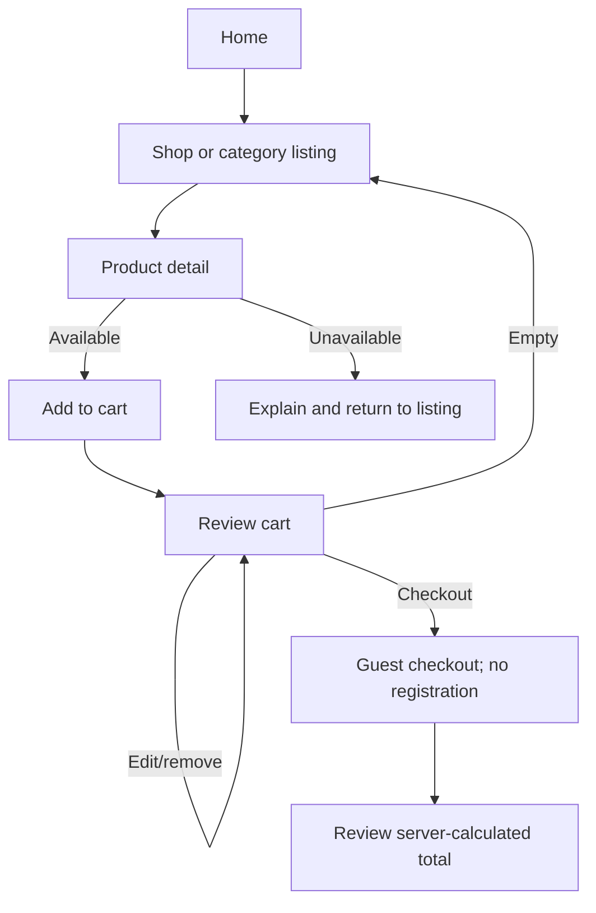
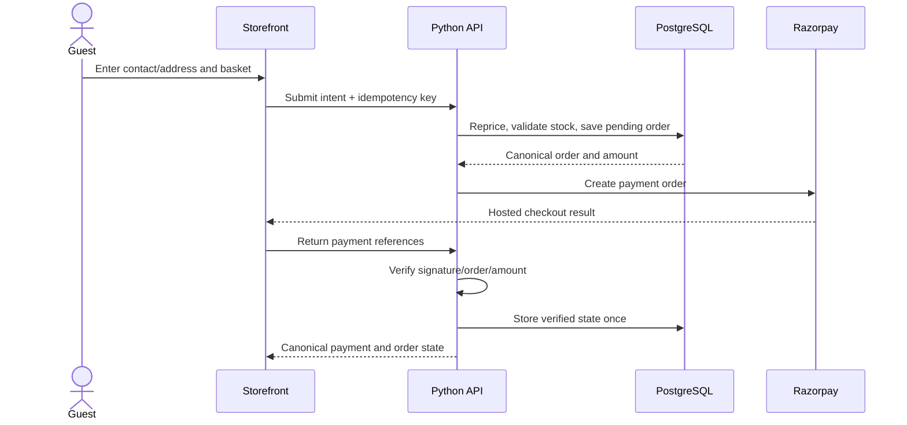
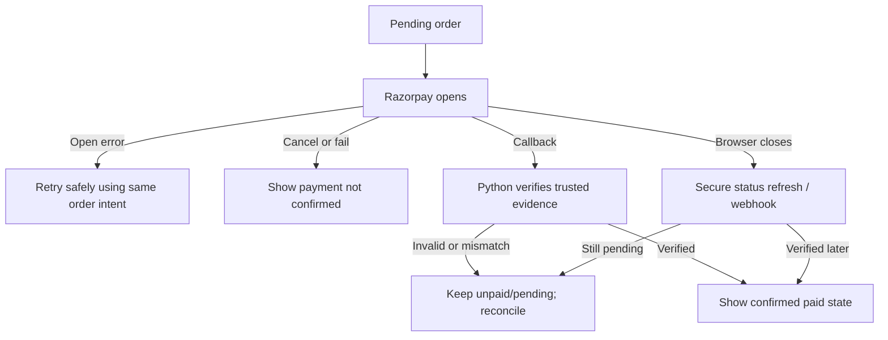
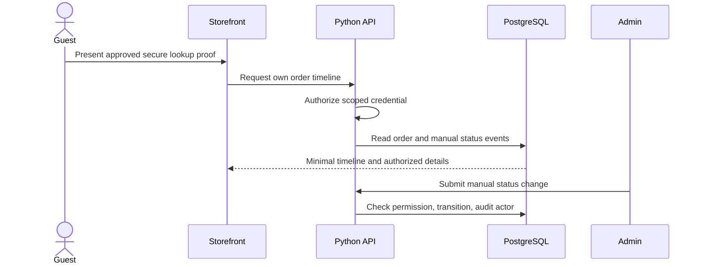
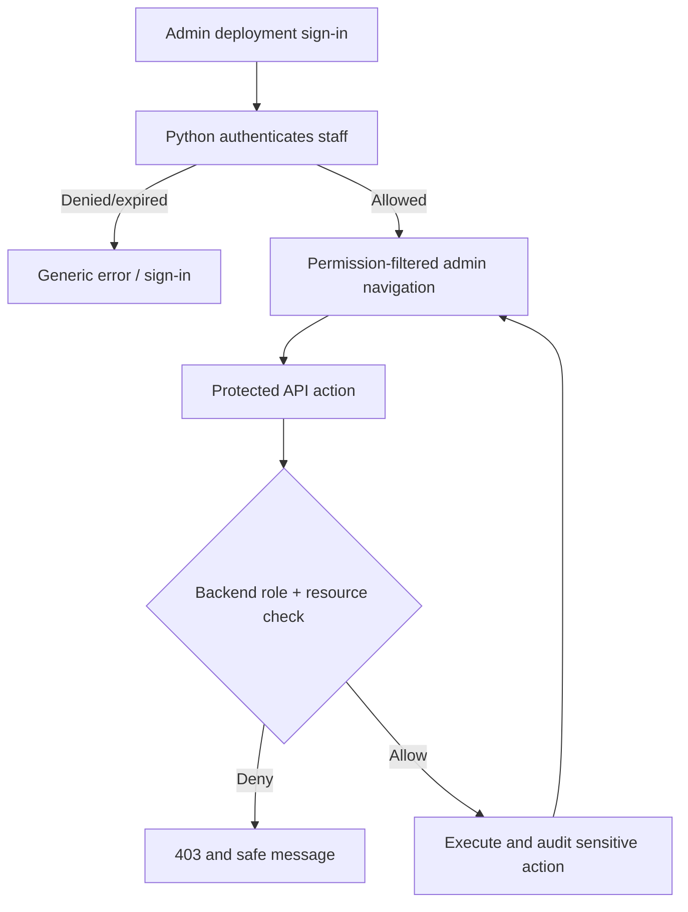
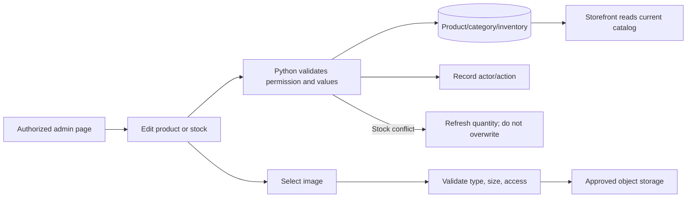
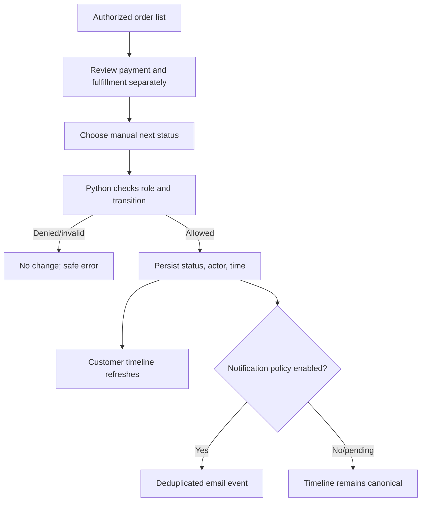
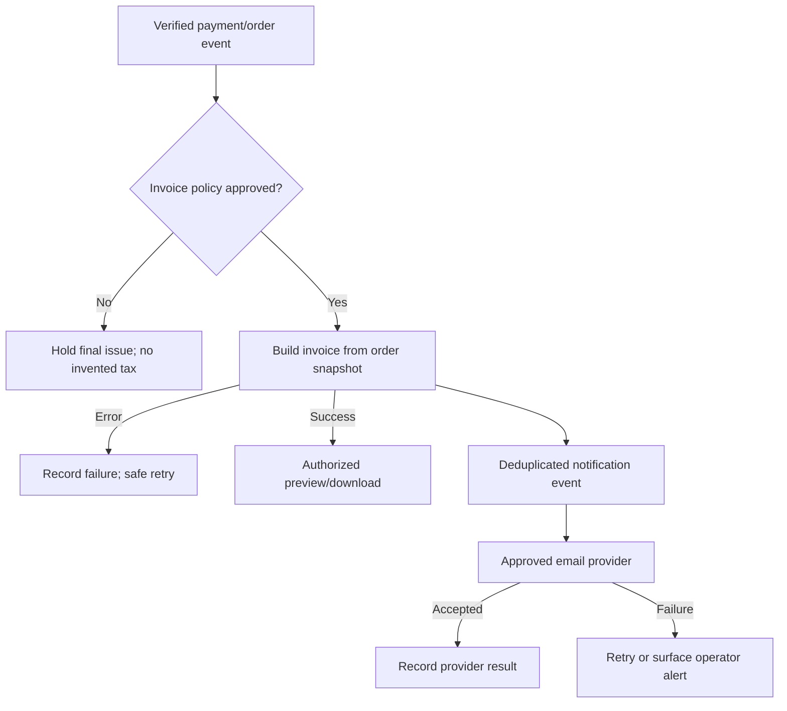

# VedhicFoods UI/UX Design Brief — Existing Client-Approved Experience

> **Design preservation instruction:** This brief documents the current repository UI as the client-approved baseline. It does not redesign, re-theme, re-layout, or replace the existing experience. Current tokens, components, page patterns and responsive behavior are recorded as found. Any mismatch with confirmed product rules is documented for owner decision; no visual or application change is authorized by this document.

## 1. Document Control

| Field | Value |
|---|---|
| Document title | VedhicFoods UI/UX Design Brief — Existing Experience |
| Project | VedhicFoods |
| Document ID | VF-UIUX-001 |
| Version | 1.0 |
| Date | 17 October 2026 |
| Purpose | Capture the existing storefront/admin visual language and page-by-page interaction contract for implementation, QA and handoff without redesigning the finalized UI. |
| Intended audience | Client, product, design, React frontend, Python backend, QA and operations teams |
| Related documents | [PRD](PRD.md), [TRD](TRD.md), [App Flow](APP_FLOW.md) |
| Status | DRAFT — PENDING REVIEW |
| Client design status | User states the current UI/UX is finalized by the client. Formal approval artifact was not present in the repository. |
| Approval | Pending written document approval; design changes are outside this brief's scope. |

### Status labels

- **CONFIRMED REQUIREMENT** — confirmed by the PRD or current user instruction.
- **VERIFIED EXISTING** — code, styles, route, asset, or component is present. This is not visual/runtime QA evidence.
- **PROPOSED DESIGN** — only used for missing interaction behavior needed to complete implementation; it does not authorize a visual redesign.
- **PENDING CONFIRMATION** — unresolved policy/content/technical detail.
- **NOT VERIFIED** — source inspection cannot establish the claim or behavior.
- **MISMATCH** — repository currently conflicts with a confirmed requirement.
- **OUT OF SCOPE** — excluded from the current product flow.

## 2. Repository and Design Audit

### 2.1 Verified structure and design artifacts

| Area | Existing implementation | Status / note |
|---|---|---|
| Storefront | React 19/TypeScript/Vite in `frontend/`; customer layout, page routes, page components and service clients under `frontend/src/` | **VERIFIED EXISTING** |
| Admin dashboard | Separate React 19/TypeScript/Vite app in `admin/`; own router, auth context, shell, pages, services and styles | **VERIFIED EXISTING**; separate deployment is confirmed by owner; production origins not independently verified |
| Backend | Node.js/TypeScript/Express under `backend/src/`; API mounted at `/api/v1` | **VERIFIED EXISTING, MISMATCH** to Python-only target in PRD/TRD; all described target backend interactions below refer to the required future Python API, not current implementation |
| Data | PostgreSQL Prisma schema and migrations in `database/prisma/` | **VERIFIED EXISTING**; backend integration details are in TRD |
| Customer routes | `/`, `/about`, `/shop`, `/categories`, `/product/:slug`, `/cart`, `/checkout`, `/order-success/:orderNumber`, invoice routes, `/contact`, `/faq`, `/support`, plus `/login`, `/register`, `/account` | **VERIFIED EXISTING** in `frontend/src/routes/index.tsx`; account routes conflict with confirmed no-customer-account experience |
| Admin routes | `/admin/login`, admin root/dashboard, products, inventory, orders, customers, delivery, invoices, discounts/promotions, support, staff, permissions, audit logs and settings routes | **VERIFIED EXISTING** in `admin/src/routes/index.tsx`; route paths are within the separate admin application origin |
| Theme tokens | `frontend/src/styles/tokens.css`, duplicated design token file under `admin/src/styles/tokens.css`; admin theme configuration in `admin/src/config/theme.ts` | **VERIFIED EXISTING**; values below are transcribed, not proposed replacements |
| Shared storefront components | Header/navigation/footer, product cards/grid, filters, cart drawer, checkout/address/payment components, common forms, states, buttons, modals, drawers, skeletons | **VERIFIED EXISTING** under `frontend/src/components/` |
| Shared admin components | Admin shell, route guards, page headers, tables, form controls, dialogs, drawers, badges, pagination, upload field, loading/error states | **VERIFIED EXISTING** under `admin/src/components/` |
| Responsive styles | Breakpoints and mobile nav/admin sidebar behavior in `frontend/src/styles/` and `admin/src/styles/admin.css` | **VERIFIED EXISTING** in CSS; actual device visual acceptance **NOT VERIFIED** |
| Imagery | Current files in `assests/desktop`, `assests/mobile`, `assests/body`, plus public icon assets | **VERIFIED EXISTING**. Filenames indicate ingredients, kitchen, cooking, arranging, packing, delivery and customer imagery. Asset meaning/rights/claim approval requires business confirmation. |
| Accessibility patterns | `SkipLink`, focus trap, Escape handling, focus first, focus-visible tokens, reduced-motion CSS and semantic labels in components | **VERIFIED EXISTING** patterns; WCAG conformance **NOT VERIFIED** |

### 2.2 Existing, required, and this brief

| Area | Existing implementation | PRD/App Flow requirement | Gap | Status |
|---|---|---|---|---|
| Overall customer experience | Warm natural food brand, responsive storefront | Preserve client-approved current UI | This brief records current UI only | **CONFIRMED REQUIREMENT** |
| Customer registration/account | `/login`, `/register`, `/account` routes and related code exist | Latest owner instruction says no customer registration/account flow | Product behavior conflict; this document does not alter UI/code | **MISMATCH; owner decision controls target flow** |
| Payment selector | Checkout code includes COD enum/label and payment selector | Razorpay online only; COD unavailable | Current code may expose COD; excluded from intended design flow until resolved in implementation | **MISMATCH** |
| Product/product-story content | Home sections and image assets exist | Only verified/approved content and claims may be published | Content correctness, image rights and claims not established by code | **PENDING CONFIRMATION** |
| Order tracking | Order/delivery API client and order result exist | Secure guest lookup and manual status timeline | Dedicated guest lookup screen not verified; exact access remains pending | **PENDING CONFIRMATION** |
| Separate deployments | Independent frontend/admin projects and routes | Storefront and admin deployment separately | Owner confirms deployment separation; actual origins and live links not inspected | **CONFIRMED / NOT VERIFIED live config** |
| Backend behavior | Current Express API services/routes | Python-only target backend | Python backend does not exist in reviewed source | **MISMATCH; migration required** |
| Tax/invoice visual content | Invoice UI and tax invoice text exist | Tax treatment/fields/numbering unresolved | Existing text is not approval of legal invoice content | **PENDING CONFIRMATION** |

No screenshot or live browser inspection was performed for this documentation task. Layout descriptions come from routes, components, CSS and current assets; exact rendered pixel positions can vary with data and viewport. No visual adjustments are proposed.

## 3. Experience Principles — Applied to Existing UI

| Principle | Existing UI expression to preserve | Interaction consequence |
|---|---|---|
| Straightforward discovery | Home sections, category cards, Shop and product grid | Category/product links remain direct; active filters are clear; no new navigation concepts are introduced. |
| Food imagery without unsupported claims | Current image/story sections and product media | Use supplied assets already present; do not add certification, health, sourcing or testimonial claims without approval. |
| Clear price and availability | Price display, stock badges/quantity controls, cart summary | Server response is authoritative at checkout; changed price/stock is shown before payment. |
| Low-friction guest checkout | Existing customer/address/review/payment steps | No account registration, customer sign-in or account dashboard is part of this experience. |
| Accurate payment status | Payment result and order page | Render success only when Python backend returns verified state; redirect is not proof. |
| Recoverable errors | Toasts, inline errors, skeletons, empty states, route error pages | Keep the user on the relevant page, preserve safe input and provide a meaningful retry/back action. |
| Clear admin operations | Sidebar, page headers, tables, forms and confirmation dialogs | Actions remain distinct and permission-specific; Python API enforces permission regardless of visible controls. |
| Least-privilege staff | Navigation filters by permission and route guards | Hidden controls are not security; denied backend action must show safe forbidden state. |
| Mobile as first-class | Responsive product grids, mobile menu/bottom navigation, collapsed admin sidebar | Touch/keyboard paths preserve same task and current visual language. |
| Motion is supportive | Existing reveal/hero/microinteraction and reduced-motion styles | Respect current implementation; no required content depends on motion; no new animation system introduced. |

## 4. Information Architecture and Sitemap

### 4.1 Public storefront

```text
Storefront deployment (own origin)
├── Home /
├── Shop /shop
│   ├── Search/filter/sort (within Shop; supported controls from current page)
│   ├── Category listing /categories
│   ├── Category results /shop?category={slug}
│   └── Product detail /product/:slug
├── Cart /cart (plus current cart drawer)
├── Guest checkout /checkout
│   ├── Contact and delivery details
│   ├── Order review
│   └── Razorpay payment modal/handoff (not separate route verified)
├── Order result /order-success/:orderNumber
├── Secure order lookup and tracking (dedicated route not verified; lookup policy pending)
├── Invoice /invoice/:id and /invoice/order/:orderNumber
├── About /about
├── Contact /contact
├── FAQ /faq
├── Support /support (no-account behavior requires confirmation)
└── Policy reading pages (paths/content pending approval)
```

### 4.2 Administration — independent deployment

```text
Admin deployment (different origin from storefront)
├── Sign-in /admin/login or /login
├── Dashboard /admin (also current root alias /)
├── Commerce: products, categories (products?view=categories), inventory,
│   orders/detail, customers/detail, delivery, invoices
├── Marketing: discounts, festival promotions
├── Support: tickets/detail
├── Website: logo/theme, homepage hero, content, contact details, settings
├── Payments: payment settings
├── Staff: staff list/create/edit, permissions
├── Security: password/security, audit logs
└── Logout/session expired
```

The two apps retain their own route namespaces and builds; the Mermaid map makes clear that their browser origins are independent and both call the Python API.



### 4.3 Screen inventory

Priority follows PRD: P0 initial release essential, P1 important, P2 future/optional. Account and policy screens are included for gap visibility; this is not approval to include them in the target flow.

| Screen ID | Screen name | Audience / goal | Entry / success destination | Auth | Priority | Status |
|---|---|---|---|---|---:|---|
| CUS-HOME-001 | Home | Public; discover brand/shop | `/` → Shop/category/product | None | P1 | **VERIFIED EXISTING** |
| CUS-SHOP-001 | Shop | Guest; browse catalogue | `/shop` → product/cart | None | P0 | **VERIFIED EXISTING** |
| CUS-CAT-001 | Categories | Guest; select category | `/categories` → category listing | None | P1 | **VERIFIED EXISTING** |
| CUS-CAT-LIST-001 | Category product listing | Guest; browse category | `/shop?category=...` → product | None | P1 | **VERIFIED EXISTING pattern** |
| CUS-PRODUCT-001 | Product detail | Guest; inspect/add item | `/product/:slug` → cart | None | P0 | **VERIFIED EXISTING** |
| CUS-SEARCH-001 | Search results | Guest; find products | Search state in Shop | None | P1 | Search UI exists; standalone route **NOT VERIFIED** |
| CUS-CART-001 | Cart | Guest; adjust basket | `/cart`/drawer → checkout | None | P0 | **VERIFIED EXISTING** |
| CUS-CHECKOUT-001 | Guest checkout details | Guest; provide contact/address | `/checkout` → review | None | P0 | **VERIFIED EXISTING** |
| CUS-REVIEW-001 | Order review | Guest; confirm amount | Checkout step → payment | None | P0 | **VERIFIED EXISTING** UI |
| CUS-PAY-001 | Payment processing | Guest; pay online | Razorpay modal → result | Scoped order credential/session | P0 | Client verified; Python API target **NOT IMPLEMENTED** |
| CUS-ORDER-001 | Order confirmation | Guest; view verified outcome | `/order-success/:orderNumber` | Private data needs secure guest proof | P0 | Route **VERIFIED EXISTING** |
| CUS-LOOKUP-001 | Guest order lookup | Guest; retrieve own order | Proposed entry link | Secure method pending | P0 | **PROPOSED / PENDING CONFIRMATION** |
| CUS-TRACK-001 | Order tracking | Guest; view manual timeline | Link from result/lookup | Secure guest proof | P0 | Client/service partial; standalone route **NOT VERIFIED** |
| CUS-ABOUT-001 | About | Public; learn approved brand story | `/about` → Shop/Contact | None | P1 | **VERIFIED EXISTING** |
| CUS-CONTACT-001 | Contact | Public; submit inquiry | `/contact` → confirmation | None | P1 | **VERIFIED EXISTING** |
| CUS-FAQ-001 | FAQs | Public; resolve common questions | `/faq` → Contact | None | P1 | **VERIFIED EXISTING** |
| CUS-POLICY-001 | Policy pages | Public; read approved rules | Footer links; paths unverified | None | P0 | **PENDING CONFIRMATION** |
| ADM-AUTH-001 | Admin sign-in | Owner/staff; access console | Admin origin `/admin/login` → dashboard | Staff auth | P0 | **VERIFIED EXISTING** |
| ADM-DASH-001 | Dashboard | Owner/staff; operational overview | `/admin` → operation page | Staff + permission | P1 | **VERIFIED EXISTING** |
| ADM-PRODUCT-001 | Product list | Manage catalogue | `/admin/products` → create/edit | Staff + permission | P0 | **VERIFIED EXISTING** |
| ADM-PRODUCT-002 | Create product | Add approved item | Product list action → list/detail | Staff + permission | P0 | Form flow **VERIFIED EXISTING** |
| ADM-PRODUCT-003 | Edit product | Update approved item | Product list row → saved detail/list | Staff + permission | P0 | **VERIFIED EXISTING** |
| ADM-CAT-001 | Category management | Organize catalogue | Current products view/query | Staff + permission | P1 | **VERIFIED EXISTING** page/view pattern |
| ADM-STOCK-001 | Inventory | Manage availability | `/admin/inventory` | Staff + permission | P0 | **VERIFIED EXISTING** |
| ADM-DISCOUNT-001 | Discounts/promotions | Manage approved pricing offers | `/admin/discounts`, `/admin/promotions` | Staff + permission | P0 | **VERIFIED EXISTING** |
| ADM-ORDER-001 | Order list | Find/process orders | `/admin/orders` → detail | Staff + permission | P0 | **VERIFIED EXISTING** |
| ADM-ORDER-002 | Order detail/fulfillment | Review and manually update | `/admin/orders/:id` | Staff + permission | P0 | **VERIFIED EXISTING** |
| ADM-CUSTOMER-001 | Customer records | Operational customer lookup | `/admin/customers` | Restricted staff | P1 | **VERIFIED EXISTING** |
| ADM-INVOICE-001 | Invoice list | Find invoices | `/admin/invoices` | Staff + permission | P1 | **VERIFIED EXISTING** |
| ADM-INVOICE-002 | Invoice preview | Inspect/print/download | Invoice row/action | Staff + permission | P1 | Admin page; preview exact layout requires visual inspection |
| ADM-STAFF-001 | Staff management | Owner manages access | `/admin/staff` | Owner/staff permission | P0 | **VERIFIED EXISTING** |
| ADM-PERM-001 | Staff permissions | Assign restricted access | `/admin/permissions` | Owner/staff permission | P0 | **VERIFIED EXISTING**; final role values pending |
| ADM-SETTINGS-001 | Admin settings | Update approved store settings | `/admin/settings` and related | Staff + permission | P1 | **VERIFIED EXISTING** |
| ADM-SESSION-001 | Logout/session expired | End or restore staff session | Admin shell/API 401 → sign-in | Staff session | P0 | **VERIFIED EXISTING UI** |

## 5. Global Design System — Current Tokens Only

This section records tokens present in both `frontend/src/styles/tokens.css` and `admin/src/styles/tokens.css`. **No replacement values or new theme are proposed.** Client-approved appearance is to remain unchanged. Runtime theme presets exist; any selection or mutation still follows client approval.

### 5.1 Current color tokens

| Token | Current value | Current use | Status |
|---|---|---|---|
| Primary | `#1f3d2b` (green-700) | Main brand controls and active nav | **VERIFIED EXISTING** |
| Primary hover | `#17341f` (green-800) | Hover state | **VERIFIED EXISTING** |
| Primary active | `#10261a` (green-900) | Pressed/emphasis | **VERIFIED EXISTING** |
| Primary soft | `#dfe9e1` | Soft brand surfaces | **VERIFIED EXISTING** |
| Secondary | `#6b7b3a` (olive-600) | Secondary control/highlight | **VERIFIED EXISTING** |
| Accent | `#c9a24b` (gold-500) | Focus/accent/gold detail | **VERIFIED EXISTING** |
| Brown | `#6b4a2f` (brown-600) | Food/earth accent | **VERIFIED EXISTING** |
| Background | `#faf6ec` (cream-100) | Page background | **VERIFIED EXISTING** |
| Background alternate | `#f5efe0` (cream-200) | Alternate section background | **VERIFIED EXISTING** |
| Surface | `#fdfbf6` (cream-50) | Card/form surface | **VERIFIED EXISTING** |
| Raised surface | `#ffffff` | Elevated card/dialog | **VERIFIED EXISTING** |
| Primary text | `#2a2e26` | Body text | **VERIFIED EXISTING** |
| Strong text | `#1c1f1a` | Headings/emphasis | **VERIFIED EXISTING** |
| Muted text | `#5c6355` | Supporting text | **VERIFIED EXISTING** |
| Subtle text | `#7b8274` | Captions | **VERIFIED EXISTING** |
| Border | `#e5ddca` | Default outlines/dividers | **VERIFIED EXISTING** |
| Strong border | `#d5c9b0` | Emphasized control outlines | **VERIFIED EXISTING** |
| Focus ring | `#c9a24b` | Keyboard focus | **VERIFIED EXISTING** |
| Success | `#2a5138`; soft `#dfe9e1` | Success state | **VERIFIED EXISTING** |
| Danger | `#b3372b`; soft `#f7e2df` | Error/destructive state | **VERIFIED EXISTING** |
| Warning | `#b57a1c`; soft `#f8ecd4` | Warning state | **VERIFIED EXISTING** |
| Info | `#2a6a9e`; soft `#e0edf6` | Informational state | **VERIFIED EXISTING** |
| Disabled | Semantic component opacity/color rules | Disabled controls | **VERIFIED EXISTING** in component styles; exact component contrast not audited |
| Link | Current primary/interactive semantic colors | Text links | **VERIFIED EXISTING**; contrast test not run |

Theme presets `olive`, `harvest`, and `midnight` are defined in token CSS. Their availability does not mean they are currently selected in production. Contrast compliance is **NOT VERIFIED**. Do not adjust colors as part of this document.

### 5.2 Current typography

| Role | Existing token | Size/behavior | Use |
|---|---|---|---|
| Display/hero | `--font-display: 'Cormorant Garamond', ... Georgia, serif` | `--text-display: clamp(2.75rem, 1.6rem + 5.2vw, 5.25rem)`; weight tokens 300–700 | Hero headlines/editorial headings |
| H1 | Display/body styles as component token | `clamp(2.25rem, 1.4rem + 3.6vw, 3.75rem)` | Page title |
| H2 | Existing fluid scale | `clamp(1.875rem, 1.3rem + 2.4vw, 2.875rem)` | Section title |
| H3/H4/H5 | Existing fluid scale | H3 1.5–2.125rem; H4 1.25–1.625rem; H5 1.0625–1.25rem | Subsection/card headings |
| Body | `--font-body: 'Outfit', ui-sans-serif, ... sans-serif` | Body clamp 0.9375rem–1.0625rem; line-height 1.55 | Product, form and explanatory text |
| Supporting/caption | Same body stack | Small 0.875rem; caption 0.75rem; label 0.8125rem | Metadata/helper text |
| Buttons | Existing body stack | 0.9375rem, medium/semibold per component | Primary/secondary action labels |
| Monospace | System mono stack | Existing token | IDs/debug-like visual values only where component already uses it |

Font selection is **VERIFIED EXISTING** in CSS; actual font files/network loading/fallback rendering were not verified. Typography is recorded; no font change is proposed.

### 5.3 Current spacing and layout

| Property | Existing token/value |
|---|---|
| Base spacing | 4px grid (`--space-1: 0.25rem` through `--space-32: 8rem`) |
| Main content width | `--container-max: 1240px`; narrow 820px; wide 1440px |
| Responsive gutter | `clamp(1rem, 0.4rem + 2.6vw, 2rem)` |
| Section rhythm | `--section-y: clamp(3.5rem, 1.5rem + 6vw, 7rem)`; compact section token also exists |
| Card padding | `clamp(1rem, 0.6rem + 1vw, 1.5rem)` |
| Grid gap | `clamp(1rem, 0.6rem + 1.2vw, 1.75rem)` |
| Radius | 6, 10, 14, 20, 28, 40px and pill/circle tokens |
| Elevation | Warm low-contrast shadows `--shadow-xs` through `--shadow-xl` |
| Layer order | base 1, raised 10, sticky 100, header 200, overlay 300, drawer 400, modal 500, toast 600, tooltip 700 |
| Admin desktop shell | 264px sidebar + fluid content; sidebar becomes fixed off-canvas under 1023px |

### 5.4 Motion tokens

Existing easing: `--ease-out`, `--ease-in-out`, `--ease-spring`; durations 100ms, 160ms, 240ms, 380ms and 560ms. Reduced-motion media rules are present. Current reveal/hero motion remains unchanged. Motion must not hide essential copy, block checkout, or prevent navigation. Video autoplay behavior and fallback asset mapping are **NOT VERIFIED**; do not introduce new autoplay media.

## 6. Global Header, Navigation, and Footer

### Storefront shell

Current source: `frontend/src/layouts/CustomerLayout.tsx`, `frontend/src/components/layout/Navbar.tsx`, `MobileNav.tsx`, `Footer.tsx`, `CartDrawer.tsx`, `AnnouncementBar.tsx`.

| Region | Existing appearance/behavior | Action contract |
|---|---|---|
| Announcement | Settings-driven announcement text/visibility | No unsupported shipping/discount claims. If enabled in current settings, clicking behavior follows existing link only if configured. |
| Logo/header | Brand mark and desktop nav within centered page frame | Logo returns to storefront `/`; never sends guest to admin app. |
| Desktop nav | Primary links from `frontend/src/data/navigation.ts` | Each link navigates to its existing route; active state follows route. |
| Search | Current search overlay/component | Open/focus input; submit/selection updates Shop query/results. Empty/error response follows shared state components. |
| Cart | Cart icon/badge and cart drawer | Opens drawer; view-full-cart goes to `/cart`; Checkout securely goes to `/checkout` when nonempty. |
| Account control | Existing app contains auth/login/account functionality | **MISMATCH** with no customer account direction. Do not describe as an approved customer flow; route exposure is a product implementation issue outside this doc. |
| Footer | Brand, navigation, contact/settings/social information | Render only configured, approved links/details. No invented phone/email/address/legal claims. |

### Mobile navigation

The current mobile menu is a left-side dialog/drawer with scrim, logo/close button, primary nav, up to six category links, support contact/social footer, body scroll lock, initial focus, focus trap and Escape support. It is **VERIFIED EXISTING** in `MobileNav.tsx` and hooks. The mobile bottom bar is also present in layout styles. PRD requires Home, Categories, Shop, Contact Us, About; verify exact rendered labels/order before changing anything. This brief records the intended list and does not redesign it.

Current route click closes drawer and navigates. Scrim/Escape close it; focus returns through dialog lifecycle. Cart remains separately accessible. Bottom nav is hidden at widths ≥768px and shown below 768px per current CSS; it should remain visually as approved. It may be hidden on checkout/payment only if the current code already does so; otherwise **NOT VERIFIED** and must not be altered without client approval.

### Admin shell

Current source: `admin/src/components/admin/AdminLayout.tsx`, `admin/src/data/adminNavigation.ts`, `admin/src/styles/admin.css`. Desktop uses fixed-width 264px deep-green sidebar, section labels, active green nav item and sticky translucent top bar with breadcrumb/brand/user identity. Main content has 24px token spacing. Below 1023px the sidebar becomes an off-canvas 280px drawer; mobile bottom links appear per shell component.

Sidebar items are filtered by client permission for usability; route guards also exist. The Python backend must enforce all permissions. Admin logo returns to admin root. “View storefront” must navigate to the separate storefront deployment; current source uses a relative `/` href, so target production URL is **PENDING CONFIRMATION** and code behavior is a known separate-origin risk.

### Shared component interaction contract

| Component | Appearance/states | Mouse/touch/keyboard behavior | Loading/error/accessibility |
|---|---|---|---|
| Button | Existing primary/secondary/tertiary, size, icon, full-width variants; normal/hover/active/disabled/loading | Click/Enter/Space; disabled blocks repeat; loading spinner and label remain legible | Preserve focus ring; `aria-busy`/disabled semantics where component provides them; failure shown in page/toast |
| Link/nav item | Text or icon+label, active/hover/focus | Click/tap navigates; Enter activates | Focus visible; active route is not sole indicator if status matters |
| Product card | Product image, name, price, tags/availability, add action | Card/details link opens detail; add action updates cart without accidentally triggering card navigation | Skeleton while loading; unavailable state blocks add |
| PriceDisplay | Current price and optional compare-at price/discount | Not interactive | Format consistently; totals must be revalidated server-side |
| QuantitySelector | Current quantity with increment/decrement buttons | Each button changes one valid unit; respect minimum and displayed stock cap | Disabled controls at bounds; accessible labels include product name in context |
| Search input | Search icon/input/overlay | Focus/open, type, Enter/select suggestion, Escape close | Debounce current hook where used; empty results and API errors distinct |
| FilterPanel/sort | Existing filter controls, selected chips/count | Select changes result query; clear resets values; keyboard native control behavior | Preserve selection while loading; announce result change |
| Form input | Label, field, helper/error | Type/select; submit by keyboard; inline correction | Error associated to input; do not clear unrelated fields on failure |
| Drawer/modal | Scrim, title, close control | Escape/outside close where configured; focus trap; return focus | Lock body scroll; announce dialog name; prevent background interaction |
| Toast | Status icon, title, supporting text | Auto-dismiss per existing provider; manually dismiss if close affordance exists | Announce success/error politely/assertively; not sole error channel |
| Skeleton/empty/error | Shared state components | Retry/action button if provided | Use role=status/alert appropriately; no fake data |
| DataTable | Admin table with sortable/filterable action cells where defined | Row action buttons have distinct accessible labels; pagination changes page | Loading skeleton, empty state, API error; mobile table overflow handled per current CSS |
| Status badge/timeline | Semantic status colors and timestamp/detail | Timeline read-only; admin status control is separate permissioned action | Do not use color alone; payment and delivery status are distinct |
| Image upload field | File chooser, preview, replace/remove and progress where supported | Select/drop if supported; clear/remove only with action | Validate type/size; show failed upload and retry; alt text from approved image data |
| Confirmation dialog | Explicit action and cancel | Escape/cancel where safe; destructive action requires affirmative selection | Focus trap and clear impact copy; no destructive default |

## 7. Page-by-Page Visual Specifications

The following specifications use current route/component structure. Wireframes are structural maps of existing page patterns, not proposed replacement designs. Exact copy should come from current component or approved content source. Any sample examples are illustrative. All screens inherit global page frame, typography, colors, spacing and focus styles in Section 5.

### Customer page template and common behavior

- **Layout:** existing `CustomerLayout` header → page-specific `PageHeader`/hero → centered content sections/cards/forms → footer; mobile bottom navigation where current shell shows it.
- **Desktop:** max content 1240px (wide sections may use 1440px); grid columns follow existing CSS.
- **Tablet:** existing media-query reflow; cards/grids reduce columns and filters may collapse per current page.
- **Mobile:** one-column form/detail flow, two-column product grid where CSS currently specifies it, fixed bottom nav, drawers become full-width/near-full-width as CSS defines.
- **States:** loading skeleton or spinner, empty state, inline validation, toast, error boundary and unavailable product state as currently used.
- **Backend contract:** all data/price/availability/payment/authorization facts come from Python target API; current TS clients are compatibility evidence only. Where the exact API isn't in TRD, use descriptive purpose rather than inventing a route.

### Page 1 — Home (`CUS-HOME-001`)

**Identity/status:** Public/guest discovery; `/`; **VERIFIED EXISTING**. Goal: understand brand and enter Shop/categories.

**Top-to-bottom layout:** (1) Global announcement strip if settings enable it. (2) Header/logo/nav/search/cart. (3) Hero slider with image, headline, supporting text and CTA/pagination. (4) Alternate-surface trust strip. (5) Category cards. (6) Bestseller/product grid. (7) premium/featured food sections. (8) tradition/storytelling imagery, ingredient/preparation content, story CTA. (9) testimonials/FAQs/newsletter sections where live approved content is returned. (10) footer. Current `HomePage.tsx` defines these sections; exact live copy comes from settings/content/catalog services.

```text
+----------------------------------------------------------+
| Announcement (settings-controlled)                       |
| Logo   Primary nav             Search       Cart          |
+----------------------------------------------------------+
| Hero: headline + copy + CTA | Current hero food image    |
| slider dots/arrows (if shown)                             |
+----------------------------------------------------------+
| Trust strip                                                 |
| Category cards                                              |
| Bestsellers/product cards                                   |
| Premium collection / tradition / ingredient story          |
| Story CTA / approved testimonials / FAQ / newsletter        |
| Footer                                                      |
+----------------------------------------------------------+
```

**Content/source:** hero slides from `frontend/src/config/heroSlides.ts`/settings, home content and product/category services. No fabricated claims/reviews. **Interactions:** logo→home; hero CTA→current configured route; pagination arrow/dot changes slide; category card→category listing; product card→detail; add-to-cart→cart count/toast; “view all”→Shop; FAQ expand/collapse; newsletter submit only if supported/approved, otherwise no promise. During loading use existing skeletons; API failure shows error/empty fallback, not fabricated items. Refresh reloads authoritative content. **Responsive:** hero media/text stack or crop per current hero styles; category/product grids reduce columns; mobile nav replaces desktop nav. **Acceptance:** UI unchanged; all active links resolve; motion honors reduced-motion; no customer registration prompt.

### Page 2 — Shop / All Products (`CUS-SHOP-001`)

**Identity/status:** Guest catalogue; `/shop`; **VERIFIED EXISTING**. **Layout:** PageHeader/breadcrumb → shop toolbar (query/filter/sort) → optional active-filter chips → product grid → pagination/load-more if present → footer. Product cards retain current imagery and price hierarchy.

```text
Header
Page title / breadcrumb
Search + Filter button + Sort select
Active filters / result count
Product grid: [card] [card] [card] [card]
Pagination or current load control
Footer
```

**Interactions:** search input type/debounce/Enter queries catalogue; filter opens panel and applies selected values; clear resets; sort selection reorders server-backed results; product card opens detail; add button enters loading then updates cart/toast; pagination loads another page. Search/filter service query fields are only those supported by current service. Backend lists approved fields and bounds query/page; product availability and final price revalidated at checkout. **States:** initial skeleton, no products, no matches, API error/retry, unavailable card, loaded. **Responsive:** toolbar wraps, filter panel becomes drawer, cards use existing 2-col mobile CSS and wider desktop grid. **Acceptance:** filter state is visible; no results differs from network failure; no fake price or stock.

### Page 3 — Categories (`CUS-CAT-001`)

**Layout:** PageHeader → category grid/list of image/name/count cards → footer. Image crop and overlay follow existing CategoryCard styles; do not choose new assets.

```text
Header
PageHeader: Categories
Category grid
[Image + name + item count] [Image + name + item count]
Footer
```

**Interactions:** category card click→`/shop?category={slug}`; hover/focus current card state; load category service; no categories empty state with Shop link; retry on API error. Backend returns active categories only. Mobile grid reduces columns. **Acceptance:** category destination matches selected slug and keyboard activation works.

### Page 4 — Category Product Listing (`CUS-CAT-LIST-001`)

**Status:** current pattern is Shop with category query, not a separate page route. **Layout:** same PageHeader/toolbar/grid as Shop, with category context title and category filter active. Wireframe: `Header → Category title → search/filter/sort → product grid → pager → Footer`.

**Interactions:** change category via category navigation; clear category returns to All Products; product/add/cart actions same as Page 2. Backend validates slug and returns active items. Empty category shows no products/return-to-shop; unknown slug shows safe not found. On mobile filter collapses to drawer; grid reflows. **Acceptance:** category filter is reflected and removable; route path is documented as query state, not invented route.

### Page 5 — Product Details (`CUS-PRODUCT-001`)

**Layout:** PageHeader/breadcrumb → desktop product media/gallery left and product identity/price/availability/quantity/add action right → details/approved description and supporting sections → related products. Mobile media precedes product information and purchase controls.

```text
Header / breadcrumb
Product gallery             Name / price / stock
Main image + thumbs          approved description
                             quantity selector
                             [Add to cart]
                             details / approved info
Related products / footer
```

**Interactions:** thumbnail selects main image; quantity selector adjusts within valid range; add disables during request, calls cart action, updates count and toast; breadcrumb/back returns to listing; related card opens another detail. Backend response supplies active product, images, current display price and public availability; checkout validates again. Missing/archived product shows current unavailable PageHeader/state with return-to-Shop CTA. **Content:** ingredients/allergens/nutrition/certification appear only if verified and in API. **Acceptance:** current styling retained; image alt text meaningful; unavailable item never enters cart.

### Page 6 — Search Results (`CUS-SEARCH-001`)

**Status:** search is integrated into Shop/search overlay; standalone search route **NOT VERIFIED**. **Layout:** existing Shop listing with search query displayed in input and results count. No separate visual treatment is proposed.

**Interactions:** open search overlay from header; focus input; type and submit/choose suggestion; close via Escape/close control; results load in Shop state; clear query resets. Backend bounds query and returns matching active catalog items. Empty search result explains no matches and lets user clear query. Mobile overlay/drawer uses current component. **Acceptance:** direct URL is not invented; deep-link query behavior only where current router/client supports it.

### Page 7 — Cart (`CUS-CART-001`)

**Layout:** PageHeader → line-item list (image/name/unit, quantity selector, remove, line price) beside/above summary card (subtotal, savings/discount, shipping, total, checkout CTA); empty state includes Shop now. Cart drawer uses same items/summary, coupon row and “View full cart”/“Checkout securely”.

```text
Header
PageHeader: Your basket
Items: image | name/unit | quantity | price | remove
Summary: subtotal, savings, shipping, total
[Checkout securely] [Continue shopping]
Footer
```

**Interactions:** +/- quantity updates cart and totals; remove deletes item and recalculates; coupon input normalizes code, Enter or Apply validates; applied coupon has Remove; checkout closes drawer and navigates `/checkout`; empty action routes `/shop`. Backend quote/revalidation determines final values; client total is indicative. COD, account registration and invoice legal claims are excluded from customer flow even where legacy component copy/code conflicts. **States:** empty, applying coupon, invalid coupon, stock conflict, stale price. **Acceptance:** prevent duplicate submit; changed total receives confirmation before payment.

### Page 8 — Guest Checkout: Customer and Delivery Details (`CUS-CHECKOUT-001`)

**Layout:** PageHeader and four-step indicator `Customer → Address → Review → Payment`; existing checkout form fields and CartSummary. Main form and summary use current responsive columns. Guest checkout has no registration/login step.

```text
Header
Checkout steps: Customer / Address / Review / Payment
Contact fields (name, email, phone) | Basket summary
Delivery fields (address lines, city, state, postal code)
Inline errors / continue action
Footer (existing layout behavior)
```

**Interactions:** type/edit field; Continue validates required fields and advances; Back returns without losing inputs; submit prevents repeated requests. Frontend validation is convenience; Python validates length/format and approved serviceability. Data persisted only with order intent; no credentials/profile created. Invalid fields get inline error/focus; API failure preserves safe form data. **Acceptance:** customer can reach review signed out; no account creation UI; privacy copy must be approved.

### Page 9 — Checkout: Order Review (`CUS-REVIEW-001`)

**Layout:** Step indicator on Review; item rows and totals with server-calculated subtotal, discount, delivery and tax only where business policy approved; payment method selection should show Razorpay online options supported by merchant.

```text
Checkout step: Review
Item rows: image/name/qty/unit price/line total
Summary: subtotal | discount | delivery (policy) | tax (policy) | payable
Address summary + Edit
Payment method: Razorpay (UPI if configured)
[Place order and pay]
```

**Interactions:** Edit address returns to address step; change quantity returns/recalculates; coupon selection/removal when available; Place order creates/reuses idempotent order then starts payment. Python recalculates all amounts and revalidates stock/discount. If stock/price changed, show updated line and require reconfirmation. Tax inclusivity/rate and delivery charges remain **PENDING CONFIRMATION**; do not hardcode visual line or amount as a business fact. No COD. **Acceptance:** displayed pay amount exactly equals server order/gateway amount.

### Page 10 — Razorpay Payment Processing (`CUS-PAY-001`)

**Layout:** Current checkout context remains visible with a processing indicator while Razorpay opens in its hosted modal/flow; no separate payment route verified. Do not overlay an unclosable custom success screen.

```text
Checkout context: order summary
Processing message + spinner
Razorpay hosted modal (gateway-controlled)
Return state: Verifying / Payment pending / Failed / Verified
```

**Interactions:** Pay opens gateway after API creates order using server amount; gateway close invokes cancellation path; gateway callback submits signed references to API; polling/manual refresh retrieves canonical state. Backend verifies signature/order/amount/webhook. Repeat action reuses same order/intent where possible. Failure/cancel is not success; no sensitive gateway secret shown. UPI only if configured; COD absent. **Responsive:** gateway UI is provider-managed; check viewport sizing, avoid covering recovery copy. **Acceptance:** no success animation/title before trusted API status.

### Page 11 — Order Confirmation (`CUS-ORDER-001`)

**Layout:** Existing order-success route includes result hero, order reference, status/payment badges, delivery summary, item/order card and relevant invoice/support actions. If payment remains pending, current success framing must be data-gated; no false confirmation.

```text
Verified result heading + order reference
Payment status badge | fulfillment status badge
Items / total / delivery summary
Invoice action only when permitted and available
Track order / contact support
```

**Interactions:** invoice link opens authorized invoice route; tracking opens secure lookup/timeline; print where present; continue shopping. Python API retrieves order under guest proof and separately reports payment/fulfillment states. Delayed result remains pending with refresh/help; duplicate refresh is safe. Address/contact fields should be minimized. **Acceptance:** screen shows paid confirmation only on verified backend state.

### Page 12 — Guest Order Lookup (`CUS-LOOKUP-001`)

**Status:** proposed because no dedicated verified lookup screen. Do not change current UI without owner approval; this screen is a gap specification required by PRD.

**Layout:** Reuse existing centered PageHeader/form visual pattern. Fields must follow chosen secure lookup design; final inputs are not selected here. A reference-only form is unsafe and must not be treated as approved.

```text
Header
Centered heading: Find your order
Approved secure lookup field(s)
[Find order]
Privacy/help text + Contact link
Footer
```

**Interactions:** Submit disables while checking; Python authorizes high-entropy token/verified-contact mechanism; generic invalid response prevents enumeration; retry/rate-limit message. Success navigates to timeline. **PENDING CONFIRMATION:** token vs contact challenge, lifetime, recovery and whether this screen is separate from confirmation flow.

### Page 13 — Order Tracking (`CUS-TRACK-001`)

**Status:** order delivery client/API exists; dedicated page route **NOT VERIFIED**. **Layout:** order reference and current fulfillment status at top; vertical timeline with status, time and optional approved note; compact product/order summary and support link. Payment status is shown separately. No map/GPS.

```text
Order reference + current status
Payment status (separate)
Timeline: Confirmed → Processing → Packed → Dispatched → Delivered
Order summary / approved delivery details
Contact support
```

**Interactions:** Refresh status requests API; optional polling frequency not approved and remains absent unless current behavior is verified; invoice action gated by authorization. Staff timeline entries are manual updates. Cancelled/returned statuses appear only if policy/status definitions approved. **Acceptance:** no live courier map, no unauthorized address exposure, clear pending payment vs fulfillment.

### Page 14 — About (`CUS-ABOUT-001`)

**Layout:** Centered PageHeader → trust strip → story section with image/text pairing → product philosophy/content panels → CTA to Shop/Contact. Current AboutPage sections/styles are authoritative.

```text
Header
PageHeader: approved story heading
Trust strip
Story image | approved brand narrative
Product/craft content rows
[Shop] [Contact]
Footer
```

**Interactions:** CTA routes to Shop/Contact; inline anchors scroll to story sections. Content from existing source/service only. No founding date/family/sourcing/certification/health statement without substantiation. Mobile image/text stack follows current styles. **Acceptance:** match current approved content and exact assets; no copy redesign.

### Page 15 — Contact (`CUS-CONTACT-001`)

**Layout:** centered PageHeader → contact information cards (configured phone/email/WhatsApp/hours/address) and contact form in adjacent desktop columns → FAQ/support section → footer. Mobile stacks cards then form.

**Interactions:** tel/mail/WhatsApp links use configured values; form fields name/email/phone/topic/message validate; Submit loading state; success displays reference and clears form; failure preserves typed content and offers retry/direct channel. Backend rate-limits and persists minimal contact ticket; don't promise “within 24 hours” unless approved (current component copy uses it; content claim is **PENDING CONFIRMATION**). **Acceptance:** no secret/customer data echoed in errors.

### Page 16 — FAQs (`CUS-FAQ-001`)

**Layout:** PageHeader followed by current FAQ accordion within narrow page container; question rows expand answer below with icon/state; contact CTA. FAQ content fetched from approved API/content source.

**Interactions:** activate question via click/Enter/Space to toggle; expanded state announced; Contact link routes `/contact`. Loading skeleton, empty message, API failure/retry. Avoid publishing unresolved tax/refund/delivery answers. **Acceptance:** keyboard-operable accordion, heading hierarchy maintained, no fabricated policy answer.

### Page 17 — Policy Pages (`CUS-POLICY-001`)

**Status:** policy routes/pages are not verified and content is pending. Do not invent legal copy or add a redesigned document shell. When approved pages are provided, use existing narrow page/PageHeader/body typography and footer patterns.

**Wireframe:** `Header → PageHeader (approved title/effective date) → readable narrow text sections/headings/lists → footer`. Interactions: contents links only if current page supports; footer links open the matching approved page; no dead links. Privacy, Terms, Shipping/Delivery, Refund/Cancellation content and publication are **PENDING CONFIRMATION**. Responsive body reflows and text zoom remains usable.

### Page 18 — Admin Sign-in (`ADM-AUTH-001`)

**Layout:** Separate admin origin, standalone centered sign-in panel with logo, “Admin console” heading, email/password fields, show/hide password control, remember option, submit and forgot-password form. No customer signup/social login.

```text
Admin origin
Centered branded panel
Admin console
Email input
Password input + show/hide
Remember control / forgot password
[Sign in]
Inline error / loading
```

**Interactions:** Email/password input; show/hide toggles type and accessible label; remember selection affects session persistence as backend supports; submit disables during request; success→original permitted route or dashboard; invalid generic error; forgot password opens reset form and safe result. Session expired message is informational. Backend Python authenticates, rate-limits and resolves permission. No customer registration. **Responsive:** panel fits narrow viewport with current spacing; keyboard visible focus.

### Page 19 — Admin Dashboard (`ADM-DASH-001`)

**Layout:** 264px desktop sidebar, sticky topbar, left-aligned admin page header, stat grid, two/three-column chart/summary cards, recent orders/customer tables and quick-action cards. Current `AdminDashboardPage.tsx` composition is source of truth.

```text
Sidebar | Sticky topbar: breadcrumb / identity
        | Page title + date/context
        | Stat cards across
        | Revenue/order/product summary cards
        | Recent orders table
        | Customer / inventory / quick-action cards
```

**Interactions:** stat card links to corresponding filtered list only where currently linked; recent order row opens order detail; quick actions open permitted admin route. Chart filters/date range only as current component supports. Metrics are API values, never fixtures. Loading skeleton, empty data, report/API error distinct. Permission-filter navigation; backend checks report access. On tablet/mobile sidebar becomes drawer and cards stack. **Acceptance:** actual numbers reconcile; no fabricated metrics.

### Page 20 — Product List (`ADM-PRODUCT-001`)

**Layout:** AdminPageHeader with Create Product action; filter/search toolbar; data table/card responsive view with image, product name/SKU, category, price, stock/status and row actions; pagination. Current `AdminProductsPage.tsx`, `DataTable`, filters.

**Interactions:** search/filters update list; Create Product opens existing form/page mode; Edit opens selected record; archive/delete action prompts confirmation and follows existing archive rules; availability toggle is permissioned and requires state confirmation if destructive. API returns paginated authoritative records. Empty/loading/error states. On narrow screens table becomes scroll/card according to current CSS. **Acceptance:** never expose unauthorized customer information in product table.

### Page 21 — Create Product (`ADM-PRODUCT-002`)

**Layout:** Admin page header/back link; grouped admin-card form sections for identity/content, category/status, prices, inventory and media; image uploader preview; actions near form end/header as implemented.

```text
Admin sidebar | Breadcrumb / Create product
              | Product identity/category form card
              | Description/pricing/stock form card(s)
              | Image upload and preview
              | [Cancel] [Save/Create]
```

**Interactions:** text/number fields validate locally; category select loads categories; choose file→upload progress→preview; remove/replace follows current uploader; Save disables on submit and posts to Python product API; success toast and return to product list or saved detail as current component defines; failure preserves fields and shows field/form error. Backend checks permission, SKU/slug/price/stock/media and audits. Do not invent schema fields; use existing form fields. **Responsive:** cards full width, buttons stack if current CSS says so.

### Page 22 — Edit Product (`ADM-PRODUCT-003`)

**Layout:** Same current form/card template as Create, prepopulated with canonical record and current image preview; status/availability and price/stock fields where present.

**Interactions:** edit fields; replace/remove image; Save submits changed values; Cancel returns to previous/list without saving; archive action confirms. On success retain detail or return as existing component defines. On stale version/conflict refresh and ask operator to reconcile rather than overwrite unseen changes (backend conflict UX **PROPOSED** if not present). Backend preserves historical order snapshots. **State:** load skeleton, missing product, API error, invalid field, save success. No layout changes.

### Page 23 — Category Management (`ADM-CAT-001`)

**Status:** category view appears through product page query `?view=categories`; no separate route. **Layout:** within current Products page shell, category tab/list/table, category name/slug/active state and existing create/edit controls.

**Interactions:** switch tab; create/edit dialog/form; save validates required name/slug; visibility toggle; remove/archive confirmation. Backend checks category permission, unique slug and product references; delete behavior not to be assumed. Empty/error/loading states. Mobile list rows stack or scroll per current table CSS. **Pending:** exact category image and delete/archive behavior.

### Page 24 — Inventory Management (`ADM-STOCK-001`)

**Layout:** AdminPageHeader; low-stock/stock summary if current data; search/filter controls; table/card rows with product, current quantity, status and stock adjustment action.

**Interactions:** search/filter; stock adjustment opens current form/modal; enter quantity/reason; Save displays loading then updated count/status; cancel closes; mark out of stock action confirms if supported. Backend checks inventory permission, nonnegative value, current version and checkout reservations. Conflict refreshes count and asks for resubmission. Customer catalog availability refreshes. **Responsive:** filter row wraps, table may scroll, buttons remain accessible.

### Page 25 — Discounts and Festival Promotions (`ADM-DISCOUNT-001`)

**Layout:** Discount page header/creation action and table; promotions page uses cards/grid with activation controls, dates and relevant content/hero fields. Existing pages are distinct.

**Interactions:** create/edit discount form; select discount type/value and eligibility where current model supports; save; enable/disable with confirmation; promotion date controls validate order; expired/invalid rules show inline errors. Python recalculates eligibility and amount; customer gets changed total confirmation. Overlap/stack behavior **PENDING CONFIRMATION**, so UI should follow approved rule and not invent stacking. Loading/empty/error states. Keep existing card/table pattern.

### Page 26 — Order List (`ADM-ORDER-001`)

**Layout:** AdminPageHeader; order summary/status filter chips/search/date filters; table with order reference, timestamp, limited customer fields, payment status, fulfillment status, total and row action; pagination.

**Interactions:** search/filter/page; row/open detail; status filter; export only if current and approved. Backend enforces `orders.read` and data scope; customer fields minimized. Empty/no results/error/loading distinctions. On mobile compact card/scroll according to current CSS; do not create horizontal layout redesign.

### Page 27 — Order Details and Manual Fulfillment (`ADM-ORDER-002`)

**Layout:** Header with order reference and status badges; summary/customer/address cards; line-item table; payment details; fulfillment/delivery timeline; actions/status editor and notes if present.

**Interactions:** click status action→select allowed next state→confirm/save→loading→updated timeline/toast; Cancel closes without mutation. Python validates actor permission and state transition; delivery changes remain manual. Payment status is read-only here and cannot be set to paid by fulfillment action. Failure: 403 safe denial, stale state conflict refresh, invalid transition message. Customer address visible only to permissioned staff. **Acceptance:** audit actor and event shown/recorded; no courier map.

### Page 28 — Customer Records (`ADM-CUSTOMER-001`)

**Layout:** AdminPageHeader, customer search/filter, table of minimal operational fields, row opens detail; customer detail uses order list and information cards. Avoid fields not present/needed.

**Interactions:** search/paginate; open detail; contact action only if current page provides; back to list. Backend permission required and audited for sensitive access. Empty/no match/error/loading. Mobile rows collapse per existing DataTable styles. Customer registration/account is not a target customer feature; order-contact records may still be shown for operations.

### Page 29 — Invoice List (`ADM-INVOICE-001`)

**Layout:** AdminPageHeader, invoice/order/date/status table with reference, order link, recipient summary and view/download actions. Tax/legal values only if approved.

**Interactions:** filter/search/paginate; view opens invoice preview; download requests authorized PDF; email/resend only if current workflow and approval permit. Backend checks invoice permission and order access; failed PDF/email shows recoverable error. **PENDING:** numbering, tax fields, seller information, resend rights and void/credit-note policy. Do not display unsupported “GST compliant” claim.

### Page 30 — Invoice Preview (`ADM-INVOICE-002`)

**Layout:** Existing invoice visual hierarchy: seller block/logo, invoice number/date, customer and delivery/billing details, item table, subtotal/discount/shipping/tax/total, payment details and notes. Printable A4 view styles exist in frontend page CSS; final legal content pending.

```text
Seller/logo                            INVOICE / number/date
Bill to / ship to                      Order reference
------------------------------------------------------------
Item | Qty | Unit price | Discount | Amount
------------------------------------------------------------
Subtotal / approved tax / delivery / Total
Payment/reference and approved notes
[Print] [Download/Back] (where current controls exist)
```

**Interactions:** Print invokes browser print; download uses authorized URL; back returns to invoice/order. Python renders from immutable order values. A4 page breaks/margins must match existing print CSS. Tax, GSTIN, seller address/rate/numbering remain pending; no fabricated fields. Access denied state reveals no invoice.

### Page 31 — Staff Management (`ADM-STAFF-001`)

**Layout:** Header and Invite Staff action, staff table (name/email/role/status), create/edit forms in current page mode with grouped controls.

**Interactions:** search/filter staff; invite/create opens form; role selector; save validates; edit updates; disable/delete confirms; success shows confirmation. Invitation email only if actually configured/approved; do not promise it from UI. Backend permits owner/authorized grants only and audits. Duplicate email/invalid grant error; no staff receives owner access by default. Mobile table becomes responsive.

### Page 32 — Staff Permissions (`ADM-PERM-001`)

**Layout:** Page header; role/member selector; grouped permission categories and checkboxes/toggles, summary and save/cancel. Current permission list is in `admin/src/data/admin.ts`.

**Interactions:** choose role/staff; select permission; Save submits mapping; Cancel resets unsaved changes; confirmation displays success. Backend enforces grant authority, prevents self-escalation/last-owner lockout and checks every request. Final role-permission values require owner confirmation; the current screen does not make UI visibility sufficient authorization. Denied state is safe and nonrevealing.

### Page 33 — Admin Settings (`ADM-SETTINGS-001`)

**Layout:** Admin shell/page header; current settings are grouped in cards/sections. Separate current routes include website settings, payment settings, security, theme, contact details, homepage hero and content. Keep those as existing pages rather than consolidating them visually.

**Interactions:** edit setting fields; Save submits only values permitted by section; payment secrets remain masked and never echoed; theme preset/branding changes must follow already-approved state and user instruction to preserve UI. Content/hero updates require preview/confirmation if currently provided. Backend settings permission is required. Do not expose credentials or modify theme in this documentation task.

### Page 34 — Logout and Session Expiration (`ADM-SESSION-001`)

**Layout:** Logout action in current admin shell/user menu; expiry notice appears at sign-in or session restore. No separate visual redesign.

**Interactions:** Logout clears local session and calls backend revoke when supported; redirects to admin sign-in. Protected page revisit redirects to sign-in. On expiry show informational notice, preserve safe return path, prevent privileged content flash, clear credential. Unsaved form warning may appear only if current form implements it. Network failure still clears local credential. Python target must invalidate/revoke safely. Keyboard accessible and no sensitive content in history/cache.

### 7.35 Checkout status visualization (shared by CUS-CHECKOUT-001, CUS-REVIEW-001, CUS-PAY-001, CUS-ORDER-001)

```mermaid
stateDiagram-v2
  [*] --> CartActive
  CartActive --> CheckoutDetails: Guest continues
  CartActive --> CartEmpty: Remove last item
  CheckoutDetails --> CheckoutDetails: Validation error
  CheckoutDetails --> Review: Details valid
  Review --> Review: Price or stock changed; customer reviews again
  Review --> OrderPending: Confirm; idempotent order created
  OrderPending --> PaymentPending: Razorpay opened
  PaymentPending --> VerificationPending: callback or webhook awaiting trusted verification
  VerificationPending --> Paid: Python verifies signature, order and amount
  VerificationPending --> PaymentFailed: trusted failure result
  VerificationPending --> PaymentPending: inconclusive / delayed result
  Paid --> OrderConfirmed: fulfillment state updated separately
  PaymentPending --> PaymentPending: browser refresh/return; retrieve same order
```



This diagram shows state separation, not a new screen design. `Paid` is reachable only through trusted Python verification; precise state names/mapping remain subject to the TRD/API contract.

### 7.36 All-page ASCII wireframe index

These page-specific wireframes identify the actual regions described above. They are compact reading aids for the current component composition, not alternate layouts. The detailed page sections remain the source for interactions, data, states and responsive behavior.

**Page 1 — Home / CUS-HOME-001**

```text
+-----------------------------------------------------------+
| Announcement | Logo | Navigation | Search | Cart         |
| Hero copy + CTA                  | Hero slide image       |
| Slider controls                                           |
| Trust strip | Category cards | Product cards              |
| Story / ingredients / process / approved social proof     |
| FAQ or newsletter (only current live content) | Footer    |
+-----------------------------------------------------------+
```

**Page 2 — Shop / CUS-SHOP-001**

```text
| Header / page title                                       |
| Search input | Filter control | Sort control              |
| Result count / active filter chips                       |
| Product grid: image / name / price / stock / add          |
| Existing pagination or load control | Footer             |
```

**Page 3 — Categories / CUS-CAT-001**

```text
| Header / Categories page heading                          |
| Category card: image + category name + item count         |
| Category card: image + category name + item count         |
| Continue category grid                                    |
| Footer                                                     |
```

**Page 4 — Category Product Listing / CUS-CAT-LIST-001**

```text
| Header / selected category title + breadcrumb             |
| Search | active category filter | sort                   |
| Category product grid: image / name / price / availability|
| Pagination or load control | Footer                       |
```

**Page 5 — Product Details / CUS-PRODUCT-001**

```text
| Header / breadcrumb                                       |
| Product image/gallery          | Product name / price    |
| Thumbnail selector             | Availability / details  |
|                                 | Quantity / Add to cart  |
| Approved description / product information                |
| Related product cards | Footer                             |
```

**Page 6 — Search Results / CUS-SEARCH-001**

```text
| Header / search query field                                |
| Query heading / result count / clear query                 |
| Filter and sort controls                                   |
| Matching product grid or no-results state                 |
| Footer                                                     |
```

**Page 7 — Cart / CUS-CART-001**

```text
| Header / Your basket                                       |
| Item image | name/unit | quantity | line total | remove   |
| Coupon field + Apply (only if supported)                   |
| Subtotal / savings / shipping / total                      |
| Checkout securely | Continue shopping | Footer             |
```

**Page 8 — Guest Checkout Details / CUS-CHECKOUT-001**

```text
| Header / Customer — Address — Review — Payment steps       |
| Name / email / phone             | Current basket summary |
| Street / city / state / postal   | Item totals            |
| Inline validation + Back / Continue                        |
```

**Page 9 — Order Review / CUS-REVIEW-001**

```text
| Checkout step: Review                                      |
| Items / quantities / current prices                       |
| Delivery address + Edit                                    |
| Subtotal / approved discount / approved fees / payable     |
| Razorpay (UPI where enabled) | Place order and pay       |
```

**Page 10 — Razorpay Payment / CUS-PAY-001**

```text
| Checkout context / order summary                           |
| Processing status                                         |
| Gateway-hosted payment modal                              |
| Return state: verifying / pending / failed / confirmed     |
```

**Page 11 — Order Confirmation / CUS-ORDER-001**

```text
| Verified result heading + order reference                  |
| Payment badge (separate) | Fulfillment badge             |
| Item/order summary | approved delivery detail             |
| Track status | Invoice if authorized | Contact             |
```

**Page 12 — Guest Order Lookup / CUS-LOOKUP-001**

```text
| Header / Find your order                                   |
| Approved secure lookup input(s)                            |
| Privacy note | Find order                                |
| Generic error/rate-limit state | Help/contact             |
```

**Page 13 — Order Tracking / CUS-TRACK-001**

```text
| Order reference | payment status | fulfillment status     |
| Manual event timeline with timestamps                      |
| Minimal order summary / authorized delivery details        |
| Invoice link if allowed | Support                           |
```

**Page 14 — About / CUS-ABOUT-001**

```text
| Page title / approved brand introduction                   |
| Trust strip                                                |
| Existing story image             | Approved story copy    |
| Current process/product content sections                  |
| Shop / Contact CTA | Footer                                |
```

**Page 15 — Contact / CUS-CONTACT-001**

```text
| Contact page heading                                       |
| Configured phone/email/address cards | Contact form        |
| Name / email / phone / topic / message                     |
| Submit / success reference or validation error             |
| FAQ section / Footer                                       |
```

**Page 16 — FAQs / CUS-FAQ-001**

```text
| FAQ heading                                                |
| Question row + expand control                              |
| Answer region (expanded)                                   |
| More questions / Contact link | Footer                     |
```

**Page 17 — Policy Pages / CUS-POLICY-001**

```text
| Approved policy title / effective date                     |
| Narrow readable document column                           |
| Headings / paragraphs / lists / approved legal copy        |
| Footer policy navigation                                   |
```

**Page 18 — Admin Sign-in / ADM-AUTH-001**

```text
| Separate admin origin                                      |
| Centered admin panel: logo / Admin console                 |
| Email input                                                |
| Password input / show-hide / remember                      |
| Forgot password | Sign in | error/loading                |
```

**Page 19 — Admin Dashboard / ADM-DASH-001**

```text
| Sidebar 264px | Sticky admin topbar                        |
|              | Left-aligned title / context                  |
|              | Summary cards                                 |
|              | Orders/report cards                           |
|              | Recent orders table / inventory / quick links |
```

**Page 20 — Product List / ADM-PRODUCT-001**

```text
| Sidebar | Page title                         [Create]   |
|         | Search / filters / status                       |
|         | Image | product | category | price | stock | actions |
|         | Pagination / empty / loading                    |
```

**Page 21 — Create Product / ADM-PRODUCT-002**

```text
| Sidebar | Breadcrumb / Create product                    |
|         | Identity / category / approved description     |
|         | Price / stock / availability                   |
|         | Image uploader / preview                       |
|         | Cancel | Save/Create                           |
```

**Page 22 — Edit Product / ADM-PRODUCT-003**

```text
| Sidebar | Edit product title / current status            |
|         | Existing product fields and category            |
|         | Current image / replace / remove                 |
|         | Price / stock / availability                     |
|         | Cancel | Save changes | Archive confirmation    |
```

**Page 23 — Category Management / ADM-CAT-001**

```text
| Sidebar | Products > Categories view                     |
|         | Search / Create category                        |
|         | Category name | slug | active | products | actions |
|         | Edit form/dialog | Save / Cancel               |
```

**Page 24 — Inventory / ADM-STOCK-001**

```text
| Sidebar | Inventory title / approved stock summary       |
|         | Search / stock filters                         |
|         | Product | quantity | status | adjust action     |
|         | Adjustment form / reason / save                 |
```

**Page 25 — Discounts/Promotions / ADM-DISCOUNT-001**

```text
| Sidebar | Discounts or Festival Promotions title         |
|         | Search / Create / active filters                |
|         | Offer card/table: name / dates / state / actions|
|         | Rule form: type/value/eligibility (supported)   |
|         | Save / Cancel / activation confirmation         |
```

**Page 26 — Order List / ADM-ORDER-001**

```text
| Sidebar | Orders title                                  |
|         | Search / date / payment / fulfillment filters  |
|         | Ref | date | limited customer | pay | status | total |
|         | Pagination / empty / loading                   |
```

**Page 27 — Order Detail / ADM-ORDER-002**

```text
| Sidebar | Order reference / payment + fulfillment badges |
|         | Customer/address (permissioned) / order totals |
|         | Item rows                                      |
|         | Manual status timeline / allowed next action   |
|         | Note / Save / Cancel                           |
```

**Page 28 — Customer Records / ADM-CUSTOMER-001**

```text
| Sidebar | Customer records title                        |
|         | Search / filters                               |
|         | Minimal contact columns / order count / open   |
|         | Customer detail: authorized orders / details   |
```

**Page 29 — Invoice List / ADM-INVOICE-001**

```text
| Sidebar | Invoices title                                 |
|         | Search / date / invoice state                  |
|         | Invoice ref | order | date | status | actions |
|         | Preview / authorized download                  |
```

**Page 30 — Invoice Preview / ADM-INVOICE-002**

```text
| Seller identity (approved)             Invoice ref/date   |
| Customer/order reference                                  |
| Item | quantity | approved price | amount                   |
| Subtotal / approved discount / tax / delivery / total     |
| Payment reference / approved notes                        |
| Print | Download | Back                                    |
```

**Page 31 — Staff Management / ADM-STAFF-001**

```text
| Sidebar | Staff title                        [Invite]  |
|         | Staff name | email | role | state | actions |
|         | Create/edit form: identity and approved role  |
|         | Save / Cancel / confirmation                  |
```

**Page 32 — Staff Permissions / ADM-PERM-001**

```text
| Sidebar | Permissions title                              |
|         | Select staff/role                               |
|         | Permission groups / checkboxes                  |
|         | Unsaved-change state | Save | Cancel            |
```

**Page 33 — Admin Settings / ADM-SETTINGS-001**

```text
| Sidebar | Current settings subsection heading           |
|         | Existing grouped admin-card fields             |
|         | Theme/contact/hero/content/payment as separate  |
|         | Permissioned Save / Cancel / error              |
```

**Page 34 — Logout/Session Expiration / ADM-SESSION-001**

```text
| Admin shell user/logout control                         |
| Optional confirm | session-revoke response              |
| Redirect to admin sign-in / expiry notice               |
| No protected page content visible                       |
```

### 7.37 Required flow diagrams — existing interactions expressed as diagrams

#### Customer shopping journey



#### Guest checkout and payment



#### Payment failure and recovery



#### Order-status tracking



#### Admin/staff access



#### Product and inventory management



#### Order management and manual delivery updates



#### Invoice and email lifecycle



### Customer account screens found but not included in numbered target pages

The repository also has `CUS-AUTH-001` `/login`, `CUS-REGISTER-001` `/register`, and `CUS-ACCOUNT-001` `/account`. They are **VERIFIED EXISTING** screens but **MISMATCH / OUT OF SCOPE** under the latest confirmed product direction that customer registration/account access is not part of the product. Their current appearance is not redesigned here and they are excluded from approved customer navigation/flows pending implementation owner action. This does not affect admin staff sign-in.

## 8. Interaction Matrices and Click-by-Click Walkthroughs

### 8.1 Customer interactions

| Interaction ID | Starting screen / element | User action | Immediate visual response | Frontend/backend action | Result / failure behavior |
|---|---|---|---|---|---|
| INT-HOME-001 | Home logo | Click/tap | Navigation active state | Client route to `/` | Home; route error boundary on failure |
| INT-HOME-002 | Hero CTA | Activate | Button pressed/loading only if request needed | Navigate to configured existing destination | Target section/page; unknown target must not be invented |
| INT-HOME-003 | Hero pager | Click dot/arrow | Active slide and indicator change | Current slider state; no backend write | Reduced-motion respects existing stylesheet |
| INT-NAV-001 | Desktop/mobile Shop | Activate | Active nav state; mobile drawer closes | Navigate `/shop` | Shop skeleton/results |
| INT-NAV-002 | Category card/menu item | Activate | Selected/active state | Read category/product list | Category results; error/empty state |
| INT-SEARCH-001 | Header search | Focus/type/Enter/Escape | Overlay/input focus; query visible | Search product API via existing service purpose | Results in Shop; no results and API failure distinct |
| INT-PROD-001 | Product card | Activate title/image | Focus/hover state | Navigate `/product/:slug`; fetch detail | Detail or unavailable state |
| INT-PROD-002 | Add to cart | Click/tap | Disable repeat; progress/pressed | Validate product/quantity; cart update | Count/toast; failure states product unavailable |
| INT-CART-001 | Quantity plus/minus | Activate | Value updates or pending indicator | Cart context update; revalidate later at checkout | New indicative total; clamp at allowed limit |
| INT-CART-002 | Remove item | Activate trash/remove | Row removal and total recalculation | Cart remove action | Empty state if last item removed |
| INT-CART-003 | Coupon input + Apply | Type/Enter/click | Checking, applied/error message | Validate coupon through service | Recalculated summary; eligibility policy pending |
| INT-CART-004 | Checkout securely | Activate | Drawer closes, route transition | Navigate checkout | Guest checkout; disabled for empty cart |
| INT-CHECKOUT-001 | Contact/address field | Type/select | Focus, helper/error state | Local validation then submit to Python API | Preserve safe values on error |
| INT-CHECKOUT-002 | Continue/step | Activate | Step indicator changes | Validate current step; API quote where needed | Review stage or focus first invalid field |
| INT-CHECKOUT-003 | Place order/pay | Activate | Button loading, duplicate click blocked | Idempotent order create and Razorpay create | Payment modal or recoverable API error |
| INT-PAY-001 | Razorpay pay | Complete gateway action | Processing indicator | Client submits provider references; Python verifies | Pending/failed/verified result, never optimistic success |
| INT-PAY-002 | Gateway close/cancel | Close modal | “Payment not confirmed” state | Query canonical order state | Safe retry/status check on same order |
| INT-ORDER-001 | Order reference/status refresh | Activate | Refresh spinner | Authorized order read | Updated state; invalid credential generic denial |
| INT-INVOICE-001 | Invoice/print | Activate | Download/print state | Authorized invoice request | PDF/print; pending invoice policy respected |
| INT-FAQ-001 | FAQ row | Click/Enter/Space | Answer expands/collapses | No backend write; content already loaded | `aria-expanded` and answer relationship update |
| INT-CONTACT-001 | Contact form Submit | Activate | Loading and duplicate submit block | Validate, rate-limit and persist contact ticket | Reference/success; error preserves form |
| INT-MOBILE-001 | Mobile menu close/scrim/Escape | Activate | Drawer closes, focus returns | No backend write | Underlying page is usable |

### 8.2 Admin interactions

| Interaction ID | Starting screen / element | User action | Immediate visual response | Frontend/backend action | Result / failure behavior |
|---|---|---|---|---|---|
| INT-ADM-AUTH-001 | Sign-in email/password | Enter and submit | Submit spinner; fields disabled | Python auth and rate limit | Dashboard/return route or generic denial |
| INT-ADM-AUTH-002 | Show password | Activate | Input toggles text/password; label changes | No backend call | Focus remains on control |
| INT-ADM-AUTH-003 | Forgot password | Activate/submit | Reset panel and result message | Python reset request if supported | Safe generic result; no user enumeration |
| INT-ADM-NAV-001 | Sidebar item | Activate | Active route; close mobile drawer | Route navigation | Guard redirects/403 state if denied |
| INT-ADM-001 | Dashboard card/order row | Activate | Card focus/pressed state | Fetch relevant list/detail | Filtered page or safe error |
| INT-PRODUCT-001 | Create product | Activate | Form opens | No write until Save | Create form |
| INT-PRODUCT-002 | Product Save | Submit | Loading/disable repeat | Python validates and persists product | Toast/list; field errors retained |
| INT-PRODUCT-003 | Edit product | Activate row action | Current record loads | GET selected product | Form or not-found/error |
| INT-PRODUCT-004 | Archive/delete | Activate then confirm | Confirmation dialog | Permission/state check; archive action | Row status update; cancel makes no mutation |
| INT-UPLOAD-001 | Image choose/replace/remove | Select file/action | Progress, preview, remove confirmation if needed | Validate type/size, authorized storage operation | Preview/success or upload error/retry |
| INT-CATEGORY-001 | Category create/edit/save | Activate/form submit | Dialog/form loading | Python validates slug/references and persists | List refresh or duplicate/reference error |
| INT-STOCK-001 | Adjust stock | Enter qty/reason and Save | Submit spinner/current value retained | Python atomic/version check | Updated stock or conflict refresh |
| INT-STOCK-002 | Mark unavailable | Activate/toggle | Confirmation/status pending | Update active/stock state | Storefront updates; failure restores prior state |
| INT-DISCOUNT-001 | Create/edit promotion | Submit | Date/value field feedback | Python validates approved eligibility and dates | Saved state or invalid/overlap response |
| INT-DISCOUNT-002 | Enable/disable promotion | Toggle and confirm | Switch pending/disabled | Server updates status | Active badge changes; conflict shown |
| INT-ORDER-001 | Order row | Open | Row focus/selected | Fetch authorized detail | Detail page or not found/denied |
| INT-ORDER-002 | Fulfillment status | Select/save/confirm | Current state retained while loading | Python transition + permission + audit | Timeline updates; payment remains separate/read-only |
| INT-INVOICE-001 | Preview/download/print | Activate | Preview/loading or browser print | Authorized PDF retrieval/generation | Invoice or safe error; no incorrect legal claim |
| INT-STAFF-001 | Create staff | Open, enter details, Save | Form validation/loading | Python checks grant authority and creates identity | Success; invitation only if configured |
| INT-STAFF-002 | Assign permissions | Toggle and Save | Changed-count/unsaved state | Python validates grants, saves and audits | Updated roles; forbidden/self-escalation denied |
| INT-SETTINGS-001 | Settings Save | Submit | Loading and unsaved marker | Permissioned update; secrets remain masked | Success toast or field/API error |
| INT-SESSION-001 | Logout | Activate | Optional confirm; shell exits | Revoke session if supported, clear client state | Admin login |
| INT-SESSION-002 | Session expired | Request/restore | Safe expiry notice | API rejects expired/revoked session | Clear protected content and redirect |

### 8.3 Required click-by-click flows

#### Home → Shop / Category / Product → Add to Cart

1. Visitor activates Shop or category link; current active nav style changes and mobile menu closes.
2. Storefront requests catalogue/category data; skeleton remains until response. Empty catalogue and API failure use distinct states.
3. Visitor opens product card title/image; route changes to detail and product service loads canonical public fields.
4. Visitor selects quantity using current QuantitySelector. At bounds, decrement/increment control disables.
5. Visitor activates Add to cart. Prevent a second activation while update is pending; cart state and badge update only on accepted action.
6. Show current toast confirmation. If product became unavailable, do not update cart; display recovery and keep the visitor on an actionable screen.

#### Cart → Guest Checkout → Order Review → Razorpay

1. Visitor opens cart drawer or `/cart`; reviews items, quantities and indicative subtotal.
2. Remove/quantity/coupon actions recalculate local summary; server quote remains authoritative.
3. Visitor activates Checkout securely. If empty, stay in cart and show Shop now.
4. Guest enters contact/address fields; no customer registration, sign-in or account creation is shown.
5. Continue validates fields; invalid field receives focus and associated message.
6. Python API revalidates product, price, stock, promotion and approved delivery/tax rules. Any changed amount is shown and must be reconfirmed.
7. Visitor confirms review; one idempotent order is created and Razorpay order uses server amount.
8. Razorpay opens. During processing, keep status clear; cancel/fail does not show success.
9. Frontend submits payment references to Python verification; webhook may arrive independently.
10. Only canonical verified API response leads to confirmed paid state; pending/error flows stay recoverable with same order reference.

#### Payment failure → Recovery

1. Gateway cannot open, fails, or is dismissed. UI says payment is not confirmed.
2. Query canonical order/payment state once or with bounded retry; do not create duplicate order.
3. If still pending, show refresh/help option. If verified paid after delayed webhook, update without duplicate message/invoice.
4. If definitively failed, allow policy-approved retry against existing order or explain support path; refund is not presumed.

#### Guest Order Lookup → Tracking

1. Visitor opens lookup from order result/help; screen remains labeled proposed until owner approves the mechanism.
2. Visitor submits approved secure proof; do not use order number alone.
3. Python verifies order-bound proof and rate limit; generic errors avoid order enumeration.
4. Show payment and fulfillment as separate statuses, with status timeline based on manual staff updates.
5. Invoice/customer address is shown only under the approved ownership scope. No live map.

#### Admin Sign-in → Dashboard

1. User opens the separate admin deployment; sign-in page does not show customer signup.
2. Email/password submit disables duplicate submit and displays generic error on failure.
3. Python validates credential/account and resolves role; client waits rather than flashing dashboard.
4. Successful user lands on intended permitted route; navigation is filtered for convenience, but API rechecks each action.
5. Expired session clears protected content, returns to sign-in and offers safe reauthentication.

#### Product List → Create/Edit Product → Save

1. Authorized operator selects Create Product or Edit row. Existing form opens with blank/current fields.
2. Enter approved content/price/stock/category. Select image; preview and progress show.
3. Save validates required inputs, disables repeat, submits to Python API and storage.
4. Success toast and current page/list refresh with canonical server values. Failure preserves input and marks invalid fields; uploaded orphan cleanup is backend/storage concern.

#### Inventory → Update Stock

1. Operator searches/selects product and current count.
2. Opens adjustment, enters amount and reason if current form supports it.
3. Save sends current version/intent; Python verifies role, nonnegative stock and reservation concurrency.
4. Success refreshes count and availability. Conflict refreshes latest count and asks operator to re-enter; no blind overwrite.

#### Promotions → Enable/Disable

1. Operator opens discount/promotion list and chooses edit/activation.
2. Enter only currently supported fields; invalid date/value shows inline error.
3. Activate/deactivate receives confirmation if current UI offers it.
4. Python validates approved dates/eligibility and persists; backend uses resulting rule during checkout. Combination policy remains pending.

#### Order List → Details → Update Status

1. Staff searches/filter list and opens authorized order.
2. Reviews payment badge separately from fulfillment badge, items and delivery details.
3. Selects a valid next fulfillment state, provides note if required, confirms.
4. Python checks permission/state/version, stores actor/time/audit and returns updated timeline.
5. Unauthorized/invalid update remains unchanged; payment state cannot be manually forged from this control.

#### Invoice List → Preview → Print/Download

1. Staff selects permitted invoice row and opens preview.
2. UI displays snapshot values; the browser Print action opens print dialog; Download asks backend for authorized document.
3. PDF error is reported separately from order/payment. Invoice/email retry does not create a second invoice number.
4. Tax/legal fields display only after accountant approval.

#### Staff List → Create Staff → Assign Permissions

1. Owner opens staff list and chooses Invite/Create.
2. Enters identity and approved role/permission set.
3. Python validates grantor authority, uniqueness and constraints; no default owner grant.
4. Success shows account status and approved next steps; do not promise email invite unless configured.
5. New staff signs in and API checks every operation; denied actions show safe message.

## 9. Visual State Library

| State | Visual treatment in current system | User action/accessibility |
|---|---|---|
| Initial load | Existing Skeleton, Spinner, page placeholder or card shimmer matching surface | Announce busy/status; preserve page heading and avoid layout jump where existing component allows |
| Product-card loading | Repeated card skeleton in existing grid | No clickable fake items |
| Cart recalculation | Button/quantity busy state; totals update after accepted change | Disable rapid duplicate writes; keep labels present |
| Checkout submitting | Loading button and current step context | Prevent double submit; focus remains in flow |
| Payment processing | Spinner/status text and gateway modal | Status announcement; no success copy before backend result |
| Admin table load | Table skeleton or spinner within card | Keep header/filter context visible |
| Image upload | Field-level progress/preview | Keyboard-operable file input and error text association |
| Invoice generation | Loading/document state | Do not claim generated until server confirms |
| Empty products/search/category | Existing EmptyState with title/description/action | CTA returns to Shop or clears filter |
| Empty cart | “Your basket is empty” and Shop now action in cart drawer/page pattern | Checkout disabled/unavailable |
| No orders/promos/staff/invoices | Page-specific empty state | Explain what to do next based on permission; no fabricated metrics |
| Invalid form | Inline message adjacent to field; focus invalid control | `aria-describedby`/invalid state as component supports |
| Product unavailable/stock conflict | Availability badge/message and return/refresh path | Do not allow add/pay with stale availability |
| Payment failed | Danger/info state, order reference and retry/help | Do not label order paid |
| Payment pending | Neutral/info badge, refresh/help | Distinguish pending from failure and fulfillment status |
| Unauthorized | Safe 403/redirect state; no protected detail | Screen reader receives status; no data flash |
| Session expired | Existing informational notice and sign-in return | Clear session, retain only safe return target |
| Upload failure | Field-level danger message and retry | Keep other form content; redact signed URL/provider details |
| Invoice failure | Non-blocking error with retry/contact | Do not mutate order status or expose tax internals |
| Success toast | Existing toast visual with success semantic color/icon | Announce politely; persistent page result remains for important actions |
| Destructive confirmation | Current ConfirmDialog pattern | Cancel default-safe; keyboard focus trapped and returned |

Example copy rules (copy content only; preserve existing approved tone): “This item is no longer available. Remove it from your basket to continue.”; “We’re still checking your payment. Refresh this page in a moment.”; “Your session has expired. Sign in again to continue.” These are interaction copy examples, not claims that current exact wording is implemented.

## 10. Responsive Design Specification

Current breakpoints visible in styles include 1023px (admin sidebar collapses), 900px, 767/768px (mobile nav/bottom navigation), 640px, 560px and narrower page-specific breakpoints. Preserve these actual media queries; do not introduce new breakpoint values without client approval.

| Element | Desktop (≥1024px generally) | Tablet (768–1023px generally) | Mobile (<768px generally) |
|---|---|---|---|
| Storefront header | Full nav, search/cart controls | Existing responsive header; menu may collapse per CSS | Mobile menu plus bottom nav; cart remains reachable |
| Home hero | Current slider image/copy composition | Cropped/resized media and compressed text columns | Mobile-specific assets present; text/CTA remains accessible; no forced autoplay assumption |
| Product grid | Multi-column fluid grid | Reduced columns/filter layout | Existing CSS uses two columns at ≤640px in relevant grid; cards fit narrow width |
| Product detail | Gallery + details columns | Reduced/gap layout | Media then purchase information stacked; controls full-width where currently styled |
| Cart | Lines beside summary/drawer | Narrower columns/stack | Item rows compact; summary and checkout remain visible without horizontal overflow |
| Checkout | Form and summary columns | Stack or narrow according to current styles | Single-column steps, full-width actions, labels/error text wrap |
| Payment state | Checkout context plus gateway modal | Provider modal constrained to viewport | Gateway-native mobile experience; keep status/recovery copy accessible |
| Timeline | Main status rail and summary | Narrow content | Vertical timeline and separate status badges; no map |
| Admin sidebar | Persistent 264px sidebar | Fixed off-canvas drawer ≤1023px | Collapsed nav and current mobile bottom links; escape/focus controls |
| Admin tables | Full column detail | Condensed/overflow per current table style | Card/scroll pattern as implemented; maintain row action labels |
| Dialogs/drawers | Centered modal/right drawer | Size-constrained | Near full width/bottom sheet where current component supports; safe-area and focus |
| Invoice | A4 printable content view | Scaled screen preview | Readable page preview with print layout preserving A4; no horizontal body scroll |

Touch targets and zoom/reflow should be evaluated against the current client-approved UI rather than redesigned here. Avoid horizontal overflow, ensure fixed bottom navigation does not cover checkout buttons/content, and include safe-area padding where CSS already uses it. Exact browser/device matrix is **PENDING CONFIRMATION**.

## 11. Motion, Image, and Content Specification

### Existing/provided visual assets

| Asset ID | Current path family | Intended subject from filename/context | Layout behavior | Status / approval |
|---|---|---|---|---|
| IMG-STORY-001 | `assests/desktop/ingredents.webp`, `assests/mobile/ingredients.webp`, `assests/body/organic-ingredients.webp` | Ingredients/grains | Use current hero/story crop and focal position; mobile asset where current config selects it | Files **VERIFIED EXISTING**; spelling/content/rights **PENDING CONFIRMATION** |
| IMG-STORY-002 | `assests/desktop/cooking.webp`, `assests/mobile/Cooking.webp` | Traditional cooking | Storytelling section image | Files **VERIFIED EXISTING**; hygiene/claim wording pending |
| IMG-STORY-003 | `assests/desktop/arranging.webp`, `assests/mobile/arranging.webp` | Food arrangement/preparation | Story/brand section | Files exist; exact alt/usage approval pending |
| IMG-STORY-004 | `assests/desktop/packing.webp`, `assests/mobile/packing.webp` | Packaging | Process/brand section | Files exist; packaging imagery must reflect actual process |
| IMG-STORY-005 | `assests/desktop/delivery.webp`, `assests/mobile/Delivery.webp` | Delivery-ready products | Story section; not a tracking/map claim | Files exist; operations depiction to approve |
| IMG-STORY-006 | `assests/desktop/customer.webp`, `assests/mobile/customers.webp` | Customer experience | Use only with genuine approved context; not fabricated testimonial | Files exist; rights/release and context **PENDING CONFIRMATION** |
| IMG-HERO-001 | `assests/desktop/Kitchen.webp`, mobile alternatives/config | Kitchen/brand hero context | Current hero slider uses configured images and crop | Asset/config **VERIFIED EXISTING**; content claim approval pending |
| IMG-BODY-001 | `assests/body/Tradition-Preparation.webp` | Traditional preparation section | Current body story imagery | File **VERIFIED EXISTING**; approved description pending |
| IMG-PRODUCT-* | Product API/storage image URLs | Actual approved product photography | Existing SmartImage/ProductCard cropping; preserve image dimensions/fallback | Source files not exhaustively enumerated; **NOT VERIFIED** completeness |

Use current SmartImage/image behavior and focal/crop CSS. No new asset generation or replacement is proposed. Alt text should name visible product/scene without adding health or certification assertions. Customer review/testimonial content must come from genuine approved data.

### Motion and performance

Current hero slider, reveal components and motion utilities are **VERIFIED EXISTING**. Their timings should continue to use token durations/easing and reduced-motion CSS. No replacement cinematic sequence, background video, scroll hijack or required-motion interaction is proposed. If a current slide fails, use existing image fallback/loading state; preserve headline and CTA. Do not assume mobile autoplay; inspect current `HeroSlider` behavior in runtime QA before any future change. Lazy load below-fold/product images where already used; preserve hero priority and current responsive assets.

## 12. Accessibility and Usability

Existing source patterns include skip links, focus trap/first focus/Escape hooks, semantic form labels, loading/status components, reduced-motion CSS and `:focus`/focus-ring tokens. Their presence is not WCAG conformance evidence.

- Preserve semantic landmarks (`header`, `nav`, `main`, `footer`) and one clear page-level heading.
- Every input has a visible label; helper/error text is programmatically associated and validation status is announced.
- Keyboard order follows visual order; active nav is distinguishable; drawer/modal traps focus and returns it to opener.
- Product images have meaningful alt only where informative; decorative images use empty alt.
- Toasts/status changes are announced without stealing focus; payment state is announced on change.
- Timeline uses ordered list/semantic status text; color is not the sole payment/fulfillment distinction.
- Check current text/background/focus contrast; exact measured ratios are **NOT VERIFIED**. Do not alter approved color tokens in this document.
- Support zoom/reflow and ensure sticky bottom nav/modal does not cover focus targets.
- Reduced-motion preference is respected by existing CSS; verify hero/reveal behavior with OS preference enabled.
- WCAG 2.2 AA is a **PROPOSED testing target** from source brief, not a compliance claim.

## 13. Security and Trust in the Interface

| UI responsibility | Required behavior |
|---|---|
| Payment trust | Say processing/pending until Python API confirms payment; browser redirect alone never displays paid. Only public Razorpay key can reach browser. |
| Guest privacy | Keep addresses/contact/order details behind approved scoped guest access; never rely on sequential order number alone. Avoid credential in URL/analytics/referrer. |
| Account scope | No customer registration/login/account creation in target customer experience; existing account pages are a mismatch. Admin staff authentication remains required and separate. |
| Staff access | Permission-filtered sidebar is convenience only. Python API denies every unauthorized request. Do not render privileged data before session restoration. |
| Status clarity | Payment status and manual fulfillment status appear as separate labels/timeline dimensions. No live tracking claim. |
| Destructive operations | Archive/delete/status changes use clear confirmation and safe cancel; never make irreversible action a default. |
| Error content | No stack trace, token, password, database host, raw provider payload, or customer PII in message. Show reference/request identifier only where safe. |
| Deployment separation | Customer storefront/admin use separate origins and deployment artifacts; admin links use configured storefront origin, not same-origin `/`. Exact origins are not in this brief. |

## 14. Design-to-Implementation Traceability

| Screen ID | PRD requirement | App Flow ID | UI component/page | Interaction ID | Python backend responsibility | Acceptance | Status |
|---|---|---|---|---|---|---|---|
| CUS-HOME-001, CUS-SHOP-001 | FR-001, FR-002, FR-003, FR-004 | CJ-001, CJ-002 | HomePage, ShopPage, ProductGrid, Navbar | INT-HOME-001–003, INT-SEARCH-001 | Approved content/catalog/search | AF-AC-001, 002 | React **VERIFIED EXISTING**; content approval pending |
| CUS-CAT-001, CUS-CAT-LIST-001 | FR-003, FR-004 | CJ-001, CJ-002 | CategoriesPage, CategoryCard | INT-NAV-002 | Active category/product reads | AF-AC-001, 002 | **VERIFIED EXISTING** |
| CUS-PRODUCT-001 | FR-005 | CJ-003 | ProductDetailPage, QuantitySelector | INT-PROD-001, 002 | Product detail, availability, cart validation | AF-AC-003 | **VERIFIED EXISTING** UI; Python target pending |
| CUS-CART-001 | FR-006 | CJ-004 | CartPage, CartDrawer, CartContext | INT-CART-001–004 | Cart validation, current quote | AF-AC-004, 005 | **VERIFIED EXISTING**; local/persisted behavior to check |
| CUS-CHECKOUT-001, CUS-REVIEW-001 | FR-007, FR-008, FR-009, FR-010 | CJ-005, CJ-006 | CheckoutPage, AddressForm, CartSummary | INT-CHECKOUT-001–003 | Guest validation, pricing, order idempotency | AF-AC-006–008 | Existing UI; COD/account mismatch |
| CUS-PAY-001 | FR-011, FR-012, FR-013 | CJ-007, CJ-008 | PaymentGateway, paymentService | INT-PAY-001, 002 | Razorpay create/verify/webhook/reconcile | AF-AC-009–012 | Current Node integration; Python missing |
| CUS-ORDER-001, CUS-LOOKUP-001, CUS-TRACK-001 | FR-014, FR-018 | CJ-008, CJ-009 | OrderSuccessPage, orderService, proposed lookup | INT-ORDER-001 | Secure scoped order/timeline | AF-AC-010–013 | Lookup mechanism pending |
| CUS-ABOUT-001, CUS-CONTACT-001, CUS-FAQ-001 | FR-001, FR-002, FR-020, FR-028 | CJ-001, CJ-010 | AboutPage, ContactPage, FaqPage | INT-FAQ-001, INT-CONTACT-001 | Content/contact/ticket service | AF-AC-001, 014 | Existing React + Node support; Python pending |
| ADM-AUTH-001, ADM-SESSION-001 | FR-025, FR-026 | AJ-001, AJ-010 | AdminLoginPage, AdminAuthContext, AdminAuditLogsPage | INT-ADM-AUTH-001–003, INT-SESSION-001–002 | Staff auth/session revocation and audit access | AF-AC-021, 026 | Existing Node auth/UI; Python pending |
| ADM-DASH-001 | FR-021, FR-027 | AJ-002 | AdminDashboardPage | INT-ADM-001 | Permissioned report aggregation | AF-AC-017 | Existing source, metric definitions pending |
| ADM-PRODUCT-001–003, ADM-CAT-001 | FR-022 | AJ-003, AJ-004 | AdminProductsPage, ImageUploadField | INT-PRODUCT-001–004, INT-UPLOAD-001, INT-CATEGORY-001 | Catalog/category/media CRUD + audit | AF-AC-016 | Existing Node implementation; Python pending |
| ADM-STOCK-001 | FR-015 | AJ-005 | AdminInventoryPage | INT-STOCK-001, 002 | Atomic inventory changes | AF-AC-005, 016 | Existing Node implementation; Python pending |
| ADM-DISCOUNT-001 | FR-023 | AJ-006 | AdminDiscountsPage, AdminPromotionsPage | INT-DISCOUNT-001, 002 | Eligibility and server pricing | AF-AC-017 | Existing UI/service; policy pending |
| ADM-ORDER-001–002 | FR-016, FR-017 | AJ-007 | AdminOrdersPage, AdminDeliveryPage | INT-ORDER-001, 002 | Permissioned valid manual transitions | AF-AC-018 | Existing Node implementation; Python pending |
| ADM-CUSTOMER-001 | FR-024 | AJ-007 | AdminCustomersPage, AdminCustomerDetailPage | INT-ADM-001 | Restricted customer reads | AF-AC-021 | Existing UI; data permissions pending |
| ADM-INVOICE-001–002 | FR-019, FR-029 | AJ-008 | AdminInvoicesPage, InvoicePage | INT-INVOICE-001 | Invoice generation, access, PDF/email | AF-AC-020 | Existing Node paths; tax policy pending |
| ADM-STAFF-001, ADM-PERM-001 | FR-025 | AJ-009 | AdminStaffPage, AdminPermissionsPage | INT-STAFF-001, 002 | Backend RBAC, staff lifecycle | AF-AC-021 | Existing UI/API; role matrix pending |
| ADM-SETTINGS-001 | FR-028 | AJ-003 | AdminSettings/Theme/Content/Contact/Hero pages | INT-SETTINGS-001 | Permissioned configuration/content | AF-AC-001, 021 | Existing pages; production configuration unverified |
| all public/admin | NFR-006–008 | Cross-cutting | Layout, common controls, mobile nav | INT-NAV-001, INT-MOBILE-001 | API errors/session/CORS where relevant | AF-AC-024, 026 | CSS patterns verified; accessibility/device test not run |

### Proposed interactions requiring confirmation before any implementation change

Secure guest lookup inputs and expiry/recovery; whether payment status polls automatically; order-status email triggers; customer-visible cancellation/refund controls; delivery serviceability feedback; policy-page routes/content; exact search/filter/coupon combinations; exact mobile bottom-nav visibility on payment/checkout; product/category archive semantics; dashboard click-through for each metric; invoice email/resend controls; staff invitation mechanism; final permission values; canonical storefront/admin/API origins. These are behavior/policy confirmations, not visual redesign requests.

## 15. QA and Acceptance Checklist

These criteria evaluate whether the current UI was implemented faithfully and safely; none has been executed for this document task.

| ID | Acceptance criterion | Acceptance class |
|---|---|---|
| UX-AC-001 | Every route uses current approved tokens, layout, component variants and supplied assets; no unapproved redesign or token changes. | Visual |
| UX-AC-002 | Home section order and hero/nav links match current HomePage and client-approved content; all links resolve. | Visual/interaction |
| UX-AC-003 | Shop/category search, filter, sort, empty and error states are distinguishable and keyboard operable. | Interaction/accessibility |
| UX-AC-004 | Product detail displays current server product data; add action respects stock and shows loading/success/failure. | Interaction/backend |
| UX-AC-005 | Cart remove/quantity/coupon actions update totals; changed prices/stock are reconfirmed at checkout. | Interaction/backend |
| UX-AC-006 | Guest checkout completes without customer account registration/login; customer account routes are not represented as target flow. | Product/accessibility |
| UX-AC-007 | Checkout has no COD option in intended flow; Razorpay only and UPI only when configured. | Product/backend |
| UX-AC-008 | Verified payment only drives success UI; failed/cancelled/pending/verification-failed states remain accurate. | Backend/security |
| UX-AC-009 | Guest order lookup does not authorize by sequential number; wrong/expired credential reveals no order existence. | Security/privacy |
| UX-AC-010 | Customer timeline shows manual statuses and separates payment from fulfillment; no live courier map. | Interaction/backend |
| UX-AC-011 | Admin shell preserves existing sidebar/topbar and responsive collapse; all controls match page implementation. | Visual/responsive |
| UX-AC-012 | Create/edit product validation, upload progress and failures preserve form state and report accessible errors. | Interaction/backend/accessibility |
| UX-AC-013 | Inventory update cannot oversell; conflict state refreshes current stock and does not silently overwrite. | Backend/security |
| UX-AC-014 | Promotion status/discounts recalculate server-side; no unsupported stacking or tax claim. | Backend/content |
| UX-AC-015 | Fulfillment status change checks staff permission and valid transition; no control changes paid status. | Security/backend |
| UX-AC-016 | Invoice display/print matches approved invoice content and order amounts; pending tax fields are not invented. | Visual/backend |
| UX-AC-017 | Staff controls are permission-filtered in UI and denied by Python API when called directly. | Security |
| UX-AC-018 | Separate storefront/admin deployments use distinct approved origins, exact API CORS origins and correct cross-site link targets. | Deployment/interaction |
| UX-AC-019 | Mobile nav exposes required Home/Categories/Shop/Contact Us/About destinations; cart/checkout remain usable and unobscured. | Responsive |
| UX-AC-020 | Keyboard focus, form labels/errors, modal focus trap, status announcements and reduced-motion are manually reviewed. | Accessibility |
| UX-AC-021 | Product/story images have approved source/alt text; no fabricated reviews, health, organic or certification claims. | Content |
| UX-AC-022 | Network/API/database/email/image failures show safe states and do not expose stack trace, credentials or customer PII. | Security/recovery |
| UX-AC-023 | A4 invoice print remains readable at approved browser print scale and page breaks. | Visual |
| UX-AC-024 | At client-approved desktop/tablet/mobile sizes, layouts have no clipped controls, horizontal page overflow or hidden focused item. | Responsive |

Visual acceptance is separate from interaction, backend, responsive, accessibility and security acceptance. A static screenshot alone cannot pass the page.

## 16. Design Handoff and Open Questions

### Confirmed design constraints

- Preserve the current client-finalized UI; no palette, typography, layout or component redesign is proposed.
- Public storefront and admin dashboard are separate applications/deployments and origins.
- No customer account registration/login/account feature in the target customer flow; guest checkout only.
- Online payment via Razorpay; COD excluded. Manual order/delivery updates and status timeline; no live courier map.
- Backend target is Python only; current TS/Express implementation is a migration mismatch.

### Existing choices verified in code

- Forest green/olive, cream, brown and gold token palette; Cormorant Garamond display and Outfit body stacks.
- 4px spacing base, fluid typography/layout, rounded cards, warm shadows, semantic states and z-index layers.
- Separate customer/admin apps, current page routes, responsive customer navigation and collapsing admin sidebar.
- Existing product grids/cards, cart drawer, checkout steps, payment client, forms, admin tables/forms/dialogs, data states, image upload and invoice rendering components.

### Assets/content needed or confirmation required

- Confirm asset ownership, rights, intended crop/focal point and mobile/desktop mappings for existing imagery.
- Approve product names, descriptions, ingredients/allergens/nutrition, prices, discounts and all claims.
- Confirm genuine testimonial/review sources and publication consent; do not fabricate.
- Supply approved logo/brand source assets if current files are not final (no replacement suggested).
- Approve privacy, terms, shipping/delivery, cancellation/refund, tax and invoice content.

### Open questions

1. Which secure guest lookup mechanism, credential lifetime, revocation and recovery process is approved?
2. Tax-inclusive vs added pricing; applicable tax rules, seller identity/fields, invoice numbering/format and credit-note rules?
3. Cancellation/refund policy, delivery coverage/fees/estimates/serviceability, and payment reservation/retry rules?
4. Final staff roles, permission matrix and allowed customer data per role?
5. Should order status changes trigger email? Which statuses/recipients/templates?
6. Which filters, coupons and promotion combinations are part of approved current experience?
7. What are exact storefront/admin/API production origins and the approved cross-app link destination?
8. Are the existing customer login/register/account routes to be removed/disabled from the product experience in a future implementation task? This brief does not change them.
9. Which browser/device matrix and accessibility conformance target are approved?

### Definition of done

- All 34 requested page specifications are included; missing/not-approved pages are explicitly identified.
- Current design tokens and visible page structures are documented from source, not replaced with new values.
- Each major page has a structural wireframe, layout, interactions, data/backend responsibilities, states and responsive notes.
- Client-confirmed no-registration and separate deployment constraints are recorded; existing route/deployment mismatches are transparent.
- Payment, stock, guest privacy and staff permission behavior match PRD/TRD constraints.
- Open questions and content/legal dependencies are visible; unapproved claims are not fabricated.
- Markdown tables/fences/diagrams are balanced and traceability uses existing PRD IDs.
- No source, style, route, component, configuration, database, environment or deployment file is changed.

**Document completion does not change the client-approved UI, remove current account/COD code, implement a Python backend, verify visual rendering, or establish production deployment state.**

### Repository evidence scope

Reviewed `docs/PRD.md`, `docs/TRD.md`, `docs/APP_FLOW.md`; frontend/admin route trees, pages, common/layout components, CSS/design tokens/configuration, navigation and relevant service clients; backend route/service integrations by source path; asset inventory. Secret values were not read or included. The UI has not been opened in a browser or compared to a signed-off Figma/spec in this task; source presence is not visual QA evidence. No application code was changed, no dependencies installed, no test/build run, and no deployment occurred.
