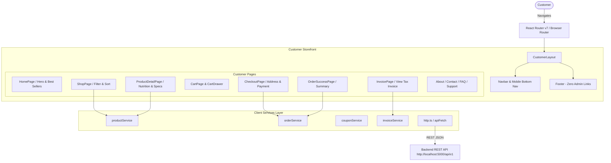

# VEDHIC FOODS — Customer Storefront (`frontend/`)

The dedicated customer-facing e-commerce storefront for **Vedhic Foods**, built with **React 19**, **TypeScript**, and **Vite**.

---

## 1. Architecture Design

The storefront is engineered exclusively for customer shopping, ordering, and tracking, completely isolated from administrative surfaces:



### Folder Structure

```
frontend/
├── src/
│   ├── assets/             # Static logos, icons, patterns
│   ├── components/         # Reusable UI components
│   │   ├── common/         # Buttons, Badges, Cards, Form controls, Skeletons
│   │   └── layout/         # Customer Navbar, Footer, Cart Drawer, Mobile Navigation
│   ├── config/             # Site metadata, trust badges, contact constants
│   ├── context/            # React contexts: CartContext, ToastContext, SettingsContext
│   ├── data/               # Seed datasets and customer navigation configs
│   ├── hooks/              # Custom hooks: useAsync, useDebounce, useMediaQuery
│   ├── layouts/            # CustomerLayout (zero administrative navigation)
│   ├── pages/
│   │   └── customer/       # Customer-only pages (Home, Shop, Detail, Checkout, etc.)
│   ├── routes/             # Client routes mapping purely customer views
│   ├── services/           # HTTP services calling Backend API (/products, /orders)
│   ├── styles/             # Modular CSS stylesheets and design tokens
│   ├── types/              # Domain TypeScript types (Catalog, Order, Customer, Cart)
│   ├── utils/              # Formatting, currency, cn helper
│   ├── App.tsx             # Root React application component
│   └── main.tsx            # DOM bootstrap
├── public/                 # Static public assets, favicon
├── .env                    # Environment configuration (VITE_API_URL)
├── index.html              # Customer SEO-optimized HTML entrypoint
├── package.json            # Scripts & dependencies
├── tsconfig.json           # TypeScript configuration
└── vite.config.ts          # Vite build & bundler configuration
```

---

## 2. Customer Security & Isolation Guarantees

* **Zero Admin Leakage**: Admin login buttons, admin URLs, and administrative permissions have been removed from the customer navbar, footer, and account dropdown menus.
* **Separately Deployable**: Can be built and deployed independently to AWS S3 + CloudFront, Vercel, or Netlify with zero coupling to the admin dashboard.
* **Live Catalog Integration**: Fetches real-time catalog items from `/api/v1/products`. Product updates made by an administrator in the admin dashboard reflect immediately for customers.

---

## 3. Step-by-Step Execution Guide

### Prerequisites
* Node.js >= 20.x
* Backend API running at `http://localhost:5000/api/v1`

### Step 1: Install Dependencies
From the repository root (or within `frontend/`):
```bash
cd frontend
npm install
```

### Step 2: Configure Environment Variables
Create or verify `frontend/.env`:
```env
VITE_API_URL=http://localhost:5000/api/v1
```

### Step 3: Run Development Server
```bash
npm run dev
```
The storefront starts at `http://localhost:5173`.

### Step 4: Validate Production Bundle
```bash
npm run build
```
Creates an optimized, tree-shaken static production bundle in `frontend/dist/`.

### Step 5: Preview Production Build
```bash
npm run preview
```
Previews the production build at `http://localhost:5173`.

---

## 4. Customer User Journey

1. **Browsing**: Customer visits Home (`/`), explores featured collections, and navigates to the Shop (`/shop`).
2. **Filtering & Search**: Searches products or filters by category (Spices, Millets, Sweeteners), price, and organic badges.
3. **Cart & Bag**: Adds items to cart, updates quantities, and selects free shipping over ₹499.
4. **Checkout (`/checkout`)**:
   - Enters shipping address and contact details.
   - Selects payment method (Cash on Delivery or Razorpay Online).
   - Places order -> Request sent to `POST /api/v1/orders/checkout`.
5. **Confirmation & Invoicing (`/order-success/:orderNumber`)**:
   - Order confirmation displays with order number and delivery timeline.
   - Customer automatically receives transactional email via Brevo with the A4 PDF tax invoice attached.

---

## 5. TODO & Next Milestones

- [ ] Add customer account order history dashboard (`/account/orders`).
- [ ] Implement wishlists stored in localStorage with cloud synchronization.
- [ ] Add PWA (Progressive Web App) offline service worker for mobile shopping.
- [ ] Implement Razorpay JavaScript SDK checkout modal on `/checkout`.
- [ ] Integrate Google Analytics 4 (GA4) e-commerce conversion tracking events.
